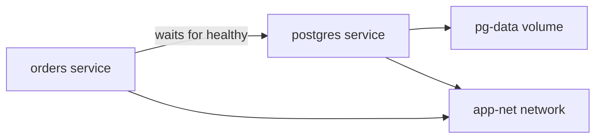

# Containers and Compose

!!! note "In simple words"
    Compose lets you describe a whole group of containers, such as an app, a database, and a cache, in one file. The containers can find each other by name, and their data can outlive a restart.

Running one container is simple. Running an application that needs a database, a cache, and a message broker is harder. The data has to survive restarts, and the services have to find each other. This page covers volumes, networks, health checks, and Docker Compose. Interviewers often ask how containers reach each other, and where data goes after a container is removed.

## Why it matters

A real service never runs alone. A typical order service talks to PostgreSQL, Redis, and Kafka. Starting those by hand, with the right ports, passwords, and data folders, is slow and error-prone. Compose turns that setup into a reproducible file that any developer can start with one command. The same ideas, such as named volumes, networks, and health checks, carry over to Kubernetes later.

## How it works

### Running containers with `docker run`

A typical run command combines the options that matter most in practice:

```bash
docker run -d --name orders \
  -p 8080:8080 \
  -e SPRING_PROFILES_ACTIVE=prod \
  -v orders-data:/var/lib/orders \
  --network app-net \
  --memory 512m --cpus 1 \
  --restart unless-stopped \
  orders-service:1.4.0
```

| Option | Meaning |
|---|---|
| `-d` | Run detached, in the background |
| `--name` | Give the container a stable name for DNS and commands |
| `-p host:container` | Publish a container port on a host port |
| `-e` | Set an environment variable |
| `-v` | Mount a named volume or a bind mount |
| `--network` | Attach the container to a named network |
| `--rm` | Remove the container automatically when it exits |
| `--memory`, `--cpus` | Set cgroup resource limits |
| `--restart` | Choose the restart policy after an exit or a daemon restart |

`-p` publishes a port on the host. If you publish a database port this way, the database is reachable on the host's network interfaces. Many teams make this mistake in production, because the database then accepts connections from outside the machine.

### Volumes: bind mounts, named volumes, and tmpfs

A container's writable layer disappears with the container. Use a volume for any data that must survive.

| Type | Where data lives | Typical use |
|---|---|---|
| Bind mount | A path you choose on the host | Mounting source code during development |
| Named volume | Storage managed by Docker | Database files and other state |
| tmpfs | Host memory, never written to disk | Temporary secrets or scratch space |

A bind mount depends on the host's directory layout and on file ownership. A named volume is the portable default for state, because Docker manages its location.

### Container networking

Docker provides several network drivers:

- **bridge**: the default for a single host. A user-defined bridge network also gives containers DNS names based on the container or service name. The default bridge network does not.
- **host**: the container shares the host's network stack. Port isolation is gone.
- **overlay**: spans several Docker hosts. Orchestrators use it.
- **none**: no networking at all.

Inside a container, `localhost` means the container itself. A service in one container cannot reach a database on the host, or in another container, by using `localhost`. Use the service name on a shared network instead. The following check connects using the Compose service name `postgres`, which Docker's DNS resolves:

```java
import java.sql.Connection;
import java.sql.DriverManager;
import java.sql.SQLException;

public class DbCheck {
    public static void main(String[] args) throws SQLException {
        // "postgres" is the Compose service name, resolved by Docker's DNS
        String url = "jdbc:postgresql://postgres:5432/orders";
        String password = System.getenv("DB_PASSWORD");
        try (Connection c = DriverManager.getConnection(url, "app", password)) {
            System.out.println("Connected: " + c.isValid(2));
        }
    }
}
```

This class compiles with the JDK alone. Running it needs the PostgreSQL JDBC driver on the classpath. It is plain Java 21 code, not a Spring example.

### Health checks, logs, and exec

A Dockerfile can declare a health check. Docker then reports the container as `starting`, `healthy`, or `unhealthy`:

```dockerfile
HEALTHCHECK --interval=30s --timeout=3s --retries=3 \
  CMD curl -fsS http://localhost:8080/actuator/health || exit 1
```

The image must contain `curl` for this check to work. Docker health status is useful for Compose startup conditions and for people reading `docker ps`. Orchestrators such as Kubernetes use their own probes instead, as described on the Kubernetes pages.

Everyday debugging commands:

- `docker logs -f orders` follows the container's stdout and stderr.
- `docker exec -it orders sh` opens a shell inside a running container. Use `bash` if the image contains it.
- `docker inspect orders` prints the full configuration, networks, mounts, and health status.

### Docker Compose

Compose describes a multi-container application in one YAML file that follows the Compose Specification. Modern Compose does not need the old top-level `version:` key. The preferred file name is `compose.yaml`, although `docker-compose.yml` still works.

```yaml
services:
  orders:
    build: .
    ports:
      - "8080:8080"
    environment:
      DB_PASSWORD: ${DB_PASSWORD}
    depends_on:
      postgres:
        condition: service_healthy
    networks: [app-net]

  postgres:
    image: postgres:16
    environment:
      POSTGRES_DB: orders
      POSTGRES_USER: app
      POSTGRES_PASSWORD: ${DB_PASSWORD}
    volumes:
      - pg-data:/var/lib/postgresql/data
    healthcheck:
      test: ["CMD-SHELL", "pg_isready -U app -d orders"]
      interval: 5s
      retries: 10
    networks: [app-net]

volumes:
  pg-data:

networks:
  app-net:
```



Key points:

- `services`, `networks`, and `volumes` are the three main top-level sections.
- `depends_on` with `condition: service_healthy` waits for the database health check to pass. A plain `depends_on` only controls the order of starting. It does not check readiness.
- `${DB_PASSWORD}` is filled in from the shell or from a `.env` file. Never commit real values.
- Compose creates missing networks and volumes, and gives each service a DNS name.

### Environment-specific configuration

Compose offers three ways to vary a setup between machines:

- **Multiple files**: `docker compose -f compose.yaml -f compose.prod.yaml up` merges the files in order. Later files override earlier ones.
- **Override file**: a `compose.override.yaml` in the same directory is merged automatically. It suits local development.
- **Profiles**: services with a `profiles:` entry start only when that profile is enabled. Use this for optional tools, such as an admin console.

## Where it is used

- Local development stacks, where an app, a database, and a broker start together.
- Integration tests in CI, where a throwaway database runs next to the service under test.
- Small single-host deployments, such as an internal tool on one virtual machine.
- Demonstrations and training environments that must be started the same way every time.

## Benefits

- The whole topology lives in one versioned file, so reviewers can read it.
- Starting and stopping a stack takes one command.
- Health-based startup order avoids the common "database not ready yet" failure.
- Named volumes and networks are created for you.

## Cons and limits

- Compose targets a single host. For several hosts, use an orchestrator such as Kubernetes.
- It has no built-in rolling updates, self-healing across machines, or autoscaling.
- Secrets in `.env` files are only as safe as the file. Plain text in a repository is a leak.
- Bind mounts behave differently on Windows and macOS. File permissions and speed can surprise people.

### Common pitfalls

- Connecting to `localhost` from inside a container.
- Assuming `depends_on` waits for the database to be ready. Add a `condition` and a health check.
- Running `docker compose down -v`, which deletes named volumes and their data.
- Bind-mounting a host directory whose ownership does not match the container user.
- Publishing internal ports, such as a database, on every host interface.
- Committing secrets into `compose.yaml` instead of using an environment file or a secret mechanism.

## Best practices

- Give every service a health check, and make dependents wait for `service_healthy`.
- Use named volumes for state, and bind mounts only for development code.
- Keep internal services on a private network. Publish only the ports that clients need.
- Keep secrets out of the Compose file. Use `.env` files that are excluded from version control, or a secret store.
- Use override files and profiles to separate development extras from the shared base.
- Run `docker compose config` to see the fully merged file before you start the stack.

!!! tip "Interview tip"
    **Q: How do two containers on the same host find each other?**
    Put both on a user-defined bridge network. Docker's embedded DNS server resolves container and service names to their addresses.

    Follow-up: why does a connection to `localhost` fail? Because `localhost` is the calling container's own network namespace, not the other container.

## Quick recap

- `docker run` options control ports, environment variables, volumes, networks, and resource limits.
- Named volumes hold state that must outlive a container. Bind mounts suit development.
- User-defined bridge networks provide DNS by container or service name.
- Compose declares services, networks, and volumes in one file, with health-based dependencies.
- Keep data safe: avoid `down -v`, and keep secrets out of version control.

## Official documentation

- [Docker Compose documentation](https://docs.docker.com/compose/)
- [Docker overview](https://docs.docker.com/get-started/docker-overview/)
- [Dockerfile reference](https://docs.docker.com/reference/dockerfile/)

**See also:** [Docker Fundamentals](docker-fundamentals.md), [Spring Boot in Containers](spring-boot-in-containers.md), [Config, Storage and Health](../16-kubernetes/config-storage-health.md)
