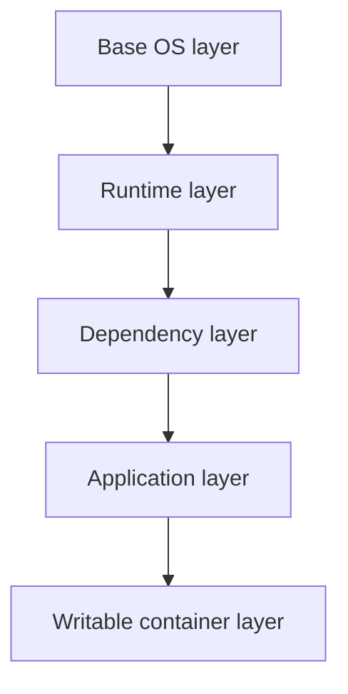
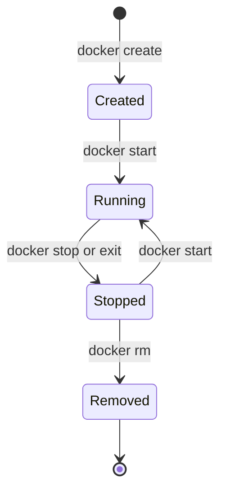

# Docker Fundamentals

!!! note "In simple words"
    A container is an ordinary program that runs in a fenced-off view of the machine. It starts from an image, which is a packed copy of the app and the files it needs.

A container is an isolated process, or a group of processes, started from an image and sharing the Linux kernel of its host. Interviewers ask about Docker to find out whether you know what a container really is, how it differs from a virtual machine, and how image layers affect build speed. Memorising commands is not enough.

## Why it matters

An application that runs on one laptop often fails on another machine because of different library versions, system packages, or environment settings. Docker moves the application together with everything it depends on into one image. The same image then runs the same way on a developer laptop, a test server, and in production. Teams use this to ship faster, to scale services up and down, and to reproduce a bug from last week exactly.

## How it works

### Containers versus virtual machines

A virtual machine runs a full guest operating system on top of a hypervisor. A container is a normal process on the host, with kernel features that limit what it can see and use. Because no operating system boots inside a container, it starts quickly and adds little overhead. A virtual machine offers a stronger boundary, and it can run a kernel that differs from the host's.

| Aspect | Container | Virtual machine |
|---|---|---|
| Kernel | Shared with the host | Its own guest kernel |
| Isolation | Process level, using kernel features | Hardware level, using a hypervisor |
| Startup | Usually seconds or less | Usually minutes for a full boot |
| Image contents | Application and its libraries | Application, libraries, and a full OS |

### Namespaces and cgroups

Two Linux features make containers possible.

- **Namespaces** decide what a process can see. Docker uses PID, network, mount, UTS (hostname), IPC, and user namespaces.
- **cgroups** (control groups) decide how much of a resource a process may use and keep count of that use. Resources include CPU, memory, I/O, and the number of processes.

The PID namespace is easy to observe. Inside a new container, `ps` shows that the first process has PID 1:

```bash
docker run --rm alpine ps
```

### Images and layers

An image is a stack of read-only layers plus metadata, such as the default command, environment variables, and exposed ports. Each Dockerfile instruction that changes the filesystem adds one layer. When a container starts, Docker places a thin writable layer on top of the stack. Anything written to that layer disappears when the container is removed.



Layers are cached and shared between images that start from the same base. The order of instructions matters. Put slow, rarely changing steps, such as installing dependencies, before fast-changing steps, such as copying source code. If the order is reversed, every source edit invalidates the cache and the dependency download runs again.

A tag such as `my-app:1.4.0` is only a name that can be moved to a different image later. A digest, written as `my-app@sha256:...`, identifies the exact content and never changes.

### Dockerfile instructions

| Instruction | Purpose |
|---|---|
| `FROM` | Sets the base image. Every build stage begins with one. |
| `RUN` | Runs a command during the build and stores the result as a layer. |
| `COPY` | Copies files from the build context into the image. Its behaviour is predictable. |
| `ADD` | Works like `COPY`, but also fetches URLs and extracts archives. Use `COPY` unless you need extraction. |
| `WORKDIR` | Sets the directory used by later instructions. |
| `ENV` | Sets an environment variable that stays in the image. |
| `EXPOSE` | Documents the port the app listens on. It does not publish the port. |
| `USER` | Chooses the user the container runs as. |
| `ENTRYPOINT` | The executable that always runs. |
| `CMD` | Default arguments, or the whole command when no `ENTRYPOINT` is set. You can override it at `docker run`. |

A minimal Dockerfile for a packaged Java service looks like this:

```dockerfile
FROM eclipse-temurin:21-jre
WORKDIR /app
COPY target/app.jar app.jar
USER 1001
EXPOSE 8080
ENTRYPOINT ["java", "-jar", "app.jar"]
```

A small Java 21 program that could run inside such an image:

```java
public class Main {
    public static void main(String[] args) {
        String greeting = System.getenv().getOrDefault("GREETING", "Hello");
        System.out.println(greeting + " from inside a container");
    }
}
```

### Exec form and shell form

Write `ENTRYPOINT` and `CMD` in exec form, which is a JSON array. The exec form starts your process directly as PID 1, so it receives signals such as SIGTERM. The shell form wraps the command in `/bin/sh -c`. In that case the shell becomes PID 1, and the signal may never reach your application.

### Multi-stage builds

A multi-stage build uses one stage with the full toolchain to compile the code, and a second stage that contains only the runtime. Compilers, build tools, and source code stay out of the final image. The result is smaller and exposes fewer packages to attackers.

```dockerfile
# Stage 1: build with the full JDK
FROM eclipse-temurin:21-jdk AS build
WORKDIR /src
COPY . .
RUN ./mvnw -q package -DskipTests

# Stage 2: runtime only
FROM eclipse-temurin:21-jre
WORKDIR /app
COPY --from=build /src/target/app.jar app.jar
ENTRYPOINT ["java", "-jar", "app.jar"]
```

This version copies the whole project before it builds, so any source change also re-downloads dependencies. A better version copies only the build descriptor first, runs the dependency download, and copies the source afterwards.

### Build context and `.dockerignore`

The build context is the directory that the client sends to the Docker daemon when a build starts. `COPY` can use anything inside that directory, and a large context slows every build. A `.dockerignore` file removes paths from the context before it is sent:

```text
.git
target/
*.log
.env
```

Excluding `.env` and `.git` keeps local secrets and version history out of the image, even when a later `COPY . .` would otherwise pick them up.

### Build arguments and environment variables

`ARG` defines a value that exists only during the build, such as a version label. `ENV` persists into the running container. Neither is a safe place for secrets. Build arguments can be read from the image history. When a build needs a credential, use a build-time secret mount instead.

### Image references, tags, and registries

A full image reference has the form `[registry/]namespace/name[:tag][@digest]`. Docker Hub is the default registry. Teams also use private registries, either hosted by a cloud provider or run by the team. The everyday commands are `docker pull`, `docker tag`, and `docker push`.

### Container lifecycle

A container moves through the states created, running, stopped (exited), and removed. The command `docker run` is shorthand for `docker create` followed by `docker start`.



- `docker stop` sends SIGTERM, waits for a timeout (10 seconds by default), and then sends SIGKILL.
- `docker kill` sends a signal at once. The default signal is SIGKILL.
- `docker rm` deletes a stopped container together with its writable layer.

### PID 1 and signals

The first process in a container is PID 1. The Linux kernel gives PID 1 special treatment. It does not get default signal handling, so a signal with no handler installed may be ignored. An application that does not handle SIGTERM keeps running until Docker escalates to SIGKILL. Two fixes help:

- Use exec form, so the application itself is PID 1 and can install a handler.
- Use a small init process, such as the one enabled by `docker run --init`. It forwards signals and reaps zombie child processes.

The JVM handles SIGTERM by running its shutdown hooks, so a Java process works well as PID 1 when it is started in exec form.

### Resource limits

`docker run --memory 512m --cpus 1` sets cgroup limits on the container. When a process exceeds its memory limit, the kernel's OOM killer stops it, and Docker reports exit code 137, which means SIGKILL. A CPU limit does not kill the process. It throttles the container instead. Without limits, one busy container can starve every other container on the same host. The JVM-specific details appear on the Spring Boot in Containers page.

### Reading layers and inspecting images

`docker history <image>` lists each layer with its size and the instruction that created it. It is the fastest way to find which step made an image large. The same output reveals a secret that was copied in and deleted later, because the earlier layer still holds it.

### Troubleshooting a container

When a container misbehaves, work through a short list of checks:

```bash
docker logs --tail 200 -f <container>                  # stdout and stderr of the main process
docker exec -it <container> sh                         # open a shell; fails on distroless images
docker exec <container> env                            # the environment the app actually sees
docker stats --no-stream                               # one-off CPU and memory usage
docker inspect -f '{{.State.OOMKilled}}' <container>   # true when the kernel killed it for memory
docker inspect <container>                             # mounts, networks, restart policy, state
```

To see how the JVM sizes itself inside an image, run `java -XshowSettings:vm` in a throwaway container. It prints the heap limits and the container memory the JVM detected. Scan images for known vulnerabilities during the build, with a tool such as Docker Scout or Trivy, rather than after an incident.

## Where it is used

- Packaging web services, batch jobs, and message consumers so that each one runs the same way in every environment.
- Running local stacks for development, where a database and a broker start with one command.
- Building the artifact that a CI pipeline publishes and a Kubernetes cluster later runs.
- Running short-lived tasks, such as a database migration or a report, in an isolated process.

## Benefits

- **Consistency**: the image carries its dependencies, so "works on my machine" problems shrink.
- **Speed**: containers start in seconds and reuse cached layers during builds.
- **Density**: many containers share one kernel, so a host runs more services than it could as virtual machines.
- **Isolation**: namespaces and cgroups separate processes and cap their resource use.
- **Portability**: any host with a container runtime can run the same image.

## Cons and limits

- Containers share the host kernel. A kernel flaw can affect every container on the host. Use a virtual machine or a stronger sandbox when you must run untrusted code.
- Linux containers need a Linux kernel. Docker Desktop runs a small Linux virtual machine behind the scenes on Windows and macOS.
- Data written to the writable layer is lost when the container is removed. State needs volumes.
- Layers add up. Old tags, dangling images, and build caches can use a lot of disk until they are pruned.
- Debugging is harder than on a normal host, because the minimal image may have no shell or diagnostic tools.

### Common pitfalls

- Using the `latest` tag in production, which makes deployments hard to reproduce.
- Running as root, which is the default unless you set `USER`.
- Copying all source before installing dependencies, which defeats layer caching.
- Putting secrets in `ENV`, `ARG`, or a file that is later copied. Deleting the file in a later layer does not remove it from the earlier layer, so the secret stays in the image history.
- Using shell-form `CMD` or `ENTRYPOINT`, which can stop SIGTERM from reaching the Java process.
- Skipping `.dockerignore`, which sends large or sensitive directories in the build context.

## Best practices

- Pin base images and application tags. Use digests where the build must be exactly repeatable.
- Choose a small base image, and use multi-stage builds so the build tools stay out of the final image.
- Put rarely changing steps first in the Dockerfile, and copy the source code last.
- Create and switch to a non-root user in the image.
- Keep secrets out of the image. Inject them at runtime, or use build secret mounts.
- Keep a `.dockerignore` file that excludes version control data, build output, and local environment files.
- Scan images in the pipeline, and fail the build on high-severity issues that have fixes.

!!! tip "Interview tip"
    **Q: What is the difference between a container and a VM?**
    A container is a process isolated with namespaces and limited with cgroups. It shares the host kernel. A VM runs its own kernel on a hypervisor. Containers are lighter and start faster. VMs isolate more strongly and can run a different kernel.

    Follow-up: why does a process that ignores SIGTERM slow down `docker stop`? Because Docker waits for the timeout and then sends SIGKILL, so the process gets no chance to clean up.

## Quick recap

- A container is a host process isolated by namespaces and limited by cgroups.
- Images are stacks of cached, read-only layers. Order instructions so that the cache is reused.
- Use exec-form `ENTRYPOINT` so the application receives SIGTERM.
- Multi-stage builds keep build tools out of the runtime image.
- Pin tags, run as a non-root user, and keep secrets out of layers.

## Official documentation

- [Docker overview](https://docs.docker.com/get-started/docker-overview/)
- [Dockerfile reference](https://docs.docker.com/reference/dockerfile/)
- [Docker Compose documentation](https://docs.docker.com/compose/)

**See also:** [Containers and Compose](containers-and-compose.md), [Spring Boot in Containers](spring-boot-in-containers.md), [Kubernetes Architecture and Objects](../16-kubernetes/kubernetes-architecture-objects.md)
