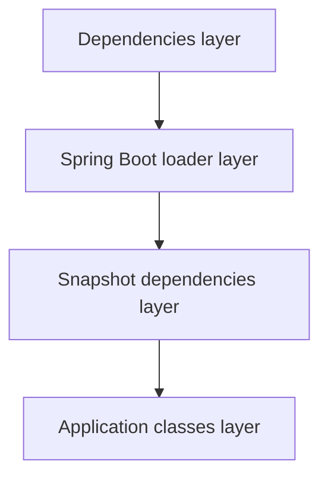
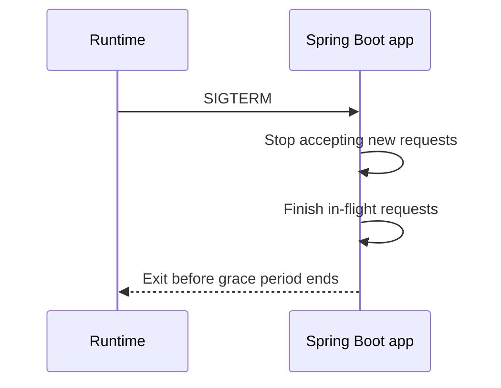

# Spring Boot in Containers

!!! note "In simple words"
    A Spring Boot service becomes a container by putting its runnable JAR into an image. The Java process then has to respect the memory limit it is given, stop cleanly when told, and run without full administrator rights.

A Spring Boot service becomes a container image when its executable JAR is packaged into a base image. The hard part is the JVM. It must respect the memory and CPU limits of the container, stop cleanly on SIGTERM, and run without root privileges. Interviewers often ask why a Java container gets killed even though the heap looks small.

## Why it matters

Java programs use more memory than the heap alone. A container runtime enforces a hard limit on the whole process, so a JVM that sizes itself for the host can be killed as soon as it runs in a small container. Platform health checks and rolling updates also depend on the app stopping cleanly. A service that ignores SIGTERM drops requests during every deployment. This page explains the settings that avoid those failures.

## How it works

### Building the image

There are two common routes:

1. **Cloud Native Buildpacks**, which need no Dockerfile. The Spring Boot Maven and Gradle plugins can build the image directly:

   ```bash
   ./mvnw spring-boot:build-image
   ./gradlew bootBuildImage
   ```

2. **A hand-written Dockerfile**, which gives full control over the base image, the user, and the layers.

The application class is ordinary Java. It needs the web and actuator starters on the classpath. The example below is a Spring Boot example. It has not been compiled in this write-up.

```java
package com.example.orders;

import org.springframework.boot.SpringApplication;
import org.springframework.boot.autoconfigure.SpringBootApplication;
import org.springframework.web.bind.annotation.GetMapping;
import org.springframework.web.bind.annotation.RestController;

@SpringBootApplication
public class OrdersApplication {

    public static void main(String[] args) {
        SpringApplication.run(OrdersApplication.class, args);
    }
}

@RestController
class PingController {

    @GetMapping("/ping")
    String ping() {
        return "pong";
    }
}
```

### Layered JARs

A Spring Boot executable JAR is one large file. Any code change produces a new JAR, so the whole file changes in the image. Spring Boot can split the JAR into layers that change at different rates: third-party dependencies, the Spring Boot loader, snapshot dependencies, and application classes. Dependencies rarely change, so their layer stays in the cache.

```dockerfile
# Extract the layers (Spring Boot example, not compiled here)
FROM eclipse-temurin:21-jre AS builder
WORKDIR /builder
COPY target/app.jar app.jar
RUN java -Djarmode=layertools -jar app.jar extract

# Assemble the runtime image, least-changing layers first
FROM eclipse-temurin:21-jre
RUN useradd --system app
WORKDIR /app
COPY --from=builder /builder/dependencies/ ./
COPY --from=builder /builder/spring-boot-loader/ ./
COPY --from=builder /builder/snapshot-dependencies/ ./
COPY --from=builder /builder/application/ ./
USER app
ENTRYPOINT ["java", "org.springframework.boot.loader.launch.JarLauncher"]
```

The launcher class depends on the Spring Boot version. Its package changed in newer Spring Boot 3.x releases, so check the reference documentation for your version before copying that line.



Order the layers from least to most frequently changed. A change to application classes then rebuilds only the top layer.

### Choosing a base image

The base image determines the size and attack surface of the runtime. Three options are common:

| Base image | Typical use | Trade-off |
|---|---|---|
| Full JDK (`eclipse-temurin:21`) | Building, not running | Largest; includes compilers you do not need at runtime |
| JRE on a general Linux base (`eclipse-temurin:21-jre`) | Simple production images | Includes a shell and package tools, which help debugging |
| Distroless Java (`gcr.io/distroless/java21-*`) | Hardened production images | Only the Java runtime and your app; no shell, so `docker exec sh` fails |

Distroless images suit production because they hold fewer packages that can carry known vulnerabilities. Their cost is debugging, since no shell is available. Use a debug variant in a test environment, or attach an ephemeral debug container to a running pod with `kubectl debug`. Pin the image tag, and check that the base operating system is still receiving security updates.

### JVM memory in containers

Modern JVMs read the container's memory limit from cgroups instead of the host's total memory. A fixed heap size is still fragile, because the same image may run with different limits in different environments. Percentage-based settings adapt to each limit:

```bash
JAVA_TOOL_OPTIONS="-XX:MaxRAMPercentage=75 -XX:InitialRAMPercentage=50"
```

Leave headroom for non-heap memory. The container limit covers all memory used by the process, including:

- Metaspace, which stores loaded classes
- Thread stacks, one per thread
- The code cache, which holds JIT-compiled code
- Direct buffers and native libraries

If the heap is allowed to use the full limit, the process can exceed the limit and the kernel's OOM killer stops it. Kubernetes reports this as `OOMKilled`. Docker reports exit code 137.

The JVM also sizes thread pools and garbage-collector threads from the number of processors it sees. Check what it detects:

```java
public class ContainerInfo {
    public static void main(String[] args) {
        Runtime rt = Runtime.getRuntime();
        System.out.println("Processors visible to the JVM: " + rt.availableProcessors());
        System.out.println("Max heap (MiB): " + rt.maxMemory() / (1024 * 1024));
    }
}
```

Run the program with and without a `--cpus` limit to see the difference. Set `-XX:ActiveProcessorCount` when you need to override the detected value.

### Graceful shutdown

Orchestrators and `docker stop` send SIGTERM, then wait before they send SIGKILL. Spring Boot can finish in-flight requests during that wait:

```yaml
server:
  shutdown: graceful
spring:
  lifecycle:
    timeout-per-shutdown-phase: 30s
```



Two conditions must hold. The Java process must receive SIGTERM, which is why exec form matters. The platform's grace period must also be longer than the Spring timeout. Otherwise the platform kills the process first.

### Health endpoints for probes

With Spring Boot Actuator, the health endpoint can expose separate liveness and readiness groups:

```yaml
management:
  endpoint:
    health:
      probes:
        enabled: true
```

The endpoints are `/actuator/health/liveness` and `/actuator/health/readiness`. Map them to the container health check, or to Kubernetes probes.

### Configuration and secrets

Spring's relaxed binding lets environment variables override properties. For example, `SPRING_DATASOURCE_URL` sets `spring.datasource.url`. Secrets can be mounted as files and loaded with `spring.config.import`. Keep credentials out of the image, and out of any `application.yml` committed to version control.

### Running as a non-root user

Set `USER` to an unprivileged account, and make sure the directories the application writes to belong to that account. Running as non-root limits the damage a compromised process can cause. Combined with a read-only root filesystem, it reduces the attack surface further.

### Container security best practices

A container image runs with exactly the rights you grant it. Four habits cover most of the risk for a Spring Boot service.

#### 1. Run as a non-root user

Create a system user in the Dockerfile and switch to it before the entrypoint. Use a numeric UID when the platform enforces `runAsNonRoot`.

```dockerfile
FROM eclipse-temurin:21-jre
RUN groupadd --system app && useradd --system --gid app app
WORKDIR /app
COPY target/app.jar app.jar
USER app
ENTRYPOINT ["java", "-jar", "app.jar"]
```

Give the user write access only to the directories it needs, such as a temporary directory.

#### 2. Scan images for known vulnerabilities

Base images and Java libraries contain known CVEs. Scan each image in the build pipeline with a scanner such as Trivy, Grype, or the scanner built into your registry. Fail the build on high-severity findings that have fixes. A scan is a snapshot in time, so rescan the images that are already deployed, because new CVEs are published after a build.

#### 3. Keep secrets out of the image

Anything written by a `RUN`, `COPY`, or `ARG` step stays in the image history, and anyone who pulls the image can read it. Passwords, tokens, and private keys belong at runtime instead:

- Inject them as environment variables or mounted files, from a Kubernetes Secret or a vault.
- For a secret that the build needs once, such as a private repository token, use a BuildKit secret mount. It does not persist in a layer.

```dockerfile
# syntax=docker/dockerfile:1
RUN --mount=type=secret,id=repo_token \
    ./mvnw -s settings.xml dependency:go-offline
```

Add a `.dockerignore` file as well, so local `.env` files and key material never enter the build context.

#### 4. Use a read-only root filesystem

Most services write only to a few paths. Make the root filesystem read-only, and give writable `emptyDir` volumes to the paths that need them. Embedded Tomcat and temporary-file handling use `/tmp`, so that path is the usual one to make writable.

```yaml
securityContext:
  runAsNonRoot: true
  allowPrivilegeEscalation: false
  readOnlyRootFilesystem: true
  capabilities:
    drop: ["ALL"]
volumeMounts:
  - name: tmp
    mountPath: /tmp
volumes:
  - name: tmp
    emptyDir: {}
```

Outside Kubernetes, the same idea works with `docker run --read-only --tmpfs /tmp`.

#### Keep images small and tags pinned

Pin the base image to a specific tag rather than a floating tag such as `latest`. Then the build is repeatable and updates are deliberate. Multi-stage builds and a minimal runtime base reduce the number of packages that can carry vulnerabilities.

## Where it is used

- Stateless HTTP services, such as order, catalogue, or payment APIs, deployed to Kubernetes or to a container host.
- Batch jobs and event consumers that run as short-lived containers.
- Internal tools deployed through the same pipeline as product services.

## Benefits

- Packaging the app with a JRE makes the runtime predictable across environments.
- Layered images make rebuilds fast when only application code changes.
- Percentage-based memory settings let one image run under different limits.
- Actuator probes and graceful shutdown integrate cleanly with platform rollouts.

## Cons and limits

- Container limits must be sized with care. Native memory and metaspace need headroom that is easy to forget.
- Distroless and other minimal images make interactive debugging harder.
- Spring's auto-configuration can start slowly in small containers. Startup probes help, and so does a leaner classpath.
- Buildpack images are convenient, but they give less control over the base image than a Dockerfile.

### Common pitfalls

- Setting `-Xmx` to the full container limit. Non-heap memory then pushes the process past the limit.
- Using shell-form `ENTRYPOINT`, so SIGTERM never reaches the JVM and requests are cut off.
- Running as root, or writing to directories the non-root user cannot access.
- Copying the whole build directory into the image, including test output and build caches.
- Logging to a file inside the container instead of stdout, so the logs vanish with the container.
- Baking configuration and credentials into the image. That forces a rebuild for every environment.

## Best practices

- Follow the twelve-factor idea: keep configuration in the environment and write logs to stdout.
- Use exec-form `ENTRYPOINT`, `server.shutdown: graceful`, and a platform grace period that is longer than the Spring timeout.
- Use percentage-based heap settings with headroom, then measure with native memory tracking if usage still grows.
- Use layered JARs or buildpacks so that rebuilds are fast.
- Run as a non-root user with a read-only root filesystem and writable temporary directories only.
- Scan images in CI, and rescan images that are already running.

!!! tip "Interview tip"
    **Q: Why is my Java container killed with exit code 137 when the heap looks small?**
    Exit code 137 means SIGKILL, usually from the OOM killer. The container limit covers the whole process, including metaspace, thread stacks, and direct buffers, not only the heap. Set `MaxRAMPercentage` with headroom, and measure native memory with `-XX:NativeMemoryTracking=summary` to see where the rest goes.

## Quick recap

- Build with buildpacks or a Dockerfile. Layered JARs keep dependency layers cached.
- Use percentage-based heap settings, and leave room for non-heap memory.
- The JVM reads container limits, but you still need to check processor and memory sizing.
- Exec-form `ENTRYPOINT` plus graceful shutdown gives clean stops.
- Actuator probe endpoints feed liveness and readiness checks. Run as a non-root user.

## Official documentation

- [Spring Boot reference documentation](https://docs.spring.io/spring-boot/reference/index.html)
- [Spring Framework reference documentation](https://docs.spring.io/spring-framework/reference/)
- [The Twelve-Factor App](https://12factor.net/)
- [Dockerfile reference](https://docs.docker.com/reference/dockerfile/)

**See also:** [Docker Fundamentals](docker-fundamentals.md), [Containers and Compose](containers-and-compose.md), [Config, Storage and Health](../16-kubernetes/config-storage-health.md)
