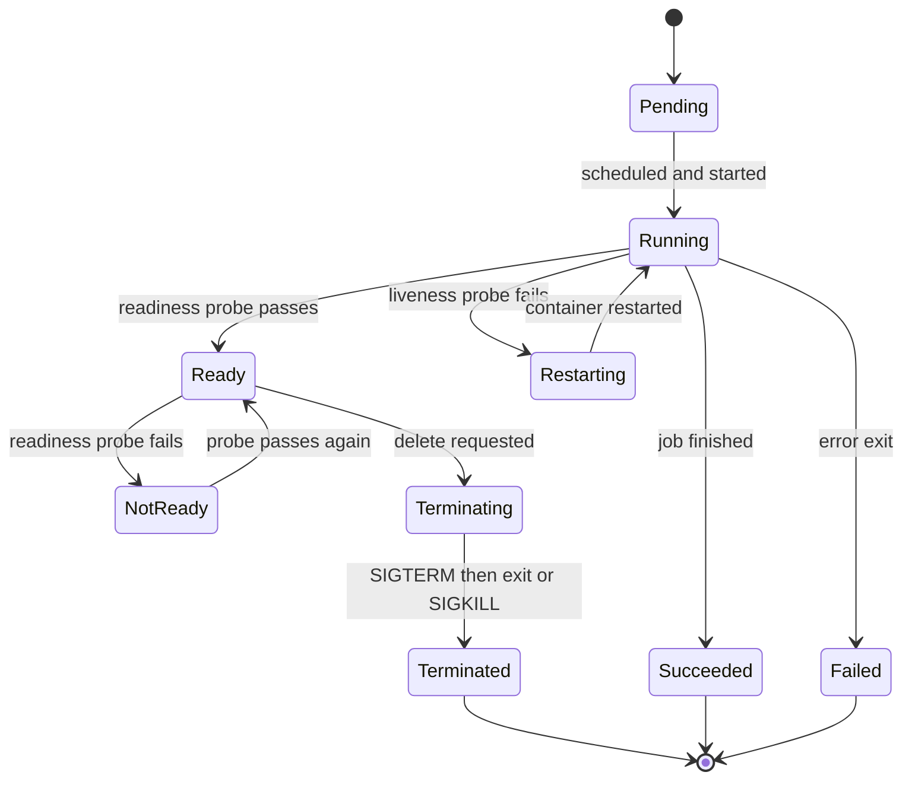

# Config, Storage and Health

!!! note "In simple words"
    Keep settings outside the image, keep data on storage that survives a pod restart, and tell Kubernetes when your app is alive and ready for traffic.

Applications on Kubernetes need three things from the platform. They need configuration supplied from outside the image, storage that outlives individual pods, and accurate signals about whether each container is alive and ready. This page covers those mechanisms. It also covers the workload types for one-off and scheduled jobs, the resource limits that stop one workload from starving the rest, and the scaling tools that change the size of a workload.

## Why it matters

A pod can be stopped, moved to another node, or replaced at any time. If configuration lives inside the image, every environment needs its own build. If data lives inside the container, it vanishes with the pod. If health is not reported, Kubernetes sends traffic to a broken pod, or restarts a healthy one for no reason. Each mechanism on this page closes one of those gaps.

## How it works

### ConfigMaps

A **ConfigMap** stores non-sensitive configuration as key-value pairs or as whole files. A pod reads it as environment variables or as mounted files.

```yaml
apiVersion: v1
kind: ConfigMap
metadata:
  name: orders-config
data:
  GREETING: "Hello"
  application.yml: |
    server:
      shutdown: graceful
```

Two update rules matter in practice:

- Environment variables are read once, when the container starts. Changing the ConfigMap does not change them in running pods, so the pods need a rollout.
- Mounted files are refreshed by the kubelet after a delay. The application must reload them on its own, for example through a file watcher or a restart.

A small Java 21 program that reads a value injected from a ConfigMap:

```java
public class GreetingFromEnv {
    public static void main(String[] args) {
        // Injected from the ConfigMap as an environment variable
        String greeting = System.getenv().getOrDefault("GREETING", "Hello");
        System.out.println(greeting + ", configuration loaded");
    }
}
```

### Secrets

A **Secret** stores sensitive values, such as passwords, tokens, and certificates. By default, Secret data is only base64-encoded. Base64 is an encoding, not encryption, so anyone who can read the object can decode the value. Protect Secrets in three ways:

- RBAC rules that limit who can read Secrets in each namespace.
- Encryption at rest for etcd, configured on the API server.
- An external secret store, such as a cloud key vault or HashiCorp Vault, synchronised into the cluster.

```yaml
apiVersion: v1
kind: Secret
metadata:
  name: orders-db
type: Opaque
stringData:
  DB_PASSWORD: "change-me"
```

`stringData` accepts plain text, and the API server stores it base64-encoded. Never commit real Secret manifests to version control.

### PersistentVolumes, PersistentVolumeClaims, and StorageClasses

Storage is split into two roles:

- A **PersistentVolume (PV)** is a piece of storage in the cluster. An administrator creates it, or it is created on demand.
- A **PersistentVolumeClaim (PVC)** is a pod's request for storage. It states the size and the access mode.

A **StorageClass** describes one kind of storage. When a PVC names a class, the cluster can create a matching PV automatically. This is **dynamic provisioning**.

```yaml
apiVersion: v1
kind: PersistentVolumeClaim
metadata:
  name: orders-data
spec:
  accessModes: ["ReadWriteOnce"]
  storageClassName: standard
  resources:
    requests:
      storage: 5Gi
```

The access mode and the class name must match what the cluster offers, and the available classes depend on the cluster or the cloud provider.

### Workloads for jobs and node agents

- **Jobs** run a task to completion, such as a data migration.
- **CronJobs** create Jobs on a schedule written in cron syntax.
- **DaemonSets** run one pod on every node. They suit log collectors and monitoring agents.
- **Init containers** run to completion before the app containers start. They handle steps such as waiting for a dependency or preparing files.

```yaml
apiVersion: batch/v1
kind: CronJob
metadata:
  name: nightly-cleanup
spec:
  schedule: "0 2 * * *"
  jobTemplate:
    spec:
      template:
        spec:
          restartPolicy: OnFailure
          containers:
            - name: cleanup
              image: orders-tools:1.0.0
              command: ["java", "-jar", "cleanup.jar"]
```

### Resource requests and limits

A **request** is the amount the scheduler reserves for a container. A **limit** is the most the container may use. CPU above the limit is throttled. Memory above the limit gets the container OOM-killed.

```yaml
resources:
  requests:
    cpu: "250m"
    memory: "512Mi"
  limits:
    memory: "512Mi"
```

A **ResourceQuota** caps total usage inside a namespace. A **LimitRange** supplies default requests and limits to containers that do not declare them. Together they stop one team from using the whole cluster.

### Health probes

Kubernetes uses three probes, and each one answers a different question:

| Probe | Question | Result of failure |
|---|---|---|
| Liveness | Is the container stuck or broken? | The container is restarted |
| Readiness | Can the pod take traffic right now? | The pod is removed from Service endpoints |
| Startup | Has a slow application finished starting? | The other probes wait, so no early restart happens |

```yaml
startupProbe:
  httpGet: { path: /actuator/health/liveness, port: 8080 }
  failureThreshold: 30
  periodSeconds: 2
readinessProbe:
  httpGet: { path: /actuator/health/readiness, port: 8080 }
  periodSeconds: 5
livenessProbe:
  httpGet: { path: /actuator/health/liveness, port: 8080 }
  periodSeconds: 10
```

The paths match the probe groups that Spring Boot Actuator provides. Keep liveness checks simple. A liveness probe that calls a database can restart healthy pods during a database outage, which makes the outage worse.

### Pod lifecycle

A pod moves through phases and conditions. Readiness is a condition that a Running pod can have or lose. The diagram shows the common path, including the probe transitions and shutdown.



### Graceful shutdown

When a pod is deleted, Kubernetes sends SIGTERM to each container. It then waits up to `terminationGracePeriodSeconds`, which defaults to 30 seconds, and sends SIGKILL if the container is still running. At the same time, the pod is removed from Service endpoints. That removal reaches the proxies after a short delay, so requests can still arrive for a moment.

To shut down cleanly:

- Run the application in exec form, so it receives SIGTERM.
- Enable `server.shutdown=graceful` in Spring Boot, so in-flight requests complete.
- Add an optional `preStop` hook, such as a short sleep, to give endpoint removal time to propagate before SIGTERM.
- Set `terminationGracePeriodSeconds` to a value longer than the application's shutdown timeout.

A JVM shutdown hook runs when the JVM receives SIGTERM. It suits releasing resources:

```java
public class ShutdownDemo {
    public static void main(String[] args) throws InterruptedException {
        Runtime.getRuntime().addShutdownHook(new Thread(() ->
                System.out.println("Releasing resources before exit")));
        System.out.println("Running; send SIGTERM to stop");
        Thread.sleep(Long.MAX_VALUE);
    }
}
```

### Scaling

Kubernetes can change the size, or the resource settings, of a workload while it runs. Two autoscalers handle the two directions:

- The **Horizontal Pod Autoscaler (HPA)** changes the number of replicas.
- The **Vertical Pod Autoscaler (VPA)** changes the CPU and memory requests of each pod.

#### Horizontal Pod Autoscaler

The HPA is part of core Kubernetes. It reads a metric, compares it with a target, and adjusts `replicas` on the target Deployment between a minimum and a maximum. For CPU and memory targets, utilisation is measured against the container's **request**. Pods must therefore declare requests, or the HPA has nothing to compare against.

```yaml
apiVersion: autoscaling/v2
kind: HorizontalPodAutoscaler
metadata:
  name: orders-hpa
spec:
  scaleTargetRef:
    apiVersion: apps/v1
    kind: Deployment
    name: orders
  minReplicas: 2
  maxReplicas: 8
  metrics:
    - type: Resource
      resource:
        name: cpu
        target:
          type: Utilization
          averageUtilization: 60
```

The HPA needs a metrics source, such as the metrics server, installed in the cluster. Custom metrics, such as requests per second, use the same `metrics` list with a different metric type.

#### Vertical Pod Autoscaler

The VPA is not part of core Kubernetes. It is an add-on that you install separately. It watches real usage and recommends requests for each container. With `updateMode: "Auto"`, it applies those values by evicting and recreating pods. With `updateMode: "Off"`, it only publishes recommendations. That is a safe way to learn the right numbers first.

```yaml
apiVersion: autoscaling.k8s.io/v1
kind: VerticalPodAutoscaler
metadata:
  name: orders-vpa
spec:
  targetRef:
    apiVersion: apps/v1
    kind: Deployment
    name: orders
  updatePolicy:
    updateMode: "Off"
```

#### When to use each

| Situation | Use |
|---|---|
| Load varies, and the application handles more replicas well | HPA |
| Requests are guessed wrongly, or pods are over-provisioned | VPA in `Off` mode, to read the recommendations |
| Stateful workloads where adding replicas is hard | VPA, with care about restarts |
| Replica count and size both need to adapt | HPA on one metric plus VPA on a different one, or VPA alone |

Pitfalls for Java workloads:

- Do not point the HPA and the VPA at the same CPU or memory metric for one workload. They work against each other.
- A VPA `Auto` update restarts pods, which can cause a short disruption unless replicas are spread across nodes.
- A JVM sized from a small memory request needs heap settings that follow the container limit, such as `-XX:MaxRAMPercentage`. Then scaling the request also scales the heap.

## Where it is used

- Application settings that differ between development, staging, and production, supplied as ConfigMaps.
- Database credentials and API keys, supplied as Secrets or synced from a vault.
- Databases and brokers that need persistent volumes, such as those run as StatefulSets.
- Nightly cleanup and reporting, run as CronJobs.
- Log shipping and metrics agents, run as DaemonSets on every node.

## Benefits

- Configuration changes do not need a new image.
- Probes let the platform route traffic only to pods that can serve it, and restart pods that are stuck.
- Storage claims decouple the application from the specific disk behind it.
- Requests and limits make scheduling predictable, and quotas protect shared clusters.
- Autoscalers adjust capacity to load without manual intervention.

## Cons and limits

- Base64 offers no protection, so Secrets need RBAC, encryption at rest, or an external store.
- ConfigMap changes do not reach running environment variables. Teams need a rollout plan.
- Persistent storage adds failure modes, such as volumes that cannot move between zones.
- Autoscalers react to metrics with a delay, so sudden spikes can still overload the service for a while.

### Common pitfalls

- Storing credentials in a ConfigMap, or assuming that base64 means encrypted.
- Expecting ConfigMap edits to reach running pods without a restart.
- Using a liveness probe that depends on external systems.
- Setting memory limits below what the JVM needs, which leads to OOM kills.
- Leaving out requests, which makes scheduling and autoscaling unpredictable.
- Setting a grace period shorter than the application's shutdown timeout.

## Best practices

- Keep configuration out of images, and keep secrets out of manifests in version control.
- Use startup probes for slow starts, a readiness probe for traffic, and a simple liveness probe for restarts.
- Set requests for every container, and set memory limits that include headroom for non-heap memory.
- Use dynamic provisioning through a StorageClass, and test restores from backups.
- Choose the autoscaler that matches the workload, and check the VPA recommendations before enabling automatic updates.

!!! tip "Interview tip"
    **Q: What is the difference between liveness and readiness probes?**
    A liveness probe decides whether to restart a container. A failure restarts it. A readiness probe decides whether the pod receives traffic. A failure removes the pod from the Service without restarting it. Mixing them up causes restart loops during slow startups or dependency outages.

## Quick recap

- ConfigMaps hold plain configuration. Secrets hold sensitive data, which is base64-encoded by default.
- PVCs request storage, and StorageClasses provision it on demand.
- Jobs, CronJobs, DaemonSets, and init containers cover one-off, scheduled, per-node, and setup work.
- Requests drive scheduling, limits cap usage, and quotas cap namespaces.
- Use startup, readiness, and liveness probes, and shut down gracefully within the grace period.

## Official documentation

- [ConfigMaps](https://kubernetes.io/docs/concepts/configuration/configmap/)
- [Secrets](https://kubernetes.io/docs/concepts/configuration/secret/)
- [Configure liveness, readiness, and startup probes](https://kubernetes.io/docs/tasks/configure-pod-container/configure-liveness-readiness-startup-probes/)
- [Horizontal Pod Autoscaling](https://kubernetes.io/docs/tasks/run-application/horizontal-pod-autoscale/)

**See also:** [Kubernetes Architecture and Objects](kubernetes-architecture-objects.md), [Spring Boot in Containers](../15-docker/spring-boot-in-containers.md), [Networking, Helm and Operators](networking-helm-operators.md)
