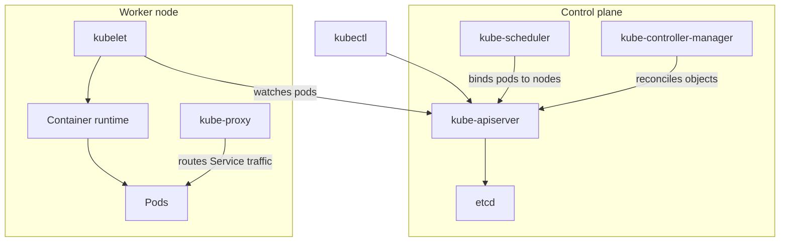

# Kubernetes Architecture and Objects

!!! note "In simple words"
    You tell Kubernetes what you want, such as three copies of your app. Background controllers keep checking the cluster and fix anything that differs from that description.

Kubernetes is a control system. You declare the state you want, and controllers keep working until the cluster matches it. Interviewers ask about the architecture to see whether you can explain what happens after `kubectl apply`. They ask about the core objects to see whether you know when to use a Deployment, a StatefulSet, or a Service.

## Why it matters

Running containers on many machines raises several questions at once: where each container should run, how to restart it when it fails, how clients find it, and how to change it without downtime. Kubernetes answers all of them with one model. The API stores desired state, and control loops act on the gap between desired and actual state. Once you understand that loop, the rest of the object model is easier to learn.

Orchestration is the broader idea behind this. Automation runs one task without a person. Orchestration coordinates many tasks and keeps them in the state you declared. Kubernetes is an orchestrator because it keeps the workload matching the declared state over time:

- The scheduler chooses a node for each new pod based on resources, constraints, and affinity rules.
- Controllers compare desired and observed state and act on the difference, such as replacing a failed pod.
- Rolling updates replace pods gradually. The `maxUnavailable` and `maxSurge` settings control how many pods can be down or extra at one time.
- Probes tell the platform when a container is alive or ready to receive traffic.

Orchestration does not replace a deployment pipeline. The pipeline builds and promotes an image. Kubernetes keeps the running pods matching the manifest that the pipeline applied.

## How it works

### Architecture overview



The control plane makes global decisions. Worker nodes run the workloads. Every component talks to the API server, and no component other than the API server reads or writes etcd directly.

### Control plane

- **kube-apiserver**: the front door. Every read and write goes through its REST API, including requests from `kubectl` and from other control-plane components.
- **etcd**: a consistent key-value store that holds all cluster state. Losing etcd without a backup means losing the cluster's record of what it should run.
- **kube-scheduler**: assigns each unscheduled pod to a node that has enough free resources and matches the pod's constraints.
- **kube-controller-manager**: runs the built-in controllers, such as the ReplicaSet controller. Each one compares desired state with actual state and acts on the difference.

### Worker nodes

- **kubelet**: an agent on each node. It makes sure the containers described in the pod specs assigned to that node are running and healthy.
- **kube-proxy**: maintains network rules, so that traffic sent to a Service address reaches a ready pod.
- **Container runtime**: the software that runs containers, such as containerd, through the Container Runtime Interface.

### Clusters, namespaces, and RBAC

A **cluster** is the control plane together with its nodes. A **namespace** is a logical partition inside a cluster. Names must be unique within a namespace. Quotas and policies can be applied per namespace, which is the usual basis for sharing one cluster between teams.

**RBAC** (role-based access control) decides who can do what:

| Object | Scope | Purpose |
|---|---|---|
| `Role` | Namespace | Grants permissions on resources inside one namespace |
| `ClusterRole` | Cluster | Grants permissions across the cluster, or on non-namespaced resources |
| `RoleBinding` | Namespace | Attaches a Role or ClusterRole to subjects in one namespace |
| `ClusterRoleBinding` | Cluster | Attaches a ClusterRole to subjects everywhere |
| `ServiceAccount` | Namespace | The identity a pod uses when it calls the API |

```yaml
apiVersion: rbac.authorization.k8s.io/v1
kind: Role
metadata:
  name: pod-reader
  namespace: orders
rules:
  - apiGroups: [""]
    resources: ["pods"]
    verbs: ["get", "list", "watch"]
```

### Pods

A **pod** is the smallest unit you deploy. It groups one or more containers that share a network namespace, which means one IP address. The containers can also share volumes, and they are scheduled together. Pods are temporary. When one dies, a new pod with a new IP replaces it. Application code should never depend on a pod's IP address.

```yaml
apiVersion: v1
kind: Pod
metadata:
  name: orders-pod
  labels:
    app: orders
spec:
  containers:
    - name: orders
      image: orders-service:1.4.0
      ports:
        - containerPort: 8080
```

You rarely create bare pods. Higher-level controllers create and replace them for you. The pod lifecycle, including probes and shutdown, is covered on the Config, Storage and Health page.

### Deployments and ReplicaSets

A **ReplicaSet** keeps a set number of identical pods running. If a pod is removed or fails, the ReplicaSet creates another.

A **Deployment** manages ReplicaSets for stateless applications. Changing the pod template creates a new ReplicaSet. The Deployment then moves pods from the old ReplicaSet to the new one, which is a **rolling update**. Old ReplicaSets are kept, so you can **roll back**.

```yaml
apiVersion: apps/v1
kind: Deployment
metadata:
  name: orders
spec:
  replicas: 3
  selector:
    matchLabels:
      app: orders
  strategy:
    type: RollingUpdate
    rollingUpdate:
      maxUnavailable: 1
      maxSurge: 1
  template:
    metadata:
      labels:
        app: orders
    spec:
      containers:
        - name: orders
          image: orders-service:1.4.0
          ports:
            - containerPort: 8080
```

Useful commands are `kubectl rollout status deployment/orders` and `kubectl rollout undo deployment/orders`.

### StatefulSets

A **StatefulSet** suits workloads that need a stable identity and stable storage, such as databases, brokers, and clustered systems. Each pod gets an ordered name (`db-0`, `db-1`), a stable network identity, and its own persistent volume claim that stays with it. By default, pods start and stop in order.

Use a Deployment for stateless services, where any replica can serve any request. Use a StatefulSet when each replica is distinct.

### Services

A **Service** gives a stable name and virtual IP to a group of pods selected by labels. Clients use the Service, so they never track individual pod IPs.

| Type | Behaviour |
|---|---|
| `ClusterIP` (default) | Reachable only from inside the cluster |
| `NodePort` | Opens the same port on every node |
| `LoadBalancer` | Asks the cloud provider for an external load balancer |
| `ExternalName` | Returns a DNS CNAME for an external hostname, with no proxying |

```yaml
apiVersion: v1
kind: Service
metadata:
  name: orders
spec:
  type: ClusterIP
  selector:
    app: orders
  ports:
    - port: 80
      targetPort: 8080
```

### Ingress and the Gateway API

An **Ingress** routes external HTTP and HTTPS traffic to Services, based on host name and path. It has no effect until an ingress controller is installed in the cluster. The **Gateway API** is the newer model for new work. It separates the responsibilities of platform owners and application teams more clearly, and it supports more protocols.

### kubectl quick reference

`kubectl` is the command-line client for the API server. Each command reads or changes state through that API, so it follows the same RBAC rules as any other client.

| Command | Purpose |
|---|---|
| `kubectl get pods -n orders` | List objects of one kind in a namespace. Add `-o wide` for node and IP, or `-o yaml` for the full object. |
| `kubectl describe pod orders-pod` | Show the spec, status, conditions, and recent events. Start here when a pod is stuck in Pending or CrashLoopBackOff. |
| `kubectl logs orders-pod` | Print stdout and stderr. Use `-f` to follow, `--previous` for the last crashed container, and `-c` to choose a container. |
| `kubectl exec -it orders-pod -- sh` | Run a command inside a running container. Use `sh` for images without bash. Prefer logs and metrics for production debugging. |
| `kubectl port-forward svc/orders 8080:80` | Forward a local port to a Service or pod for testing, without exposing it publicly. |
| `kubectl apply -f orders-deployment.yaml` | Create or update objects from a manifest. You can apply the same file again safely. |
| `kubectl delete -f orders-deployment.yaml` | Remove the objects described in a manifest. |
| `kubectl rollout status deployment/orders` | Wait for and report the progress of a rolling update. Useful in CI scripts. |
| `kubectl rollout history deployment/orders` | List the recorded revisions of a Deployment. |
| `kubectl rollout undo deployment/orders` | Return to the previous revision. Add `--to-revision=N` to choose one. |

A typical debugging flow for a failing pod:

```bash
kubectl get pods -n orders -o wide                       # which pods, which nodes, what state
kubectl describe pod orders-7d9f-abcde                   # events: scheduling, image pulls, probes
kubectl logs orders-7d9f-abcde --previous                # output from the crashed container
kubectl port-forward pod/orders-7d9f-abcde 8080:8080     # test the endpoint locally
```

## Where it is used

- Running stateless web APIs and workers as Deployments with rolling updates.
- Running databases, brokers, and other stateful systems as StatefulSets.
- Giving several teams isolated areas of one cluster with namespaces, quotas, and RBAC.
- Scheduled and one-off tasks, through Jobs and CronJobs.

## Benefits

- **Self-healing**: failed pods are replaced without a person involved.
- **Declarative**: a manifest in version control describes what runs, so reviews and rollbacks are possible.
- **Scalability**: adding replicas is a change to one number.
- **Portability**: the same manifests run on any conformant cluster, on-premises or in a cloud.
- **Built-in service discovery**: Services give clients a stable name.

## Cons and limits

- The control plane and networking add operational complexity. A small team may not need a cluster at all.
- A reconcile loop reacts after the fact. Changes take time to converge, and a bad manifest can still cause an outage.
- Namespaces are not a security boundary on their own. You need RBAC and network policies as well.
- Stateful workloads need careful planning for storage, backups, and upgrades.

### Common pitfalls

- Hard-coding pod IP addresses. Use Service names.
- Using a Deployment for a database that needs stable identity and storage.
- Forgetting that a Service selects pods by label. A typo in a label means traffic never arrives, and no error is shown.
- Creating bare pods, which are not recreated after they die.
- Treating a namespace as a security boundary without RBAC and network policies.
- Expecting an Ingress to work without an ingress controller.

## Best practices

- Declare everything in manifests, and apply them through a pipeline rather than by hand.
- Set labels consistently, and check that Service selectors match pod labels.
- Use Deployments for stateless services, and set `maxUnavailable` and `maxSurge` deliberately.
- Keep the rollback path ready with `kubectl rollout undo`, and test it before you need it.
- Give each workload its own ServiceAccount with the smallest set of RBAC permissions it needs.

!!! tip "Interview tip"
    **Q: What happens when you create a Deployment?**
    The API server validates the object and stores it in etcd. The Deployment controller creates a ReplicaSet, and the ReplicaSet creates the pods. The scheduler binds each pod to a node, and the kubelet on that node starts the containers through the runtime. The control loops keep running after that, so a failed pod is replaced automatically.

    **Q: How is orchestration different from automation?** A script that runs `kubectl apply` is automation. The control loops that keep pods running, reschedule them after a node fails, and roll out changes without breaking availability are orchestration. The difference is ongoing state management and recovery, not a single action.

## Quick recap

- The control plane (API server, etcd, scheduler, controller manager) decides. Nodes (kubelet, kube-proxy, runtime) run the work.
- Pods are temporary and share a network identity within the pod.
- Deployments manage stateless replicas with rolling updates and rollbacks. StatefulSets keep stable identity and storage.
- Services give stable names to changing pods. Ingress and the Gateway API route external traffic.
- Namespaces divide the cluster. RBAC controls who can change what.

## Official documentation

- [Kubernetes documentation home](https://kubernetes.io/docs/home/)
- [Pods](https://kubernetes.io/docs/concepts/workloads/pods/)
- [Deployments](https://kubernetes.io/docs/concepts/workloads/controllers/deployment/)
- [Service](https://kubernetes.io/docs/concepts/services-networking/service/)

**See also:** [Config, Storage and Health](config-storage-health.md), [Networking, Helm and Operators](networking-helm-operators.md), [Docker Fundamentals](../15-docker/docker-fundamentals.md)
