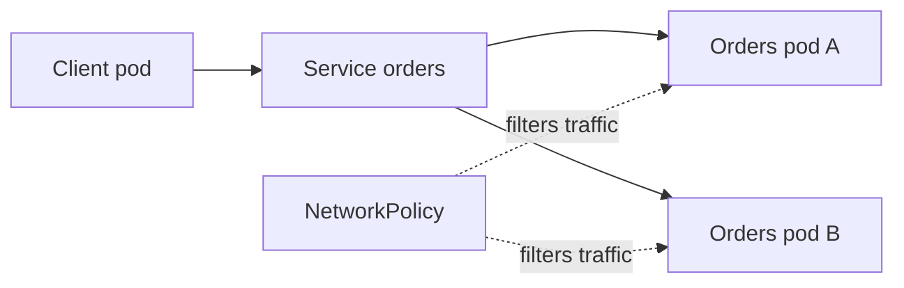

# Networking, Helm and Operators

!!! note "In simple words"
    Pods reach each other through Service names, you decide which callers are allowed in, Helm packages your YAML into reusable bundles, and operators teach Kubernetes how to run complex software such as a database.

Kubernetes gives every pod an IP address. It expects pods to reach one another without network address translation, but it leaves the details to a network plugin. On top of that, you control which traffic is allowed, you can add a service mesh, you can package applications with Helm, and you can extend the API with operators. Interviewers ask about these topics to see whether you can reason about how traffic flows and how the platform is extended.

## Why it matters

A cluster with many services quickly raises three questions. Which service may call which other service? How do you ship the same application to several environments without copying YAML by hand? How do you teach the cluster to run something complex, such as a database with backups and failover? Network policies, meshes, Helm, and operators are the usual answers. Each one solves a different part of that problem.

## How it works

### Traffic flow at a glance



A client calls the Service name. The Service picks a ready pod. A NetworkPolicy, if one applies, decides whether that connection is allowed in the first place.

### Pod-to-pod communication

Every pod gets its own IP address. Pods on any node can reach other pods by IP address, and the cluster network plugin, called the CNI plugin, makes that work. Pod IPs change whenever pods are replaced, so clients should use Services instead.

### Service discovery through DNS

The cluster DNS server gives each Service a name in the form `<service>.<namespace>.svc.cluster.local`. Inside the same namespace, the short name `orders` is enough. A pod in another namespace uses a name such as `orders.payments`.

```java
import java.net.InetAddress;
import java.net.UnknownHostException;

public class ServiceLookup {
    public static void main(String[] args) throws UnknownHostException {
        // Resolves inside a pod through cluster DNS; fails on a machine outside the cluster
        InetAddress address = InetAddress.getByName("orders.payments.svc.cluster.local");
        System.out.println("Resolved to " + address.getHostAddress());
    }
}
```

In practice, most applications put the Service URL in their configuration, such as `http://orders.payments.svc.cluster.local`, and let the HTTP client do the lookup.

### Network policies

By default, every pod can talk to every other pod. A **NetworkPolicy** selects pods and restricts their ingress (incoming) and egress (outgoing) traffic. A policy has effect only when the network plugin enforces it. A common baseline is a default-deny policy, followed by explicit allow rules.

```yaml
apiVersion: networking.k8s.io/v1
kind: NetworkPolicy
metadata:
  name: allow-orders-from-gateway
  namespace: orders
spec:
  podSelector:
    matchLabels:
      app: orders
  policyTypes: ["Ingress"]
  ingress:
    - from:
        - podSelector:
            matchLabels:
              app: gateway
      ports:
        - protocol: TCP
          port: 8080
```

This policy lets only pods labelled `app: gateway` reach the orders pods on port 8080. Once a pod is selected by an `Ingress` policy, any incoming traffic that no allow rule matches is dropped.

### Service meshes

A **service mesh** adds a layer for service-to-service traffic. It usually injects a proxy beside each pod. Typical features are mutual TLS between services, retries and timeouts, traffic splitting for canary releases, and consistent metrics. Istio and Linkerd are the common choices.

A mesh adds operational complexity and resource overhead, so adopt it when you need its features, not by default.

#### How Istio is built

Istio has two parts. The **control plane**, called `istiod`, turns Istio resources into configuration and pushes it to each proxy over the xDS protocol. It also acts as a certificate authority, issuing identities to workloads for mTLS. The **data plane** is an Envoy sidecar injected next to each pod. The sidecar intercepts the pod's inbound and outbound traffic and applies the rules it received.

Enable injection per namespace, then restart the pods so that the sidecar is added:

```bash
istioctl install --set profile=demo -y        # demo profile for evaluation; choose a production profile deliberately
kubectl label namespace orders istio-injection=enabled
kubectl rollout restart deployment -n orders
```

#### Traffic management with VirtualService and DestinationRule

A **DestinationRule** names the versions of a service, called subsets, which are selected by pod labels. It also sets connection and outlier policies. A **VirtualService** decides how requests for a host are routed to those subsets. Together they implement canary releases without any change to the application:

```yaml
apiVersion: networking.istio.io/v1
kind: DestinationRule
metadata:
  name: orders
spec:
  host: orders
  subsets:
    - name: stable
      labels:
        version: "1.3.0"
    - name: canary
      labels:
        version: "1.4.0"
---
apiVersion: networking.istio.io/v1
kind: VirtualService
metadata:
  name: orders
spec:
  hosts:
    - orders
  http:
    - route:
        - destination:
            host: orders
            subset: stable
          weight: 90
        - destination:
            host: orders
            subset: canary
          weight: 10
```

Raising the canary weight in steps, for example 10, 25, 50, and then 100, is a progressive rollout. Route rules can also match on headers, which lets internal testers reach the new version first.

#### Timeouts, retries, and outlier detection

A VirtualService sets a request timeout and a retry policy. A DestinationRule can eject unhealthy pod instances from the load-balancing pool. That behaves like a circuit breaker:

```yaml
apiVersion: networking.istio.io/v1
kind: VirtualService
metadata:
  name: orders
spec:
  hosts:
    - orders
  http:
    - timeout: 5s
      retries:
        attempts: 2
        perTryTimeout: 2s
        retryOn: 5xx,connect-failure,reset
      route:
        - destination:
            host: orders
---
apiVersion: networking.istio.io/v1
kind: DestinationRule
metadata:
  name: orders
spec:
  host: orders
  trafficPolicy:
    outlierDetection:
      consecutive5xxErrors: 5    # field names vary by Istio version; check the reference for yours
      interval: 30s
      baseEjectionTime: 30s
      maxEjectionPercent: 50
```

Retries multiply the load during an outage. Retrying a non-idempotent call, such as a payment, can charge a customer twice. Retry only the operations that are safe to repeat.

#### Mutual TLS and authorization

A PeerAuthentication policy in `STRICT` mode accepts only mTLS traffic. An AuthorizationPolicy then limits which service identities may call which paths. Identities are the service account names that the mesh issued:

```yaml
apiVersion: security.istio.io/v1
kind: PeerAuthentication
metadata:
  name: default
  namespace: orders
spec:
  mtls:
    mode: STRICT
---
apiVersion: security.istio.io/v1
kind: AuthorizationPolicy
metadata:
  name: orders-from-gateway
  namespace: orders
spec:
  selector:
    matchLabels:
      app: orders
  rules:
    - from:
        - source:
            principals: ["cluster.local/ns/edge/sa/gateway"]
      to:
        - operation:
            methods: ["GET", "POST"]
            paths: ["/api/*"]
```

Switch to `STRICT` only after every client in the namespace has a sidecar. Otherwise plain-text callers are rejected and traffic breaks.

#### Observability from the mesh

Each sidecar reports request metrics, such as `istio_requests_total`, labelled by source and destination. Traces need the application to forward the trace headers, because the sidecar cannot join spans that the application drops. Kiali draws a service graph from the same telemetry, and Jaeger displays traces. In a test cluster, reach these tools with `kubectl port-forward`.

#### Istio or Linkerd

Istio offers the widest feature set, including detailed traffic shaping and authorization. The cost is more components and more memory. Linkerd is smaller and simpler, and it covers mTLS, retries, and metrics with fewer settings. Choose Istio when you need its traffic and policy features. Choose Linkerd when you mainly want mTLS and observability with little operational effort.

### Helm: packaging and templating

**Helm** packages Kubernetes manifests as a **chart**. A chart holds a `Chart.yaml` file with metadata, a `values.yaml` file with default settings, and a `templates/` folder with manifests that contain placeholders.

```yaml
# templates/deployment.yaml (excerpt)
spec:
  replicas: {{ .Values.replicaCount }}
  template:
    spec:
      containers:
        - name: {{ .Chart.Name }}
          image: "{{ .Values.image.repository }}:{{ .Values.image.tag }}"
```

```yaml
# values.yaml
replicaCount: 3
image:
  repository: orders-service
  tag: "1.4.0"
```

Common commands:

- `helm install orders ./orders-chart -f values-prod.yaml` creates a **release**.
- `helm upgrade orders ./orders-chart -f values-prod.yaml` applies changes as a new revision.
- `helm rollback orders 1` returns the release to an earlier revision.
- `helm template ./orders-chart` renders the manifests locally without applying them. CI uses this for review.

Helm records each release and its revisions in the cluster, so a rollback is one command away.

#### Chart layout and template helpers

A typical chart has this layout:

```text
orders-chart/
├── Chart.yaml          # name, chart version, appVersion
├── values.yaml         # defaults
├── values-prod.yaml    # environment overrides
├── charts/             # dependency charts
└── templates/
    ├── _helpers.tpl    # named templates shared across files
    ├── deployment.yaml
    ├── service.yaml
    └── migrate-job.yaml
```

Named templates in `_helpers.tpl` keep labels consistent across every manifest:

```yaml
# templates/_helpers.tpl
{{- define "orders.labels" -}}
app.kubernetes.io/name: {{ .Chart.Name }}
app.kubernetes.io/version: {{ .Chart.AppVersion | quote }}
{{- end -}}
```

```yaml
# templates/deployment.yaml (excerpt)
metadata:
  name: {{ .Release.Name }}-orders
  labels:
    {{- include "orders.labels" . | nindent 4 }}
```

Values files merge in order, and later files win. A flag such as `--set image.tag=1.4.1` overrides both. Put non-secret settings in values. Refer to Secrets by name instead of storing passwords in `values.yaml`, because anyone who can read the release can read its values.

#### Hooks for migrations

A hook is a resource that Helm runs at a fixed point in the release lifecycle. A pre-upgrade Job is a common way to run database migrations before the new pods start:

```yaml
# templates/migrate-job.yaml
apiVersion: batch/v1
kind: Job
metadata:
  name: {{ .Release.Name }}-migrate
  annotations:
    "helm.sh/hook": pre-install,pre-upgrade
    "helm.sh/hook-weight": "-5"
    "helm.sh/hook-delete-policy": before-hook-creation,hook-succeeded
spec:
  backoffLimit: 0
  template:
    spec:
      restartPolicy: Never
      containers:
        - name: migrate
          image: "{{ .Values.image.repository }}:{{ .Values.image.tag }}"
          command: ["sh", "-c", "./migrate.sh"]   # a script that applies schema changes
```

The hook types are `pre-install`, `post-install`, `pre-upgrade`, `post-upgrade`, `pre-delete`, `post-delete`, `pre-rollback`, `post-rollback`, and `test`. Hook weights order the hooks of the same type. The delete policy removes old hook Jobs.

Useful checks before a release:

- `helm lint ./orders-chart` finds template and metadata errors.
- `helm template ./orders-chart -f values-prod.yaml` renders the manifests locally, so CI can review them.
- `helm install orders ./orders-chart --dry-run --debug` asks the cluster to validate the release without creating anything.
- `helm history orders` lists the revisions that `helm rollback` can return to.

A rollback restores the manifests, but it does not reverse a database migration. Write migrations so that the previous application version still works against the new schema.

### Custom Resource Definitions (CRDs)

A **CustomResourceDefinition** adds a new resource type to the Kubernetes API, such as `Database` or `Certificate`. After installation, you create and read those objects with `kubectl`, just like built-in objects. The objects are stored in etcd.

### Operators and controllers

A **controller** runs a reconcile loop. It reads the desired state from an object, observes the actual state, and makes changes that close the gap. An **operator** is a controller for a CRD that encodes operational knowledge, such as how to back up, upgrade, or fail over a database.

The reconcile pattern is the core idea. The following simplified Java 21 model shows the shape of one pass:

```java
import java.util.Optional;

public class ReconcileSketch {

    record DesiredState(int replicas) {}
    record ObservedState(int runningReplicas) {}

    static Optional<String> reconcile(DesiredState desired, ObservedState observed) {
        int diff = desired.replicas() - observed.runningReplicas();
        if (diff > 0) {
            return Optional.of("scale up by " + diff);
        }
        if (diff < 0) {
            return Optional.of("scale down by " + (-diff));
        }
        return Optional.empty(); // already matches the desired state
    }

    public static void main(String[] args) {
        System.out.println(reconcile(new DesiredState(3), new ObservedState(1)).orElse("in sync"));
    }
}
```

Real operators run this loop against the API server. The loop is triggered by watch events, and it requeues work when something fails. Frameworks such as Operator SDK and Kubebuilder help you build them. A reconcile must be idempotent, so that running it twice with the same input gives the same result.

## Where it is used

- Enforcing a default-deny network posture in shared namespaces that serve regulated data.
- Canary releases and mutual TLS in service-heavy platforms that run dozens of services.
- Packaging one application for dev, staging, and production, with a values file for each environment.
- Running databases, certificate issuers, and message brokers through operators.

## Benefits

- **Network policies** limit the blast radius of a compromised pod.
- **Meshes** provide encryption and traffic control without changing application code.
- **Helm** gives repeatable installs, tracked revisions, and one-command rollbacks.
- **Operators** turn manual runbooks for complex software into code that runs continuously.

## Cons and limits

- A mesh adds sidecars, certificates, and configuration to operate. Upgrades need care.
- Network policies have no effect unless the network plugin enforces them.
- Helm templates can become hard to read. Heavy logic in templates is difficult to test.
- Helm rollbacks do not reverse data changes made by hooks or migrations.
- An operator is software that you must run, upgrade, and monitor. A buggy operator can damage the resources it manages.

### Common pitfalls

- Assuming network policies are enforced. The network plugin must support them.
- Forgetting egress rules. After a default-deny policy, pods may no longer reach DNS or external APIs.
- Hard-coding pod IPs or node addresses in configuration.
- Editing Helm-managed resources by hand, which the next `helm upgrade` overwrites.
- Installing a service mesh for a single service with simple traffic needs.
- Writing an operator whose reconcile is not idempotent.

## Best practices

- Start with a default-deny NetworkPolicy, then add allow rules for each caller and for DNS.
- Turn on mTLS in permissive mode first, check that every client has a sidecar, and then move to strict mode.
- Retry only idempotent operations, and cap retries and timeouts.
- Keep environment differences in values files, and keep secrets out of them.
- Run `helm lint` and `helm template` in CI, and review the rendered output.
- Write database migrations so that old and new application versions can both run.

!!! tip "Interview tip"
    **Q: How do you restrict which services can call the orders service?**
    Use a NetworkPolicy with a default-deny baseline and an explicit allow rule for the calling pods' labels. For identity-based control between services, a service mesh can add mutual TLS and authorization rules. Explain that the policy only works when the CNI plugin enforces it.

## Quick recap

- Pods reach each other by IP address, but applications should use Service DNS names.
- NetworkPolicies restrict traffic, but only where the network plugin enforces them.
- Service meshes add mTLS, retries, and traffic splitting at the cost of complexity. Istio does weighted canary routing with VirtualService and DestinationRule.
- Helm hooks run migrations before an upgrade, but a rollback does not undo them.
- Helm packages manifests as charts with values and tracked, rollback-able releases.
- CRDs add API types. Operators reconcile them toward the desired state.

## Official documentation

- [Services](https://kubernetes.io/docs/concepts/services-networking/service/)
- [Ingress](https://kubernetes.io/docs/concepts/services-networking/ingress/)
- [Istio documentation](https://istio.io/latest/docs/)
- [Helm documentation](https://helm.sh/docs/)

**See also:** [Kubernetes Architecture and Objects](kubernetes-architecture-objects.md), [Config, Storage and Health](config-storage-health.md), [Continuous Deployment and IaC](../17-cicd/continuous-deployment-iac.md)
