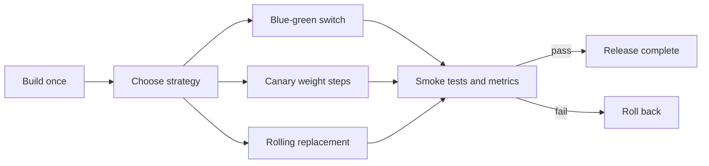
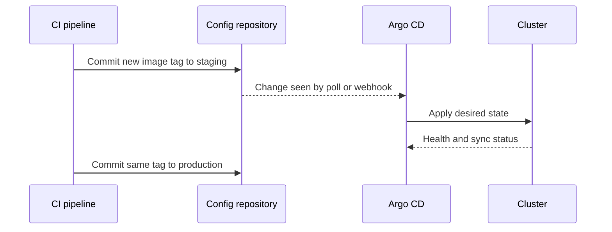

# Continuous Deployment and Infrastructure as Code

!!! note "In simple words"
    Continuous deployment ships each change that passes the pipeline. Infrastructure as code describes servers and networks in files, so you can recreate them. A good release shifts traffic slowly and checks itself, and it can be undone quickly.

Continuous deployment releases every change that passes the pipeline. Continuous delivery keeps the software ready to release at the push of a button. Either way, the release itself must be safe. The deployment strategy controls how traffic moves to the new version. Infrastructure is described in code, so environments can be reproduced. Automated checks decide whether a release stays or gets rolled back. Interviewers ask about these topics to test risk management, not only tool names.

## Why it matters

A deployment that replaces everything at once has no safety margin. If the new version is broken, every user feels it. If the servers were configured by hand, nobody knows exactly what runs where. Strategies that move traffic gradually, automated verification, and infrastructure in version control reduce both kinds of risk. They also make it normal to ship small changes often, which is the point of continuous delivery.

## How it works

### Deployment strategies

Each strategy trades speed, cost, and risk differently:

- **Blue-green** runs two identical environments: blue, which is live, and green, which holds the new version. You deploy to green, verify it, and then switch traffic at the router or load balancer. Rolling back means switching back. The cost is double capacity during the switch.
- **Canary** sends a small share of traffic to the new version, watches its metrics, and then raises the share step by step. Rolling back removes the canary. The blast radius of a bad release stays small.
- **Rolling** replaces instances a few at a time, so old and new versions run side by side. It needs no extra capacity, but the two versions must be compatible during the rollout.
- **Shadow** sends a copy of production traffic to the new version and discards its responses. It tests real load and behaviour without affecting users. Side effects, such as writes, need careful handling.



In Kubernetes, the rolling strategy is the default for a Deployment. Canary and blue-green are usually built on traffic-splitting features of a service mesh, an ingress controller, or a progressive-delivery tool.

#### Kubernetes strategies in practice

A rolling update is configured on the Deployment. `maxSurge` allows extra pods during the rollout, and `maxUnavailable: 0` keeps full capacity. A new pod receives traffic only after its readiness probe passes:

```yaml
apiVersion: apps/v1
kind: Deployment
metadata:
  name: orders
spec:
  replicas: 4
  strategy:
    type: RollingUpdate
    rollingUpdate:
      maxSurge: 1
      maxUnavailable: 0
  selector:
    matchLabels:
      app: orders
  template:
    metadata:
      labels:
        app: orders
    spec:
      containers:
        - name: orders
          image: registry.example.com/orders:1.4.1
          readinessProbe:
            httpGet:
              path: /actuator/health/readiness
              port: 8080
```

Kubernetes does not roll back a Deployment on its own. If the new pods never become ready, the rollout stalls, and `progressDeadlineSeconds` marks it as failed. Someone, or the pipeline, must run `kubectl rollout undo`.

A blue-green switch uses two Deployments and one Service. The Service selector decides which Deployment receives traffic. Each Deployment's pod template carries a `track` label, such as `blue` or `green`. Both Deployments run during the switch, so capacity briefly doubles:

```bash
kubectl apply -f orders-green.yaml                       # green runs the new version; the Service still selects blue
kubectl patch service orders -p '{"spec":{"selector":{"app":"orders","track":"green"}}}'
kubectl patch service orders -p '{"spec":{"selector":{"app":"orders","track":"blue"}}}'   # instant rollback
```

A canary without a mesh is only approximate. Run nine stable pods and one canary pod behind the same Service, and the canary receives roughly 10 percent of connections. Kubernetes balances by connection rather than by request, so the split drifts with traffic patterns. A mesh or an ingress controller gives exact weights, as shown on the networking page.

Shadow traffic also needs the mesh. Istio's `mirror` field copies each request to a second subset and discards that subset's response:

```yaml
http:
  - route:
      - destination:
          host: orders
          subset: stable
    mirror:
      host: orders
      subset: canary
    mirrorPercentage:
      value: 100.0
```

Mirrored requests can cause side effects, such as a second charge or a second email. Point the shadow version at sandbox dependencies, or block its writes, before you mirror production traffic.

Progressive-delivery tools such as Flagger automate the canary steps. They raise the canary weight in increments, check success rate and latency from Prometheus at each step, and roll back when a threshold is breached.

Rollout commands for day-to-day control:

```bash
kubectl rollout status deployment/orders
kubectl rollout history deployment/orders
kubectl rollout undo deployment/orders                    # previous revision
kubectl rollout undo deployment/orders --to-revision=3    # a specific revision
kubectl rollout pause deployment/orders                   # hold mid-rollout to inspect
kubectl rollout resume deployment/orders
```

### Infrastructure as code (IaC)

IaC describes servers, networks, databases, and permissions in versioned files. Environments can then be created, compared, and recreated.

**Terraform** uses HCL (HashiCorp Configuration Language). You declare resources, and Terraform calculates a plan of changes against the recorded **state**. Key ideas:

- **State** maps the configuration to real resources. Store it remotely with locking, so two people cannot apply changes at the same time.
- **Modules** package reusable groups of resources with input variables and outputs.
- `terraform plan` shows the changes before `terraform apply` makes them.

```hcl
resource "aws_s3_bucket" "orders_exports" {
  bucket = "example-orders-exports"
}

output "bucket_name" {
  value = aws_s3_bucket.orders_exports.bucket
}
```

**CloudFormation** is AWS's native IaC service. It uses JSON or YAML templates and manages resources as stacks. **Ansible** focuses on configuration management: installing packages, templating files, and configuring machines, usually with idempotent playbooks.

Terraform and CloudFormation provision infrastructure. Ansible configures what runs on it. Some teams use all three, and some use only one.

### Secrets in pipelines

Pipelines need credentials to deploy, but those credentials must never appear in code or in logs.

- **GitHub Actions secrets** are stored encrypted and passed to jobs as environment variables. GitHub masks their values in logs. **GitLab CI variables** can be marked as masked and protected, so that they reach only protected branches.
- **HashiCorp Vault** or a cloud key vault issues short-lived credentials on demand. That is safer than long-lived keys.
- Prefer OpenID Connect federation between the CI system and the cloud. The pipeline then needs no stored cloud keys at all.

```yaml
# GitHub Actions: deploy using a secret, never a literal value
- name: Deploy
  env:
    DEPLOY_TOKEN: ${{ secrets.DEPLOY_TOKEN }}
  run: ./scripts/deploy.sh
```

### After deployment: verification and rollback

A deployment is not finished when the new version starts. Post-deployment steps include:

- **Smoke tests**: a few quick checks on critical paths, such as sign-in or a payment status call.
- **Health checks**: readiness and liveness signals from the platform, plus application metrics such as error rate and latency.
- **Automatic rollback**: if a smoke test or a health threshold fails, the pipeline reverts to the previous version.
- **Approvals and notifications**: manual approval gates for sensitive environments, and alerts when a deployment starts, succeeds, or fails.

A deployment without automatic rollback depends on a person noticing the problem and reacting quickly. Build the rollback path before you need it.

A smoke test can be a small program. The Java 21 example below checks an endpoint and exits with a non-zero code on failure. The URL is a placeholder. The pipeline reads the exit code, not the program's output.

```java
import java.io.IOException;
import java.net.URI;
import java.net.http.HttpClient;
import java.net.http.HttpRequest;
import java.net.http.HttpResponse;

public class SmokeTest {
    public static void main(String[] args) throws IOException, InterruptedException {
        HttpClient client = HttpClient.newHttpClient();
        HttpRequest request = HttpRequest.newBuilder(URI.create("https://orders.example.com/actuator/health"))
                .GET()
                .build();
        HttpResponse<String> response = client.send(request, HttpResponse.BodyHandlers.ofString());
        if (response.statusCode() != 200) {
            System.exit(1); // a non-zero exit fails the pipeline step and triggers rollback logic
        }
        System.out.println("Smoke test passed");
    }
}
```

### Choosing a strategy

| Strategy | Extra capacity needed | Rollback speed | Old and new versions run together | Best when |
|---|---|---|---|---|
| Blue-green | Yes, a full second environment | Very fast, by switching back | No, only one serves users at a time | Changes need an all-or-nothing switch |
| Canary | A small share of extra capacity | Fast, by removing the canary | Yes, by design | Risk must be measured on real traffic |
| Rolling | Little or none | Moderate, one instance at a time | Yes, during the rollout | Old and new versions are compatible |
| Shadow | Yes, to process copied traffic | Not applicable to users | Yes, but only the old version responds | Behaviour and load need checking before exposure |

The change determines the strategy. A schema migration that breaks the old code rules out rolling and canary releases, unless the migration is split into compatible steps.

### Promoting one artifact through environments

Build the artifact once, and promote the same version through development, staging, and production. Only the configuration changes between environments, and that configuration lives in version control or in a secret store. Rebuilding for each environment means production runs code that was never tested. Record which artifact version is in each environment, so audits and rollbacks have a clear answer.

### GitOps with Argo CD

GitOps makes a Git repository the single source of truth for what runs in a cluster. A controller inside the cluster compares the desired state in Git with the live state, and it applies the difference. Nobody runs `kubectl apply` by hand, so every change has a commit, a reviewer, and a history. **Argo CD** is a widely used GitOps controller. Flux follows the same principle.

An Argo CD **Application** connects one Git path to one cluster and namespace:

```yaml
apiVersion: argoproj.io/v1alpha1
kind: Application
metadata:
  name: orders
  namespace: argocd
spec:
  project: default
  source:
    repoURL: https://git.example.com/platform/orders-config.git
    targetRevision: main
    path: overlays/prod
  destination:
    server: https://kubernetes.default.svc
    namespace: orders
  syncPolicy:
    automated:
      prune: true       # delete cluster objects that were removed from Git
      selfHeal: true    # revert manual changes that drift from Git
```

A common layout keeps shared manifests in `base/`, with one `overlays/<environment>/` folder per environment. Kustomize or Helm renders the differences. A deployment then follows this path:



1. CI builds the image once, pushes it to the registry, and runs the tests.
2. CI opens a commit, or a pull request, that changes the image tag in `overlays/staging`.
3. After review, the change merges into the branch that Argo CD tracks. Argo CD then syncs, on a poll or a webhook.
4. Another commit promotes the same tag to `overlays/prod`, so production runs the artifact that staging tested.

Rolling back is a `git revert` of the change, and the next sync brings the cluster back. Keep CI and CD separate. CI should not hold cluster credentials when a GitOps controller can pull the change instead. Secrets cannot sit in plain text in Git. Use an encrypted format such as Sealed Secrets or SOPS, or refer to a vault.

### Configuration management with Ansible

Ansible playbooks describe the desired state of machines. This small example installs a runtime and deploys a JAR:

```yaml
- name: Configure the orders host
  hosts: orders
  become: true
  tasks:
    - name: Ensure the JRE package is installed
      ansible.builtin.package:
        name: openjdk-21-jre-headless
        state: present

    - name: Copy the application JAR
      ansible.builtin.copy:
        src: build/app.jar
        dest: /opt/orders/app.jar
        mode: "0644"
```

Modules such as `package` and `copy` are idempotent. Running the playbook again changes nothing when the machine already matches the playbook. The package name is an example for Debian-based systems, and other distributions use different names.

### Drift and state

Infrastructure drifts when someone changes a resource by hand. Detect drift by running a plan on a schedule and alerting on any difference. Fix it by changing the code and applying, not by editing the console. The same principle applies to Kubernetes. A GitOps tool that reconciles the cluster against a repository stops manual changes from lingering.

### Approvals, windows, and change control

Sensitive environments often need a manual approval step. Some teams allow deployments only during certain hours, or freeze them around peak periods. Automate what you can: approval gates in the pipeline, notifications that link to the change, and a record of who approved what. If manual approvals become frequent, treat that as a signal to improve the automated checks.

## Where it is used

- Web services that deploy several times a day, using rolling or canary strategies on Kubernetes.
- Legacy systems on virtual machines, where a blue-green switch behind a load balancer is the safer option.
- Cloud accounts, networks, and databases that are defined in Terraform or CloudFormation.
- Clusters whose desired state lives in Git and is applied by Argo CD.

## Benefits

- Small, frequent releases are easier to review and easier to undo.
- Strategies such as canary limit how many users a bad release can reach.
- Infrastructure in code can be reviewed, tested, and recreated.
- GitOps gives a full audit trail of every change in the cluster.

## Cons and limits

- Blue-green doubles capacity during the switch, which costs money.
- Canary and shadow releases need good metrics. Without them, you cannot tell whether the new version is healthy.
- Strategy choice is limited by database changes. Old and new code must work with the same schema during the rollout.
- Terraform state is sensitive. It can hold values that were never meant to be shared.
- GitOps adds a controller that needs its own upgrades, monitoring, and access control.

### Common pitfalls

- Running `terraform apply` by hand against shared state, which causes drift and conflicts.
- Storing Terraform state locally, or without locking.
- Choosing a rolling update when old and new versions cannot run together.
- Using blue-green without checking that the database schema works for both versions.
- Keeping long-lived cloud keys in pipeline secrets, instead of short-lived credentials.
- Declaring a deployment successful without any post-deployment checks.

## Best practices

- Build once, and promote the same artifact through every environment.
- Run `terraform plan` in review, and apply only the reviewed plan.
- Keep remote state with locking, and restrict who can read it.
- Use short-lived credentials, such as OpenID Connect federation, instead of stored keys.
- Write smoke tests for the critical paths, and make their failure trigger a rollback.
- Make database changes backward compatible, so that a rollback is always possible.
- Keep the cluster in Git, and let a GitOps controller apply it.

!!! tip "Interview tip"
    **Q: How would you release a risky change to an order service with minimal impact?**
    Use a canary. Route a small percentage of traffic to the new version, watch the error rate and latency against the current version, and then increase the share. Tie automatic rollback to those metrics. Make the database changes backward compatible, so that both versions can run during the rollout.

## Quick recap

- Blue-green, canary, rolling, and shadow strategies trade off capacity, speed, and risk.
- Terraform, CloudFormation, and Ansible describe infrastructure or configuration as versioned code.
- Pipelines should use short-lived credentials and secret stores, not literal values.
- Smoke tests, health checks, and automatic rollback decide whether a release stands.
- GitOps tools such as Argo CD sync a cluster to a Git repository. Promote the same image tag through environments by commit.
- Make releases reversible before you need to reverse one.

## Official documentation

- [Argo CD documentation](https://argo-cd.readthedocs.io/en/stable/)
- [Kubernetes Deployments](https://kubernetes.io/docs/concepts/workloads/controllers/deployment/)
- [Istio documentation](https://istio.io/latest/docs/)

**See also:** [Continuous Integration](continuous-integration.md), [Git Workflows](git-workflows.md), [Networking, Helm and Operators](../16-kubernetes/networking-helm-operators.md), [Cloud Platforms](../18-cloud/index.md)
