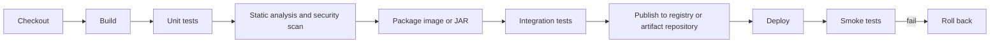

# Continuous Integration

Continuous integration (CI) means every change is merged often and automatically built and tested. A CI pipeline compiles the code, runs unit and integration tests, scans for quality and security problems, and publishes artifacts. Interviewers ask about CI to see whether you know how to make a pipeline fast, reliable, and useful as a gate, not just whether you can name a tool.

## Core concepts

### Build automation and tests
The core of CI is a repeatable build. For a Java project that means the build tool compiles the code, runs the tests, and packages the result. The same command must work on a developer machine and on the CI runner.

A unit test in JUnit 5 is the typical unit of work the pipeline runs:

```java
import static org.junit.jupiter.api.Assertions.assertEquals;

import org.junit.jupiter.api.Test;

class OrderTotalTest {

    @Test
    void sumsLineItemsWithoutDiscount() {
        int total = 300 + 250;
        assertEquals(550, total);
    }
}
```

A real test would call production code instead of repeating the arithmetic. The pipeline fails when any test fails, which is what makes it a gate.

### GitHub Actions
**GitHub Actions** defines workflows as YAML files in `.github/workflows/`. A **workflow** is triggered by **events** (such as `push` or `pull_request`), runs one or more **jobs**, and each job runs **steps** on a **runner**, which is a hosted or self-hosted machine.

```yaml
name: ci
on:
  pull_request:
  push:
    branches: [main]

jobs:
  build:
    runs-on: ubuntu-latest
    steps:
      - uses: actions/checkout@v4
      - uses: actions/setup-java@v4
        with:
          distribution: temurin
          java-version: "21"
          cache: maven
      - run: ./mvnw -B verify
```

Steps either run a shell command (`run`) or use a reusable **action** (`uses`). Pin actions to a version or commit SHA for reproducibility.

### Jenkins
**Jenkins** is a self-hosted automation server. Pipelines are defined in a `Jenkinsfile`. The **declarative** syntax is structured and recommended for most teams. The **scripted** syntax is a Groovy-based DSL that allows more free-form control. A pipeline is organised into **stages**, and an **agent** directive chooses where stages run.

```groovy
pipeline {
    agent { docker { image 'maven:3.9-eclipse-temurin-21' } }
    stages {
        stage('Build') {
            steps { sh 'mvn -B -q package' }
        }
        stage('Test') {
            steps { sh 'mvn -B test' }
        }
    }
}
```

### GitLab CI
**GitLab CI** reads `.gitlab-ci.yml` at the repository root. Jobs run on **runners**, and they are often Docker-based, so each job starts from a clean container image.

```yaml
stages: [build, test]

build:
  stage: build
  image: maven:3.9-eclipse-temurin-21
  script:
    - mvn -B -q package
  artifacts:
    paths: [target/*.jar]

test:
  stage: test
  image: maven:3.9-eclipse-temurin-21
  script:
    - mvn -B test
```

### Quality gates
A **quality gate** is a check that blocks a merge or release when a metric falls below a threshold. Examples include test coverage, code smells, duplicated code, and rating thresholds. **SonarQube** is a common static analysis platform for this. Commercial application-security platforms, such as Checkmarx and Prisma Cloud, provide similar gates for security findings. Choose thresholds the team can actually meet, and tighten them over time.

### Security testing in the pipeline
- **SAST** (static application security testing) analyses source code without running it, for example for injection flaws or unsafe deserialization.
- **DAST** (dynamic application security testing) probes a running application, usually a test deployment, from outside.
- **SCA** (software composition analysis) scans third-party dependencies for known vulnerabilities and licence issues.

Run SCA and SAST on every pull request, and DAST against a deployed test environment. Map findings to the OWASP Top 10 categories where relevant; the list is updated periodically, so check the current edition.

### Artifact management
Built artifacts such as JARs and container images go to an **artifact repository**, which gives them versions and a single trusted source for deployment. **Nexus** and **Artifactory** are common Maven and container repositories. Deploy the same artifact to each environment instead of rebuilding it per environment, so what was tested is what ships.

### Test layers in the pipeline
A healthy pipeline runs the fast tests first and the slow tests later, a shape often described as a test pyramid:

- **Unit tests** are numerous, run in milliseconds, and need no external systems.
- **Integration tests** exercise a real database or message broker, often started in containers for the duration of the run.
- **End-to-end tests** drive the deployed application. They are few, slow, and the most prone to flakiness.

Stop the pipeline at the earliest failing layer. Developers get the fastest possible answer, and expensive stages run only for changes that passed the cheap ones.

### Speeding up pipelines
- **Cache dependencies** between runs, keyed on the build file, so downloads are skipped when nothing changed.
- **Run independent jobs in parallel**, such as unit tests and static analysis.
- **Split test suites** across several runners when one machine becomes the bottleneck.
- **Avoid rebuilding** the same artifact in every job. Build once, and pass the artifact forward.

Measure each stage's duration before optimising. Speed matters because slow feedback encourages large batches of changes.

### Pipeline as code and reuse
Keep the pipeline definition in the repository next to the code it builds. Changes to the pipeline are then reviewed like any other change. Shared templates, such as a GitLab CI `include` or a reusable GitHub Actions workflow, let many services use one tested definition, with per-service settings.

### Reporting and notifications
Publish test reports and coverage results where developers look, usually on the pull request. Notify the author on failure, not on every success, so messages stay meaningful. Quarantine flaky tests into a separate job with an owner, rather than letting them block everyone.

### The full pipeline at a glance
A pipeline runs cheap, fast checks first, and each stage gates the next. Build the artifact once, then promote that same artifact through the later stages.



Quality gates such as coverage thresholds and "no high-severity findings" belong between the stages, so a failing check stops the promotion. Secrets come from the CI system's secret store or a vault, never from the pipeline file itself.

## How it works / Step by step
1. A pull request or push triggers the pipeline.
2. The runner checks out the code and restores cached dependencies.
3. The build compiles the code and runs unit and integration tests.
4. Static analysis, SAST, and SCA run; quality gates decide whether to continue.
5. The artifact is versioned and published to the repository, ready for deployment.

## Common pitfalls
- Slow pipelines that developers stop waiting for. Cache dependencies and run tests in parallel where possible.
- Flaky tests that fail randomly, which teaches people to re-run and ignore failures.
- Rebuilding the artifact in each environment, so production runs something that was never tested.
- Storing secrets in the pipeline file instead of the CI secret store.
- Quality gates set so strict that teams bypass them, or so loose that they never block anything.
- Running DAST against production, which can damage data.

!!! tip "Interview tip"
    **Q: What makes a CI pipeline useful?**
    It gives fast, reliable feedback on every change, and its failures block bad code. Speed, determinism, and trustworthy tests matter more than the number of checks. Build the artifact once, then promote that same artifact through environments.

## Linux commands for deployment and maintenance

A CI/CD job often ends by running commands on a Linux server. These are the ones to know, and to use with care:

```bash
java -version                                    # confirm the runtime
systemctl status order-service                   # is the service running?
journalctl -u order-service -n 200 --no-pager    # recent service logs
ss -tlnp | grep 8080                             # which process listens on the port?
df -h && free -m                                 # disk and memory
curl -fsS http://localhost:8080/actuator/health  # health check, fails on HTTP errors
```

A deploy script should stop at the first error, keep the previous jar for rollback, and check health before reporting success:

```bash
#!/usr/bin/env bash
set -euo pipefail
NEW_JAR="$1"
install -m 0644 "$NEW_JAR" /opt/order-service/app.jar.new
mv /opt/order-service/app.jar.new /opt/order-service/app.jar   # atomic on one filesystem
systemctl restart order-service
curl -fsS --max-time 5 http://localhost:8080/actuator/health > /dev/null
```

### Log rotation with logrotate

`logrotate` runs daily on most distributions and rotates, compresses, and deletes old logs according to a rule file:

```
/var/log/order-service/*.log {
    daily
    rotate 14
    compress
    delaycompress
    missingok
    notifempty
    copytruncate
}
```

Use `copytruncate` only when the application cannot reopen its log file. Test a rule with `logrotate -d` (dry run) and `logrotate -f` (force).

### Backup script idea

A nightly job dumps the database, removes dumps past the retention period, and copies them off the server:

```bash
#!/usr/bin/env bash
set -euo pipefail
DIR=/var/backups/orders-db
STAMP=$(date +%Y%m%d-%H%M%S)
mkdir -p "$DIR"
pg_dump -h db-host -U orders -d orders -Fc -f "$DIR/orders-$STAMP.dump"   # password from ~/.pgpass
find "$DIR" -name 'orders-*.dump' -mtime +7 -delete
```

Schedule it with cron or a systemd timer, log its output, alert on failure, and test a restore regularly.

## Quick recap
- CI builds and tests every change automatically; the build must be repeatable.
- GitHub Actions uses workflows, jobs, and steps; Jenkins uses Jenkinsfiles with stages and agents; GitLab CI uses `.gitlab-ci.yml` and runners.
- Quality gates and security scans (SAST, DAST, SCA) block bad changes.
- Publish versioned artifacts to Nexus or Artifactory and promote the same artifact.
- Keep pipelines fast, tests reliable, and secrets in the CI secret store.

**See also:** [Git Workflows](git-workflows.md), [Continuous Deployment and IaC](continuous-deployment-iac.md), [Build Tools](../05-build-tools/index.md)
