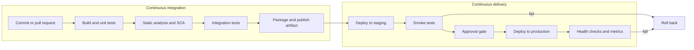

# Continuous Integration

!!! note "In simple words"
    Continuous integration means every change is merged often and checked automatically. A robot builds the code, runs the tests, and scans for problems, and it blocks the change when something fails.

Continuous integration (CI) means that every change is merged often and automatically built and tested. A CI pipeline compiles the code, runs unit and integration tests, scans for quality and security problems, and publishes artifacts. Interviewers ask about CI to see whether you can make a pipeline fast, reliable, and useful as a gate. Naming a tool is not enough.

## Why it matters

Without CI, problems surface late. Two developers merge changes that each pass on their own laptop but break together, and nobody notices until a release. A pipeline that runs on every change finds those problems within minutes, while the author still remembers the code. Good CI also makes deployment safer, because the artifact that ships has already passed every check.

## How it works

### Build automation and tests

The core of CI is a repeatable build. For a Java project, the build tool compiles the code, runs the tests, and packages the result. The same command must work on a developer's machine and on the CI runner. If it works only on one of them, the pipeline is hiding a configuration problem.

A JUnit 5 test is the typical unit of work that the pipeline runs. The example below needs the JUnit dependency on the classpath. It is a JUnit example that has not been compiled in this write-up.

```java
import static org.junit.jupiter.api.Assertions.assertEquals;

import org.junit.jupiter.api.Test;

class OrderTotalTest {

    @Test
    void sumsLineItemsWithoutDiscount() {
        int total = 300 + 250;
        assertEquals(550, total);
    }
}
```

A real test calls production code instead of repeating the arithmetic. The pipeline fails when any test fails, and that failure is what makes the pipeline a gate.

### The full pipeline at a glance

A pipeline runs cheap, fast checks first, and each stage gates the next one. The artifact is built once. Then the same artifact moves through the later stages.



Quality gates, such as a coverage threshold or a rule that no high-severity finding is allowed, sit between the stages. A failing gate stops the promotion. Secrets come from the CI system's secret store or a vault, never from the pipeline file itself.

### GitHub Actions

**GitHub Actions** defines workflows as YAML files in `.github/workflows/`. A **workflow** starts on **events**, such as `push` or `pull_request`. It runs one or more **jobs**, and each job runs **steps** on a **runner**. A runner is a hosted or self-hosted machine.

```yaml
name: ci
on:
  pull_request:
  push:
    branches: [main]

jobs:
  build:
    runs-on: ubuntu-latest
    steps:
      - uses: actions/checkout@v4
      - uses: actions/setup-java@v4
        with:
          distribution: temurin
          java-version: "21"
          cache: maven
      - run: ./mvnw -B verify
```

A step either runs a shell command with `run`, or uses a reusable **action** with `uses`. Pin each action to a version or to a commit SHA, so that a change upstream cannot silently change your pipeline.

### Jenkins

**Jenkins** is a self-hosted automation server. Pipelines are defined in a `Jenkinsfile`. The **declarative** syntax is structured and suits most teams. The **scripted** syntax is a Groovy-based DSL that allows freer control. A pipeline is organised into **stages**, and an **agent** directive chooses where the stages run.

```groovy
pipeline {
    agent { docker { image 'maven:3.9-eclipse-temurin-21' } }
    stages {
        stage('Build') {
            steps { sh 'mvn -B -q package' }
        }
        stage('Test') {
            steps { sh 'mvn -B test' }
        }
    }
}
```

### GitLab CI

**GitLab CI** reads `.gitlab-ci.yml` from the root of the repository. Jobs run on **runners**, and they are often Docker-based, so every job starts from a clean container image.

```yaml
stages: [build, test]

build:
  stage: build
  image: maven:3.9-eclipse-temurin-21
  script:
    - mvn -B -q package
  artifacts:
    paths: [target/*.jar]

test:
  stage: test
  image: maven:3.9-eclipse-temurin-21
  script:
    - mvn -B test
```

### Quality gates

A **quality gate** blocks a merge or a release when a metric falls below a threshold. Typical metrics are test coverage, code smells, duplicated code, and ratings. **SonarQube** is a common static analysis platform for this. Commercial application-security platforms provide similar gates for security findings. Choose thresholds the team can meet, and tighten them gradually.

### Security testing in the pipeline

- **SAST** (static application security testing) analyses source code without running it. It finds problems such as injection flaws and unsafe deserialization.
- **DAST** (dynamic application security testing) probes a running application from the outside, usually on a test deployment.
- **SCA** (software composition analysis) scans third-party dependencies for known vulnerabilities and licence problems.

Run SCA and SAST on every pull request, and run DAST against a deployed test environment. Map findings to the OWASP Top 10 categories where that helps. The list is updated periodically, so check the current edition.

### Artifact management

Built artifacts, such as JARs and container images, go to an **artifact repository**. The repository gives each artifact a version and acts as the single trusted source for deployment. **Nexus** and **Artifactory** are common repositories for Maven packages and container images. Deploy the same artifact to every environment instead of rebuilding it for each one, so that what was tested is what ships.

### Test layers in the pipeline

A healthy pipeline runs fast tests first and slow tests later. The shape is often described as a test pyramid:

- **Unit tests** are numerous, run in milliseconds, and need no external systems.
- **Integration tests** exercise a real database or message broker, often started in containers for the length of the run.
- **End-to-end tests** drive the deployed application. There are few of them, they are slow, and they are the most prone to flakiness.

Stop the pipeline at the first failing layer. Developers get the fastest possible answer, and the expensive stages run only for changes that passed the cheap ones.

### Speeding up pipelines

- **Cache dependencies** between runs, keyed on the build file, so downloads are skipped when nothing changed.
- **Run independent jobs in parallel**, such as unit tests and static analysis.
- **Split test suites** across several runners when one machine becomes the bottleneck.
- **Avoid rebuilding** the same artifact in every job. Build once, and pass the artifact forward.

Measure each stage's duration before you optimise. Speed matters because slow feedback pushes people toward large batches of changes.

### Pipeline as code and reuse

Keep the pipeline definition in the repository next to the code it builds. Changes to the pipeline then go through review like any other change. Shared templates, such as a GitLab CI `include` or a reusable GitHub Actions workflow, let many services use one tested definition with per-service settings.

### Reporting and notifications

Publish test reports and coverage results where developers look, usually on the pull request. Notify the author when a build fails, not on every success, so the messages stay meaningful. Move flaky tests into a separate job with a named owner, rather than letting them block everyone.

### Linux commands for deployment and maintenance

A CI/CD job often ends by running commands on a Linux server. These are the commands to know, and to use with care:

```bash
java -version                                    # confirm the runtime
systemctl status order-service                   # is the service running?
journalctl -u order-service -n 200 --no-pager    # recent service logs
ss -tlnp | grep 8080                             # which process listens on the port?
df -h && free -m                                 # disk and memory
curl -fsS http://localhost:8080/actuator/health  # health check; fails on HTTP errors
```

A deploy script should stop at the first error, keep the previous jar for rollback, and check health before it reports success:

```bash
#!/usr/bin/env bash
set -euo pipefail
NEW_JAR="$1"
APP_DIR=/opt/order-service

install -m 0644 "$NEW_JAR" "$APP_DIR/app.jar.new"
if [ -f "$APP_DIR/app.jar" ]; then
  cp -p "$APP_DIR/app.jar" "$APP_DIR/app.jar.prev"       # keep the previous version
fi
mv "$APP_DIR/app.jar.new" "$APP_DIR/app.jar"             # atomic rename on one filesystem

if ! { systemctl restart order-service && curl -fsS --max-time 5 http://localhost:8080/actuator/health > /dev/null; }; then
  echo "Health check failed, restoring the previous jar" >&2
  mv "$APP_DIR/app.jar.prev" "$APP_DIR/app.jar"
  systemctl restart order-service
  exit 1
fi
```

### Log rotation with logrotate

`logrotate` runs daily on most distributions. It rotates, compresses, and deletes old logs according to a rule file:

```
/var/log/order-service/*.log {
    daily
    rotate 14
    compress
    delaycompress
    missingok
    notifempty
    copytruncate
}
```

Use `copytruncate` only when the application cannot reopen its log file. Test a rule with `logrotate -d` (a dry run) and `logrotate -f` (force a rotation).

### Backup script idea

A nightly job dumps the database, removes dumps older than the retention period, and copies them off the server:

```bash
#!/usr/bin/env bash
set -euo pipefail
DIR=/var/backups/orders-db
STAMP=$(date +%Y%m%d-%H%M%S)
mkdir -p "$DIR"
pg_dump -h db-host -U orders -d orders -Fc -f "$DIR/orders-$STAMP.dump"   # password from ~/.pgpass
find "$DIR" -name 'orders-*.dump' -mtime +7 -delete
```

Schedule the script with cron or a systemd timer, log its output, alert on failure, and test a restore regularly. A backup that has never been restored is only a hope.

## Where it is used

- Every pull request in a service repository, as the gate before review is considered complete.
- Nightly builds of long-running suites, such as full end-to-end runs.
- Libraries published to a Maven repository after tests and signing succeed.
- Container images built and scanned before they are pushed to a registry.

## Benefits

- Problems are found within minutes, close to the change that caused them.
- A repeatable build removes "works on my machine" surprises.
- Gates make the quality standard visible and enforced.
- Artifacts are versioned, so any release can be traced back to its source.

## Cons and limits

- A pipeline is code that needs maintenance, including runners, plugins, and images.
- Slow pipelines reduce how often people push changes.
- Flaky tests erode trust. Once people re-run and ignore failures, the gate stops meaning anything.
- Security scanners report false positives, which teams must triage.
- CI proves only what the tests check. Gaps in test coverage remain gaps after the pipeline passes.
- Shell scripts on servers are hard to test and easy to drift from the pipeline. Prefer the same artifacts and tooling everywhere.
- A rollback that only swaps a jar does not undo database changes.

### Common pitfalls

- Slow pipelines that developers stop waiting for. Cache dependencies and run tests in parallel where possible.
- Flaky tests that fail at random, which teaches people to re-run and ignore failures.
- Rebuilding the artifact in each environment, so production runs something that was never tested.
- Storing secrets in the pipeline file instead of the CI secret store.
- Quality gates so strict that teams bypass them, or so loose that they never block anything.
- Running DAST against production, which can damage data.

## Best practices

- Keep the build command identical for developers and for CI.
- Fail fast: run compilation and unit tests before slow integration tests.
- Build the artifact once, sign or scan it, and promote the same version through each environment.
- Pin actions, base images, and tool versions, so the pipeline is repeatable.
- Keep secrets in the CI secret store or a vault, and give jobs only the permissions they need.
- Make quality gates strict enough to matter, and agree on how exceptions are approved.

!!! tip "Interview tip"
    **Q: What makes a CI pipeline useful?**
    It gives fast and reliable feedback on every change, and its failures block bad code. Speed, determinism, and trustworthy tests matter more than the number of checks. Build the artifact once, and promote that same artifact through the environments.

## Quick recap

- CI builds and tests every change automatically, and the build must be repeatable.
- GitHub Actions uses workflows, jobs, and steps. Jenkins uses Jenkinsfiles with stages and agents. GitLab CI uses `.gitlab-ci.yml` and runners.
- Quality gates and security scans (SAST, DAST, SCA) block bad changes.
- Publish versioned artifacts to Nexus or Artifactory, and promote the same artifact.
- Keep pipelines fast, tests reliable, and secrets in the CI secret store.

## Official documentation

- [Maven guides](https://maven.apache.org/guides/)
- [Gradle user guide](https://docs.gradle.org/current/userguide/userguide.html)
- [JUnit 5 user guide](https://junit.org/junit5/docs/current/user-guide/)
- [OWASP Top Ten](https://owasp.org/www-project-top-ten/)

**See also:** [Git Workflows](git-workflows.md), [Continuous Deployment and IaC](continuous-deployment-iac.md), [Build Tools](../05-build-tools/index.md)
