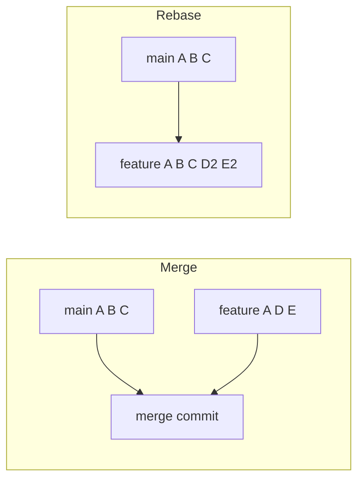

# Git: Pull, Merge, Rebase, and Renames

!!! note "In simple words"
    `fetch` downloads what others changed without touching your work. `merge` joins two lines of work and records that join. `rebase` moves your own commits to sit on top of the latest work, which makes history straight but rewrites it.

Git history is how a team understands what changed and why. Interviewers ask about `pull` versus `rebase`, and about merging versus rebasing. The choice affects the shape of the history, how conflicts are handled, and whether a force push is ever needed.

## Why it matters

Most Git problems at work come from choosing the wrong tool for the situation. A stray merge commit clutters a private branch. A rebase on a shared branch breaks teammates who built on the old commits. Knowing what each command does to the commit graph lets you pick the right one, and lets you recover when something goes wrong.

## How it works

### Everyday commands

These commands cover most daily work:

| Command | Purpose |
|---------|---------|
| `git init` | Create a new repository in the current folder |
| `git clone <url>` | Copy a remote repository, including its history |
| `git status` | Show which files are modified, staged, or untracked |
| `git add <path>` | Stage changes for the next commit |
| `git diff` | Show unstaged changes. `git diff --staged` shows staged ones. |
| `git reset` | Unstage files, or move the branch pointer to another commit |
| `git commit -m "..."` | Record staged changes as a commit |
| `git fetch` | Download remote commits and update remote-tracking branches, without changing your branch |
| `git merge <branch>` | Join another branch's history into the current branch |
| `git push` | Upload local commits to the remote |
| `git pull` | Fetch, then integrate the remote branch (a merge by default) |
| `git rebase <base>` | Replay your commits on top of another base |

`fetch` is the safe step. It changes where your remote-tracking branches point, but it does not change your working files or your branch. Most of the confusion between `pull` and `rebase` comes from forgetting that.

### Pull versus rebase

Both `git pull` and `git rebase` bring the remote's work into your local branch. They arrange the commits differently.

**`git pull`** fetches the remote and merges it into your current branch. If your branch has diverged, the result is a merge commit with two parents. That commit records where the two lines of work came together. The history keeps exactly what happened:

```bash
git pull origin main
```

**`git rebase`** does not fetch by itself. After you fetch, it sets your local commits aside, moves the branch to the updated base, and applies each commit again. The result is a straight line of history with no merge commit:

```bash
git fetch origin
git rebase origin/main
```

`git pull --rebase` combines those two steps into one command.

Guidance that matches common team practice:

- On a **shared branch** that others have already pulled, use `git pull` or a merge, so you do not rewrite history under your collaborators.
- On a **private feature branch**, rebase onto the main branch before merging, which keeps the history readable.
- Do not rebase commits that have been pushed and that other people use, because the rewritten commits get new IDs.

A fast-forward is a special case. If your branch has no commits that the remote lacks, `git pull` moves the pointer forward and creates no merge commit.

### Merging versus rebasing

Merging and rebasing both bring two lines of history together. They differ in what happens to the commits on your side.

| Aspect | `git merge` | `git rebase` |
|--------|-------------|--------------|
| History | Keeps the original branches and adds a merge commit, so the log is non-linear | Rewrites your commits on top of the base, so the log is linear |
| Commit IDs | Existing commits keep their IDs | Replayed commits get new IDs |
| Conflicts | Resolved once, in the merge commit | May be resolved once per replayed commit |
| Safety on shared branches | Safe, because history is not rewritten | Risky, because pushing rewritten commits needs a force push |
| Typical use | Integrating a shared or public branch, or keeping an exact record | Tidying a private feature branch, or keeping it current with main |



The diagram shows the shape of the result. With a merge, both branches stay visible and join at one commit. With a rebase, your commits D and E are applied again as new commits, written D2 and E2 here, on top of C.

A common follow-up question is why a rebase needs a force push. The branch now points to different commits than the remote has, so a normal push is rejected. A force push overwrites the remote, which breaks anyone who based work on the old commits. `git push --force-with-lease` is the safer form, because it refuses to overwrite commits that you have not seen.

### Renaming files

Git does not store renames as an operation. It records the old file as removed and the new file as added. It detects the rename afterwards by comparing content. That is why `git mv` is the clean approach:

```bash
git mv old_name.txt new_name.txt
git commit -m "Rename old_name.txt to new_name.txt"
```

`git mv` stages the removal and the addition together, so the commit is easy to read. If you rename in the file manager instead, stage both sides and let rename detection do its work:

```bash
git add new_name.txt
git rm old_name.txt
git commit -m "Rename old_name.txt to new_name.txt"
```

Detection uses similarity heuristics. If a rename comes with heavy edits in the same commit, Git may show a delete and an add instead. The content is still correct, but `git log --follow` becomes less useful.

### Step by step: updating a feature branch

A safe way to bring new work from `main` into a feature branch:

1. Commit or stash local changes so the working tree is clean.
2. Run `git fetch origin` to see what changed.
3. If the branch is private, run `git rebase origin/main`. Resolve conflicts commit by commit, and continue.
4. Run the tests.
5. Push with `git push --force-with-lease`, but only if the branch was already pushed and you rebased it.

On a shared branch, step 3 becomes `git merge origin/main` or `git pull`.

### Worked example: resolving a conflict during a rebase

Rebase replays one commit at a time, so a conflict can stop it several times. The loop is the same each time:

```bash
git rebase origin/main
# CONFLICT (content): Merge conflict in pricing.txt

git status                      # lists the conflicted files as "both modified"
# open pricing.txt, keep the intended text, delete the conflict markers
git add pricing.txt             # mark the file as resolved
git rebase --continue           # replay the next commit, or finish

# If the rebase is going badly, return to where the branch started:
git rebase --abort
```

Aborting is safe, because it restores the branch to its state before the rebase began. If many commits conflict, squashing the feature branch into a few commits first can reduce the number of stops.

## Where it is used

- Everyday work on feature branches, where a rebase keeps the branch current with `main`.
- Integrating a shared branch, where a merge keeps the history that others depend on.
- Code review, where a tidy linear history makes each commit easier to read.
- Incident work, where `git log --graph` shows which change merged when.

## Benefits

- `fetch` lets you inspect remote changes before they touch your branch.
- Merges preserve the true history, which is useful for audits and for shared branches.
- Rebases produce a straight history that reads well in review and in `git bisect`.
- `--force-with-lease` lets you update your own rebased branch with a safety check.

## Cons and limits

- Rebasing rewrites commit IDs, so any change to shared history affects everyone who has it.
- Merge-heavy history can be harder to read, with many small merge commits.
- Conflicts during a rebase can repeat for every replayed commit.
- Rename detection depends on similarity, so a large rewrite in the same commit can hide a rename.

### Common pitfalls

- Running `git pull` on a feature branch and getting an unwanted merge commit when a rebase was intended. Use `git pull --rebase`, or set `pull.rebase` in your configuration.
- Rebasing a branch that teammates already built on, then force-pushing and losing their commits from the remote view.
- Using plain `git push --force` instead of `--force-with-lease`.
- Resolving the same conflict many times during a long rebase. Squash commits first, or merge instead.
- Assuming `git fetch` updates your files. It only updates remote-tracking branches.
- Renaming a file and editing it heavily in one commit, then wondering why the history shows a deletion.

## Best practices

- Fetch first, then look at `git log origin/main` before you integrate.
- Rebase private branches, and merge shared ones.
- Set `pull.rebase true` if your team prefers rebase-based pulls, so the default matches your habit.
- Use `--force-with-lease` after rebasing a branch that is already pushed.
- Use `git mv` for renames, so the intent is clear in the history.
- Run the test suite after every rebase or merge that involved conflicts.

!!! tip "Interview tip"
    **Q: When would you use `git pull --rebase` instead of `git pull`?**
    When your local commits are not yet shared and you want them to sit on top of the latest remote history. It avoids a merge commit, which keeps the feature history linear. On a branch that others use, prefer a plain merge.

## Quick recap

- `fetch` updates remote-tracking branches. `pull` fetches and integrates. `rebase` replays your commits.
- A merge keeps history and adds a merge commit. A rebase rewrites your commits onto a new base.
- Do not rewrite history that others have built on.
- Use `--force-with-lease` rather than `--force` after rebasing a pushed branch.
- Use `git mv` for renames, so the intent is clear in history.

## Official documentation

- [git pull reference](https://git-scm.com/docs/git-pull)
- [git rebase reference](https://git-scm.com/docs/git-rebase)
- [Pro Git book](https://git-scm.com/book/en/v2)

**See also:** [Git Workflows](git-workflows.md), [Continuous Integration](continuous-integration.md), [SDLC and Methodologies](../foundations/sdlc-methodologies.md)
