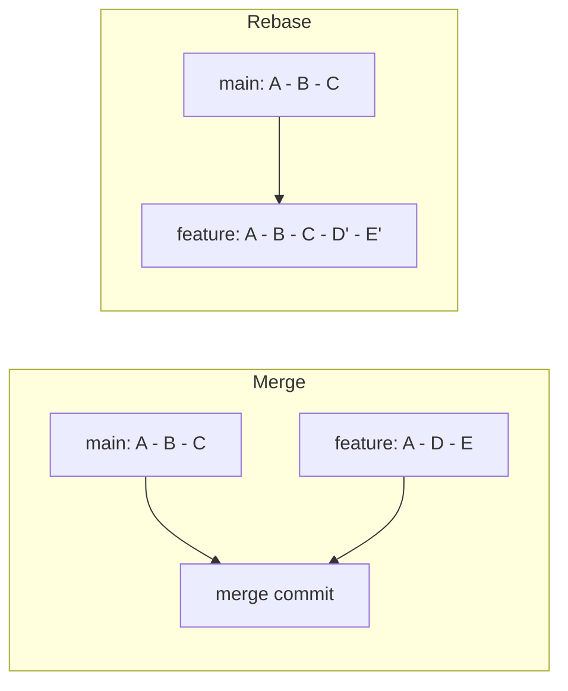

# Git: Pull, Merge, Rebase, and Renames

Git history is how a team understands what changed and why. Interviewers ask about `pull` versus `rebase`, and about merging versus rebasing, because the choice affects the shape of history, conflict handling, and whether a force push is ever needed.

## Core concepts

### Everyday commands

These commands cover most daily work. Each one is listed with its purpose.

| Command | Purpose |
|---------|---------|
| `git init` | Create a new repository in the current folder |
| `git clone <url>` | Copy a remote repository, including its history |
| `git status` | Show which files are modified, staged, or untracked |
| `git add <path>` | Stage changes for the next commit |
| `git diff` | Show unstaged changes; `git diff --staged` shows staged ones |
| `git reset` | Unstage files, or move the branch pointer to another commit |
| `git commit -m "..."` | Record staged changes as a commit |
| `git fetch` | Download remote commits and update remote-tracking branches, without changing your branch |
| `git merge <branch>` | Join another branch's history into the current branch |
| `git push` | Upload local commits to the remote |
| `git pull` | Fetch and then integrate the remote branch (merge by default) |
| `git rebase <base>` | Replay your commits on top of another base |

`fetch` is the safe step: it changes what your remote-tracking branches point to, but not your working files or your branch. Most of the confusion between `pull` and `rebase` comes from forgetting that.

### Pull versus rebase

Both `git pull` and `git rebase` bring the remote's work into your local branch, but they arrange the commits differently.

**`git pull`** fetches the remote and then merges it into your current branch. If your branch has diverged, the result is a merge commit with two parents. That commit records where the two lines of work joined. History is preserved exactly as it happened:

```bash
git pull origin main
```

**`git rebase`** does not fetch on its own. After you fetch, it takes your local commits, sets them aside, moves your branch to the updated base, and reapplies each commit. The result is a straight line of history with no merge commit:

```bash
git fetch origin
git rebase origin/main
```

`git pull --rebase` combines those two steps into one command.

Guidance that matches the common team practice:

- On a **shared branch** that others have already pulled, use `git pull` (or merge) so you do not rewrite history under collaborators.
- On a **private feature branch**, rebase onto the main branch before merging to keep the history readable.
- Do not rebase commits that have been pushed and are used by others, because the rewritten commits have new IDs.

A fast-forward is a special case: if your branch has no commits the remote lacks, `git pull` simply moves the pointer forward and creates no merge commit.

### Merging versus rebasing

Merging and rebasing both integrate two lines of history. They differ in what happens to the commits on your side.

| Aspect | `git merge` | `git rebase` |
|--------|-------------|--------------|
| History | Keeps the original branches and adds a merge commit; the log is non-linear | Rewrites your commits on top of the base; the log is linear |
| Commit IDs | Existing commits keep their IDs | Replayed commits get new IDs |
| Conflicts | Resolved once, in the merge commit | May be resolved once per replayed commit |
| Safety on shared branches | Safe; history is not rewritten | Risky; pushing rewritten commits needs a force push |
| Typical use | Integrating a shared or public branch, or keeping an exact record | Tidying a private feature branch, or keeping it current with main |



The diagram shows the shape of the result. With merge, the two branches stay visible and join at one commit. With rebase, your commits `D` and `E` are reapplied as `D'` and `E'` on top of `C`.

A common interview follow-up is "why would a rebase need a force push?" Because the branch pointer now refers to different commits than the remote has, a normal push is rejected. Force-pushing overwrites the remote, which breaks anyone who based work on the old commits. `git push --force-with-lease` is the safer form, because it refuses to overwrite commits you have not seen.

### Renaming files

Git does not store renames as an operation. It records the old file removed and the new file added, and detects a rename afterwards by comparing content. That is why `git mv` is the clean approach:

```bash
git mv old_name.txt new_name.txt
git commit -m "Rename old_name.txt to new_name.txt"
```

`git mv` stages the removal and the addition together, so the commit is easy to read. If you rename in the file manager instead, stage both sides and let detection do its work:

```bash
git add new_name.txt
git rm old_name.txt
git commit -m "Rename old_name.txt to new_name.txt"
```

Detection uses similarity heuristics. Heavy edits in the same commit as a rename can make Git show a delete and an add instead, which does not change the content but can make `git log --follow` less helpful.

## How it works / Step by step

A safe way to update a feature branch with new work from main:

1. Commit or stash local changes so the working tree is clean.
2. Run `git fetch origin` to see what changed.
3. Run `git rebase origin/main` if the branch is private; resolve conflicts commit by commit and continue.
4. Run the tests.
5. Push with `git push --force-with-lease` only if the branch was already pushed and you rebased it.

On a shared branch, step 3 becomes `git merge origin/main` or `git pull`.

## Worked example: resolving a conflict during a rebase

Rebase replays one commit at a time, so a conflict can stop it several times. The loop is the same each time:

```bash
git rebase origin/main
# CONFLICT (content): Merge conflict in pricing.txt

git status                      # lists the conflicted files as "both modified"
# open pricing.txt, keep the intended text, delete the <<<<<<< ======= >>>>>>> markers
git add pricing.txt             # mark the file as resolved
git rebase --continue           # replay the next commit, or finish

# If the rebase is going badly, go back to where the branch started:
git rebase --abort
```

Aborting is safe: it restores the branch to the state it had before the rebase began. If many commits conflict, squashing the feature branch into a few commits first can reduce the number of stops.

## Common pitfalls

- Running `git pull` on a feature branch and getting an unwanted merge commit, when a rebase was intended. Use `git pull --rebase` or set `pull.rebase` in your configuration.
- Rebasing a branch that teammates already built on, then force-pushing and losing their commits from the remote view.
- Using plain `git push --force` instead of `--force-with-lease`.
- Resolving the same conflict many times during a long rebase. Consider squashing commits first, or merging instead.
- Assuming `git fetch` updates your files. It only updates remote-tracking branches.
- Renaming a file and editing it heavily in one commit, then wondering why history looks like a deletion.

!!! tip "Interview tip"
    **Q: When would you use `git pull --rebase` instead of `git pull`?**
    When your local commits are not yet shared and you want them to sit on top of the latest remote history. It avoids a merge commit, which keeps the feature history linear. On a branch others use, prefer a plain merge.

## Quick recap

- `fetch` updates remote-tracking branches; `pull` fetches and integrates; `rebase` replays your commits.
- Merge keeps history and adds a merge commit; rebase rewrites your commits onto a new base.
- Do not rewrite history that others have built on.
- Use `--force-with-lease` rather than `--force` after rebasing a pushed branch.
- Use `git mv` for renames so the intent is clear in history.

**See also:** [Git Workflows](git-workflows.md), [Continuous Integration](continuous-integration.md), [SDLC and Methodologies](../foundations/sdlc-methodologies.md)
