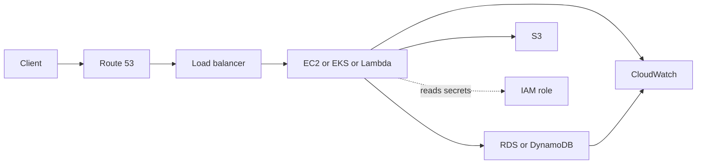
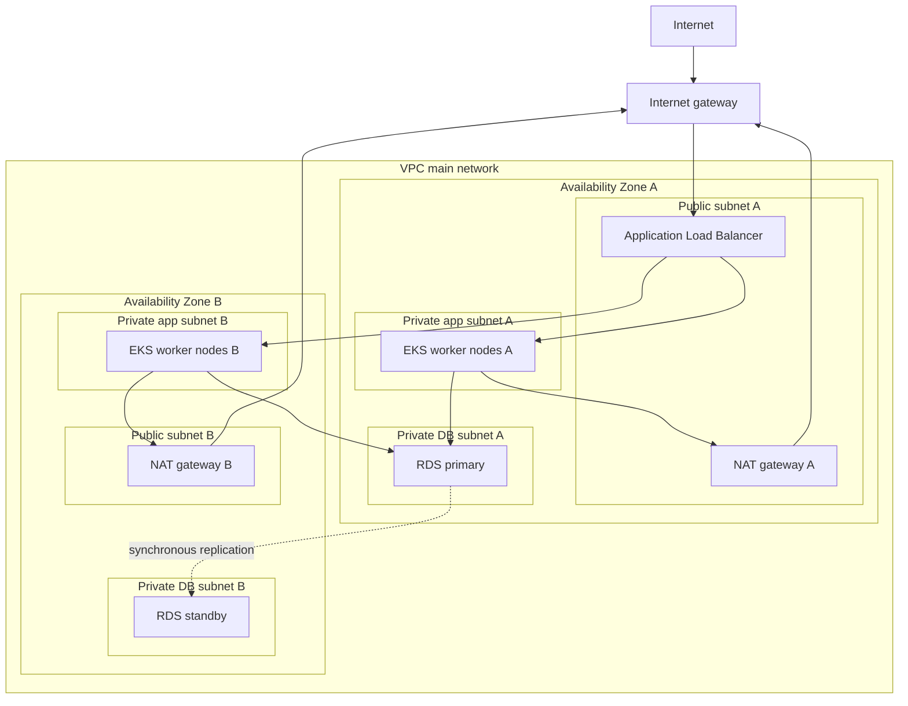

# Amazon Web Services (AWS)

!!! note "In simple words"
    Think of AWS as a catalogue of rentable parts: machines, disks, databases, networks, and access controls. You don't need every product name. Learn what each family is for and how a few of them connect to serve a web app.

AWS is the largest of the three major clouds, so interviewers often use it as the reference point. Rather than memorising the catalogue, focus on which family solves which problem, and why two services get wired together.

Coverage here is conceptual. Pricing, quotas, and regional availability change over time and depend on your account, so they are left to the official documentation.

## Why it matters

Any cloud design has to answer the same handful of questions. Where does the code run? Where does the data sit? Who may reach which component? How will you know it is healthy? AWS gives a named service for each answer. A candidate who can walk through those answers, and justify each choice, looks far stronger than one who lists products.

The model also divides responsibility. AWS runs the physical facilities and the managed-service machinery. Your network layout, your identities, and your data protection are yours to get right. Most production incidents come from the second group.

## How it works

Picture an AWS system as a stack of layers. Traffic arrives through DNS and a load balancer, runs on compute, reads and writes data, and passes through networks and identities the whole way. Monitoring and audit trails observe every layer.



### Compute

Compute services execute your code. Each option hands you a different share of the server to look after.

- **EC2** (Elastic Compute Cloud) gives you virtual servers. Each one boots from an **AMI** (Amazon Machine Image), a template that bundles the operating system and preinstalled software.
- **Elastic Beanstalk** takes a web application package and handles the instances, load balancing, and scaling around it, while the code stays yours.
- **ECS** (Elastic Container Service) is AWS's own container orchestrator.
- **EKS** (Elastic Kubernetes Service) is managed Kubernetes. AWS operates the control plane, and you operate the workloads.
- **Lambda** executes functions when events occur. There is no server for you to see.

A quick heuristic: EC2 when you need the machine itself, Elastic Beanstalk for a web app with minimal infrastructure work, ECS or EKS for containers, and Lambda for short event-driven tasks.

| Option | What you deploy | Who runs the host and runtime | Typical fit |
|---|---|---|---|
| EC2 | An instance built from an AMI | You | Full control, legacy or specialised software |
| Elastic Beanstalk | An application bundle | AWS, while you keep control of the code | Web apps that don't need deep infrastructure work |
| ECS | Containers grouped into tasks | AWS, through its own orchestrator | Containers with a simpler model than Kubernetes |
| EKS | Containers scheduled on a Kubernetes cluster | Shared | Kubernetes tooling and workload portability |
| Lambda | A function handler | AWS | Event-driven, brief, bursty work |

A sensible progression is to start with the most managed option that satisfies the requirement, and step down to less managed options only when a concrete need demands it.

### Storage

- **S3** (Simple Storage Service) holds objects, such as files and backups, in buckets. Access is over HTTP, and it does not behave like a mounted disk.
- **EBS** (Elastic Block Store) supplies block volumes that attach to a single EC2 instance, much like a physical disk.
- **EFS** (Elastic File System) offers a shared network file system that multiple instances can mount together.

Object storage fits static assets and data lakes. Block volumes fit a database that runs on one machine. Shared file storage fits content that several servers must read and write at once.

### Databases

- **RDS** (Relational Database Service) hosts managed relational engines, including MySQL, PostgreSQL, and Oracle. AWS takes care of provisioning, patching, and backups, but the schema is still your design.
- **Aurora** is an AWS-engineered relational engine that speaks the MySQL and PostgreSQL protocols.
- **DynamoDB** is a managed NoSQL key-value and document store, tuned for predictable latency when you access items by key.

### Networking

- **VPC** (Virtual Private Cloud) is a private network you define inside a Region and carve into subnets. Each subnet sits in exactly one Availability Zone.
- **Security groups** act as stateful firewalls on instances and network interfaces.
- **ALB** (Application Load Balancer) works at layer 7 for HTTP and HTTPS, and routes using host and path rules.
- **NLB** (Network Load Balancer) works at layer 4 for TCP and UDP traffic.
- **CloudFront** is a CDN that stores copies of responses at edge locations.
- **Route 53** is AWS's DNS service.

The common arrangement puts load balancers in public subnets and keeps application servers and databases in private subnets.

### Identity and access

- **IAM** (Identity and Access Management) manages users, groups, roles, and policies. A policy is a JSON document that allows or denies actions on resources.
- **KMS** (Key Management Service) creates and controls the encryption keys that other services rely on.

Least privilege is the guiding rule: give each identity only the actions it truly needs. The full access model is covered in [IAM and Security Basics](iam-and-security-basics.md).

### Monitoring, logging, and audit

- **CloudWatch** gathers metrics and logs, and fires alarms when values cross thresholds.
- **CloudTrail** keeps a record of API calls made in the account, so you can see who changed what and when.

CloudWatch tells you how the system behaves. CloudTrail tells you who touched it. For the broader signal model and how to act on it, see [Metrics](../20-observability/metrics.md) and [Alerting and Health Checks](../20-observability/alerting-health-checks.md).

### Messaging

- **SQS** (Simple Queue Service) is a managed queue that lets producers and consumers run at different speeds.
- **SNS** (Simple Notification Service) implements publish-subscribe, copying one message to many subscribers.
- **Kinesis** takes in and processes continuous streams of records with low delay.

Queues suit spreading work across workers. Pub-sub suits telling several systems about the same event. Streams suit ordered, high-throughput event data that consumers may need to read again.

### CI/CD

- **CodePipeline** coordinates the stages of a release.
- **CodeBuild** runs builds and tests on managed machines.
- **CodeDeploy** pushes releases to EC2, ECS, Lambda, and on-premises hosts, and can roll back.

Plenty of teams prefer GitHub Actions or GitLab CI for pipelines and simply deploy into AWS from there, which is a perfectly reasonable approach.

### Reliability features

- **Several Availability Zones.** A Region contains multiple isolated zones. Distributing instances and database replicas across them guards against the loss of one zone. AWS documents that each Region has at least three zones.
- **Health checks on load balancers.** Targets that fail stop receiving requests, and auto scaling can replace them.
- **Backups and snapshots.** Managed databases and block volumes can be backed up. Practise restoring as well, since an untested backup is only a hope.

Discuss these as design principles, and consult current documentation for the exact features and their limits.

### Regions, zones, and edges

A **Region** is a geographic area, and most services are bound to a single Region. Pick one based on data-residency law, distance to users, the services it offers, and cost.

Each Region contains several **Availability Zones** (AZs). A zone is a cluster of data centres with its own power, cooling, and networking. Zones connect over fast, low-latency links, so a design can survive one zone going down. **Edge locations** are far more numerous, and CloudFront uses them to serve cached copies close to users. Caching at the edge does not relocate the underlying data.

### VPC layout

A VPC is assigned an address range in CIDR notation, for example a `/16` block, and that range is split into subnets. A subnet never spans two zones.



Reading the diagram from the outside in:

- A **public subnet** routes to an **internet gateway**. The load balancer sits there so that outside clients can reach it.
- A **private subnet** has no inbound route from the internet. Outbound calls leave through a **NAT gateway** that lives in a public subnet. Nodes can therefore fetch images and call external APIs, while nothing outside can open a connection to them.
- The **EKS worker nodes** run pods inside private subnets. The control plane belongs to AWS and is not placed inside your subnets.
- **RDS** sits in a DB subnet group made of private subnets. With Multi-AZ, a standby copy is kept in the second zone.

Route tables decide where traffic goes. The `local` entry keeps traffic inside the VPC. A `0.0.0.0/0` entry that points at the internet gateway is what makes a subnet public.

```
Destination     Target
10.0.0.0/16     local
0.0.0.0/0       igw-<id>
```

Two further networking facts matter in interviews:

- **VPC peering** links two VPCs privately. Their address ranges must not overlap, and the link does not pass traffic onward. If A peers with B and B peers with C, A has no route to C through B.
- **Network ACLs** are stateless filters at the subnet boundary. They support both allow and deny rules. Security groups are stateful and attach to instances, and most designs depend on them.

| Attribute | Security group | Network ACL |
|---|---|---|
| Where it applies | Instances and network interfaces | Whole subnets |
| Kinds of rule | Allow only | Allow and deny, checked in order |
| Return traffic | Permitted automatically (stateful) | Needs an explicit rule (stateless) |

Good designs refer to other security groups rather than to IP ranges. A database group might accept the database port only from the application group.

### Scaling compute

An Auto Scaling group keeps a fleet of EC2 instances between a minimum and a maximum size, and moves the desired count inside that window. **Target tracking** policies try to hold a metric, such as average CPU utilisation, close to a target value.

Scaling works best when the instances are stateless, sit behind a load balancer, and are checked by health probes that replace broken members. Set the cooldown from the real boot time of the application. Scale in too slowly and you pay for idle capacity. Scale in too eagerly and you cause churn.

### Managed databases: RDS and DynamoDB

RDS offers three availability patterns:

- **Single-AZ**: one instance, and no automatic failover.
- **Multi-AZ**: a standby in another zone takes over automatically when the primary fails. The standby exists for resilience, not for serving reads.
- **Read replicas**: asynchronous copies that take read load away from the primary. Because replication lags, a replica can return data that is a little stale.

Automated backups can be retained for up to 35 days, and manual snapshots plus point-in-time restore work within that window. Data is encrypted at rest with KMS, and clients typically connect over TLS. Keep the instance in private subnets, limit it with security groups, and where the engine supports it use IAM database authentication, so that no static password is kept in code. The price of managed hosting is less access to the operating system and to some engine parameters.

DynamoDB stores items in tables. Every item carries a partition key and, optionally, a sort key. Lookups by key are fast and steady. A `Scan` reads the entire table, so its cost climbs as the table gets larger.

- **Capacity modes.** On-demand billing charges per request, which suits spiky or unknown traffic. Provisioned mode charges for read and write capacity you reserve. One read capacity unit covers a strongly consistent read of up to 4 KB. One write capacity unit covers a write of up to 1 KB.
- **Reads.** Prefer `Query` with the partition key, optionally narrowed by a sort-key condition. Keep `Scan` for rare full-table jobs.
- **Global tables** copy a table across Regions, so each Region reads and writes locally, and the copies converge eventually.
- **TTL** removes items once a Unix epoch timestamp, stored in a chosen attribute, passes. Removal happens in the background and may be late, so filter expired items in queries when that matters.

A library example using the AWS SDK for Java v2 `dynamodb` module. It is not compiled here:

```java
import java.time.Instant;
import java.util.Map;
import software.amazon.awssdk.services.dynamodb.DynamoDbClient;
import software.amazon.awssdk.services.dynamodb.model.AttributeValue;
import software.amazon.awssdk.services.dynamodb.model.PutItemRequest;
import software.amazon.awssdk.services.dynamodb.model.QueryRequest;

public class SessionStore {

    public static void main(String[] args) {
        try (DynamoDbClient ddb = DynamoDbClient.create()) {
            long expiresAt = Instant.now().plusSeconds(86_400).getEpochSecond();
            ddb.putItem(PutItemRequest.builder()
                .tableName("sessions")
                .item(Map.of(
                    "userId", AttributeValue.fromS("12345"),
                    "sessionId", AttributeValue.fromS("abc"),
                    "expiresAt", AttributeValue.fromN(String.valueOf(expiresAt))))
                .build());

            ddb.query(QueryRequest.builder()
                .tableName("sessions")
                .keyConditionExpression("userId = :uid")
                .expressionAttributeValues(Map.of(":uid", AttributeValue.fromS("12345")))
                .build());
        }
    }
}
```

### Pod identity on EKS

A pod that calls AWS should obtain a role, never a stored access key. Two mechanisms do this:

- **IRSA** (IAM Roles for Service Accounts) relies on the cluster's OIDC identity provider. The service account carries a role ARN annotation, and the pod receives temporary credentials through `sts:AssumeRoleWithWebIdentity`.
- **EKS Pod Identity** is a newer mechanism that links a service account to a role through an agent that EKS manages. Check the current EKS guide for the setup that fits your cluster.

The IRSA trust policy below lets exactly one service account in one namespace assume the role:

```json
{
  "Effect": "Allow",
  "Principal": {
    "Federated": "arn:aws:iam::111122223333:oidc-provider/oidc.eks.eu-west-1.amazonaws.com/id/EXAMPLED539D4633E53DE1B71EXAMPLE"
  },
  "Action": "sts:AssumeRoleWithWebIdentity",
  "Condition": {
    "StringEquals": {
      "oidc.eks.eu-west-1.amazonaws.com/id/EXAMPLED539D4633E53DE1B71EXAMPLE:sub": "system:serviceaccount:orders:order-service",
      "oidc.eks.eu-west-1.amazonaws.com/id/EXAMPLED539D4633E53DE1B71EXAMPLE:aud": "sts.amazonaws.com"
    }
  }
}
```

The service account holds the annotation, and a pod that names it inherits the role:

```yaml
apiVersion: v1
kind: ServiceAccount
metadata:
  name: order-service
  namespace: orders
  annotations:
    eks.amazonaws.com/role-arn: arn:aws:iam::111122223333:role/order-service-role
```

With `serviceAccountName: order-service` in the pod spec, the EKS webhook adds `AWS_ROLE_ARN` and `AWS_WEB_IDENTITY_TOKEN_FILE` to the container. The SDK's default credential chain performs the token exchange, so application code builds clients without any key material.

### Infrastructure as code

CloudFormation and Terraform can both declare these resources. CloudFormation is built into AWS, while Terraform spans several providers. Store templates in version control, read the plan before applying, and resist manual console edits, since those cause drift from the code.

### Secrets and configuration

Put database passwords and API keys in a managed secrets store. Grant the application's role read access to the specific secrets it needs. Fetch values at runtime instead of baking them into environment files. Rotate on a schedule, and make the application pick up new values without a crash.

### Edge and supporting services

- **CloudFront** serves cached content from edge sites. Origins can be S3 buckets or load balancers, and AWS Shield Standard is included at no extra charge.
- **ElastiCache** runs managed Redis or Memcached. It offloads the database and holds sessions and short-lived values. The Redis side is covered in [Redis Advanced Patterns](../12-caching-performance/redis-advanced-patterns.md).
- **AWS X-Ray** follows a request across services, revealing where time is spent.

### A three-tier request, end to end

1. A Route 53 record maps the domain name to the load balancer.
2. The load balancer, which lives in public subnets, passes each request to a pod or instance in a private subnet.
3. The application reads and writes RDS inside private subnets, and stores uploaded files in S3.
4. The application's IAM role limits it to the permissions it needs, and no keys are stored anywhere.
5. CloudWatch receives logs and metrics, and CloudTrail records the API calls.

## Where it is used

- Web applications and APIs that pair a load balancer with a managed database and horizontal scaling.
- Container platforms on EKS or ECS, where workloads need AWS identities and private networking.
- Event-driven processing built from Lambda, SQS, SNS, and EventBridge.
- Storage and archives on S3, with lifecycle rules that shift old objects into cheaper classes.
- Batch and worker fleets that run on Spot capacity for work that can be interrupted.

## Benefits

- **Managed services** absorb much of the patching, backup, and failover effort.
- **Breadth.** One provider covers compute, storage, messaging, and monitoring, so there is no second vendor to integrate.
- **Multiple zones and Regions** make high availability and disaster recovery achievable.
- **Fine-grained identity** through roles and policies keeps access auditable.
- **Flexible billing.** Pay-as-you-go combined with commitment discounts lets cost track demand.

## Cons and limits

- **Many overlapping services.** Some products do similar jobs, and a weak choice is awkward to reverse later.
- **Surprise bills** arise from resources left running after a test, and from cross-zone or cross-Region data transfer.
- **Lock-in grows** with proprietary services such as DynamoDB and Lambda event integrations.
- **Shared responsibility** means AWS protects the platform, while public buckets, open security groups, and broad roles stay on your side.
- **Quotas** are applied per account and per Region, and a limit can block a launch at a bad moment.

The three main cost levers are commitment discounts for steady load, Spot capacity for interruptible batch work, and right-sizing with cleanup. The actual rates change, so check current pricing before you decide. Consistent tags such as `owner`, `environment`, and `cost-centre` show who owns each resource and where its spend lands. Billing alerts give you early warning.

## Best practices

- Choose the most managed service that meets the requirement, and justify every step toward less managed options.
- Place load balancers in public subnets, and everything else in private subnets.
- Keep databases out of public subnets, and limit them with security groups that name the application group.
- Authenticate workloads with roles, and keep long-lived access keys out of code and pipelines.
- Expose ports only to the narrowest source that works. Never open port 22 to `0.0.0.0/0` for convenience.
- Spread workloads and database replicas over at least two zones.
- Use a separate account for each environment or team, so that permissions and billing boundaries follow the organisation.
- Describe infrastructure as code, review changes, and avoid untracked console edits.

## Common pitfalls

- Opening security groups to everyone for convenience, such as port 22 to the world.
- Hard-coding long-lived access keys in code or pipelines instead of using roles.
- Mistaking S3 object storage for a mountable file system.
- Placing databases in public subnets.
- Forgetting to delete test resources, so the bill keeps growing unnoticed.
- Picking Lambda for long-running, steady workloads that a container would serve more cheaply.

!!! tip "Interview tip"
    **Q: How would you deploy a web app with a database on AWS?**
    Walk through the layers: a load balancer in public subnets, application compute in private subnets, a database in private subnets behind restrictive security groups, secrets from a secrets service or IAM roles, and CloudWatch for monitoring. Justify the compute choice: EC2 for control, ECS or EKS for containers, Lambda for events.

!!! tip "Interview tip"
    **Q: How does a pod get AWS permissions without credentials?**
    The pod presents a token signed by Kubernetes. AWS STS checks that token against the cluster's OIDC provider and the `sub` condition in the trust policy, then returns temporary credentials for the role. Keep the `sub` condition specific, and grant the role only what the workload needs.

## Quick recap

- Compute spans EC2 (full control) through Lambda (no visible servers), with containers on ECS or EKS.
- S3 is object storage, EBS is block storage, and EFS is shared file storage.
- RDS covers managed relational workloads, and DynamoDB covers key-based workloads.
- VPC subnets, security groups, and load balancers shape network reach, and IAM roles establish identity.
- CloudWatch observes the system, and CloudTrail audits it.

## Official documentation

- [IAM User Guide: introduction](https://docs.aws.amazon.com/IAM/latest/UserGuide/introduction.html)
- [Amazon EKS User Guide](https://docs.aws.amazon.com/eks/latest/userguide/what-is-eks.html)
- [Amazon S3 User Guide](https://docs.aws.amazon.com/AmazonS3/latest/userguide/Welcome.html)
- [Amazon VPC User Guide](https://docs.aws.amazon.com/vpc/latest/userguide/what-is-amazon-vpc.html)

**See also:** [Microsoft Azure](azure.md), [Google Cloud Platform](gcp.md), [Multi-Cloud Considerations](multi-cloud.md), [Compute and Storage on AWS](compute-and-storage.md), [IAM and Security Basics](iam-and-security-basics.md), [Continuous Deployment and IaC](../17-cicd/continuous-deployment-iac.md)
