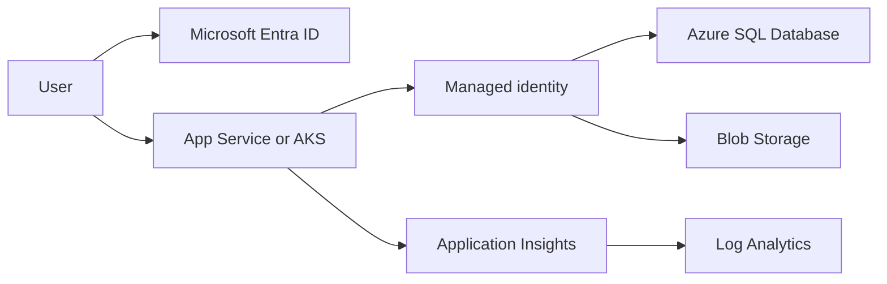

# Microsoft Azure

!!! note "In simple words"
    Azure supplies the same kinds of building blocks as AWS and Google Cloud, just with different names. The practical skill is matching each job to the right Azure service, and letting a service prove its identity without a password stored in its settings.

Azure arranges its services into the same broad families used by the other clouds, though the names and the boundaries between services differ. Interviewers frequently ask how a Java application would run on Azure. The answer depends on knowing which service covers each family and how identity flows through Microsoft Entra ID.

This page covers service families and their purpose. Pricing, quotas, and regional availability are left to Microsoft's documentation.

## Why it matters

A Java team on Azure has to choose where the application runs, which database holds its data, where files go, how users sign in, and how failures get noticed. Every choice shapes operational load and security. Azure's identity model also differs from AWS IAM, so copying a policy from one cloud to the other is a common mistake. Understanding the model lets you reason about trade-offs instead of guessing.

## How it works

A Spring Boot service on Azure typically runs on App Service or AKS, reaches its data through a managed identity, and reports telemetry to Application Insights. The diagram traces both the user's path and the workload's identity path.



### Compute

- **Virtual Machines** offer complete control of the operating system, which parallels EC2.
- **App Service** runs web apps and APIs. Azure looks after the operating system and the runtime, and Java is supported directly, so Spring Boot services fit well.
- **Container Instances** start one container without any orchestrator, which suits small or short-lived jobs.
- **AKS** (Azure Kubernetes Service) is managed Kubernetes. Azure runs the control plane, while your team operates the workloads on top.

As a rule of thumb, App Service suits a web API that should need little infrastructure attention. AKS suits a platform that hosts many microservices. Virtual Machines suit cases where the whole machine must be controlled.

| Option | What you deploy | Who runs the host and runtime | Typical fit |
|---|---|---|---|
| Virtual Machines | An OS image plus everything installed on it | You | Full control, legacy software |
| App Service | A packaged web app or API | Azure | APIs that need minimal infrastructure work |
| Container Instances | One container | Azure | Simple or short-lived container jobs |
| AKS | Containers scheduled on a Kubernetes cluster | Shared | Many services, Kubernetes-native tooling |

The decision mostly comes down to how much operations work the team is willing to own. App Service is often the first home for a Spring Boot API. AKS earns its extra overhead once a platform runs numerous services.

### Data

- **Azure SQL Database** is a managed relational database built on the SQL Server engine.
- **Cosmos DB** is a multi-model NoSQL store with global distribution and a choice of consistency levels.
- **Blob Storage** keeps unstructured objects, such as files, backups, and logs.

| Requirement | Service |
|---|---|
| A managed relational store on the SQL Server engine | Azure SQL Database |
| Worldwide NoSQL with adjustable consistency | Cosmos DB |
| Files, backups, and logs stored as objects | Blob Storage |

The partition key you pick for Cosmos DB has the largest effect on scale and cost, so derive it from how the data is read and written. The consistency levels deserve study too, because each one trades read freshness against latency and availability.

### Networking

- **Virtual networks** (VNets) form the isolated boundary, split into subnets. They are Azure's counterpart to a VPC.
- **Network security groups** filter traffic that reaches subnets and network interfaces, much like AWS security groups.
- **Application Gateway** is a layer 7 load balancer for HTTP and HTTPS, and it can include a web application firewall.
- **Azure Front Door** handles global HTTP routing and content delivery. Azure has revised its CDN lineup more than once, so confirm current guidance before choosing one.

Keep databases and storage off the public internet wherever the application does not need that exposure. **Private endpoints** assign a service a private address inside a VNet. When paired with network security group rules that admit only the application subnet, this sharply reduces the attack surface. Support for private endpoints varies by service, so verify the list before you rely on it.

### Identity

- **Microsoft Entra ID** is the cloud identity platform. It used to be called Azure Active Directory (Azure AD). Applications sign people in through OAuth 2.0 and OpenID Connect against it.
- **Managed identities** attach an identity to an Azure resource without any secret to store. An App Service instance can read Blob Storage or Key Vault using its own identity.
- **Role assignments** give an identity rights on a resource, for instance read access to a single storage container.

Two separate layers apply, and each answers a different question:

- **Who is the user?** Entra ID authenticates people and applications and issues tokens. A Spring Boot resource server checks those tokens through Spring Security's OAuth 2.0 support.
- **What may the workload reach?** Role assignments define what a managed identity can do to a given resource.

Holding a valid user token does not open every Azure resource. Keep the two layers apart when you review a design.

Managed identities let you drop credentials from configuration, and that is the pattern to aim for. The example below is a library example. It needs `azure-identity` and `azure-core` on the classpath, and Reactor too, because the token call returns a reactive type. It is not compiled here:

```java
import com.azure.core.credential.AccessToken;
import com.azure.core.credential.TokenRequestContext;
import com.azure.identity.DefaultAzureCredentialBuilder;

public class ManagedIdentityTokenExample {

    public static void main(String[] args) {
        // Uses the managed identity when running in Azure, or developer credentials locally
        var credential = new DefaultAzureCredentialBuilder().build();
        var request = new TokenRequestContext().addScopes("https://management.azure.com/.default");

        AccessToken token = credential.getToken(request).block();
        System.out.println("Token expires at " + token.getExpiresAt());
    }
}
```

The example demonstrates the credential-chain approach. It deliberately does not print the token, since a token is a secret.

### DevOps

- **Azure DevOps** bundles source repositories, work tracking, and pipelines.
- **Azure Pipelines** executes YAML-defined CI and CD pipelines, and it can deploy to App Service, AKS, and other targets.

Azure Pipelines and GitHub Actions overlap considerably, and both are able to deploy to Azure.

### Monitoring

- **Application Insights** records requests, outbound dependency calls, exceptions, and trace messages. For Java it is often attached as an agent, so the code does not change.
- **Log Analytics** holds logs in a workspace, which you query with the Kusto Query Language (KQL).

Application Insights can trace one slow request through every service it touched. Log Analytics answers questions like "which endpoint produced the most errors in the past hour?" Dashboards and alerts built on error rate and latency turn that data into a response. For the general method, see [Metrics](../20-observability/metrics.md) and [Distributed Tracing](../20-observability/distributed-tracing.md).

### Messaging and events

- **Service Bus** offers queues and topics with subscriptions, meant for dependable messaging between services. Its role resembles SQS together with SNS.
- **Event Hubs** absorbs very large volumes of streamed events, similar to Kinesis.
- **Event Grid** delivers individual events, such as a resource change or a blob upload, to registered handlers.

In an interview, separate three ideas: a queue carries work that must be done, a stream carries ordered events that consumers can replay, and an event router reacts to something that has already happened.

### Scaling a Java service

App Service and AKS can both add instances. Scaling rules generally watch a metric such as CPU or queue length, and you set minimum and maximum instance counts as safety limits. The application should be stateless, so that any instance can handle any request. Session data belongs in a shared store.

### Configuration and environments

Give each environment its own resource group or subscription. That keeps access and cost apart, and stops a mistake in one environment from reaching another. Environment-specific values belong in application settings or a configuration store. Build the artifact once and promote that same artifact through every environment. Declaring infrastructure with Bicep, Terraform, or another IaC tool keeps environments comparable.

### Deployment checklist for a Java service

- Use a managed identity for database and storage access, not connection-string passwords.
- Keep runtime choices such as the active Spring profile in application settings, and keep secrets in a key vault.
- Switch on Application Insights from day one, so failures and slow dependencies are visible early.
- Run deployments through a pipeline (Azure Pipelines or GitHub Actions) that builds the artifact once.
- Plan the rollback before the release, such as redeploying the previous package or using deployment slots where the plan supports them.

### A typical Spring Boot flow

1. The application runs on App Service or AKS.
2. Users sign in against Microsoft Entra ID.
3. The service reaches Azure SQL Database or Cosmos DB through its managed identity, with no stored password.
4. Application Insights captures requests and failures, and Log Analytics retains the logs for querying.
5. Azure Pipelines builds the artifact and deploys it to the chosen environment.

## Where it is used

- Enterprises that already run on Microsoft identity and Microsoft 365.
- Spring Boot APIs hosted on App Service, reaching data through managed identities.
- Microservice platforms on AKS, monitored with Application Insights across services.
- Event-driven integration built on Service Bus, Event Hubs, and Event Grid.

## Benefits

- **Strong identity integration**, particularly for organisations that already use Entra ID.
- **A range of hosting options**, from App Service to AKS, so a team can start small and grow.
- **Secrets-free access** to data stores through managed identities.
- **Built-in observability** with Application Insights and Log Analytics.

## Cons and limits

- **Frequent renaming.** Products are rebranded and reorganised, so older guides can mislead.
- **Entra ID is not the same thing as on-premises Active Directory.** The two are separate products, even though they can be connected.
- **AKS brings operational weight** that a single API would not need on App Service.
- **Cosmos DB behaviour depends on its keys.** A poor partition key or consistency choice is costly to undo.
- **Private connectivity varies** by service, so it needs planning per resource.

## Best practices

- Pick the least demanding host that meets the need, and adopt AKS only when many services require it.
- Use managed identities and role assignments whenever one Azure resource calls another.
- Review the user-identity layer and the workload-identity layer separately.
- Turn on Application Insights, set alerts on error rate and latency, and write a runbook for failed deployments.
- Apply private endpoints to any database or storage account that should stay private.
- Separate environments by resource group or subscription, and build the artifact once.

## Common pitfalls

- Equating Entra ID with on-premises Active Directory.
- Keeping connection strings with passwords in App Service settings where a managed identity would do.
- Adopting Cosmos DB without understanding its partitioning and consistency options.
- Following a CDN recommendation from an older article without checking it is still current.
- Choosing AKS when App Service would have covered the requirement.

!!! tip "Interview tip"
    **Q: How does a service on Azure reach a database without a password in its configuration?**
    Attach a managed identity to the service, grant that identity a role on the database, and have the application request a token at runtime through the Azure Identity library. The credential never appears in code or configuration.

## Quick recap

- Virtual Machines, App Service, Container Instances, and AKS range from full control to ease of use.
- Azure SQL Database, Cosmos DB, and Blob Storage handle relational, global NoSQL, and object data.
- Microsoft Entra ID (formerly Azure AD) manages identity, and managed identities remove stored secrets.
- Application Insights and Log Analytics supply telemetry and queryable logs.
- Azure Pipelines delivers YAML-based CI and CD.

## Official documentation

- [Azure App Service overview](https://learn.microsoft.com/en-us/azure/app-service/overview)
- [What is Microsoft Entra ID](https://learn.microsoft.com/en-us/entra/fundamentals/what-is-entra)
- [Managed identities for Azure resources](https://learn.microsoft.com/en-us/entra/identity/managed-identities-azure-resources/overview)
- [Azure Private Link private endpoints](https://learn.microsoft.com/en-us/azure/private-link/private-endpoint-overview)

**See also:** [Amazon Web Services](aws.md), [Google Cloud Platform](gcp.md), [Multi-Cloud Considerations](multi-cloud.md), [Git Workflows](../17-cicd/git-workflows.md)
