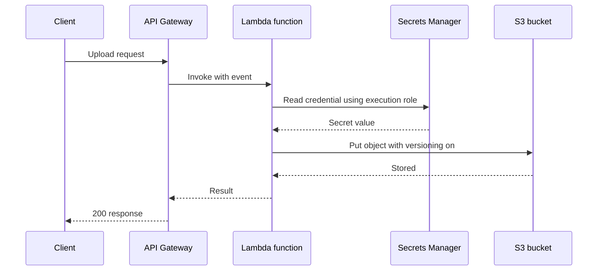

# Compute and Storage on AWS: EC2, Lambda, and S3

!!! note "In simple words"
    EC2 is a computer you rent and fully control. Lambda runs your code only when something triggers it, and you never touch a server. S3 keeps files under a name you choose, reachable over the network. It is not a disk you can mount.

Compute and storage decide most early AWS designs: which machine runs the code, how it is started and reached, and where the data lives. This page goes deeper into three services: EC2 for virtual servers, Lambda for event-driven functions, and S3 for object storage. The map of every service family appears in [AWS](aws.md).

## Why it matters

Each application needs somewhere to execute and somewhere to keep its data. A poor choice costs money, slows releases, or loses information. An EC2 instance that is stopped may lose whatever sat on its local disk. A Lambda function asked to do long work will be cut off at its time limit. An S3 bucket accidentally opened to the public can expose customer files. Understanding these limits is the difference between a sound design and a fragile one.

## How it works

A common event-driven flow touches all three services. An API route triggers a function, the function fetches a secret, stores a file in S3, and records what happened. The sequence diagram shows the order of those calls.



### EC2 virtual servers

Amazon EC2 (Elastic Compute Cloud) leases virtual servers called instances. You pick the CPU, memory, storage, and networking. Each instance boots from an **AMI** (Amazon Machine Image), a bundle of operating system, software, and default settings. The AMI can be one published by AWS, one from the community, or one you assembled with your application already in place.

Two storage types can attach to an instance:

- **EBS** (Elastic Block Store) volumes behave like network disks, and their contents survive a stop.
- **Instance store** is physical disk attached to the host. It is quick, but anything on it disappears when the instance stops or its host fails.

Anything that has to outlive the instance belongs on EBS or in S3, never only on instance store.

### Instance families

Instance families are named after their emphasis. The letter at the front hints at the purpose, and a trailing `g` (as in `m7g`) means the instance runs on Arm-based Graviton processors.

| Family | Emphasis | Common workloads |
|---|---|---|
| T | Burstable CPU that builds up credits when idle | Small web servers, development and test |
| M | Even mix of CPU and memory | General application servers, mid-size databases |
| C | Maximum compute for the price | Batch jobs, CPU-heavy services |
| R, X, Z | Large memory | In-memory databases, caches, analytics |
| I, D, H | Fast local storage | Data warehouses, databases on local disks |
| P, G, Inf, Trn | Accelerators: GPUs, Inferentia, Trainium | Machine learning training and inference, graphics |
| Hpc | Tightly coupled high-performance computing | Simulations, large numerical models |

Select a family from the workload's CPU, memory, storage, and network profile, along with its performance target and budget. Benchmark under realistic load before you settle.

### Purchasing options

| Option | Commitment | Best suited to |
|---|---|---|
| On-Demand | None; billed for the time running | Unpredictable or short-lived work |
| Savings Plans | A steady hourly spend over one or three years | Steady use spread across instance types |
| Reserved Instances | A fixed configuration over one or three years | Predictable use of a single configuration |
| Spot Instances | None; spare capacity that AWS may reclaim after a brief warning | Interruptible batch processing, stateless workers |
| Dedicated Hosts | A whole physical server for you | Per-socket or per-core licensing, compliance rules |
| Dedicated Instances | Single-tenant hardware, billed hourly | Isolation without managing a complete host |
| Capacity Reservations | Guaranteed room in one Availability Zone | Making sure launches succeed at a known time |

Savings Plans and Reserved Instances reduce the price but also reduce flexibility. Commit only to the baseline you are sure of, and run the rest On-Demand. Confirm the current rates before committing.

### User data

User data is a script or directive set handed to an instance when it launches. It executes on first boot, as root on Linux or as Administrator on Windows. Typical uses are installing packages, writing configuration files, starting services, and reading instance metadata such as the instance ID or tags.

- **Never store secrets there.** Anyone able to read the instance metadata or the console can view user data. Pull credentials from Secrets Manager or Parameter Store at runtime, through the instance role.
- **Write it to be safely re-runnable.** A script that could execute twice must not fail on its second pass.
- **Check the logs.** On Linux, cloud-init records its activity under `/var/log`. Start there when an instance is misconfigured.
- **Mind the size cap.** Raw user data is capped at 16 KB. For bigger setups, use a configuration management tool, or bake the software into the AMI.

### Security groups for EC2

A security group is a stateful firewall attached to instances or network interfaces, with allow rules for inbound and outbound traffic. Every rule specifies a protocol, a port or port range, and a source (inbound) or destination (outbound). That endpoint can be an IP range, a CIDR block, or another security group.

Behaviour worth remembering:

- A freshly created custom group permits no inbound traffic and all outbound traffic. Replies to permitted inbound connections are allowed automatically, because the group tracks state.
- A security group belongs to one Region and one VPC, and a single group can be shared by many instances.
- A **timeout** typically means a security group is dropping the packets. A **connection refused** typically means nothing is listening on that port. Treat them as different problems.
- Maintain a dedicated group for administrative access, and do not run active resources in the default group.

Limit every rule to the narrowest source that serves the purpose. Pointing a rule at "the web tier group" beats exposing a port to `0.0.0.0/0`. Periodically prune rules and groups that nothing uses.

| Port | Protocol | Use |
|---|---|---|
| 21 | FTP | File transfer without encryption; prefer SFTP or FTPS |
| 22 | SSH | Encrypted remote shell |
| 23 | Telnet | Legacy remote shell with no encryption; avoid |
| 25 | SMTP | Mail relay between servers |
| 53 | DNS | Name lookups |
| 80 | HTTP | Plain web traffic |
| 443 | HTTPS | Encrypted web traffic |

### Connecting to an instance

There are four usual ways to open a shell on an instance:

1. **SSH with a key pair.** Easy and broadly supported. You own the private key, and SSH produces no built-in session audit.
2. **EC2 Instance Connect.** AWS places a short-lived public key on the instance, and you connect over SSH. Key handling becomes simpler, and the key is no longer a standing secret.
3. **Systems Manager Session Manager.** Requires the SSM Agent and suitable IAM permissions. It opens no inbound port and needs no key, and sessions can be recorded. Confirm in current documentation which traffic is logged.
4. **EC2 Serial Console.** A low-level console for boot and networking faults, reached from the EC2 console. Its connections are limited, so keep it for recovery.

For routine access, Session Manager is the better choice, since it removes the need for open inbound ports.

### Lambda functions

AWS Lambda executes functions without any server provisioning on your side. You upload code, select a runtime and memory size, and Lambda runs the code whenever an event occurs. Common triggers include S3 uploads, DynamoDB streams, API Gateway requests, SQS messages, Kinesis records, EventBridge schedules, and SNS notifications. The [Lambda developer guide](https://docs.aws.amazon.com/lambda/latest/dg/welcome.html) is the authoritative reference.

Key characteristics:

- **Scaling is automatic.** Lambda starts as many concurrent executions as the event rate demands, subject to account concurrency limits.
- **Billing** combines the request count with compute duration, metered in 1 ms steps and scaled by the configured memory.
- **Timeouts.** The default is 3 seconds and the ceiling is 15 minutes. Anything longer will not fit.
- **Cold starts** occur when a fresh execution environment is initialised. Shrink dependencies, avoid heavyweight framework boot, and consider provisioned concurrency on latency-sensitive paths. Java cold starts run longer than those of Node.js or Python, so measure before deciding.
- **VPC attachment** gives access to private resources such as RDS, at the cost of extra start-up time. Attach a function to a VPC only when it truly needs one.

A small Java handler. It requires the `aws-lambda-java-core` library, so it is a library example and is not compiled here:

```java
import com.amazonaws.services.lambda.runtime.Context;
import com.amazonaws.services.lambda.runtime.RequestHandler;
import java.util.Map;

public class OrderEventHandler implements RequestHandler<Map<String, Object>, String> {

    @Override
    public String handleRequest(Map<String, Object> event, Context context) {
        context.getLogger().log("Request " + context.getAwsRequestId() + " received");
        Object orderId = event.getOrDefault("orderId", "unknown");
        return "processed " + orderId;
    }
}
```

Keep the handler slim, and place the logic in ordinary classes that tests can exercise without Lambda. Secrets belong in Secrets Manager or Parameter Store. Environment variables are a poor home, because anyone who can read the function configuration can see them.

### S3 object storage

S3 (Simple Storage Service) holds **objects**, meaning a file plus its metadata, inside **buckets**. Bucket names are unique across all of AWS, and a bucket resides in a single Region. Each object is addressed by its **key**, the complete path string.

S3 is not a file system. It has no true directories. A "folder" is simply a shared prefix in the key. This shows up when you rename: changing a prefix means copying and deleting every object beneath it.

Features worth knowing:

- **Versioning** preserves earlier versions of each object, guarding against accidental overwrites and deletions.
- **Lifecycle rules** shift objects into cheaper storage tiers, or delete them, once they reach a certain age.
- **Replication** copies objects into another bucket in the same or a different Region, for resilience or compliance.

Storage tiers trade price against how quickly data can be retrieved:

| Tier | Relative price | Retrieval speed | Use |
|---|---|---|---|
| S3 Standard | Highest storage price | Immediate | Data read often |
| S3 Intelligent-Tiering | Varies | Immediate | Access patterns you can't forecast |
| S3 Standard-IA | Lower storage price | Immediate, with a retrieval charge | Data read rarely |
| S3 Glacier tiers | Low | Minutes to hours | Archives and backups |
| S3 Glacier Deep Archive | Lowest | Typically 12 hours or more | Long-term retention |

### Access control and encryption

- **Block Public Access** is enabled by default for new buckets. Leave it on unless a bucket must serve anonymous visitors, such as a static site fronted by a CDN.
- **Bucket policies** and **IAM policies** control access. Prefer them to per-object ACLs, which AWS now disables by default on new buckets.
- **Pre-signed URLs** give time-limited access to a single private object.
- Stored objects are encrypted automatically with server-side encryption. For audit and key control, select SSE-KMS with a customer-managed key. A bucket policy can demand HTTPS on every request.
- **MFA Delete** can require MFA before object versions are permanently removed or versioning is switched off.

A brief example with the AWS SDK for Java v2 `s3` module. It is a library example and is not compiled here:

```java
import java.net.URL;
import java.nio.file.Path;
import java.time.Duration;
import software.amazon.awssdk.services.s3.S3Client;
import software.amazon.awssdk.services.s3.model.GetObjectRequest;
import software.amazon.awssdk.services.s3.model.PutObjectRequest;
import software.amazon.awssdk.services.s3.presigner.S3Presigner;
import software.amazon.awssdk.services.s3.presigner.model.GetObjectPresignRequest;

public class ArchiveClient {

    public static void main(String[] args) {
        try (S3Client s3 = S3Client.create()) {
            s3.putObject(
                PutObjectRequest.builder().bucket("orders-archive").key("2024/report.csv").build(),
                Path.of("report.csv"));

            s3.getObject(
                GetObjectRequest.builder().bucket("orders-archive").key("2024/report.csv").build(),
                Path.of("downloaded.csv"));
        }

        try (S3Presigner presigner = S3Presigner.create()) {
            GetObjectPresignRequest request = GetObjectPresignRequest.builder()
                .signatureDuration(Duration.ofHours(1))
                .getObjectRequest(GetObjectRequest.builder()
                    .bucket("orders-archive").key("2024/report.csv").build())
                .build();
            URL url = presigner.presignGetObject(request).url();
            System.out.println("Temporary link: " + url);
        }
    }
}
```

### Auto scaling and EC2 fleets

An Auto Scaling group maintains instances between a minimum and a maximum count, and swaps out instances that fail their health checks. It performs best with stateless servers behind a load balancer. Put uploaded files in S3 and session state in a shared store, so that any instance can serve any request.

## Where it is used

- EC2 for legacy applications, specialised software, GPU work, and steady-state capacity.
- Lambda for webhooks, processing files as they land in S3, and scheduled jobs that finish inside the timeout.
- S3 for static assets, backups, data lakes, logs, and build artefacts.
- Mixed designs, where a web tier runs on EC2 or containers and background work runs on Lambda.

## Benefits

- **EC2 offers complete control** over the operating system and software stack.
- **Lambda removes server chores**, absorbs bursts, and charges only for execution.
- **S3 is durable and elastic**, requires no capacity planning, and works with most AWS services.
- **Purchasing options** lower the cost of steady workloads without any code changes.

## Cons and limits

- **EC2 means ongoing operations**, covering patching, scaling, and capacity.
- **Lambda's 15-minute cap** and cold starts make some work unsuitable, and debugging is harder than on a long-running process.
- **S3 is not a file system.** Renames and listings behave differently from a disk.
- **Instance store disappears** on stop or failure, so it must never hold the only copy of anything.
- **Costs creep** through forgotten instances, storage without lifecycle rules, and cross-Region transfer.

## Best practices

- Keep instances stateless, and store data on EBS, EFS, S3, or a managed database.
- Keep secrets out of user data and Lambda environment variables. Use Secrets Manager or Parameter Store.
- Restrict security group rules to other groups, and reach instances through Session Manager or Instance Connect instead of open SSH.
- Keep the Lambda handler minimal, and test the business logic in plain classes.
- Turn on versioning and Block Public Access for buckets, and add lifecycle rules for aging data.
- Keep one backup copy in a second Region when your recovery target demands it.

## Common pitfalls

- Expecting instance store contents to survive a stop or a host failure.
- Placing passwords in user data or in Lambda environment variables.
- Opening port 22 or 3389 to `0.0.0.0/0` for convenience.
- Paying On-Demand rates, or buying an oversized family, for a steady baseline that a Savings Plan would cover more cheaply.
- Using Lambda for jobs longer than 15 minutes, or for steady high-throughput work that a container handles more economically.
- Assuming a "folder" rename in S3 is cheap. It copies and deletes each object.
- Disabling Block Public Access to publish a bucket without a sound reason.
- Storing the only backup in the same Region as the data, so one Region outage removes both copies.

!!! tip "Interview tip"
    **Q: When would you choose EC2, Lambda, or containers for a service?**
    Choose EC2 for full operating-system control, specialised software, or steady capacity. Choose containers on ECS or EKS when several services should be packaged and scaled the same way. Choose Lambda for short, event-driven work with spiky traffic and no servers to run. Back the answer with the cost and timeout trade-offs.

## Quick recap

- An EC2 instance starts from an AMI. Families follow the workload, and purchasing options trade commitment for price.
- User data runs once at boot and must never carry secrets.
- Security groups are stateful firewalls on instances. A timeout points at the network, while a refusal points at the application.
- Lambda scales itself, but tops out at 15 minutes per run. Keep handlers small, and watch cold starts.
- S3 stores objects in buckets. Storage tiers trade cost for retrieval speed, while Block Public Access and IAM policies govern access.

## Official documentation

- [Amazon EC2 User Guide: concepts](https://docs.aws.amazon.com/AWSEC2/latest/UserGuide/concepts.html)
- [Amazon S3 User Guide](https://docs.aws.amazon.com/AmazonS3/latest/userguide/Welcome.html)
- [AWS Lambda Developer Guide](https://docs.aws.amazon.com/lambda/latest/dg/welcome.html)

**See also:** [AWS](aws.md), [IAM and Security Basics](iam-and-security-basics.md), [Multi-Cloud Considerations](multi-cloud.md)
