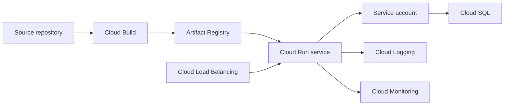

# Google Cloud Platform (GCP)

!!! note "In simple words"
    Google Cloud offers machines, containers, databases, storage, and identity, much like the other clouds. It stands out for managed Kubernetes and large analytics. For a single web service, pick the option that gives you the least to operate while still doing the job.

Google Cloud sorts its products into the same families as AWS and Azure. Interviewers bring it up to test whether you can translate ideas between providers and whether you can tell the compute options apart. Remembering every product name is rarely the point.

This page covers service families and their purpose. Pricing, quotas, and regional availability are left to Google's documentation.

## Why it matters

Google Cloud has several ideas that differ from its rivals. The VPC network spans regions. Identity for software is handled by service accounts. The serverless container platform is often the easiest way to host one Spring Boot service. Knowing these differences stops you from making wrong assumptions in a design review, and it lets you justify why one compute option beats another.

## How it works

A containerised Java service on Google Cloud is built once, stored in a registry, deployed to a managed runtime carrying an attached identity, and observed through logs and metrics. The diagram follows that path.



### Compute

- **Compute Engine** supplies virtual machines, comparable to EC2 or Azure Virtual Machines.
- **Cloud Run** executes stateless containers that scale with request traffic, including down to zero when idle. You hand over an image, and the platform does the rest.
- **Google Kubernetes Engine (GKE)** is managed Kubernetes, with Google running the control plane.
- **Cloud Functions** executes event-driven functions, similar to AWS Lambda.

For a containerised Spring Boot service that does not need Kubernetes-specific features, Cloud Run is often the most direct route. GKE fits a platform with many services and custom cluster requirements.

| Option | What you deploy | Who handles scaling and the host | Typical fit |
|---|---|---|---|
| Compute Engine | A VM image or an operating system | You | Full control, legacy software |
| Cloud Run | A container image | Google | Stateless HTTP services and jobs |
| GKE | Containers scheduled on a Kubernetes cluster | Shared, since you still manage workloads and cluster settings | Many services, Kubernetes tooling |
| Cloud Functions | A function handler | Google | Small event-driven tasks |

The more the platform absorbs, the less you control. Choose the option with the least management that still covers the service's needs.

### Cloud Run expects a listening port

A Cloud Run container has to listen on the port named by the `PORT` environment variable. The example below relies only on the JDK's built-in HTTP server, so it needs no framework. It is plain Java 21 code and is not compiled here:

```java
import com.sun.net.httpserver.HttpServer;
import java.io.IOException;
import java.net.InetSocketAddress;

public class CloudRunHello {

    public static void main(String[] args) throws IOException {
        int port = Integer.parseInt(System.getenv().getOrDefault("PORT", "8080"));
        HttpServer server = HttpServer.create(new InetSocketAddress(port), 0);
        server.createContext("/", exchange -> {
            byte[] body = "hello".getBytes();
            exchange.sendResponseHeaders(200, body.length);
            try (var out = exchange.getResponseBody()) {
                out.write(body);
            }
        });
        server.start();
        System.out.println("Listening on " + port);
    }
}
```

Whatever the container prints to standard output or standard error ends up in Cloud Logging. Writing structured lines makes them easy to search later.

### Rolling out new revisions

Every Cloud Run deployment produces a fresh **revision**. Traffic can be divided between revisions by percentage, so a new version first receives a small slice. Moving traffic back to the earlier revision is the rollback. That amounts to a canary release that the platform manages for you. Cloud Run also builds from source with buildpacks, so no Dockerfile is required. For production pipelines, an explicit image is easier to reproduce, so prefer it.

### Data

- **Cloud SQL** hosts managed MySQL, PostgreSQL, and SQL Server.
- **Firestore** is a managed document database with real-time sync and offline use, aimed at client apps.
- **Datastore** is the earlier name for the document API. Google now calls the capability Firestore in Datastore mode, so confirm the current name before using it in an answer.
- **Bigtable** is a wide-column NoSQL store for very large workloads that need low-latency key access.
- **BigQuery** is a serverless warehouse for SQL analytics over large data sets.

| Need | Service |
|---|---|
| A relational schema with transactions and familiar SQL | Cloud SQL |
| Documents that sync live to clients | Firestore |
| Huge volumes of low-latency lookups by key | Bigtable |
| SQL analysis across large data sets | BigQuery |
| Files and backups | Cloud Storage |

BigQuery and Bigtable get mixed up often. BigQuery is for analytical SQL queries. Bigtable is for application lookups by key. Avoid using BigQuery for frequent small transactional writes.

### Storage

- **Cloud Storage (GCS)** keeps objects in buckets, the counterpart of S3 or Blob Storage.
- **Persistent disks** offer block storage for Compute Engine VMs and GKE nodes.

### Networking

A **VPC network** in Google Cloud is global, while its **subnets** are regional. On AWS a VPC is confined to one region, so this is a frequent surprise. Instances in any region can communicate across the same network, as long as firewall rules permit it.

- **Firewall rules** are set on the VPC. They can select instances by network tag or by service account, which lets you express "only the application tier can reach the database" in terms of identities.
- **Cloud Load Balancing** comes in global and regional variants for HTTP(S) and TCP/UDP. Your choice shapes how requests reach the backends, so settle the entry point before picking compute. Changing it later disturbs DNS and certificates.
- **Cloud CDN** caches responses at Google's edge, usually behind a load balancer.
- **Private Google Access** allows instances without external IP addresses to call Google APIs. Read the current documentation to see how it fits your layout.

### Identity

- **Cloud Identity** manages the users and groups of an organisation, and it works alongside Google Workspace.
- **Service accounts** represent applications and workloads. You bind IAM roles to them, and services such as Cloud Run or GKE use them without key files.

Attach a service account to the workload rather than downloading a key file and shipping it. A downloaded key is a long-lived credential that needs guarding and rotating, and keys often leak through source control.

Give each service account only the roles its job requires. Read access to one bucket is far safer than project-wide editor rights. At runtime the workload fetches tokens from the metadata server, so the image contains no key.

Cloud Identity covers people, including their groups and organisation policies. Service accounts cover software. Keep those two uses separate in reviews.

### DevOps

- **Cloud Build** runs builds and tests described in `cloudbuild.yaml`, or started by a repository trigger.
- **Artifact Registry** holds container images and language packages such as Maven artifacts. It replaced Container Registry.

### Monitoring

- **Cloud Monitoring** collects metrics, draws dashboards, and sends alerts.
- **Cloud Logging** gathers and searches logs from GCP resources and from your applications.

Base alerts on what users experience, such as error rate and latency, instead of CPU alone. When one request fails, Cloud Logging lets you pull up its lines quickly. Artifact Registry keeps every image version, so rolling back means redeploying a known tag or digest. For the general method, see [Alerting and Health Checks](../20-observability/alerting-health-checks.md).

### Projects, folders, and organisation

Resources are grouped into **projects**. A project is the basic unit for billing, enabled APIs, and IAM policy. **Folders** and the **organisation** sit above projects, letting you attach policy to many projects simultaneously.

A common layout gives each environment or team its own project, and grants roles at the narrowest scope that works. Read the current resource-hierarchy guidance before designing yours, as it changes over time.

### A containerised Spring Boot flow

1. Cloud Build builds the image and pushes it to Artifact Registry.
2. Cloud Run deploys that image with a service account attached.
3. The service queries Cloud SQL, authorised by the service account's IAM permissions.
4. Cloud Logging collects what the container writes to stdout, and Cloud Monitoring raises alerts on error rate and latency.
5. A load balancer sits in front of the public endpoint, with Cloud CDN where content can be cached.

## Where it is used

- Stateless HTTP APIs and web services on Cloud Run, which scale to zero when nothing is happening.
- Platforms made of many interacting services on GKE.
- Analytics and reporting on BigQuery over very large data sets.
- Batch and event-driven jobs using Cloud Functions or Cloud Run jobs.
- Document-style data for client-facing applications on Firestore.

## Benefits

- **Simple serverless containers.** Cloud Run needs no cluster to manage and scales with demand.
- **Strong analytics.** BigQuery runs large SQL workloads without capacity planning.
- **A single global network.** One VPC covers every region, which makes cross-region designs simpler.
- **Workload identity without keys.** Service accounts remove the need for key files.
- **Mature managed Kubernetes.** GKE suits teams that need the full Kubernetes feature set.

## Cons and limits

- **Name changes.** Services get renamed or merged, so check the current name before you use it.
- **A different mental model.** Engineers who know AWS VPCs may assume regional networks and be caught out.
- **Less control on Cloud Run.** The platform fixes some host and networking choices, so unusual needs may push you to GKE.
- **Key files are a hazard.** Downloaded service account keys become secrets that must be protected and rotated.
- **Analytics is not an operational database.** Using BigQuery for application transactions is a mismatch.

## Best practices

- Assign service accounts with narrow roles, and avoid downloaded key files.
- Start with a single stateless service on Cloud Run, and move to GKE only when Kubernetes features are required.
- Log to stdout in a structured format, and alert on user-facing symptoms.
- Send a new revision a small share of traffic first, and widen it once checks pass.
- Run one project per environment, and grant roles at the narrowest level.
- Deploy by image digest or a fixed tag, so that a rollback restores an exact version.

## Common pitfalls

- Assuming VPC networks are regional. In Google Cloud, a VPC network is global with regional subnets.
- Downloading service account key files and committing them to version control.
- Running frequent small writes against BigQuery as if it were an operational database.
- Confusing the Datastore and Firestore names without checking the current terminology.
- Choosing GKE for one stateless service that Cloud Run would host more simply.

!!! tip "Interview tip"
    **Q: When would you pick Cloud Run over GKE?**
    Pick Cloud Run for stateless containers that should be deployed and scaled without a cluster to operate. Pick GKE when you need Kubernetes-specific features, many services that interact, custom node configuration, or the same tooling you use on other clusters.

## Quick recap

- Compute Engine, Cloud Run, GKE, and Cloud Functions range from VM-level control to function-level simplicity.
- Cloud SQL, Firestore, Bigtable, and BigQuery cover relational, document, wide-column, and analytical needs.
- Cloud Storage and persistent disks provide object and block storage.
- Service accounts give workloads an identity without downloaded key files.
- Cloud Build, Artifact Registry, Cloud Monitoring, and Cloud Logging handle delivery and observability.

## Official documentation

- [Google Cloud documentation](https://cloud.google.com/docs)
- [Kubernetes documentation](https://kubernetes.io/docs/home/)

**See also:** [Amazon Web Services](aws.md), [Microsoft Azure](azure.md), [Multi-Cloud Considerations](multi-cloud.md), [Networking, Helm and Operators](../16-kubernetes/networking-helm-operators.md)
