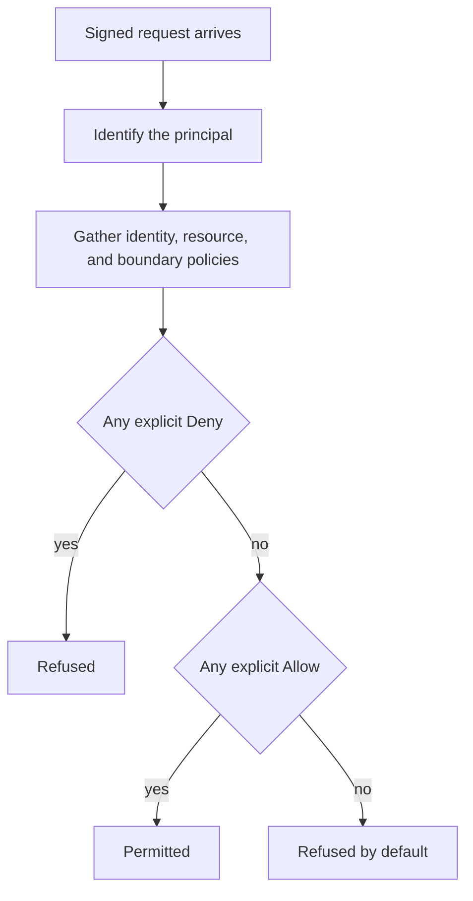

# AWS Identity and Access Management (IAM) Basics

!!! note "In simple words"
    IAM settles two things for every request: who is making it, and whether that identity may perform the action on that resource. Hand each person and each program only the rights they need, and favour temporary credentials over permanent keys.

IAM controls which principals, whether people or programs, may act on which AWS resources. Interviewers focus on it because most cloud incidents trace back to permissions that are too broad, keys that never expire, or accounts without multi-factor authentication. Be ready to name the five building blocks (users, groups, roles, policies, and MFA) and explain how AWS reaches an allow or deny decision.

## Why it matters

In a cloud account, identity forms the security perimeter. A leaked key with wide rights can read customer data, alter infrastructure, or wipe backups, and no other layer of the design will stop it. A disciplined IAM model keeps each workload's power small, ties every action to a principal, and makes containment fast: revoke one role or one key and the damage stops there.

## How it works

Each request to an AWS service follows the same path. The service identifies the caller, collects every policy relevant to the request, and then decides. The decision rule is simple, and it is the part interviewers test most often.



### Users and the root account

Each AWS account is created with a **root user**, which has unrestricted power. Reserve it for first-time setup and the handful of tasks that only root can perform. Enable MFA on it, and keep it away from everyday work.

An **IAM user** represents one person or one application. A user can sign in to the console with a password, and can hold access keys for the CLI or an SDK. The practice of one human per user keeps every action attributable.

### Groups

A **group** gathers users. Groups hold users only, never other groups. One user may belong to several groups, or to none. Assign permissions to groups instead of to people one at a time, so a job change becomes a membership change.

### Roles

A **role** carries no password and no permanent key. Some trusted entity assumes it and receives short-lived credentials. The trusted entity may be an EC2 instance through an instance profile, a Lambda function through its execution role, CloudFormation through a service role, or a principal in another account.

Roles are the recommended way for AWS services to act on your behalf. An EC2 application reading S3 should rely on an instance role, not an access key stored on disk. The [IAM roles guide](https://docs.aws.amazon.com/IAM/latest/UserGuide/id_roles.html) explains the model in detail.

### Policies

A **policy** is a JSON document describing permissions. It can be attached to an identity (a user, group, or role), or to a resource, such as an S3 bucket policy.

```json
{
  "Version": "2012-10-17",
  "Statement": [
    {
      "Sid": "ReadArchiveBucket",
      "Effect": "Allow",
      "Action": ["s3:GetObject", "s3:ListBucket"],
      "Resource": [
        "arn:aws:s3:::orders-archive",
        "arn:aws:s3:::orders-archive/*"
      ]
    }
  ]
}
```

| Element | Purpose |
|---|---|
| `Version` | Language version of the policy. Use `2012-10-17`. |
| `Id` | Optional label for the whole policy. |
| `Statement` | The list of individual statements, at least one. |
| `Sid` | Optional label for one statement. |
| `Effect` | Either `Allow` or `Deny`. |
| `Principal` | Who the statement covers, used in resource policies. |
| `Action` | API operations being allowed or denied, such as `s3:GetObject`. |
| `Resource` | The ARNs the actions apply to. |
| `Condition` | Optional constraints, such as a source address range or MFA being present. |

The bucket ARN and the object ARN (the bucket plus `/*`) are two separate resources. Overlooking the second is a classic cause of "access denied" confusion. Listing the bucket works, while reading an object does not.

### How the decision is made

An explicit `Deny` always beats any number of `Allow` statements. When nothing allows the action, the request is refused by default. Permission boundaries and session policies can narrow an allow further, as described below.

### How people and programs reach AWS

Three main doorways exist:

- **Management console:** a password, ideally guarded by MFA.
- **AWS CLI:** a command-line tool that uses access keys, or temporary credentials from SSO or a role.
- **AWS SDKs:** code libraries that authenticate in the same ways.

An access key consists of an access key ID and a secret access key. Guard the secret as carefully as a password. Keep it out of source control and out of chat or tickets, and rotate it regularly. Short-lived credentials from SSO or from roles on compute are preferable to long-lived keys.

### Multi-factor authentication (MFA)

MFA pairs something you know, the password, with something you possess, such as a device or security key. Turn it on for the root user and for every person who signs in to the console. Many organisations go further and attach a policy condition, so sensitive actions fail unless the session used MFA.

### Auditing permissions

Two IAM reports answer different questions:

- **Credentials report** (account wide). A downloadable table listing each user with the status of their password, access keys, and MFA devices. It helps you find stale or unrotated credentials.
- **Access Advisor** (per user or role). Lists which services a principal was granted, and when each was last exercised. Use it to strip permissions that are never used.

To learn who made a change, check CloudTrail (see [AWS](aws.md)). IAM describes what is permitted, while CloudTrail records what actually happened.

### Shared responsibility for identity

AWS is responsible for the security of the cloud itself: buildings, hardware, the global network, the managed-service infrastructure, and independent compliance audits. You are responsible for security inside the cloud. For IAM that means curating users, groups, roles, and policies, requiring MFA, rotating keys, granting only what is necessary, and reviewing access on a regular cycle.

### Trust policies and cross-account access

A role has two policies. The **permissions policy** lists what the role can do. The **trust policy** lists who can assume it. Consider a production role that a CI system in another account must be able to assume. Its trust policy looks like this:

```json
{
  "Version": "2012-10-17",
  "Statement": [
    {
      "Effect": "Allow",
      "Principal": { "AWS": "arn:aws:iam::111122223333:role/ci-deployer" },
      "Action": "sts:AssumeRole",
      "Condition": { "Bool": { "aws:MultiFactorAuthPresent": "true" } }
    }
  ]
}
```

The caller invokes `sts:AssumeRole` and gets temporary credentials, which normally last about an hour unless configured otherwise. Cross-account roles mean no user's keys are shared between accounts, and CloudTrail shows which role performed each action.

### Conditions: adding context to a rule

A `Condition` block narrows when a statement applies. The statement below permits object deletion only when the session was authenticated with MFA. It is a typical guard for destructive operations:

```json
{
  "Effect": "Allow",
  "Action": "s3:DeleteObject",
  "Resource": "arn:aws:s3:::orders-archive/*",
  "Condition": {
    "Bool": { "aws:MultiFactorAuthPresent": "true" }
  }
}
```

Other frequently used keys filter by source network (`aws:SourceIp`), by time of day, or by tags on the target resource. Conditions let you narrow a broad role without authoring a pile of separate policies. The [policy reference](https://docs.aws.amazon.com/IAM/latest/UserGuide/access_policies.html) lists every element.

### Permission boundaries and least privilege

A **permission boundary** is a managed policy that sets the ceiling on what a user or role may ever receive, even if a broader policy is attached later. It lets developers create roles for their own services without being able to grant themselves unlimited access. The effective permission is the intersection of the identity policy and the boundary.

Least privilege means granting exactly the actions and resources a job needs:

- Begin from the calls the code actually makes, which you can read from CloudTrail or Access Advisor.
- Name specific resources, and use prefixes for families of resources, such as `arn:aws:s3:::orders-*`, rather than `*`.
- Keep read-only roles separate from write roles, and keep deploy roles separate from runtime roles.
- Revisit the policy when the code changes, not only after someone hits an access error.

### Access key lifecycle

Long-lived access keys are the weakest point in most AWS accounts, so manage them through a lifecycle:

1. **Avoid creating them.** Use IAM Identity Center for people, and roles for workloads.
2. **If one is unavoidable,** make it single-purpose, store it in a secrets manager, and record who owns it.
3. **Rotate on a schedule.** Create the replacement, move the consumer over, then delete the old key.
4. **Deactivate idle keys.** The credentials report shows which keys nobody uses.
5. **Delete keys** once the owner leaves or the job is retired.

A single IAM user may hold at most two access keys at a time. That spare slot is what makes rotation possible without downtime.

### Password policy

The account-level password policy controls minimum length, character rules, reuse restrictions, and expiry for IAM user passwords. A firm policy is necessary, but it does not replace MFA, because passwords can still be phished. MFA is the stronger defence for console logins.

### Connecting from workloads

Workloads should obtain their identity from the platform they run on. On EC2 that is an instance profile. On EKS it is a service account linked to a role (see [AWS](aws.md) for IRSA and Pod Identity). On Lambda it is the execution role. In every case the SDK discovers temporary credentials automatically, so the application code holds no keys.

## Where it is used

- Every AWS account, governing console sign-in, CLI use, and SDK calls.
- EC2 instances, Lambda functions, and EKS pods that need S3, DynamoDB, or Secrets Manager access.
- CI and CD pipelines that deploy into production accounts by assuming roles.
- Cross-account setups where a shared services account reaches into workload accounts.

## Benefits

- **Granular control** over each action on each resource type.
- **Temporary credentials** shrink the harm a leaked credential can do.
- **An audit trail** in CloudTrail, attributed to a specific principal.
- **Central management** of people through groups and single sign-on.
- **Guardrails** provided by permission boundaries and conditions.

## Cons and limits

- **Policies grow complicated.** Long JSON documents are difficult to read, and one slip can grant too much or block a service.
- **Changes take time to spread.** A new policy or role may need a short while to become effective everywhere.
- **Keys linger** in teams that do not enforce roles and rotation.
- **Testing is largely manual** unless a policy simulator or peer review is part of the pipeline.
- **Root and break-glass accounts** need special handling, because they bypass most everyday controls.

## Best practices

- Turn on MFA for the root user and every human user. Store root credentials safely and leave them unused.
- Use IAM Identity Center for people, and roles for workloads. Steer clear of long-lived keys.
- Grant least privilege, beginning from the actions the code really uses.
- Attach policies to groups, and let people inherit them.
- Add conditions to destructive or sensitive actions, such as requiring MFA or a known network.
- Audit credentials and access regularly, using the credentials report and Access Advisor.
- Keep trust policies tight: name the exact role and, for IRSA, the exact service account.

## Common pitfalls

- Attaching `AdministratorAccess` to an application role because a narrower policy was tedious to write.
- Using `"Resource": "*"` where the action can target specific resources.
- Keeping access keys in source files, container images, or shared CI variables instead of relying on roles.
- Running daily tasks as root, or leaving root without MFA.
- Letting several people share one IAM user, which destroys accountability.
- Keeping unused access keys active after their owner has departed.

!!! tip "Interview tip"
    **Q: How does an EC2 application read from S3 without storing keys?**
    Attach an IAM role that carries a least-privilege S3 policy to the instance via an instance profile. The SDK obtains temporary credentials from the instance metadata service and refreshes them on its own. No secret sits in the application or its configuration.

!!! tip "Interview tip"
    **Q: A policy has an Allow and a Deny for the same action. Which wins?**
    The explicit Deny wins. AWS gathers every applicable policy first. If any of them explicitly denies the action, the request is refused, even though an Allow also matches. If nothing grants the action, it is refused anyway, since the default is deny.

## Quick recap

- Users are individual identities, and groups hold users and share permissions.
- Roles hand out temporary credentials to services and trusted principals, which makes them preferable to keys.
- A policy is a JSON document of Allow and Deny statements. An explicit Deny always wins, and the default is deny.
- MFA on the root user and on every console user is a baseline control.
- The credentials report and Access Advisor reveal unused credentials and excess permissions.

## Official documentation

- [IAM User Guide: introduction](https://docs.aws.amazon.com/IAM/latest/UserGuide/introduction.html)
- [IAM policies and permissions](https://docs.aws.amazon.com/IAM/latest/UserGuide/access_policies.html)
- [IAM roles](https://docs.aws.amazon.com/IAM/latest/UserGuide/id_roles.html)

**See also:** [AWS](aws.md), [Compute and Storage on AWS](compute-and-storage.md), [Secrets Management](../10-security/secrets-management.md)
