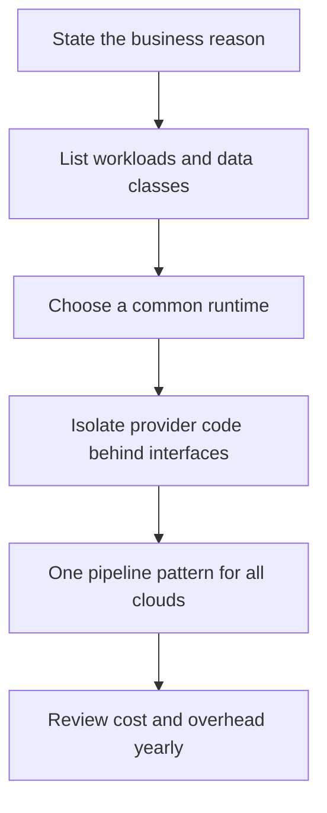

# Multi-Cloud Considerations

!!! note "In simple words"
    Multi-cloud means running workloads on two or more cloud providers. It can lower your reliance on a single vendor, but each extra provider brings extra work. Only add one when you have a concrete reason that a single provider cannot satisfy.

A multi-cloud setup uses more than one public provider, whether by deliberate design or because separate teams picked different ones. It can reduce vendor dependence and satisfy regulatory or customer demands, yet it adds operational complexity. Interviewers raise the topic to see whether you can balance portability against the expense of running several platforms.

## Why it matters

Plenty of teams declare they want to be multi-cloud without naming a reason, then pay double for the result. A strong answer begins with the problem being solved: resilience, a particular service, a contractual rule, or a merger. Each of those leads to a different design, and some of them do not require multi-cloud at all. Recognising this prevents an expensive setup that guards against the wrong risk.

## How it works

Moving from a business reason to a design is a sequence of decisions. The steps below work as a checklist for a design review.



### Why organisations go multi-cloud

- **Resilience and leverage.** A single provider's outage or pricing change then affects less of the estate. Complete resilience across providers is difficult, so state exactly which failure you are guarding against.
- **Best-fit services.** Some workloads run better on one provider's analytics or AI offerings.
- **Acquisitions and legacy.** A merger can bring systems that already run on another provider.
- **Customer or regulatory rules.** Some customers or regulators dictate where and how data is hosted.
- **Hybrid cloud.** Public cloud is combined with on-premises systems, frequently to keep certain data local.

### Vendor lock-in and portability

Lock-in is the expense of leaving a provider. It mostly stems from proprietary managed services, such as a particular queue, database, or serverless API, that have no direct equivalent elsewhere.

Portability techniques reduce lock-in, and each has a cost of its own:

- **Containers and Kubernetes** give a shared runtime. The managed Kubernetes offerings still diverge on networking, storage, and identity.
- **Infrastructure as code** with Terraform offers one workflow for many clouds, but every provider's resources remain distinct.
- **Open standards** such as PostgreSQL or open message formats are simpler to migrate than proprietary APIs.
- **Ports and adapters** keep provider-specific code behind interfaces the application defines, so the core does not import a vendor SDK.

The center of the ports-and-adapters pattern is an interface owned by the application:

```java
import java.io.InputStream;
import java.util.Optional;

// The application depends on this port, not on any provider SDK
public interface ObjectStore {
    void put(String key, InputStream content);
    Optional<InputStream> get(String key);
}
```

Each provider receives an adapter: one for S3, one for Blob Storage, and one for Cloud Storage. The core compiles and tests with no cloud SDK on the path. Adapters should stay thin, and some provider features will not translate cleanly.

### Cost comparison and optimisation

A fair comparison holds the workload, the region class, the commitment terms, and the cost of moving data between providers constant. Prices and discount schemes move, so any comparison is only accurate on the day it was done.

Hidden costs are often bigger than the list prices. Egress between clouds, duplicated tooling, staff training, and the effort to keep several pipelines working can outweigh any saving. Multi-cloud frequently costs more before it returns anything.

### Hybrid cloud

Hybrid cloud joins public cloud to on-premises infrastructure. Common arrangements keep regulated data on premises and run stateless services in the cloud, or stretch an on-premises cluster into the cloud. It calls for secure private links, a consistent identity model on both sides, and a clear plan for moving data.

### Data residency and compliance

Residency rules restrict where personal or regulated data may be kept and processed. Before picking regions or providers, establish:

- Which data is covered by residency rules, and where it is permitted to live.
- Which compliance frameworks apply, and which providers and services hold the relevant certifications.
- Where copies of that data end up in backups, logs, and analytics pipelines, since those copies are routinely overlooked.

Verify current certifications and regional options in each provider's compliance material rather than relying on memory.

### Service equivalents across providers

Most categories have a counterpart on each cloud, although names differ and boundaries shift. Treat the table as a map to start from, then check the details of each service.

| Category | AWS | Azure | Google Cloud |
|---|---|---|---|
| Virtual machines | EC2 | Virtual Machines | Compute Engine |
| Managed web app platform | Elastic Beanstalk | App Service | App Engine (not covered in this section) |
| Serverless containers | ECS or Fargate (task model) | Container Instances, Container Apps | Cloud Run |
| Managed Kubernetes | EKS | AKS | GKE |
| Functions | Lambda | Azure Functions | Cloud Functions |
| Object storage | S3 | Blob Storage | Cloud Storage |
| Block storage | EBS | Managed disks | Persistent disks |
| Managed relational database | RDS, Aurora | Azure SQL Database | Cloud SQL |
| Wide-column or key-value NoSQL | DynamoDB | Cosmos DB | Bigtable, Firestore |
| Layer 7 load balancing | ALB | Application Gateway | Cloud Load Balancing |
| Identity and access | IAM | Entra ID, Azure RBAC | Cloud IAM, service accounts |
| Monitoring and logs | CloudWatch | Azure Monitor, Application Insights, Log Analytics | Cloud Monitoring, Cloud Logging |
| CI/CD | CodePipeline, CodeBuild | Azure Pipelines | Cloud Build |

Identity needs particular care. A managed identity, a service account, and an IAM role address the same problem with different models. Translate each policy on purpose instead of copying it.

### Testing against a portable interface

Business logic should run in tests without touching any cloud. The in-memory adapter below implements the same `ObjectStore` contract, so unit tests need no account. It is plain Java 21 in a single file, and it is not compiled here:

```java
import java.io.ByteArrayInputStream;
import java.io.IOException;
import java.io.InputStream;
import java.io.UncheckedIOException;
import java.util.HashMap;
import java.util.Map;
import java.util.Optional;

interface ObjectStore {
    void put(String key, InputStream content);
    Optional<InputStream> get(String key);
}

class InMemoryObjectStore implements ObjectStore {
    private final Map<String, byte[]> data = new HashMap<>();

    @Override
    public void put(String key, InputStream content) {
        try {
            data.put(key, content.readAllBytes());
        } catch (IOException e) {
            throw new UncheckedIOException(e);
        }
    }

    @Override
    public Optional<InputStream> get(String key) {
        return Optional.ofNullable(data.get(key)).map(ByteArrayInputStream::new);
    }
}
```

Each cloud adapter needs its own tests, run against an emulator or a sandbox account. This verifies the contract on every provider rather than assuming it.

### Disaster recovery across providers

Failover to a second provider is a recovery plan that must be built and paid for. It requires:

- **Recovery point objective (RPO).** The tolerable amount of data loss. It decides how frequently data is copied across providers.
- **Recovery time objective (RTO).** The tolerable downtime. It decides whether the standby stays cold, warm, or fully running.
- **Traffic steering.** DNS or a global router that moves users, triggered by health checks.
- **Rehearsed runbooks.** A failover that has never been practised usually fails when it is needed.

Active-passive designs are simpler than active-active ones. Active-active has to accept writes in two places and reconcile conflicts.

### Exit planning

Before adopting a provider-specific service, record how you would replace it. For every managed dependency, note the data format, the export route, and a rough estimate of the migration effort. This is cheap to do, and it converts lock-in from a vague fear into concrete choices the team can accept or reject.

### Operational overhead

Every additional provider multiplies the work: identity federation, connectivity between clouds, logging and metrics pipelines, and the skills the team has to hold. Bring observability together in one tool that can read from each provider, and share pipeline templates so that services do not reinvent deployment.

## Where it is used

- Enterprises that inherited systems on more than one provider through acquisitions.
- Organisations whose residency rules a single region or provider cannot meet.
- Teams that depend on an analytics or AI service available on just one provider.
- Hybrid estates where regulated data stays on premises while services run in the cloud.

## Benefits

- **Smaller vendor dependence**, so one provider's outage or price change touches less of the estate.
- **Access to best-fit services** from each provider.
- **Support for residency and customer requirements** that one provider cannot meet alone.
- **Better contract leverage** when renewals come around.

## Cons and limits

- **Twice the operational work.** Identities, networks, pipelines, and monitoring all multiply.
- **Transfer costs** between providers grow with the data volume.
- **Lowest common denominator.** An abstraction that hides useful features throws away their value.
- **Harder incident response.** A fault that spans two providers is slower to diagnose.
- **Thinly spread skills.** The team has to operate several platforms competently.

## Best practices

- Document the business reason first, and review it every year.
- Run one provider well before adding a second, and only for a reason a single provider cannot meet.
- Lean on containers, infrastructure as code, and open data formats to keep workloads portable.
- Confine SDK calls to adapters behind ports that the application owns.
- Test each adapter against an emulator or real account, and rehearse the failover path on a schedule.
- Record the residency status of every copy of the data, including logs and backups.

## Common pitfalls

- Adopting multi-cloud without a clear reason, which doubles the operational load.
- Assuming multi-cloud brings disaster recovery for free. It needs rehearsed runbooks and replicated data.
- Leaving egress and cross-provider network charges out of cost comparisons.
- Building a portability layer so generic that it hides features and runs slowly.
- Using a different tool on each cloud for the same job, which fragments skills and monitoring.
- Forgetting that backups, logs, and analytics copies fall under residency rules too.

!!! tip "Interview tip"
    **Q: Would you use multiple clouds for this system?**
    Begin by asking what problem it solves. For resilience, explain what would actually fail over, how the data is replicated, and how the failover is tested. For a specific service, weigh whether that service justifies the overhead of a second platform. Containers, IaC, and ports-and-adapters design are worth having even if you stay on one provider.

## Quick recap

- Multi-cloud is justified by resilience, best-fit services, requirements, or hybrid needs, and it costs extra effort.
- Lock-in comes from proprietary managed services. Containers, IaC, and standard data formats loosen it.
- Ports-and-adapters design keeps provider SDKs out of the core business logic.
- Compare costs on a like-for-like basis, including transfer and upkeep.
- Confirm residency and compliance for every copy of the data.

## Official documentation

- [The Twelve-Factor App](https://12factor.net/)
- [Kubernetes documentation](https://kubernetes.io/docs/home/)
- [Google Cloud documentation](https://cloud.google.com/docs)

**See also:** [Amazon Web Services](aws.md), [Microsoft Azure](azure.md), [Google Cloud Platform](gcp.md), [Continuous Deployment and IaC](../17-cicd/continuous-deployment-iac.md)
