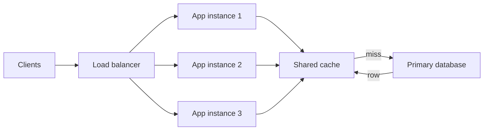

# Building Blocks

!!! note "In simple words"
    Building blocks are the standard parts you combine in most designs: something to spread traffic, something to remember answers, something to store data, something to hold work for later, and something to decide who may call.

Most system designs reuse the same handful of components. Knowing what each one does, what it costs, and how it fails lets you assemble a design quickly and explain it clearly. This page covers the common blocks, the choices within each, and the failure modes that interviewers like to probe.

## Why it matters

A component chosen without a reason is a liability. A cache without an expiry rule serves stale data forever. A queue without a consumer fills the disk. A load balancer that sends traffic to a dead instance turns one failure into many. Understanding the blocks means understanding both their benefit and the way each one can go wrong.

## How it works

### Load balancer and cache together

The diagram shows a common shape. Clients reach a load balancer, which spreads requests across several application instances. Each instance checks a shared cache first. On a miss, it reads the primary database and fills the cache for the next caller.



Notice what makes this work. The instances hold no session state, so the load balancer can send any request to any of them. The cache sits between the instances and the database, which means the database sees only the misses.

### Load balancer

A load balancer distributes incoming requests across a group of instances and stops sending traffic to instances that fail their health checks.

- **Layer 4** load balancers route on transport details such as IP address and TCP port. They are fast because they do not read the message.
- **Layer 7** load balancers read the HTTP request. They can route by path or host, add headers, and terminate TLS. They cost more CPU per request.
- **Algorithms** include round robin, least connections, weighted distribution, and IP hashing. Least connections suits requests that take uneven time. IP hashing gives a rough form of session affinity, but it breaks when a client changes network.
- **Health checks** remove instances that stop responding, and bring them back once they recover.

Kubernetes Services and Ingress provide these behaviours inside a cluster. The [Ingress concept](https://kubernetes.io/docs/concepts/services-networking/ingress/) page describes the model.

### Caching

A cache holds a copy of data that is expensive to fetch, so repeated requests skip the slow source. Three details decide whether a cache helps:

- **Read pattern.** Cache-aside is the most common. The application checks the cache, loads from the database on a miss, and stores the result. Write-through and write-behind are variants that change when the database is updated.
- **Expiry.** A time to live (TTL) bounds how stale an entry can get. A size limit with least-recently-used eviction bounds memory.
- **Invalidation.** When the source changes, the cached copy must change too. This is the hard part. Deleting the key on write is simple, but a reader can still store an old value after the delete.

A local, in-process cache is fast but private to one instance. A distributed cache such as Redis is shared by all instances and spreads keys across nodes. The [Redis documentation](https://redis.io/docs/latest/) covers its data types, eviction policies, and clustering.

The sketch below shows cache-aside with a bounded size and an expiry time, using only the JDK. A production system would normally use a library such as Caffeine for the bound and the expiry:

```java
import java.util.LinkedHashMap;
import java.util.Map;
import java.util.function.Function;

public class LruCacheAside<K, V> {

    private final int capacity;
    private final Function<K, V> source;
    private final Map<K, V> entries;

    public LruCacheAside(int capacity, Function<K, V> source) {
        this.capacity = capacity;
        this.source = source;
        // accessOrder = true makes iteration follow recent use, so the oldest entry is evicted first
        this.entries = new LinkedHashMap<>(16, 0.75f, true) {
            @Override
            protected boolean removeEldestEntry(Map.Entry<K, V> eldest) {
                return size() > LruCacheAside.this.capacity;
            }
        };
    }

    public synchronized V get(K key) {
        return entries.computeIfAbsent(key, source);   // miss: load and store
    }

    public synchronized void invalidate(K key) {
        entries.remove(key);                            // call this on every write to the source
    }
}
```

This version is not thread-safe for concurrent loads, because `computeIfAbsent` runs under the object's lock and blocks other callers. It is good enough to show the contract. The lock is the reason a library cache is preferred in production.

### Database scaling

- **Replication** copies data from a primary to replicas. Replicas serve reads and provide a standby. Asynchronous replicas can lag, so a read after a write may be stale.
- **Sharding** splits the data across several databases by a shard key. Each shard handles a share of the writes and the storage.
- **Indexes** speed up lookups on the columns that queries filter and sort by. They slow writes slightly and take space.

The trade-offs and the choice of shard key are covered in [Replication, Sharding, and NoSQL](replication-sharding-nosql.md).

### Message queue and stream

A queue decouples a producer from a consumer. The producer writes a message and moves on. Consumers read at their own pace, which absorbs bursts and makes retries possible.

- A **queue** such as RabbitMQ or Amazon SQS delivers each message to one consumer and removes it after an acknowledgement. The [RabbitMQ](../13-messaging/rabbitmq.md) page in this playbook covers the model.
- A **stream** such as Apache Kafka keeps an ordered log that many consumer groups can read again. Consumers track their own position, so a new consumer can replay history.

Queues bring their own risks. Delivery is usually at least once, so consumers must be idempotent. A growing backlog signals that consumers are too slow. Messages that keep failing should go to a dead-letter queue instead of blocking the rest.

### API gateway

An API gateway is the single entry point for external clients. It routes requests to services, checks authentication, applies rate limits, terminates TLS, and can combine several internal calls into one response. Business rules stay in the services. A gateway with business logic becomes the place every team must change.

### Content delivery network

A content delivery network (CDN) keeps copies of static files, such as images, scripts, and video segments, at edge locations near users. It reduces latency and origin load. Dynamic, per-user responses need explicit cache rules, or they must bypass the CDN entirely.

### Rate limiting

A rate limiter caps how often a client, key, or route may call the system. It protects services from overload and from abusive callers. Common algorithms are:

- **Fixed window**: count requests in each time window. Cheap, but a client can send double the limit across a window boundary.
- **Sliding window**: count over a moving period. More accurate, with more storage work.
- **Token bucket**: tokens refill at a steady rate, and each request spends one. Bursts up to the bucket size are allowed.
- **Leaky bucket**: requests leave at a fixed rate. It smooths traffic at the cost of queueing delay.

Place the limiter at the gateway or in middleware. Keep the counters in a shared store such as Redis, so every instance sees the same count. When a client is over the limit, return `429 Too Many Requests` with a `Retry-After` header.

A single-process token bucket shows the logic. The clock is `System.nanoTime`, which is monotonic and suits measuring intervals:

```java
public final class TokenBucket {

    private final double capacity;
    private final double refillPerSecond;
    private double tokens;
    private long lastNanos;

    public TokenBucket(double capacity, double refillPerSecond) {
        this.capacity = capacity;
        this.refillPerSecond = refillPerSecond;
        this.tokens = capacity;                 // start full, so the first burst is allowed
        this.lastNanos = System.nanoTime();
    }

    public synchronized boolean tryAcquire() {
        refill();
        if (tokens >= 1.0) {
            tokens -= 1.0;
            return true;
        }
        return false;                           // caller should answer 429
    }

    private void refill() {
        long now = System.nanoTime();
        double elapsedSeconds = (now - lastNanos) / 1_000_000_000.0;
        tokens = Math.min(capacity, tokens + elapsedSeconds * refillPerSecond);
        lastNanos = now;
    }

    public static void main(String[] args) {
        TokenBucket bucket = new TokenBucket(3, 1);   // burst of 3, then one per second
        for (int i = 1; i <= 5; i++) {
            System.out.println("request " + i + " allowed: " + bucket.tryAcquire());
        }
    }
}
```

Running `main` prints three `true` values and then `false` values. The bucket starts with three tokens, and the loop finishes in far less than the one second needed to refill a token.

### Consistent hashing

Consistent hashing maps keys and servers onto the same ring of hash positions. Each key belongs to the next server clockwise from its position. When a server joins or leaves, only the keys between it and its neighbour move, which is roughly `1/N` of the keys for `N` servers. Plain modulo hashing would move almost every key.

Real rings give each server many virtual points, so the load spreads evenly. The sketch below uses `String.hashCode` for brevity. A production ring uses a stronger hash function:

```java
import java.util.Map;
import java.util.TreeMap;

public class ConsistentHashRing {

    private final TreeMap<Integer, String> ring = new TreeMap<>();
    private final int virtualNodes;

    public ConsistentHashRing(int virtualNodes) {
        this.virtualNodes = virtualNodes;
    }

    public void addNode(String node) {
        for (int i = 0; i < virtualNodes; i++) {
            ring.put(hash(node + "#" + i), node);
        }
    }

    public void removeNode(String node) {
        for (int i = 0; i < virtualNodes; i++) {
            ring.remove(hash(node + "#" + i));
        }
    }

    public String nodeFor(String key) {
        if (ring.isEmpty()) {
            throw new IllegalStateException("ring has no nodes");
        }
        Map.Entry<Integer, String> entry = ring.ceilingEntry(hash(key));
        if (entry == null) {
            entry = ring.firstEntry();          // wrap around the ring
        }
        return entry.getValue();
    }

    private static int hash(String value) {
        return value.hashCode();
    }

    public static void main(String[] args) {
        ConsistentHashRing ring = new ConsistentHashRing(100);
        ring.addNode("cache-a");
        ring.addNode("cache-b");
        System.out.println("user:42 is on " + ring.nodeFor("user:42"));
    }
}
```

### Coordination and consensus

Some decisions must be made once for the whole cluster: which node is the leader, who holds a lock, or what the current configuration is. Coordination services such as etcd or ZooKeeper, which use consensus protocols such as Raft, provide these guarantees. Use them for small amounts of critical state, not as a general database. Leader election, locks, and configuration are the typical uses.

### Unique IDs

Many designs need IDs that are unique across many machines without asking one database for each value.

- A **database sequence** is simple and gives ordered values, but every ID needs a call to the database.
- A **UUID** needs no coordination. It is 128 bits and is not ordered by time in its usual form, which hurts index locality.
- A **Snowflake-style ID** packs a timestamp, a machine number, and a per-millisecond sequence into 64 bits. The IDs are roughly ordered by time, and each machine creates them alone.

The Snowflake sketch below uses a 41-bit timestamp, a 10-bit machine number, and a 12-bit sequence. It compiles on Java 21 and rejects a clock that moves backwards:

```java
public final class SnowflakeIds {

    private static final long EPOCH_MILLIS = 1_700_000_000_000L;  // custom epoch
    private static final int SEQUENCE_BITS = 12;
    private static final int MACHINE_BITS = 10;
    private static final long SEQUENCE_MASK = (1L << SEQUENCE_BITS) - 1;

    private final long machineId;
    private long lastMillis = -1L;
    private long sequence = 0L;

    public SnowflakeIds(long machineId) {
        if (machineId < 0 || machineId >= (1L << MACHINE_BITS)) {
            throw new IllegalArgumentException("machineId must fit in 10 bits");
        }
        this.machineId = machineId;
    }

    public synchronized long nextId() {
        long now = System.currentTimeMillis();
        if (now < lastMillis) {
            throw new IllegalStateException("clock moved backwards; refusing to create duplicates");
        }
        if (now == lastMillis) {
            sequence = (sequence + 1) & SEQUENCE_MASK;
            if (sequence == 0) {                 // 4096 IDs used this millisecond: wait for the next one
                while (now <= lastMillis) {
                    now = System.currentTimeMillis();
                }
            }
        } else {
            sequence = 0L;
        }
        lastMillis = now;
        return ((now - EPOCH_MILLIS) << (MACHINE_BITS + SEQUENCE_BITS))
                | (machineId << SEQUENCE_BITS)
                | sequence;
    }

    public static void main(String[] args) {
        SnowflakeIds generator = new SnowflakeIds(7);
        System.out.println(generator.nextId());
        System.out.println(generator.nextId());
    }
}
```

Machine numbers must be assigned without collisions, usually from configuration or a coordination service. The clock check matters: a machine whose clock steps backwards could reuse an ID.

### Idempotency and retries

Networks can fail after the server has done the work. The caller sees a timeout and cannot tell whether the operation happened. Retrying is then necessary, and the server must tolerate repeats. An idempotent operation gives the same final result no matter how many times it runs. Setting a status to `shipped` is idempotent. Adding 10 to a balance is not.

An **idempotency key** makes a create request safe to retry. The client sends a unique key, the server stores the result under that key, and any repeat returns the stored result. Combine this with timeouts, retries with exponential backoff and jitter, and circuit breakers. The resilience side of this is covered in [Scalability and Failover](scalability-and-failover.md).

## Where it is used

- A load balancer in front of every web tier, with health checks.
- Redis or Memcached as a shared cache in front of a relational database.
- Kafka or RabbitMQ between an order service and the services that react to orders.
- An API gateway that handles authentication and rate limits for many services.
- A CDN for images, scripts, and video segments.
- Snowflake-style IDs for orders, messages, and posts that need rough time order.

## Benefits

- Each block solves one problem, so a design can be explained as a set of parts.
- Load balancers and stateless instances let capacity grow by adding machines.
- Caches cut latency and protect the database from read spikes.
- Queues absorb bursts and let slow work finish later.
- A gateway applies cross-cutting rules in one place.

## Cons and limits

- Every extra block is one more thing to run, monitor, and fail.
- Caches can serve stale data, and invalidation is hard to get right.
- Queues give at-least-once delivery, so duplicates must be handled.
- Consistent hashing reduces key movement but does not remove hot keys.
- Rate limiters that depend on a shared store add a dependency to the request path.

## Best practices

- Put a health check on every instance behind a load balancer, and remove failed instances quickly.
- Give every cache a TTL and a size limit, and decide how writes invalidate it.
- Make consumers idempotent, and send poison messages to a dead-letter queue.
- Keep the gateway thin, and keep business rules in the services.
- Use idempotency keys on every create or payment request.
- Monitor queue depth, cache hit ratio, and the rate of 429 and 503 responses.

!!! tip "Interview tip"
    **Q: Why not put a cache in front of every database read?**
    A cache adds a copy that can go stale, a dependency that can fail, and an invalidation rule to maintain. Cache only data that is read often, that tolerates some staleness, and that is expensive to fetch. For data that must always be current, such as an account balance at the moment of payment, read from the source of truth and protect it another way.

## Quick recap

- Load balancers spread traffic and remove unhealthy instances. Layer 7 adds routing at a higher cost.
- Caches need an expiry rule and a clear invalidation rule. Distributed caches share entries across instances.
- Queues decouple producers and consumers. Expect duplicates and design consumers to be idempotent.
- Token buckets allow bursts. Consistent hashing moves few keys when nodes change.
- Snowflake-style IDs are unique and roughly time ordered, and they need a clock that does not move backwards.

## Official documentation

- [Kubernetes Ingress concept](https://kubernetes.io/docs/concepts/services-networking/ingress/)
- [Redis documentation](https://redis.io/docs/latest/)
- [Apache Kafka documentation](https://kafka.apache.org/documentation/)
- [Amazon SQS developer guide](https://docs.aws.amazon.com/AWSSimpleQueueService/latest/SQSDeveloperGuide/welcome.html)

**See also:** [Fundamentals](fundamentals.md) | [Worked Examples](worked-examples.md) | [High-Level Design](high-level-design.md) | [Replication, Sharding, and NoSQL](replication-sharding-nosql.md) | [Redis and Caching](../12-caching-performance/spring-cache-and-redis.md)
