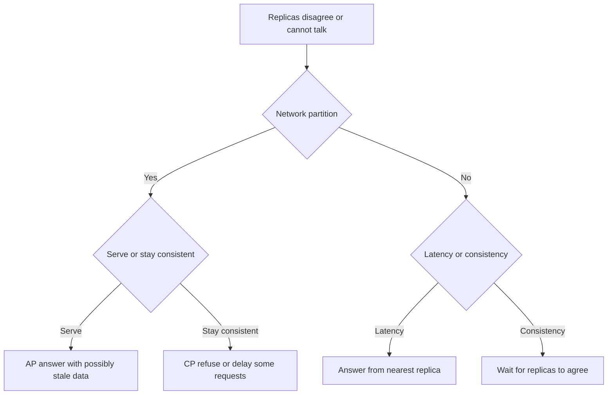

# Core Concepts

!!! note "In simple words"
    Four ideas run through every system design: how a system grows, how it stays up, what data it promises to return, and how quickly it answers. Most design debates are trade-offs among these four.

Interviewers use these terms to check whether you can name a trade-off precisely. They also check whether you understand that the CAP theorem describes what happens during a network partition, not a permanent choice you make once for the whole system.

## Why it matters

Vocabulary is the fastest way to lose or win a design discussion. If someone says "we need high availability," the next question is always "what is the target, and what happens during a failure?" Knowing the difference between an SLA, an SLO, and an SLI turns a vague promise into something you can measure. Knowing the consistency models turns "it should be correct" into a precise requirement. Without these terms, decisions get made by habit instead of reasoning.

## How it works

### Scaling: up and out

- **Vertical scaling** (scaling up) gives one machine more CPU, memory, or disk. It needs no code changes and it is simple to operate. It has a ceiling set by the largest machine available, and it leaves a single point of failure.
- **Horizontal scaling** (scaling out) adds machines and spreads the work across them. It removes the ceiling and improves fault tolerance, but the system must handle distribution: load balancing, shared state, and partial failures.

Stateless services scale out easily, because any instance can serve any request. Stateful parts, such as databases, scale by partitioning the data and replicating it. A good design pushes state into a few well-understood stores and keeps the rest of the application stateless.

### Availability and how it composes

Availability is the share of time that a system can serve requests. It depends on how its parts are wired together.

- **In series**, every part must work. The overall availability is the product of the parts. Two independent components at 99 percent each give 0.99 times 0.99, which is about 98.01 percent. That is lower than either component alone.
- **In parallel**, one working copy is enough. The chance that all copies fail together is the product of their failure chances. Two independent copies at 99 percent each fail together with probability 0.01 times 0.01, which is 0.0001. That gives 99.99 percent.

The arithmetic assumes independent failures, which is rarely fully true. Copies in the same rack, zone, or deployment fail together. A shared dependency on one external provider can cap the availability of the whole system, however much redundancy you add elsewhere.

Availability comes from three things: redundancy (no single point of failure), failover (switching to a standby automatically), and replication (keeping data copies on several nodes). Redundancy only helps when the copies are placed so that they do not share a failure cause.

### SLI, SLO, and SLA

These three terms describe reliability in layers.

| Term | Meaning | Example form |
|---|---|---|
| SLI (indicator) | The measured quantity | Share of requests that succeed |
| SLO (objective) | The internal target for the indicator | Successful requests stay above a set level over a rolling window |
| SLA (agreement) | The external contract with consequences | Service credits if the target is missed |

Teams set the SLO tighter than the SLA, so they get a warning before the contract is breached. The **error budget** is the failure the SLO allows. When the budget is spent, the team slows feature work and works on reliability. An SLA quoted without a defined SLI is only a promise with no measurement behind it.

### Consistency models

Consistency describes what a read sees after a write.

- **Strong consistency**: every read returns the latest acknowledged write. It is simple to reason about, but it needs coordination that adds latency and can reduce availability during a partition.
- **Causal consistency**: operations that depend on each other are seen in the same order by everyone. Unrelated operations may appear in different orders.
- **Eventual consistency**: replicas converge if writes stop. Reads can be stale for a while. This suits counters, feeds, and caches.

Choose the weakest model the business rule allows. A bank balance needs stronger guarantees than the number of views on a video.

### Consensus: Raft and Paxos

Consensus lets a group of nodes agree on one value, such as the current leader or the next entry in a log, even when some nodes fail. Paxos is the original algorithm, and it is known for being hard to follow. Raft was designed to be understandable. It elects a leader, sends log entries through that leader, and commits an entry once a majority of nodes have stored it. Systems such as etcd rely on Raft-style consensus.

At interview depth, explain the majority idea. A group of five nodes keeps working with two failures, because three nodes still form a majority. That is why odd group sizes are common.

### CAP and PACELC

The CAP theorem says that during a **network partition**, a distributed system must choose between **consistency** (every node gives the same, latest answer) and **availability** (every non-failing node still answers). Partitions happen in real networks, so partition tolerance is not optional.

- A CP system refuses or delays some requests during a partition, so it never returns a wrong answer.
- An AP system keeps answering during a partition and reconciles the copies later.

CAP says nothing about normal operation. PACELC extends it. If there is a partition, choose between availability and consistency. Otherwise, choose between latency and consistency. PACELC is often more useful day to day, because the latency-consistency trade-off appears in every request.



### Latency, throughput, and bandwidth

- **Latency** is the time one request takes to finish. Users feel it, and the slow tail (high percentiles) often matters more than the average.
- **Throughput** is how many requests or operations finish in a unit of time.
- **Bandwidth** is the capacity of the network path. A link can have high bandwidth and still high latency, and the two are improved in different ways.

Common ways to improve performance are caching, fewer network round trips, batching, compression, and moving data closer to users. Measure before optimising, and report percentiles rather than averages.

The program below computes the mean and the 90th percentile of a small set of response times. It compiles on Java 21:

```java
import java.util.Arrays;

public class LatencyPercentiles {

    public static void main(String[] args) {
        long[] samples = {12, 15, 14, 220, 13, 16, 18, 15, 14, 300};   // milliseconds
        long[] sorted = samples.clone();
        Arrays.sort(sorted);

        double mean = Arrays.stream(samples).average().orElse(0);
        int p90Index = (int) Math.ceil(0.9 * sorted.length) - 1;       // nearest-rank method
        System.out.printf("mean=%.1f ms, p90=%d ms, max=%d ms%n",
                mean, sorted[p90Index], sorted[sorted.length - 1]);
    }
}
```

The mean is 63.7 ms, yet most requests finish in about 15 ms. Two slow outliers pull the average up, and the 90th percentile shows the real tail.

### Stateless and stateful components

A stateless service keeps no client data between requests, so it scales out and recovers from crashes easily. A stateful component, such as a database, holds data that must be correct and available. Its scaling depends on partitioning and replication, which take longer to plan and operate.

### Idempotency and retries

A caller cannot always tell whether a timed-out request was applied. Clients therefore retry, and the server must tolerate the repeats. An **idempotent** operation gives the same result however many times it runs. Setting a status to `shipped` is idempotent. Adding 10 to a balance is not.

An **idempotency key** makes creation safe to retry. The client sends a unique key with the request, the server stores the result for that key, and any repeat returns the stored result. Retries should use exponential backoff with jitter, so many clients do not hit a recovering service at the same moment.

The example below shows the contract with an in-memory map. A repeated key returns the first result and creates nothing new. In production the key store must be durable, shared across instances, and expire old keys.

```java
import java.util.Map;
import java.util.concurrent.ConcurrentHashMap;

public class IdempotentCreate {

    private final Map<String, String> resultsByKey = new ConcurrentHashMap<>();
    private int nextId = 1;

    public synchronized String createOrder(String idempotencyKey) {
        // A repeated key returns the original result, so no second order is created
        return resultsByKey.computeIfAbsent(idempotencyKey, key -> "order-" + nextId++);
    }

    public static void main(String[] args) {
        IdempotentCreate service = new IdempotentCreate();
        System.out.println(service.createOrder("req-abc"));   // order-1
        System.out.println(service.createOrder("req-abc"));   // order-1 again, not order-2
    }
}
```

## Where it is used

- Service-level objectives for APIs, queues, and storage systems.
- Choosing a database: a relational store for strong transactions, a key-value store for low latency at scale.
- Designing a payment or inventory flow, where a duplicate action has a real cost.
- Deciding how much redundancy a region or zone needs.
- Explaining trade-offs to product owners who ask for "always correct and always fast".

## Benefits

- The shared vocabulary makes design discussions shorter and more exact.
- Measuring an SLI turns reliability into a number that teams can act on.
- Stating the consistency model per data type avoids paying for guarantees nobody needs.
- Idempotency keys make retries safe, so transient failures do not become incidents.

## Cons and limits

- Strong consistency everywhere adds latency and reduces availability during partitions.
- Redundancy does not help when copies share a failure cause.
- Chasing a very high availability target costs much more, and the last few decimal places are the most expensive.
- Percentile metrics need enough samples to be meaningful, and they are harder to aggregate across hosts than averages.
- Idempotency keys need storage and an expiry policy, and they do not make a non-idempotent operation safe on their own.

## Best practices

- Define the availability target as an SLO, with the SLI that measures it written down.
- Decide which parts scale up and which scale out, and why.
- Remove single points of failure with redundancy and replication, and check that copies fail independently.
- Pick the weakest consistency model that each data type can accept.
- State what happens during a partition: which side answers, and what the user sees.
- Track tail latency and report percentiles, not only averages.
- Put idempotency keys on every create or payment request, and give retries backoff with jitter.

!!! tip "Interview tip"
    **Q: Explain CAP with an example.**
    Suppose two data centres lose contact. A system that must always return the latest account balance has to refuse some reads or writes until the link returns, which makes it CP. A system that keeps serving a product catalogue from both sides accepts that answers may differ briefly, which makes it AP. Then add PACELC: even with no partition, replication gives a trade-off between latency and consistency.

## Quick recap

- Vertical scaling is simple but capped. Horizontal scaling needs design for distribution and stateless instances.
- Availability comes from redundancy, failover, and replication. Series parts multiply, parallel copies help only when failures are independent.
- SLI measures, SLO targets, SLA promises. The error budget tells the team when to stop shipping features and fix reliability.
- Consistency models range from strong to eventual. Choose the weakest one that the requirement allows.
- Raft and Paxos reach agreement with a majority. CAP applies during partitions, and PACELC covers normal operation.
- Report tail latency. Use idempotency keys and backoff so retries are safe.

## Official documentation

- [RFC 9110: HTTP Semantics (idempotent methods)](https://www.rfc-editor.org/rfc/rfc9110)
- [Prometheus overview](https://prometheus.io/docs/introduction/overview/)
- [OpenTelemetry documentation](https://opentelemetry.io/docs/)
- [Redis documentation](https://redis.io/docs/latest/)

**See also:** [Fundamentals](fundamentals.md) | [High-Level Design](high-level-design.md) | [Low-Level Design](low-level-design.md) | [Practice Problems](practice-problems.md) | [Redis and Caching](../12-caching-performance/spring-cache-and-redis.md)
