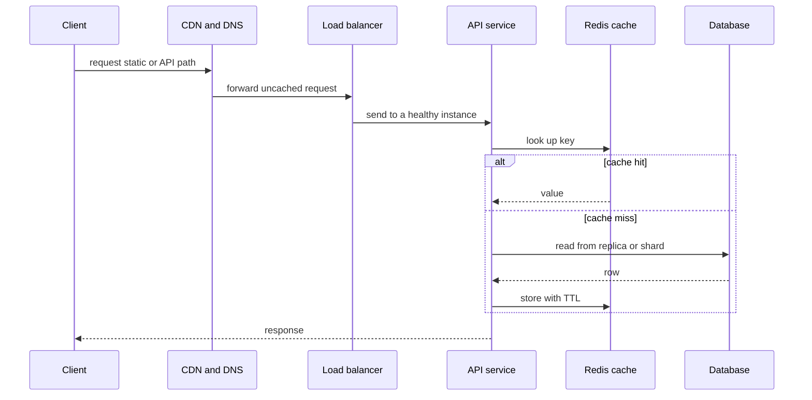

# System Design Fundamentals

!!! note "In simple words"
    System design is planning how many parts a service needs, how they talk to each other, and where the data lives, so the service stays fast and working as more people use it.

System design questions are open-ended on purpose. An interviewer gives you a product, such as a messaging app or a video service, and watches how you turn a vague request into a plan. The plan is not judged by one correct answer. It is judged by whether you asked the right questions, made reasonable assumptions with numbers, and explained the trade-off behind each choice.

## Why it matters

Most production outages are not caused by a single bad line of code. They come from a design that assumed too little load, kept too much state in one place, or retried a failing call until everything else stopped. Thinking through the design before building avoids those problems. It also gives a shared picture that a team can discuss, change, and review.

For an engineer, the skill is a repeatable method. With a method, you do not need to remember every technology to structure an answer. You start with the questions, move to the numbers, then to the boxes and arrows, and finish with the failure cases.

## How it works

A practical design flow has eight stages. Spend the most time on the stages that matter most for the product. A read-heavy catalogue needs a deep look at caching. A payment system needs a deep look at correctness.

1. **Clarify the requirements.** Split them into functional requirements (what the system does) and non-functional requirements (how well it does it). Non-functional requirements cover scale, latency, availability, durability, and consistency.
2. **Estimate the scale.** Work out daily users, requests per second, data stored per year, and the ratio of reads to writes. Label these numbers as assumptions.
3. **Define the interface.** List the main operations, their inputs and outputs, and how lists are paged.
4. **Sketch the components.** Show clients, an entry point, services, storage, and any caches or queues. Trace the path of one important request.
5. **Model the data.** Choose a store family, define keys and indexes, and decide how data is partitioned.
6. **Scale the design.** Add horizontal scaling, load balancing, caching, asynchronous processing, and a content delivery network where they help.
7. **Plan for failure.** Decide what happens when a dependency is slow, down, or returns errors. Use timeouts, retries with limits, circuit breakers, and sensible fallbacks. The details are in [Scalability and Failover](scalability-and-failover.md).
8. **State the trade-offs.** Say what you chose, what you gave up, and what would change at ten times the load.

### Estimating scale with a quick calculation

Estimates do not need to be exact. They need to show the order of magnitude, so you know whether a single database is enough. The Java program below turns daily active users into average and peak requests per second. It compiles on Java 21:

```java
public class TrafficEstimate {

    public static void main(String[] args) {
        long dailyActiveUsers = 5_000_000L;
        int requestsPerUserPerDay = 40;
        double peakToAverageRatio = 3.0;      // assume traffic peaks at three times the average

        long requestsPerDay = dailyActiveUsers * requestsPerUserPerDay;
        double averageQps = requestsPerDay / 86_400.0;
        double peakQps = averageQps * peakToAverageRatio;

        System.out.printf("requests per day: %,d%n", requestsPerDay);
        System.out.printf("average QPS: %.0f%n", averageQps);
        System.out.printf("peak QPS: %.0f%n", peakQps);
    }
}
```

With these assumptions the service handles about 2,300 requests per second on average and about 7,000 at peak. That is a size a few well-placed instances and a cache can serve. Change one assumption and the answer changes, which is exactly why the assumptions must be stated.

### The request flow

The diagram below shows the path of one read request through a typical web system. Each arrow is a place where you can add a cache, a timeout, or a metric.



Writes follow a different path. They go to the primary database or to the correct shard, and the service then publishes an event so that search indexes, analytics, and notifications update later.

### Questions to ask at the start

Before drawing, ask the questions below. Each answer changes a later decision, so write the answers down where everyone can see them.

- Who are the users, and how many are active each day?
- Which action is the most frequent, and which one matters most to the business?
- How fresh must the data be? Is a delay of a few seconds acceptable?
- What happens if the system is down for five minutes? For an hour?
- Are there legal rules about where data is stored or how long it is kept?
- Which numbers are known, and which must be assumed?

### Turning the flow into a plan

Use the request flow to explain each component:

- The **edge** serves static files close to the user and can absorb some traffic before it reaches your servers.
- The **load balancer** spreads requests across instances and removes unhealthy ones.
- The **service** holds the business rules. It should be stateless so any instance can serve any request.
- The **cache** saves repeated reads. It needs a clear rule for when entries expire or are removed.
- The **database** stores the source of truth. Replicas and shards handle the growth.
- The **queue** carries slow work out of the request path.

## Where it is used

- Designing new services for a team that will run them in production.
- Preparing for technical interviews, where the same framework applies to nearly every prompt.
- Reviewing an existing system before a large launch or a traffic peak.
- Writing architecture decision records, where the trade-offs must be explicit.

## Benefits

- A fixed method keeps an open question manageable, and it leaves less to chance.
- Estimates reveal early whether a simple design is enough, which saves cost.
- Explicit trade-offs make decisions easier to review and to reverse later.
- Failure planning in the design leads to fewer surprises in production.

## Cons and limits

- Estimates can look more precise than they are. Always label them as assumptions.
- Designing for a scale you will not reach adds complexity without value. Start with the simplest design that meets the stated requirements.
- A framework can become a checklist that hides weak reasoning. Interviewers and reviewers look for the reason behind each box.
- Every design has a cost in operations, people, and money, and not all of those costs appear on the whiteboard.

Common mistakes in a design answer:

- Jumping to a technology before the requirements are clear.
- Adding a queue, cache, or new service without saying which problem it solves.
- Quoting a number with no assumption behind it.
- Forgetting the failure case, so the design only works on a good day.
- Talking for a long time about one box and never reaching the rest of the system.

## Best practices

- Ask about the users, the peak load, the read-to-write ratio, and the acceptable delay before drawing anything.
- Write down the numbers and the assumptions behind them. Change them out loud when they change.
- Start with the simplest design that meets the requirements, then add parts only for a stated reason.
- Trace one main request end to end before adding detail elsewhere.
- Name the failure cases for each component, including what the user sees.
- Close each decision with its trade-off, instead of saving all the trade-offs for the end.

!!! tip "Interview tip"
    **Q: Where do you start when given an open design question?**
    Start with the requirements and the scale, not the technology. Ask who the users are, how many there are, how many requests they make, and which behaviour matters most. Once the numbers are on the table, the choice of cache, queue, and store follows from them, and you can justify each choice.

## Quick recap

- Clarify requirements, estimate scale, define the interface, sketch components, model data, scale, plan for failure, and state trade-offs.
- Estimates turn a vague load into requests per second and storage. Always label assumptions.
- Trace one request through the edge, load balancer, service, cache, and database to find the bottlenecks.
- Make the service stateless so it can scale out, and keep failure handling in the design from the start.
- Explain every decision with the trade-off it accepts.

## Official documentation

- [The Twelve-Factor App](https://12factor.net/)
- [Microservices by Martin Fowler](https://martinfowler.com/articles/microservices.html)
- [Kubernetes Service concept](https://kubernetes.io/docs/concepts/services-networking/service/)
- [Kubernetes Ingress concept](https://kubernetes.io/docs/concepts/services-networking/ingress/)

**See also:** [Building Blocks](building-blocks.md) | [Worked Examples](worked-examples.md) | [Core Concepts](core-concepts.md) | [High-Level Design](high-level-design.md) | [Scalability and Failover](scalability-and-failover.md)
