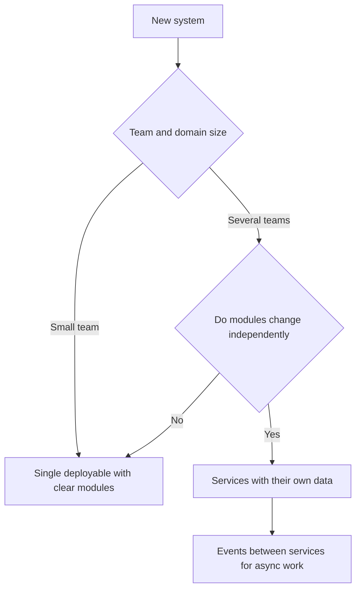

# High-Level Design

!!! note "In simple words"
    High-level design is the map of a system: which big parts exist, how they send messages to each other, and where each kind of data is kept.

High-level design (HLD) is about the big picture. You choose an architecture style, place the entry point, the caches, the databases, the queues, and the content network, and explain why each one is there. The details inside each box belong to low-level design, covered in [Low-Level Design](low-level-design.md).

## Why it matters

The first architecture decision shapes the team for years. A system split into many services too early adds network calls, deployment work, and debugging pain before anyone needs them. A single database used for everything becomes the bottleneck when traffic grows. Good high-level design picks the simplest shape that meets the stated requirements, and it leaves clear places where the shape can grow later.

## How it works

### Architecture styles

- **Layered (N-tier)**: presentation, business logic, and data access live in separate layers. It is easy to understand and a common starting point for a monolith.
- **Model-view-controller**: separates data, presentation, and input handling. It describes how a web application is structured inside, not how it is deployed.
- **Microservices**: independently deployed services, each owning its own data. They allow independent scaling and team autonomy, at the cost of network calls, distributed data, and more operational work.
- **Event-driven**: components publish and consume events through a broker. This decouples producers from consumers and makes asynchronous work natural.
- **Lambda architecture**: a batch layer and a speed layer process the same data, and a serving layer merges their results. It combines complete historical results with fast, approximate, recent ones.

Start with the simplest style that meets the requirements. A modular monolith, with clear module boundaries inside one deployable unit, is often a better first step than microservices. Move a module into its own service when a real reason appears, such as independent scaling or a separate team.



### Load balancing

A load balancer spreads requests across healthy instances. The main algorithms are:

| Algorithm | How it chooses | Suits |
|---|---|---|
| Round robin | Next server in turn | Similar servers and similar requests |
| Least connections | Server with the fewest open connections | Requests that take uneven time |
| Weighted | Servers with higher weight get more traffic | Machines of different sizes |
| IP hash | Hash of the client address | Simple affinity, with some breakage when clients move networks |
| Consistent hashing | Position on a hash ring | Caches and shards that must move few keys when nodes change |

A Layer 4 balancer routes on transport details such as IP and port, which is fast. A Layer 7 balancer reads HTTP details such as paths and headers, which allows smarter routing and TLS termination, at higher CPU cost. The ring behind consistent hashing is explained, with code, in [Building Blocks](building-blocks.md).

### Caching

A cache keeps data that is read often and closer to the caller. Three write patterns are common:

- **Cache-aside**: the application checks the cache first. On a miss it loads from the database and stores the result. Writes update the database and then remove or update the cache entry.
- **Write-through**: writes go to the cache and the database together. Reads see the latest data, but writes are slower.
- **Write-behind**: writes go to the cache and reach the database later. This is fast, but a cache failure before the flush loses data.

A time to live bounds how stale an entry may become. Invalidation is harder: it means removing or updating entries when the source changes, while handling races between readers and writers. A distributed cache such as a Redis cluster is shared by all instances and partitions keys across nodes.

The sketch below shows cache-aside with `ConcurrentHashMap`. It has no expiry and no size limit, which a real cache must add:

```java
import java.util.Map;
import java.util.concurrent.ConcurrentHashMap;
import java.util.function.Function;

public class CacheAside<K, V> {

    private final Map<K, V> cache = new ConcurrentHashMap<>();
    private final Function<K, V> database;

    public CacheAside(Function<K, V> database) {
        this.database = database;
    }

    public V get(K key) {
        V cached = cache.get(key);
        if (cached != null) {
            return cached;                       // hit
        }
        V loaded = database.apply(key);          // miss: read the source of truth
        if (loaded != null) {
            cache.put(key, loaded);
        }
        return loaded;
    }

    public void onWrite(K key) {
        cache.remove(key);                       // invalidate so the next read reloads
    }

    public static void main(String[] args) {
        CacheAside<String, String> users = new CacheAside<>(id -> "profile-of-" + id);
        System.out.println(users.get("42"));     // miss, loads from the source
        System.out.println(users.get("42"));     // hit, served from the map
    }
}
```

### Database scaling

- **Read replicas** copy data from a primary and serve reads. They scale read-heavy work, but they lag behind the primary, so a read straight after a write can be stale.
- **Sharding** splits data across databases by a shard key. Range sharding keeps neighbouring keys together, which makes range scans easy, but new data can pile onto the newest range. Hash sharding spreads load evenly, but range queries must visit every shard. Consistent hashing lets you add shards while moving few keys.
- **The shard key** decides whether load is even. A key with a few very common values creates hot shards.
- **Cross-shard queries** need scatter-gather or a separate read model. Cross-shard transactions are costly.
- **Primary-replica** replication has one writer. **Multi-primary** accepts writes in several places and must resolve conflicts.

Deeper treatment of these choices is in [Replication, Sharding, and NoSQL](replication-sharding-nosql.md).

### Message queues

A queue separates the producer from the consumer. The producer records the work and returns. Workers take the work at their own pace. Queues smooth spikes, allow retries, and spread work over many workers. The cost is that the caller no longer knows when the work finished. Design for eventual completion, and make consumers idempotent, because redelivery is normal.

### Content delivery networks

A content delivery network (CDN) stores copies of static and cacheable responses at edge locations near users. It lowers latency, reduces load on the origin, and absorbs some traffic spikes. Compression and correct cache headers increase the benefit. Personalised responses are harder to cache, and they need explicit rules.

### Synchronous and asynchronous calls

A synchronous call waits for the answer. The caller's latency includes the callee's work, so a slow callee slows the caller. An asynchronous message returns at once. The caller is decoupled, but the result arrives later and must be handled.

Use synchronous calls where the user needs the answer now, such as a price on a product page. Use asynchronous work where the user does not wait, such as sending a receipt or updating a search index.

### OLTP and OLAP

- **OLTP** (online transaction processing) handles many small, concurrent transactions, such as placing orders. It favours normalised schemas, indexes for point lookups, and strong consistency.
- **OLAP** (online analytical processing) runs large scans and aggregations for reports. It favours denormalised or columnar storage, often fed from a copy of the transactional data.

Keep analytics away from the transactional database. Stream or replicate changes into an analytical store, so a long report does not slow checkout.

### API gateway

An API gateway is the single entry point for external clients. It routes each request to the right service, and it handles cross-cutting concerns once, not in every service: authentication, TLS termination, rate limiting, request logging, and sometimes aggregation of several internal calls into one response.

Keep the gateway thin. Routing and policy belong there, and business rules belong in services. A gateway full of business logic becomes a bottleneck that every team must change. It must also be highly available, because every external request passes through it.

### Rate limiting

Rate limiting caps how many requests a client, key, or route may make in a period. It protects services from overload and noisy callers. Place the limiter at the gateway or in middleware. Keep the counters in a shared store, so every instance sees the same count. When the limit is reached, return `429 Too Many Requests` with a `Retry-After` header.

Decide whether the limiter fails open or fails closed when its store is unavailable. Failing open keeps traffic flowing, and failing closed protects the backend. The right answer depends on the route.

### Unique IDs

Many designs need IDs that are unique across many machines without a central bottleneck.

- A **database sequence** is simple and ordered, but every ID needs a call to one database.
- A **UUID** needs no coordination, but it is 128 bits and not ordered by time in its usual form, which weakens index locality.
- A **Snowflake-style ID** packs a timestamp, a machine number, and a sequence into 64 bits. It is roughly time ordered, and each machine can create IDs alone, provided machine numbers are unique and the clock does not run backwards.

Snowflake-style IDs suit feeds, messages, and orders where rough time order helps.

### API design and pagination

Design the API before the storage, and make the contract explicit: resource names, methods, status codes, and request limits. For lists, pick the paging style on purpose.

- **Offset pagination** (`page` and `size` parameters) is easy to use, but the database must skip rows, so deep pages get slower. Rows inserted while a client pages can also shift results.
- **Cursor or keyset pagination** asks for rows after a known position. The cost stays flat, and results do not shift. It is harder for a client that wants to jump straight to page 40.

Use cursors for feeds and large collections that change often. Offset pagination is fine for small, stable lists. The SQL below shows keyset paging, which is what a cursor usually becomes in the database:

```sql
-- first page
SELECT id, title, created_at
FROM posts
ORDER BY created_at DESC, id DESC
LIMIT 20;

-- next page, using the last row seen on the previous page as the cursor
SELECT id, title, created_at
FROM posts
WHERE (created_at, id) < (:last_created_at, :last_id)
ORDER BY created_at DESC, id DESC
LIMIT 20;
```

The `id` breaks ties when two posts share a timestamp. Without it, rows could be skipped or repeated at a page boundary.

## Where it is used

- Designing a new platform, where the architecture style and the storage plan are chosen together.
- Planning the read path of a product catalogue, with a CDN, a cache, and replicas.
- Splitting a monolith when one module needs its own scaling or team.
- Reviewing a system before a launch that will raise the load sharply.

## Benefits

- A simple architecture is cheaper to build, run, and debug.
- Caches, replicas, and queues each relieve one specific bottleneck, so you add them only where the numbers call for them.
- A thin gateway keeps cross-cutting rules consistent across services.
- Keyset pagination keeps deep pages fast and stable.

## Cons and limits

- Microservices add network calls, distributed data, and operational overhead, and they can slow a small team down.
- Caches can serve stale data, and invalidation is easy to get wrong.
- Replicas lag, and a read after a write may not see the write.
- Sharding makes some queries and transactions expensive or impossible without extra design.
- A queue does not guarantee exactly-once processing, so consumers must handle duplicates.

## Best practices

- Choose the simplest architecture that meets the requirements, and write down the trigger for splitting it.
- Give every cache a time to live and a clear invalidation rule.
- Pick a shard key that matches the main queries and spreads the load.
- Route reads that must be fresh to the leader, and accept lag elsewhere.
- Keep analytics off the transactional database.
- Make consumers idempotent, and make the gateway thin.
- Publish a request path diagram, and review it with the team.

## Common pitfalls

- Adding microservices before the domain and the team need them.
- Caching without a plan for invalidation, which serves old data indefinitely.
- Choosing a shard key that concentrates traffic on one shard.
- Reading from a replica straight after a write and expecting to see the write.
- Sending analytical queries to the primary transactional database.
- Assuming a queue delivers each message exactly once.

!!! tip "Interview tip"
    **Q: How would you scale the read path of a product catalogue?**
    Put a CDN in front of cacheable pages and images. Add a distributed cache with cache-aside and a time to live. Send the remaining reads to replicas. Then name the trade-off: a price change may take as long as the time to live to appear. Decide whether that delay is acceptable, or whether writes should invalidate the cache directly.

## Quick recap

- Pick an architecture style that matches the team and the domain, and start simple.
- Load balancers use simple or hash-based algorithms; consistent hashing moves few keys when nodes change.
- Cache-aside, write-through, and write-behind trade freshness, speed, and durability.
- Replicas scale reads with lag. Sharding scales writes but brings hot spots and cross-shard costs.
- Queues decouple work. CDNs serve edge content. Keep OLTP and OLAP apart.
- Use cursor pagination for large, changing lists.

## Official documentation

- [Microservices by Martin Fowler](https://martinfowler.com/articles/microservices.html)
- [Kubernetes Ingress concept](https://kubernetes.io/docs/concepts/services-networking/ingress/)
- [Redis documentation](https://redis.io/docs/latest/)
- [Apache Kafka documentation](https://kafka.apache.org/documentation/)

**See also:** [Core Concepts](core-concepts.md) | [Low-Level Design](low-level-design.md) | [Building Blocks](building-blocks.md) | [Practice Problems](practice-problems.md) | [Redis and Caching](../12-caching-performance/spring-cache-and-redis.md)
