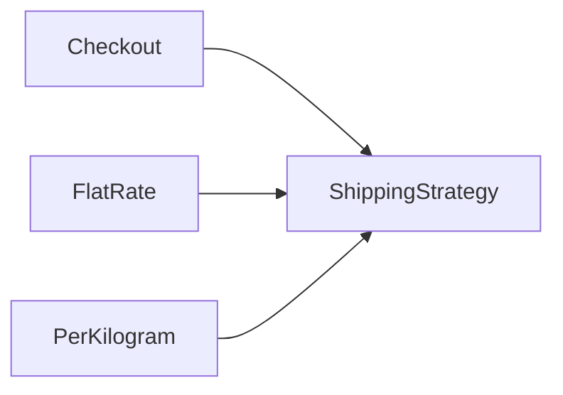

# Low-Level Design

!!! note "In simple words"
    Low-level design takes one box from a system diagram and decides which classes live inside it, what each class is responsible for, and how they talk to each other.

Low-level design (LLD) tests object-oriented thinking. An interviewer wants to see that you separate responsibilities, choose a sensible abstraction, use patterns only where they pay off, and handle errors without letting failures spread through the whole program.

## Why it matters

Code written without a plan tends to grow tangled. One class does the pricing, the persistence, and the email, so any change touches everything. A design that starts from the requirements gives each piece one job. Later changes, such as a new payment method or a new notification channel, then add code in one place instead of editing many tested classes.

LLD also protects the team. Clear interfaces let people work in parallel, and small classes are easier to test in isolation.

## How it works

### Start from the requirements

Read the requirements and mark the nouns and verbs. Nouns usually become classes, such as `Order`, `Seat`, or `Account`. Verbs usually become methods, such as `reserve`, `pay`, or `cancel`. Then decide which parts of the system change often, because those are the places that need seams.

A good object design has four traits:

- **Clear responsibilities.** Each class has one reason to change.
- **Encapsulated state.** Fields are private, and changes go through methods that keep the object valid.
- **Interfaces at the seams.** Code depends on an abstraction wherever the behaviour may vary.
- **Composition over inheritance.** Objects are combined, instead of stacking deep class hierarchies that tie code together.

### Protect invariants in the constructor

An invariant is a rule that must always hold for an object. The constructor is the place to enforce it. The `Order` below cannot exist with a negative total, and its fields are final, so the object is safe to share between threads:

```java
import java.math.BigDecimal;

public final class Order {

    private final String id;
    private final BigDecimal total;

    public Order(String id, BigDecimal total) {
        if (total.signum() < 0) {
            throw new IllegalArgumentException("total must not be negative");
        }
        this.id = id;
        this.total = total;
    }

    public String id() {
        return id;
    }

    public BigDecimal total() {
        return total;
    }

    public static void main(String[] args) {
        System.out.println(new Order("o-1", new BigDecimal("19.90")).total());
    }
}
```

### Records and sealed types for data

A **record** (Java 16) is a concise, immutable carrier for data. A **sealed** type (Java 17) lists the only classes allowed to implement it. Together they model a closed set of results, and a `switch` over them is checked by the compiler:

```java
public class PaymentResultDemo {

    public sealed interface PaymentResult permits Approved, Declined {}

    public record Approved(String authCode) implements PaymentResult {}

    public record Declined(String reason) implements PaymentResult {}

    static String describe(PaymentResult result) {
        return switch (result) {
            case Approved approved -> "approved with code " + approved.authCode();
            case Declined declined -> "declined: " + declined.reason();
        };
    }

    public static void main(String[] args) {
        System.out.println(describe(new Approved("A1")));
        System.out.println(describe(new Declined("insufficient funds")));
    }
}
```

If a new variant is added to `permits`, every `switch` without a case for it fails to compile. That is the safety net you want.

For API design, give methods names that describe intent, such as `reserve(seat)` rather than `update(state)`. Return new values rather than changing arguments in place, and document the preconditions. A public Java API deserves the same care as an HTTP API: stable names, clear error types, and no leaking of internal types.

### Design patterns

Patterns are named answers to recurring problems. Use one when it removes real duplication or a real variation point. Do not add one just to look thorough.

**Singleton** guarantees one instance. In Java, a single-element enum is the simplest safe form, because the JVM guarantees it is created once and it resists reflection and serialisation tricks:

```java
public enum AppClock {
    INSTANCE;

    public long nowMillis() {
        return System.currentTimeMillis();
    }

    public static void main(String[] args) {
        System.out.println(AppClock.INSTANCE.nowMillis() > 0);
    }
}
```

A singleton is still a global. Tests cannot easily replace it, so prefer injecting a dependency where you can.

**Factory** moves object creation into one place, so callers depend on an interface rather than on concrete classes:

```java
public class NotifierFactoryDemo {

    interface Notifier {
        void send(String message);
    }

    static final class EmailNotifier implements Notifier {
        public void send(String message) {
            System.out.println("email: " + message);
        }
    }

    static final class SmsNotifier implements Notifier {
        public void send(String message) {
            System.out.println("sms: " + message);
        }
    }

    static Notifier create(String channel) {
        return switch (channel) {
            case "email" -> new EmailNotifier();
            case "sms" -> new SmsNotifier();
            default -> throw new IllegalArgumentException("unknown channel: " + channel);
        };
    }

    public static void main(String[] args) {
        create("sms").send("your code is 1234");
    }
}
```

**Strategy** puts each algorithm behind an interface, so one can be swapped without changing its caller. A checkout that charges shipping by different rules is a natural fit:

```java
import java.math.BigDecimal;

public class ShippingDemo {

    interface ShippingStrategy {
        BigDecimal cost(BigDecimal weightKg);
    }

    static final class FlatRate implements ShippingStrategy {
        public BigDecimal cost(BigDecimal weightKg) {
            return new BigDecimal("5.00");
        }
    }

    static final class PerKilogram implements ShippingStrategy {
        public BigDecimal cost(BigDecimal weightKg) {
            return weightKg.multiply(new BigDecimal("1.50"));
        }
    }

    static final class Checkout {
        private final ShippingStrategy shipping;

        Checkout(ShippingStrategy shipping) {
            this.shipping = shipping;
        }

        BigDecimal shippingFor(BigDecimal weightKg) {
            return shipping.cost(weightKg);
        }
    }

    public static void main(String[] args) {
        Checkout checkout = new Checkout(new PerKilogram());
        System.out.println(checkout.shippingFor(new BigDecimal("2")));   // prints 3.00
    }
}
```

The diagram shows the dependency direction. `Checkout` depends on the interface, and each rule is a separate class that can be tested alone:



**Observer** lets interested parties react when something changes. In Java, listener interfaces and the `java.util.concurrent.Flow` API follow this idea. Keep listeners quick, or hand their work to an executor, so one slow listener does not hold up the publisher.

### SOLID principles

- **Single responsibility**: a class has one reason to change.
- **Open/closed**: add behaviour by adding code, such as a new strategy, instead of editing tested code.
- **Liskov substitution**: a subtype honours the contract of its supertype, so callers need no type checks.
- **Interface segregation**: prefer small interfaces that each client actually uses.
- **Dependency inversion**: depend on abstractions and receive implementations from outside.

The `Checkout` above follows dependency inversion. It depends on `ShippingStrategy`, not on any one carrier, so a new carrier needs no change to `Checkout`.

### Errors and graceful degradation

- Use exceptions for conditions the caller cannot continue from. Use checked exceptions for recoverable cases the caller must handle, and unchecked exceptions for programming mistakes.
- Use `Optional` to say that a query may find nothing. Do not use it for a value that is always required.
- Translate low-level errors at the boundary. A repository should not expose a driver-specific exception to the domain code.
- **Graceful degradation** keeps the core function working when a dependency fails. Return cached or default data, skip a non-essential feature, or fail fast with a clear message.

The service below returns a generic answer when its recommendation client fails, so the page still renders:

```java
public class RecommendationService {

    interface RecommendationClient {
        String fetchFor(String userId) throws Exception;
    }

    private final RecommendationClient client;

    RecommendationService(RecommendationClient client) {
        this.client = client;
    }

    public String recommendationsFor(String userId) {
        try {
            return client.fetchFor(userId);
        } catch (Exception e) {
            // Degrade: the page still renders, just without personal items
            return "popular-items";
        }
    }

    public static void main(String[] args) {
        RecommendationService service = new RecommendationService(id -> {
            throw new Exception("recommendation service is down");
        });
        System.out.println(service.recommendationsFor("user-7"));   // prints popular-items
    }
}
```

In production, also log the failure with its context, and consider a circuit breaker, so that repeated failures stop adding latency to every request.

### Step by step method

A method that works in an LLD interview:

1. Clarify the requirements and the main use cases.
2. Identify the core entities and how they relate.
3. Define the public interfaces and the main method signatures.
4. Apply patterns only where variation or creation logic is real.
5. Walk one main use case from start to finish, and check the SOLID principles.
6. Describe the error cases and what the user sees in each one.

## Where it is used

- Designing the domain model of a service, such as orders, accounts, or bookings.
- Structuring a library or SDK, where public interfaces must stay stable.
- Interview rounds that ask you to design a parking lot, a vending machine, an elevator, or a rate limiter in code.
- Code reviews, where patterns and responsibilities are checked against the requirements.

## Benefits

- Small classes with clear responsibilities are easier to test and to change.
- Interfaces at the seams let you swap a carrier, a channel, or a store without rewriting callers.
- Records and sealed types make invalid states hard to write, and the compiler helps find missing cases.
- Graceful degradation keeps the user's core task working during partial outages.

## Cons and limits

- Every interface with one implementation adds indirection with no benefit.
- Patterns can be applied too early. A plain `if` or an enum with a `switch` is often clearer for a small, stable set of variants.
- A singleton holds global state, and that state makes tests order-dependent.
- Deep inheritance trees couple classes so tightly that a change in one ripples through many others.
- Over-abstracted code is harder to debug, because the path from the call to the work is long.

## Best practices

- Derive the classes and methods from the requirements, and write down the main use case before drawing any class.
- Enforce invariants in constructors, and make value objects immutable.
- Use interfaces where behaviour varies, and keep them small.
- Inject dependencies so that tests can replace them.
- Translate errors at boundaries, and never swallow an exception silently.
- Make shared mutable objects thread-safe, or avoid sharing them.

## Common pitfalls

- Making every class an interface with exactly one implementation.
- Using a singleton for state that tests need to replace.
- Building deep inheritance trees for code reuse.
- Sharing mutable domain objects across threads without synchronisation.
- Catching an exception and doing nothing, so the failure disappears.
- Picking a pattern before understanding the variation it is meant to handle.

!!! tip "Interview tip"
    **Q: Why use a Strategy instead of an if-else chain?**
    A Strategy puts each algorithm behind an interface. Adding a new algorithm means adding a class, not editing a conditional that every change touches. That follows the open/closed principle and lets each algorithm be tested alone. Mention that an enum with a `switch` is often enough when the set of variants is small and stable, and that choosing a pattern is a judgement, not a rule.

## Quick recap

- Model with clear responsibilities, private state, and narrow, intent-revealing methods.
- Use records for data and sealed types for closed sets of variants.
- Apply a singleton as an enum, a factory, a strategy, or an observer only where they remove real variation.
- SOLID guides the seams. Dependency inversion matters most for testing.
- Translate errors at boundaries, and degrade gracefully when a dependency fails.

## Official documentation

- [Java 21 API documentation](https://docs.oracle.com/en/java/javase/21/docs/api/index.html)
- [Java Language Specification, Java SE 21](https://docs.oracle.com/javase/specs/jls/se21/html/index.html)
- [Java.dev](https://dev.java/)

**See also:** [Core Concepts](core-concepts.md) | [High-Level Design](high-level-design.md) | [Practice Problems](practice-problems.md) | [Java Core](../02a-core-language/index.md)
