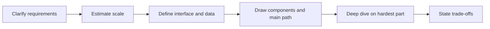

# Practice Problems

!!! note "In simple words"
    Practice problems are open design prompts. You take a product, ask questions, sketch the parts, then pick the hardest part to explain in detail. Practising the same steps on many products is what makes the steps automatic.

This page gives a repeatable approach for design interviews, then ten worked outlines: a URL shortener, a chat system, a hotel booking system, a rate limiter, a news feed, a payment system, a notification service, a video platform, a ride-sharing system, and an issue tracker. The outlines are starting points. The answer you give depends on the requirements you clarify, so treat each outline as a set of questions to ask as much as a set of answers.

## Why it matters

A 45-minute design interview rewards structure. Candidates who jump straight to boxes often build the wrong system, because they never confirmed the scale or the most important requirement. Candidates who follow a steady order find the hard part early, spend their time there, and finish with a clear list of trade-offs.

The outlines also teach patterns that repeat. Key generation appears in URL shorteners and in ID services. Idempotency appears in payments, notifications, and bookings. Fan-out appears in chat, feeds, and notifications. Once you recognise a pattern, you can reuse it on a product you have never seen.

## How it works

### A repeatable approach

1. **Requirements.** Separate what the system does (functional) from how well it does it (non-functional: scale, latency, availability, consistency). Ask about the read-to-write ratio and the peak load.
2. **Estimates.** Give rough numbers for users, requests per second, storage, and bandwidth. Label them as assumptions.
3. **Interface and data model.** Name the main operations and the core entities with their keys.
4. **High-level design.** Draw the components and trace the path of the main request.
5. **Deep dive.** Pick the hardest part, such as key generation, ordering, or concurrency, and explain it in detail.
6. **Trade-offs.** Say what you chose, what you gave up, and what would change at ten times the load.

### Pacing the interview

- Spend the first few minutes on requirements. A design built on the wrong assumptions wastes the rest of the session.
- Sketch the high-level diagram early, then move to the deep dive when the interviewer shows interest.
- State each trade-off as you make the decision, rather than saving them for the end.
- When you do not know a detail, state an assumption and carry on. Interviewers usually value the reasoning more than the exact figure.

### Other common prompts

Some prompts appear often without an outline here: an online shop with a product catalogue, inventory, and orders; a search engine with crawling, indexing, and ranking; and a video streaming service with encoding, a CDN, and adaptive bitrate. The same six steps apply to them.

### Outline: URL shortener

**Requirements.** Create a short link for a long URL. Redirect a short link to the original. Support custom aliases, expiry, and click counts. Redirects must be fast and highly available, and no two links may share a code. The system is read-heavy.

**Estimates (assumptions).** A 7-character code from a 62-character alphabet gives 62 to the power 7, about 3.5 trillion codes. Storage is the record size times the number of links kept.

**API and data.** `POST /links` returns a short code. `GET /{code}` returns a redirect. A `links` table is keyed by code, and clicks go to a separate, asynchronous store.

**Components.**

- A key generator. A counter encoded in base 62 is simple but needs coordination. Random codes need a uniqueness check. Pre-allocated ranges let each instance generate codes without a call per link.
- A key-value store partitioned by code, with a cache in front for hot codes.
- A click pipeline that receives events from a queue, so redirects never wait for analytics.

**Trade-offs.** A counter avoids collisions but reveals how many links exist. Random codes hide volume but need a uniqueness check. A 301 redirect is cached by browsers and lowers load, but it hides later clicks. A 302 keeps counts accurate at higher load.

!!! tip "Interview tip"
    **Q: How do you prevent two users from getting the same short code?**
    Let the unique constraint on the code column be the final judge. Generate a candidate, insert it, and retry on a duplicate-key error. For higher throughput, give each instance its own range of counter values, so no two instances ever produce the same number.

### Outline: chat system

**Requirements.** One-to-one and group messaging, message history, delivery and read status, presence, and push notifications for offline users. A message acknowledged to the sender must not be lost. Delivery should feel immediate.

**Estimates (assumptions).** The key number is the count of open connections at peak, because it decides how many connection servers you need. Message throughput and average message size set the storage budget.

**API and data.** Clients keep a persistent connection, such as a WebSocket, for live messages. History comes from a REST call. Messages are partitioned by conversation and ordered by time inside each partition. A presence record expires unless a heartbeat refreshes it.

**Components.**

- Connection gateways that hold the sockets and record which server holds which user.
- A session registry, which is a shared key-value store.
- A message service that assigns IDs and persists each message before the sender is acknowledged.
- A fan-out service that pushes to the recipient's connection server, or queues the message and sends a push notification when the recipient is offline.
- A presence service built on heartbeats and expiry.

**Trade-offs.** Fan-out on write makes reads fast, but large groups multiply the writes. Acknowledging only after persistence is safer but slower. Ordering is simplest in one partition, which caps the throughput of very large groups. Presence is approximate, and the design should accept brief errors.

!!! tip "Interview tip"
    **Q: What happens if the recipient is offline when a message is sent?**
    The message is stored first, so it is never lost. The fan-out service finds no active connection in the registry, so it queues the delivery and sends a push notification. When the client reconnects, it fetches history from the last message it has seen. Message IDs that increase within a conversation let the client spot gaps.

### Outline: hotel booking

**Requirements.** Search availability by dates and place, reserve a room, pay, cancel, and never double-book a room. Search may be slightly stale, but a reservation must be correct under concurrent requests.

**Estimates (assumptions).** Searches far outnumber bookings. Inventory is per room type per night, which makes the table manageable for each property.

**API and data.** `GET /availability` for search, `POST /reservations` to book, and `DELETE /reservations/{id}` to cancel. The `room_inventory` table has a unique key on hotel, room type, and night, plus a version column.

**Components.**

- A search service that reads a replica or a cache of availability.
- A reservation service, the only writer of inventory.
- A relational inventory store, where transactions protect the counts.
- A payment step that uses idempotency keys, so retries never charge twice.
- A workflow that reserves, charges, and confirms, and releases the room if payment fails.
- An expiry job that frees unpaid holds after a time limit.

**Concurrency control.** A pessimistic lock on the inventory rows is correct, but it holds locks during the whole transaction. An optimistic version check succeeds only when nobody changed the row, and the client retries on conflict. A conditional decrement, such as "decrease the count where the count is above zero", is atomic and avoids a separate read. Choose by contention. A popular property on a sale date needs the short, atomic update.

**Trade-offs.** Holding a room during checkout improves the experience but can block rooms from abandoned carts, so a short hold with expiry is a balance. Overbooking is a business policy, and the design should make it explicit.

!!! tip "Interview tip"
    **Q: Two users book the last room at the same moment. What happens?**
    Only one conditional update can succeed, because the database serialises writes to the same row. The other request updates zero rows and returns "no longer available". Mention the optimistic version column as the alternative, and explain when each one is better.

### Outline: rate limiter

**Requirements.** Limit each API key to N requests per window, with different limits for each plan or route. Return a clear rejection when the limit is reached. Enforce the limit across all instances, add little latency, and avoid a single point of failure.

**Estimates (assumptions).** Each key needs one small counter per window, so storage is modest. The real cost is store operations, because every request makes at least one.

**Components.** A gateway filter that identifies the caller, a shared counter store with expiry, a rule cache in each instance, and metrics that show rejections per key.

**Trade-offs.** A token bucket allows bursts. A fixed window is cheaper but lets a client send double the limit around a window boundary. A central store is accurate but adds a round trip. Failing open protects availability, while failing closed protects the backend. Choose per route.

!!! tip "Interview tip"
    **Q: Two gateway instances check the same key at the same moment. How do you stop both getting through?**
    Make the check and the update one atomic operation in the store, such as a Redis script that increments the counter and compares it with the limit in one step. Reading the count, deciding in the application, and writing it back is a race that lets extra requests through.

### Outline: news feed

**Requirements.** Users follow other users and publish posts. The home timeline shows followed posts, newest or ranked first, and pages as the user scrolls. Reading must be fast, a new post should appear within seconds, and no accepted post may be lost. Very popular accounts must not overload the system.

**Estimates (assumptions).** The key number is fan-out: posts per second times average follower count. A few accounts with millions of followers dominate that total, so averages alone mislead.

**API and data.** `POST /posts`, `POST /follows/{userId}`, and `GET /timeline?cursor=`. Posts use time-ordered IDs. The follow graph is indexed in both directions. Each user has a capped timeline cache of post IDs.

**Components.** A post service that publishes a post-created event. Fan-out workers that add the post ID to each follower's timeline cache. A timeline service that loads post bodies in a batch. A follow service that backfills recent posts for a new follow.

**Trade-offs.** Fan-out on write makes reads cheap, but one post by an account with ten million followers creates ten million writes. Fan-out on read keeps writes cheap, but each read merges many sources. A hybrid pushes ordinary posts on write and merges celebrity posts on read.

!!! tip "Interview tip"
    **Q: What happens when an account with millions of followers posts?**
    Fan-out on write would queue millions of cache updates at once. Skip fan-out for accounts above a follower threshold, and merge their recent posts when a follower loads the timeline. The read becomes slightly more expensive, but the write stays bounded. The threshold is a tunable setting.

### Outline: payment system

**Requirements.** Accept a payment for an order, report its status, and refund it in full or in part. Never charge twice, even when a client retries. Keep a complete audit trail, reconcile with the provider's records, and keep checkout usable when the provider is slow.

**Components.** A payment API that requires an idempotency key on each charge. A ledger that appends one entry per state change. A provider adapter with timeouts, which retries only safe operations. An outbox that writes the outcome event in the same transaction as the ledger change. A reconciliation job that compares the ledger with the provider's daily report.

**Trade-offs.** A synchronous answer is immediate, but a slow provider then slows checkout. A pending state with a callback keeps checkout responsive, at the cost of more states. A database transaction cannot undo a charge at the provider, so the design uses refunds and reconciliation.

### Outline: notification service

**Requirements.** Send notifications by email, SMS, push, and in-app. Respect each user's preferences and quiet hours. Support templates and scheduled sends, and report delivery status. Handle bursts, such as a sale or an outage alert. A failing channel must not block the others.

**Components.** A notification API that validates requests and templates. A preference service that decides which channels apply. One queue per channel, so a slow SMS provider does not delay email. Channel workers with retries, backoff, and a dead-letter queue. A status store that records each attempt.

**Trade-offs.** Queues absorb bursts and isolate channels, but they add delay, so urgent alerts may need a priority queue. Delivery is at least once, so every message needs an ID that workers can use to deduplicate. Large fan-outs should run as batches, which trade a short delay for lower load on providers.

### Outline: video platform

**Requirements.** Upload a video, transcode it to several resolutions, play it with adaptive bitrate, search and browse, and show views and comments. Uploads can be large and slow. Playback must start quickly anywhere. Reads far outnumber writes, and processing may be delayed without harm.

**Components.** An upload service that issues resumable upload URLs and stores raw files in object storage. A processing pipeline driven by a queue, with workers that transcode and create thumbnails. A metadata database. A CDN that serves video segments. Asynchronous counters for views and comments.

**Trade-offs.** Transcoding everything up front wastes work on videos nobody watches. Transcoding on demand saves cost but delays the first play. Caching segments at the edge speeds playback, but a removed video must be purged from the CDN. Approximate view counts are cheap, and exact counts are rarely worth their cost.

### Outline: ride-sharing system

**Requirements.** A rider requests a trip. The system matches a nearby driver, both sides see live locations, fares are computed, and trips are rated and paid. Matching should usually finish within seconds. The system must stay correct when a driver disconnects mid-trip.

**Components.** A location service that keeps each driver's latest position in memory, grouped by a geographic cell. A matching service that searches nearby cells and offers the trip to one driver at a time, with a timeout. A trip service with a state machine: requested, matched, in progress, completed, cancelled. A pricing service. An event stream that feeds notifications, analytics, and payments.

**Trade-offs.** Geographic cells keep matching fast, but a trip near a cell edge needs a search across neighbours. Location updates can be lost without much harm, which favours memory over a durable write for each update. Surge pricing balances supply and demand, but it must be explained and capped.

### Outline: issue tracker

**Requirements.** Organisations create projects. Each project holds issues with fields, comments, attachments, and history. Each issue type follows a configurable workflow. Users see and change issues according to their project roles, search with filters, and watchers receive notifications. The write path must never lose an update. Search may lag by seconds. The system serves many tenants of very different sizes.

**Components.** A configuration service for projects, issue types, custom fields, and workflows. An issue service that writes to a relational database, partitioned by tenant or project, and allocates per-project keys such as PROJ-123. A workflow engine that checks each transition on the server. A permission service with cached roles. An activity log for audit. A search index fed by change events. A notification service that resolves watchers and sends batches.

**Trade-offs.** Search is eventually consistent, so a user who just saved an issue may need to read it from the database. Filtering search results by permission is always correct but costs work on every query. Precomputed visibility is faster but must be updated when roles change. Per-project custom fields need a flexible schema, which is harder to index than fixed columns.

## Where it is used

- Technical interviews for backend and platform roles.
- Design reviews, where the same steps structure a proposal for a new feature.
- Self-study, where each outline becomes a timed exercise with a written answer.

## Benefits

- A fixed order of steps keeps a 45-minute session focused.
- The outlines share patterns, so each one you practise makes the next easier.
- Explicit trade-offs show the reasoning that interviewers score.

## Cons and limits

- Outlines can be memorised and recited. Interviewers notice that, and they change the requirements to test real reasoning.
- The numbers are assumptions. A real product has traffic patterns that a short outline cannot show.
- Each outline names one hard problem, but a real design has several.

## Best practices

- Ask about scale, latency, and consistency before drawing anything.
- Write each assumption down, and use round numbers.
- Pick the hardest part early, and go deep there.
- Say each trade-off out loud at the moment you make the decision.
- After each practice session, ask which requirement would have changed the design, and why.

## Quick recap

- Use the six steps every time: requirements, estimates, interface and data, high-level design, deep dive, trade-offs.
- Common patterns repeat across products: key generation, idempotency, fan-out, atomic counters, and asynchronous processing.
- Chat and feeds need fan-out decisions. Payments and bookings need idempotency and correct concurrency.
- Across every outline, name the trade-off you chose and what would change at higher scale.

## Official documentation

- [Apache Kafka documentation](https://kafka.apache.org/documentation/)
- [Redis documentation](https://redis.io/docs/latest/)
- [Amazon SQS developer guide](https://docs.aws.amazon.com/AWSSimpleQueueService/latest/SQSDeveloperGuide/welcome.html)
- [Microservices by Martin Fowler](https://martinfowler.com/articles/microservices.html)

**See also:** [Core Concepts](core-concepts.md) | [High-Level Design](high-level-design.md) | [Low-Level Design](low-level-design.md) | [Worked Examples](worked-examples.md) | [Real-World Projects](../projects/index.md)
