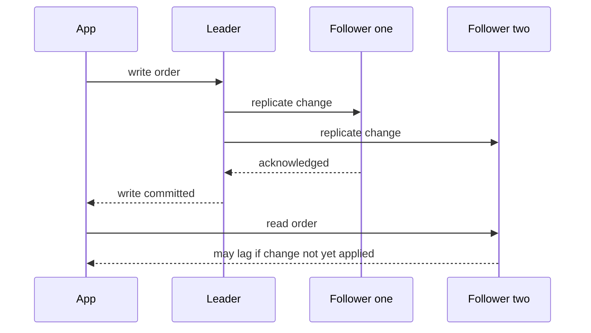

# Replication, Sharding, and NoSQL

!!! note "In simple words"
    Replication keeps copies of the same data on several machines, so reads are shared out and one machine can fail. Sharding splits the data itself across machines, so each one holds less and takes fewer writes.

Every scaling answer eventually reaches the database. Replication and sharding are the two main tools, and the choice between a relational store and a NoSQL store frames both. Interviewers ask about these topics because each choice has a cost in consistency, operations, and query flexibility, and you must name that cost.

## Why it matters

A single database can handle a surprising amount of load with good indexes and sensible queries. When it does not, the next step depends on the bottleneck. Too many reads call for replicas. Too many writes or too much data call for sharding. Choosing wrongly costs months: a poor shard key is very hard to change later, and a store chosen for the wrong access pattern forces awkward workarounds in every feature.

## How it works

### SQL or NoSQL

| Aspect | Relational (SQL) | NoSQL |
|---|---|---|
| Schema | Fixed tables and column types | Flexible, often per record |
| Scaling | Usually vertical first, then extra work to scale out | Designed to spread across many nodes |
| Consistency | Strong transactions by default | Often tunable, frequently eventual |
| Joins | Native and efficient | Limited or absent, so data is denormalised |
| Strength | Relationships, integrity, ad hoc queries | Very large scale, high write rates, flexible shapes |

ACID transactions and the BASE model are covered in depth in [Databases and SQL](../06-databases-sql/index.md). In short, ACID favours correctness inside one database. BASE accepts looser guarantees so that availability and scale improve.

Choose the store by the access patterns, not by fashion. Write down the most important queries first. If they need joins and transactions across related rows, start with a relational database. If they are mostly key lookups, or large append-heavy streams with a known partition key, a NoSQL store may fit better.

### The main NoSQL families

- **Key-value** stores, such as Redis and DynamoDB, get and put values by key. They suit sessions, carts, and caches. Queries beyond the key are weak or absent.
- **Document** stores, such as MongoDB and Couchbase, hold JSON-like documents with indexes on fields inside them. They suit cases where a whole aggregate is read together, such as a product with its attributes.
- **Column-family** stores, such as Cassandra and HBase, partition rows by a key and sort them inside each partition. They suit time series and write-heavy logs with predictable queries.
- **Graph** stores, such as Neo4j, hold nodes and relationships, and answer traversal queries. They suit recommendations and social links when traversal is the main work.

Each family makes some queries cheap and others expensive. Designing the data model around the queries is the real skill. The product name matters much less.

### Replication

Replication copies data from one node to others. It serves two purposes: spreading read traffic, and surviving the loss of a node.

- **Leader and follower**: every write goes to one leader, which streams changes to followers. Reads may go to followers.
- **Asynchronous** replication confirms a write before the followers have it. It is fast, but a failover can lose the newest writes, and followers can lag.
- **Synchronous** replication waits for at least one follower. It protects data, and it adds latency to every write.

Failover promotes a follower when the leader fails. Automatic failover is quicker, but it must avoid **split brain**, where two nodes both believe they are the leader. Manual failover is slower, but a person makes the final call.

**Multi-leader** replication accepts writes in several regions or nodes. It improves write locality and availability. Concurrent writes to the same record must be reconciled, using last-write-wins, version vectors, or business rules.

**Leaderless** replication, as in Dynamo-style stores, sends each write to several replicas and reads from several. Quorums decide when an operation counts as successful.



### Quorums

With `N` replicas, a write succeeds after `W` replicas confirm it. A read contacts `R` replicas. When `R + W` is greater than `N`, every read set shares at least one replica with every write set. That replica holds the latest acknowledged write, so the read sees it, provided the cluster has no unusual failures.

```text
N = 3, W = 2, R = 2  ->  R + W = 4, greater than 3: reads overlap the latest write
N = 3, W = 1, R = 1  ->  R + W = 2, not greater than 3: reads can be stale
```

Quorums are a tuning knob. A higher `W` improves durability and makes writes less available when replicas are down. A higher `R` improves freshness and costs more reads.

### Reads after writes

A user who saves a profile and reloads the page may land on a lagging follower and see the old value. Three fixes are common:

- Send that user's reads to the leader for a short window after a write.
- Record the log position of the write, and read only from replicas that have reached it.
- Return the new value in the write response, so the client does not need to read it again.

### Sharding

Sharding splits rows across nodes by a **shard key**. Each shard holds a subset of the rows and can be stored, scaled, and backed up on its own.

- **Range sharding** assigns key ranges to shards, such as customer IDs 1 to a million on shard A. Range scans are easy, but new data often lands on the newest range, which creates a hot spot.
- **Hash sharding** hashes the key and maps the result to a shard. Load spreads evenly, but a range query must visit every shard.
- **Directory sharding** keeps a lookup table that maps each key, or group of keys, to a shard. It is flexible, but the directory becomes a dependency that must stay available.

The router below sends a customer to a shard by taking the key modulo the shard count. It compiles on Java 21:

```java
import java.util.List;

public class ShardRouter {

    private final List<String> shards;

    public ShardRouter(List<String> shards) {
        this.shards = List.copyOf(shards);
    }

    public String shardFor(long customerId) {
        // floorMod keeps the index non-negative, even for negative keys
        return shards.get((int) Math.floorMod(customerId, (long) shards.size()));
    }

    public static void main(String[] args) {
        ShardRouter router = new ShardRouter(List.of("shard-0", "shard-1", "shard-2"));
        System.out.println(router.shardFor(42L));   // 42 mod 3 is 0, so shard-0
    }
}
```

Modulo routing is simple, but adding a shard changes the divisor and remaps almost every key. When the shard count will change, use consistent hashing or a directory. The ring idea is explained in [Building Blocks](building-blocks.md).

### Choosing a shard key

The shard key decides most of how a sharded system behaves, and it is hard to change later. A good key has three properties:

- **High cardinality**: many distinct values, so data and traffic can spread out.
- **Even access**: no single value receives a large share of reads or writes.
- **Locality for the main query**: the most frequent queries touch one shard. A customer ID often works for an online shop, because a customer's orders, addresses, and carts can live together.

A timestamp is a poor key for write-heavy data, because every new record lands on the newest shard. A country code is a poor key, because a few countries dominate. When no single key fits, consider a composite key, such as customer ID followed by order date. Alternatively, keep a small directory for the rare queries that cut across customers.

### Vertical partitioning

Vertical partitioning splits a table by columns or by access pattern. Frequently read columns can sit in one table, large and rarely used blobs in another, and sensitive fields in a separate store. It reduces the width of each row and the amount of I/O, and it does not change the number of shards.

### The costs of sharding

- **Cross-shard queries** need scatter-gather, which asks every shard and merges the results, or a separate read model built from events.
- **Cross-shard transactions** are expensive. Keep related data on one shard, or use a saga, described in [Distributed Transactions](../14-microservices/distributed-transactions.md).
- **Hot shards** appear when one key or one range takes most of the traffic. A shard key with few distinct values is a common cause.
- **Rebalancing** moves data when the shard count or the key distribution changes. Plan it while the system is still small enough for moves to be cheap.

### CAP applied to storage

During a network partition, a store must either refuse some requests to stay consistent (CP), or keep answering and reconcile later (AP). Replication choices decide which side a system takes. Leader-based stores with synchronous replication lean towards CP. Leaderless stores with tunable quorums can be set either way. The theory is covered in [Core Concepts](core-concepts.md).

### Caching in front of the database

Most reads need not reach the database at all. A cache of hot data, such as Redis, absorbs repeated reads and gives the database room to breathe. The strategies and invalidation rules are described in [High-Level Design](high-level-design.md) and [Spring Cache and Redis](../12-caching-performance/spring-cache-and-redis.md).

## Where it is used

- Read-heavy relational databases with one or more replicas, such as product catalogues and reporting reads.
- Sharded order or message stores, where a customer or conversation ID is the shard key.
- Key-value stores for sessions and carts.
- Wide-column stores for time-series metrics and event logs.
- Multi-region services that accept writes locally and reconcile them later.

## Benefits

- Replicas add read capacity and a standby for failover.
- Sharding lets write capacity and storage grow beyond one machine.
- NoSQL stores can scale out with few changes to the application, when the access pattern fits.
- A clear shard key keeps most queries on one shard, which keeps them fast.

## Cons and limits

- Replicas lag, so reads can be stale.
- Sharding makes joins, aggregates, and transactions across shards harder.
- A poor shard key creates hot shards that are hard to undo.
- NoSQL does not mean schema-free. The schema moves into the application code, and it is still needed.
- Operating replicas, failover, and rebalancing takes real skill and time.

## Best practices

- Write down the main queries, their frequency, and the read-to-write ratio before choosing a store.
- Tune a single database first, with indexes, query changes, and replicas, before sharding.
- Choose a shard key with high cardinality and even access, and check it against the top queries.
- Use consistent hashing or a directory if the number of shards will change.
- Route reads that must be fresh to the leader, or to replicas that have caught up.
- Monitor replication lag, shard size, and per-shard request rates.
- Test failover, and check how a new follower catches up.

## Common pitfalls

- Sharding before a well-tuned single database has been tried.
- Choosing a shard key for convenience, such as a timestamp, that sends all new writes to one shard.
- Assuming a replica is always current, then showing users stale data right after they write.
- Using modulo sharding and then adding shards with no migration plan.
- Writing request paths that join across shards.
- Treating NoSQL as schema-free.

!!! tip "Interview tip"
    **Q: How would you scale a database that is slow on writes?**
    Check first whether one node can be tuned or scaled up, and whether indexes and batching would help. If not, shard by a key that matches the main writes, such as customer ID. Explain how you will route requests and rebalance later. Name the cost: cross-shard reads now need scatter-gather or a read model, and cross-shard transactions need a saga or must be avoided.

## Quick recap

- SQL and NoSQL differ in schema, scaling model, and consistency. The access pattern decides which fits.
- Replication scales reads and adds failover. The trade-offs are lag and write latency.
- With `N`, `W`, and `R`, the condition `R + W > N` means reads overlap the latest acknowledged write.
- Sharding scales writes by key. Modulo routing breaks when the shard count changes, so use consistent hashing or a directory.
- Cross-shard queries and transactions are the main costs of sharding.

## Official documentation

- [PostgreSQL documentation](https://www.postgresql.org/docs/current/)
- [MySQL documentation](https://dev.mysql.com/doc/)
- [Redis documentation](https://redis.io/docs/latest/)
- [Apache Kafka documentation](https://kafka.apache.org/documentation/)

**See also:** [Core Concepts](core-concepts.md) | [High-Level Design](high-level-design.md) | [Databases and SQL](../06-databases-sql/index.md) | [Scalability and Failover](scalability-and-failover.md)
