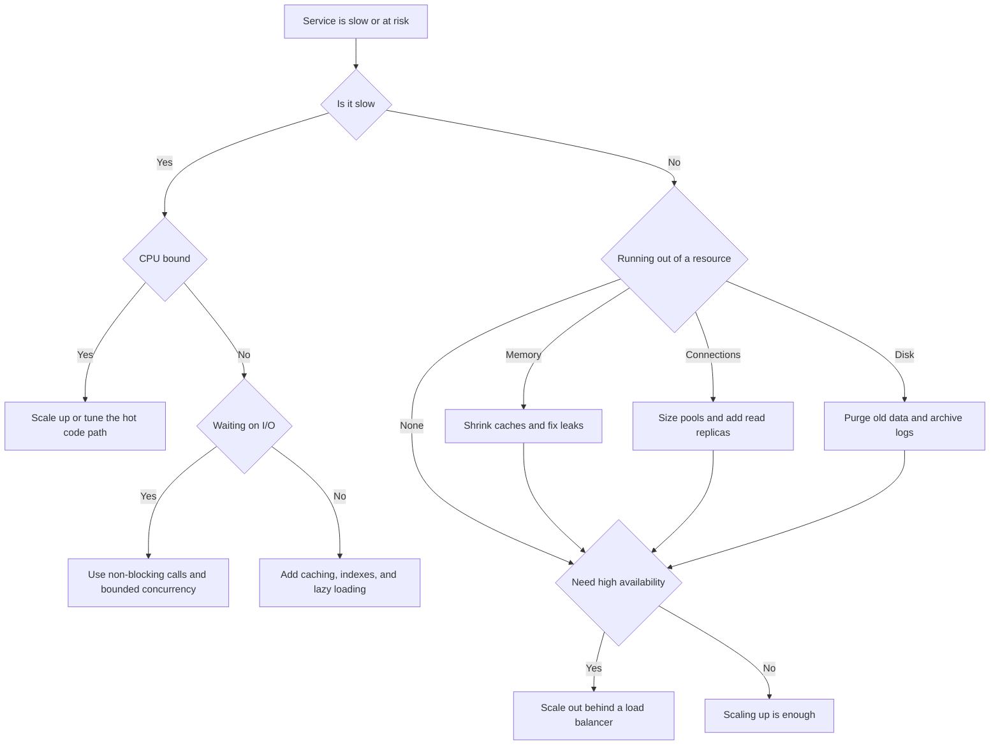
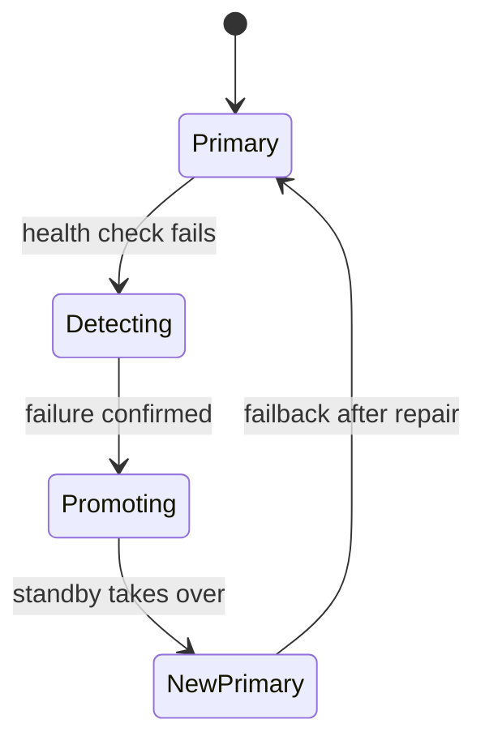

# Scalability and Failover

!!! note "In simple words"
    Scaling means handling more work by adding capacity. Failover means that when one part breaks, another part takes over so users keep getting answers.

Scalability and failover meet in the same places inside a Java service: thread pools, connection pools, caches, session state, and the database. Interviewers ask about these topics to see whether you can name the failure behind each setting, not only the setting itself. A pool size is a limit. A cache without a size is a memory leak waiting to happen. A standby that nobody has tested is a hope, not a plan.

## Why it matters

A service that works for 100 users can fail at 10,000 for reasons that have nothing to do with the code's logic. Requests pile up in queues, connections run out, memory fills with cached data, and one slow dependency drags every caller down with it. Designing for scale means knowing which limit will be hit first and making sure that hitting it causes a controlled rejection rather than a crash.

Designing for failover means accepting that machines, zones, and networks will fail. The question is how long users are affected and how much data is lost when that happens. Those two numbers, recovery time and recovery point, drive every other decision on this page.

## How it works

### Vertical and horizontal scaling

Vertical scaling gives one machine more CPU, memory, or disk. It needs no code changes, but it stops at the largest machine you can rent and leaves a single point of failure. Horizontal scaling adds more instances behind a load balancer. It removes the ceiling, but only works when an instance keeps no per-client state in its own memory. The broader discussion is in [Core Concepts](core-concepts.md).

### Choosing a fix for a slow service

Before adding machines, find the bottleneck. Each symptom points to a different fix, and more instances do nothing for a bottleneck that lives in one shared database.



Read the tree from the top. A CPU-bound service needs a faster or more efficient process. A service that mostly waits needs concurrency that does not block, plus caching in front of the slow dependency. When a resource runs out, fix the leak or the unbounded growth first. More instances would only copy the problem.

### Bound the thread pool

Creating a new thread for every request is unbounded. Under load the process either runs out of memory or spends its time switching between threads. Use a pool with a fixed maximum and a bounded queue.

`Executors.newFixedThreadPool` uses an unbounded queue, so its backlog can grow until memory runs out. A `ThreadPoolExecutor` with an explicit queue and a rejection policy is safer:

```java
import java.util.concurrent.ArrayBlockingQueue;
import java.util.concurrent.ThreadPoolExecutor;
import java.util.concurrent.TimeUnit;

public class BoundedWorkers {

    public static void main(String[] args) throws InterruptedException {
        ThreadPoolExecutor pool = new ThreadPoolExecutor(
                4, 8,                                   // core and maximum threads
                30, TimeUnit.SECONDS,                   // extra idle threads exit after 30 s
                new ArrayBlockingQueue<>(100),          // bounded backlog
                new ThreadPoolExecutor.CallerRunsPolicy());

        for (int i = 0; i < 5; i++) {
            int job = i;
            pool.execute(() ->
                    System.out.println("job " + job + " on " + Thread.currentThread().getName()));
        }
        pool.shutdown();
        pool.awaitTermination(5, TimeUnit.SECONDS);
    }
}
```

`CallerRunsPolicy` slows the producer when the queue is full, which applies back-pressure instead of dropping work quietly. For a request that should fail fast, use `AbortPolicy` and return `503 Service Unavailable` with a `Retry-After` header. Virtual threads are final since Java 21, so blocking calls are cheaper. They do not remove the limits of downstream resources such as database connections.

### Size connection pools and keep transactions short

A connection pool is a shared limit. If each request holds a database connection while it waits for a slow remote call, the pool empties and every other request queues behind it. Keep the pool modest, and hold a connection only for the database work itself.

This is a Spring Boot configuration fragment for the HikariCP pool. It is not compiled here:

```yaml
spring:
  datasource:
    hikari:
      maximum-pool-size: 20      # upper bound on concurrent connections
      minimum-idle: 5
      max-lifetime: 1800000      # 30 minutes, kept below the database idle timeout
      idle-timeout: 600000       # 10 minutes
      connection-timeout: 30000  # wait at most 30 seconds for a free connection
```

The rule is simple: do not wait on the network while a transaction is open. Put the database work in one bean with `@Transactional`, and make the remote call from a method that is not annotated. The following Spring sketch is not compiled and only shows the shape:

```java
// Spring sketch, not compiled. Shows where the transaction boundary sits.
@Service
class OrderWorkflow {

    private final OrderTxService tx;          // @Transactional methods live here
    private final PaymentClient payments;     // remote HTTP call

    OrderWorkflow(OrderTxService tx, PaymentClient payments) {
        this.tx = tx;
        this.payments = payments;
    }

    // Not @Transactional, so no connection is held during the payment call
    void placeOrder(long orderId) {
        String summary = tx.loadSummary(orderId);   // connection returned when this returns
        payments.charge(summary);                   // remote call runs with no open transaction
    }
}
```

### Bound every cache

An unbounded `HashMap` used as a cache grows until the heap is full. Give every cache a maximum size and a time to live. Caffeine is a common in-process choice. The sketch below uses a library, so it is not compiled with the plain JDK:

```java
import com.github.benmanes.caffeine.cache.Cache;
import com.github.benmanes.caffeine.cache.Caffeine;
import java.time.Duration;

class ProfileCache {

    private final Cache<Long, String> cache = Caffeine.newBuilder()
            .maximumSize(10_000)
            .expireAfterWrite(Duration.ofMinutes(10))
            .build();

    String get(long userId) {
        return cache.get(userId, this::load);   // loads on a miss; size and age are bounded
    }

    private String load(long userId) {
        return "profile-" + userId;             // placeholder for a database read
    }
}
```

In a cluster, an in-process cache lives inside one instance. Each instance keeps its own copy, so copies can disagree. Use a shared cache such as Redis when instances must see the same values, and accept that a copy can be briefly stale.

### Keep instances stateless

State held in one instance's memory breaks horizontal scaling. If a user's next request reaches another instance, the cart is gone. Move session data to a shared store. With Spring Session backed by Redis, this is a configuration change rather than new code:

```yaml
spring:
  session:
    store-type: redis
```

The application still reads and writes the session as before, and any instance can serve the request. Uploaded files follow the same rule: write them to object storage instead of the local disk.

### Route reads to replicas on purpose

Read-only transactions do not pick a database on their own. `@Transactional(readOnly = true)` only marks intent. To send those reads to a replica, configure a routing `DataSource` that checks the read-only flag and chooses the replica. Plan for replication lag: a read right after a write may miss that write. For reads that must be fresh, use the leader.

### Move slow work off the request path

If one request must send an email, charge a card, and schedule a shipment, the caller waits for all three. A better design saves the order, publishes an event or enqueues a job, and returns `202 Accepted`. Workers finish the job later. Retries and idempotent handlers keep the result correct.

For work that stays inside one process, `@Async` with a bounded executor is enough. This is a Spring sketch, not compiled:

```java
// Spring sketch, not compiled.
@Configuration
@EnableAsync
class AsyncConfig {

    @Bean(name = "mailExecutor")
    Executor mailExecutor() {
        ThreadPoolTaskExecutor executor = new ThreadPoolTaskExecutor();
        executor.setThreadNamePrefix("mail-");
        executor.setCorePoolSize(4);
        executor.setMaxPoolSize(12);
        executor.setQueueCapacity(200);     // a full queue rejects new work
        executor.initialize();
        return executor;
    }
}

@Service
class ConfirmationService {

    @Async("mailExecutor")
    public void sendConfirmation(long orderId) {
        // runs on mailExecutor, not on the request thread
    }
}
```

`@Async` works through a proxy. A call from inside the same class skips the proxy and runs synchronously, so call the method through another bean.

### Failover modes

Failover is the act of moving work to a backup when the primary fails. The main choices are:

- **Active-passive**: one node serves traffic while a standby waits. Simple, but the standby may be unused for a long time.
- **Active-active**: several nodes serve traffic at once. Losing one node reduces capacity instead of causing an outage.
- **Cold standby**: the backup is switched off and must boot and load data before it serves. Recovery is slow and cheap.
- **Warm standby**: the backup runs and has recent data, but it does not take live traffic until promoted.
- **Hot standby**: the backup runs, stays synchronised, and can take over quickly with little or no data loss.

Failover can be **automatic**, when health checks detect the failure and switch without a person, or **manual**, when an operator decides. **Failback** returns traffic to the original node after repair. Failback needs care, because the repaired node may be behind on data.

Some articles invent their own names for these modes. Stick to the terms above, which most teams and vendors use.



### Recovery objectives

Two numbers shape a failover design:

- **RTO** (recovery time objective): how long the service may be unavailable.
- **RPO** (recovery point objective): how much recent data may be lost.

A hot standby with synchronous replication gives a small RTO and RPO, at a higher cost. A cold standby restored from nightly backups costs less, but both numbers grow. Agree on the numbers with the business first, then choose the architecture that meets them.

### Resilience patterns in brief

- **Timeout**: stop waiting on a slow dependency after a fixed time.
- **Retry**: repeat a transient failure with exponential backoff and jitter, only for idempotent calls.
- **Circuit breaker**: stop calling a failing dependency for a while, then probe it again.
- **Bulkhead**: limit concurrent calls or threads for each dependency, so one dependency cannot take all the capacity.
- **Fallback**: return a degraded answer, such as cached or default data, when the real one is unavailable.

The details, including Resilience4j configuration, are in [Resilience Patterns](../14-microservices/resilience-patterns.md).

### Metrics to watch

Watch a small set of signals that answer three questions: is the service meeting its latency target, is it close to a limit, and is a dependency failing?

| Signal | What it tells you | Notes |
|--------|-------------------|-------|
| Latency at p50, p95, p99 | User-visible speed | An average can look fine while the tail is slow |
| Throughput | Requests or messages per second | Compare with the load you designed for |
| Error rate | Share of failed requests | Split by status code and by dependency |
| Saturation | How full each limit is | CPU, heap, pool queue, connection wait time |
| Cache hit ratio | How often a cache saves work | Formula below |
| Replication lag | How far a replica trails the leader | Stale reads come from lag |
| Queue depth or consumer lag | Whether consumers keep up | A growing backlog means producers are faster |

Treat the CPU and heap thresholds as starting points for alerts. Tune them to the workload and to what the garbage collector and the load balancer need. Collection and dashboards are covered in [Metrics](../20-observability/metrics.md).

### Cache hit ratio

The hit ratio is the share of lookups that the cache answers:

```text
hit ratio = hits / (hits + misses)
```

For example, 9,000 hits and 1,000 misses give 0.90, or 90 percent. A high ratio matters only when a miss is expensive. A 95 percent ratio on cheap lookups saves little, while a 70 percent ratio in front of a slow report query can be a large win.

Watch the ratio over time. A sudden drop often means that a key format changed, the cache is too small and evicting hot entries, a deploy cleared the cache, or the time to live is too short. Read the ratio together with eviction counts and memory use. A high ratio with constant evictions can hide a cache that is too small for its working set.

```java
public class HitRatio {

    static double hitRatio(long hits, long misses) {
        long total = hits + misses;
        return total == 0 ? 0.0 : (double) hits / total;   // no traffic yet: avoid dividing by zero
    }

    public static void main(String[] args) {
        System.out.printf("%.2f%n", hitRatio(9_000, 1_000));   // prints 0.90
    }
}
```

### Scaling in practice: a short sequence

1. Measure first. Find whether the bottleneck is CPU, memory, connections, or a dependency.
2. Bound the pools and the caches, so overload turns into rejections rather than memory exhaustion.
3. Make instances stateless, so the load balancer can send any request anywhere.
4. Shorten transactions, and move slow work to queues or `@Async`.
5. Add replicas for reads and a standby for failover, sized to the RTO and RPO.
6. Alert on percentiles, saturation, and replication lag, then rehearse the failover.

## Where it is used

- Web APIs behind a load balancer, where each instance must be stateless.
- Database clusters with a leader, read replicas, and a standby for promotion.
- Message consumers that scale by adding workers to a queue.
- Caches shared by many instances, such as Redis clusters.
- Multi-zone deployments, where a whole zone can be lost without a full outage.

## Benefits

- Capacity grows in steps, so cost follows demand.
- A single failed instance or zone does not stop the service.
- Bounded pools and caches make overload visible and predictable.
- Clear RTO and RPO values let teams choose the right cost for each service.

## Cons and limits

- Horizontal scaling adds distributed-systems problems: shared state, partial failures, and clock skew.
- Replicas add lag, so reads can be stale.
- A standby that has never been tested often fails when it is needed.
- Automatic failover can cause split-brain, where two nodes both accept writes.
- Retries amplify load when a dependency is already struggling, unless they use backoff and limits.

## Best practices

- Name the critical systems and write down their RTO and RPO.
- Add redundancy at every layer: hardware, network, storage, and power, and across zones where possible.
- Put a load balancer in front of every pool of instances, and use health checks to remove bad ones.
- Bound every pool, queue, and cache, and choose the rejection behaviour on purpose.
- Keep transactions short, and never hold a connection across a remote call.
- Automate failover, test it on a schedule, and test failback as well.
- Alert on percentiles and saturation rather than on averages alone.

!!! tip "Interview tip"
    **Q: The service is slow under load. What do you check first?**
    Check whether it is CPU bound, waiting on I/O, or starved for a pool. A full thread pool or a connection pool with waiters shows up as rising latency with flat CPU. Fix the limit that is actually full. Make the failure visible with a bounded queue and a clear rejection, instead of letting memory grow without limit.

## Quick recap

- Scale up for simplicity, scale out for a higher ceiling and fault tolerance, and keep instances stateless so scaling out works.
- The standby type and the failure detection method decide how fast failover happens. Set RTO and RPO first.
- Bound thread pools, connection pools, and caches so overload becomes a controlled rejection.
- Keep transactions short, and never wait on the network inside one.
- Move slow work off the request path, and watch percentiles and saturation.

## Official documentation

- [Java 21 java.util.concurrent package](https://docs.oracle.com/en/java/javase/21/docs/api/java.base/java/util/concurrent/package-summary.html)
- [JEP 444: Virtual Threads](https://openjdk.org/jeps/444)
- [Java 21 garbage collection tuning guide](https://docs.oracle.com/en/java/javase/21/gctuning/)
- [Spring Boot reference documentation](https://docs.spring.io/spring-boot/reference/index.html)

**See also:** [Replication, Sharding, and NoSQL](replication-sharding-nosql.md) | [High-Level Design](high-level-design.md) | [Resilience Patterns](../14-microservices/resilience-patterns.md) | [Core Concepts](core-concepts.md)
