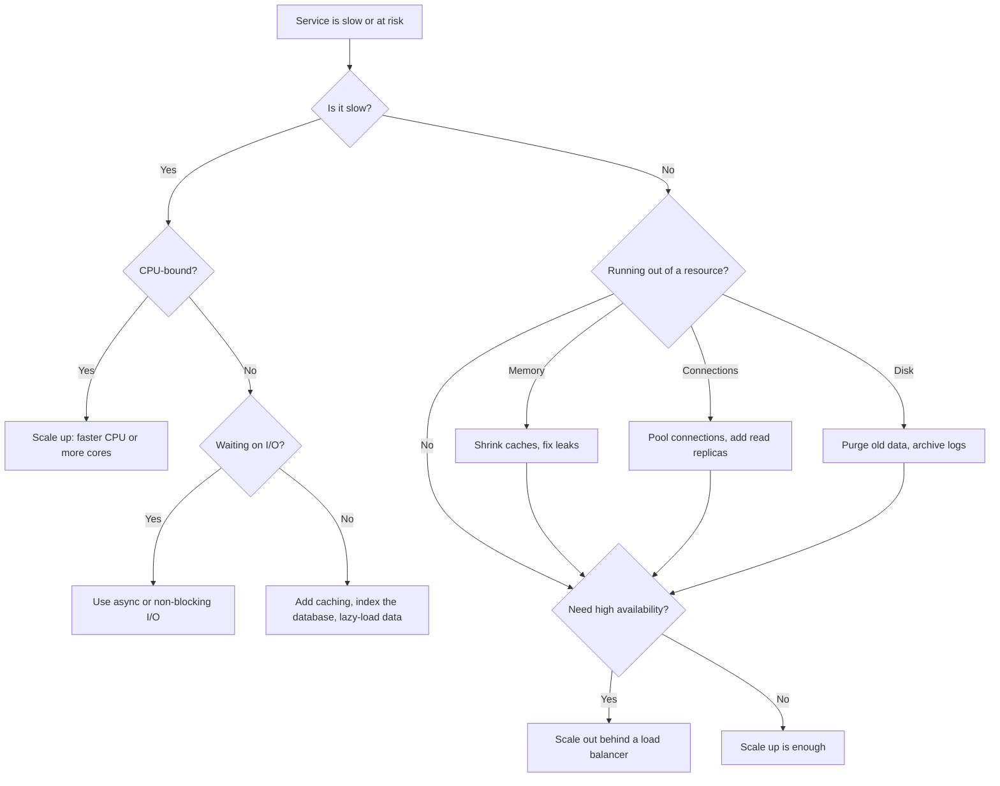

# Scalability and Failover

Scalability is the ability to handle more load by adding resources, and failover is the ability to keep serving when a component fails. In a Java service the two meet in the same places: thread pools, connection pools, caches, session state, and the database. Interviewers ask about these topics to see whether you can name the failure mode behind each knob, not just the knob.

## Core concepts

### Vertical and horizontal scaling, briefly

Vertical scaling gives one machine more CPU, memory, or disk. It is simple and needs no code changes, but it stops at the largest machine you can use and leaves one point of failure. Horizontal scaling adds instances behind a load balancer. It removes the ceiling, but only works when the application keeps no per-client state in memory. The general discussion is in [Core Concepts](core-concepts.md).

A simple way to choose:

```text
Is the service slow?
+- CPU-bound -> scale up (faster or more cores), or scale out if work can split
+- I/O-bound -> use non-blocking I/O or more concurrency with limits, cache, add indexes
+- Running out of memory -> bound caches, fix leaks, check object lifetimes
+- Running out of connections -> size pools, shorten transactions, add replicas
+- Need availability -> scale out with two or more instances across failure domains
```

### Failover vocabulary

- **Active-passive**: one node serves traffic, and a standby takes over on failure.
- **Active-active**: several nodes serve traffic at once, so losing one reduces capacity instead of causing an outage.
- **Cold standby**: the backup is off and must boot and load data before it can serve. Recovery is slow.
- **Warm standby**: the backup runs and has data, but does not serve live traffic yet. It needs promotion and some catch-up.
- **Hot standby**: the backup runs, is synchronised, and can take over quickly with little or no data loss.
- **Automatic failover** detects the failure and switches without a person. **Manual failover** waits for an operator.
- **Failback** returns traffic to the original node after repair. It needs its own care, because the repaired node may be behind on data.

Some articles use invented names for these modes. Use the terms above, which most teams and vendors recognise.

### Recovery objectives

Two numbers shape a failover design:

- **RTO** (recovery time objective): how long the service may be down.
- **RPO** (recovery point objective): how much recent data may be lost.

A hot standby with synchronous replication gives a small RTO and RPO, at a higher cost. A cold standby with nightly backups gives a large RTO and RPO, at a lower cost. Pick the numbers with the business first, then the architecture.

### Resilience patterns in one line each

- **Timeout**: stop waiting on a slow dependency.
- **Retry**: repeat a transient failure, with backoff and jitter, only for idempotent calls.
- **Circuit breaker**: stop calling a failing dependency for a while.
- **Bulkhead**: limit concurrent calls or threads per dependency.
- **Fallback**: return a degraded answer when the real one is unavailable.

The details are in [Resilience Patterns](../14-microservices/resilience-patterns.md).

## Java scaling patterns

### Bound the thread pool

Creating a thread per request is unbounded: under load the process runs out of memory or context-switches itself into the ground. Use a pool with a fixed maximum and a bounded queue. Note that `Executors.newFixedThreadPool` uses an unbounded queue, so its backlog can grow until memory runs out. A `ThreadPoolExecutor` with an explicit queue and rejection policy is safer:

```java
import java.util.concurrent.ArrayBlockingQueue;
import java.util.concurrent.ThreadPoolExecutor;
import java.util.concurrent.TimeUnit;

class BoundedWorkers {

    static ThreadPoolExecutor create() {
        return new ThreadPoolExecutor(
                4,                                  // core threads
                8,                                  // maximum threads
                30, TimeUnit.SECONDS,               // idle threads above core exit after 30 s
                new ArrayBlockingQueue<>(100),      // bounded backlog
                new ThreadPoolExecutor.CallerRunsPolicy()); // back-pressure when full
    }

    public static void main(String[] args) {
        ThreadPoolExecutor pool = create();
        pool.execute(() -> System.out.println("working on " + Thread.currentThread().getName()));
        pool.shutdown();
    }
}
```

`CallerRunsPolicy` slows the producer down when the queue is full, which is often better than dropping work silently. For a request that should fail fast, use `AbortPolicy` and return `503` with `Retry-After`. Virtual threads are final since Java 21 and make blocking calls cheaper, but they do not remove the limits on downstream resources such as database connections.

### Size connection pools and keep transactions short

A connection pool is a shared limit. If each request holds a database connection while it waits on a slow remote call, the pool empties and every other request queues behind it. Keep the pool modest and hold connections only for the database work:

```yaml
spring:
  datasource:
    hikari:
      maximum-pool-size: 20          # upper bound on concurrent connections
      minimum-idle: 5
      max-lifetime: 1800000          # 30 minutes, below the server's idle timeout
      idle-timeout: 600000           # 10 minutes
      connection-timeout: 30000      # wait at most 30 s for a free connection
```

```java
import org.springframework.stereotype.Service;
import org.springframework.transaction.annotation.Transactional;

interface PaymentClient {
    void charge(String orderSummary);
}

@Service
class OrderTxService {

    @Transactional(readOnly = true)
    public String loadSummary(long orderId) {
        return "order-" + orderId;        // a real version queries the database here
    }
}

@Service
class OrderWorkflow {

    private final OrderTxService tx;
    private final PaymentClient payments;

    OrderWorkflow(OrderTxService tx, PaymentClient payments) {
        this.tx = tx;
        this.payments = payments;
    }

    // Deliberately not @Transactional: that would hold the connection across the payment call.
    void placeOrder(long orderId) {
        String summary = tx.loadSummary(orderId);   // connection returned when this call ends
        payments.charge(summary);                   // remote call runs with no open transaction
    }
}
```

The rule is simple: do not wait on the network while a transaction is open. Put the transactional database work in one bean and the remote call in a method that is not annotated.

### Bound every cache

An unbounded `HashMap` used as a cache grows until the heap fills. Give caches a maximum size and a time-to-live. Caffeine is a common in-process choice:

```java
import com.github.benmanes.caffeine.cache.Cache;
import com.github.benmanes.caffeine.cache.Caffeine;
import java.time.Duration;

class ProfileCache {

    private final Cache<Long, String> cache = Caffeine.newBuilder()
            .maximumSize(10_000)
            .expireAfterWrite(Duration.ofMinutes(10))
            .build();

    String get(long userId) {
        return cache.get(userId, this::load);   // loads on a miss, bounded by size and age
    }

    private String load(long userId) {
        return "profile-" + userId;             // placeholder for a database read
    }
}
```

In a cluster, an in-process cache is per instance. Use a shared cache such as Redis when instances must agree, and remember that each instance's copy can be stale.

### Keep instances stateless

State held in one instance's memory breaks horizontal scaling: a user whose next request lands on another instance loses the cart. Move session state to a shared store. With Spring Session backed by Redis, the setting is a property rather than code:

```yaml
spring:
  session:
    store-type: redis
```

The application then reads and writes the session as usual, and any instance can serve the request. The pattern applies to uploaded files too: write them to object storage rather than the local disk.

### Route reads to replicas on purpose

Spring's `@Transactional(readOnly = true)` does not choose a database by itself. To send reads to replicas, configure a routing `DataSource` that inspects the transaction's read-only flag and selects the replica for read-only transactions. Plan for lag: a read right after a write may not see that write, so use the leader for reads that must be fresh.

### Move slow work off the request path

If a request triggers an email, a payment, and a shipment, the caller waits for all three. Save the order, publish an event or enqueue a job, and return `202 Accepted`. Workers process the job at their own pace, and retries and idempotency keep the result correct. For in-process work, `@Async` with a bounded executor does the job:

```java
import java.util.concurrent.Executor;
import org.springframework.context.annotation.Bean;
import org.springframework.context.annotation.Configuration;
import org.springframework.scheduling.annotation.EnableAsync;
import org.springframework.scheduling.concurrent.ThreadPoolTaskExecutor;

@Configuration
@EnableAsync
class AsyncConfig {

    @Bean(name = "emailExecutor")
    Executor emailExecutor() {
        ThreadPoolTaskExecutor executor = new ThreadPoolTaskExecutor();
        executor.setThreadNamePrefix("mail-");
        executor.setQueueCapacity(200);      // bounded backlog; a full queue rejects new tasks
        executor.setMaxPoolSize(12);
        executor.setCorePoolSize(4);
        executor.setKeepAliveSeconds(60);
        executor.initialize();
        return executor;
    }
}
```

```java
import org.springframework.scheduling.annotation.Async;
import org.springframework.stereotype.Service;

@Service
class ConfirmationService {

    @Async("emailExecutor")
    public void sendConfirmation(long orderId) {
        // runs on the emailExecutor pool, not the request thread
    }
}
```

`@Async` is applied through a proxy, so a call from inside the same class bypasses it. Call the method through another bean.

### Watch the numbers that matter

Rules of thumb, not standards, help you set alerts: keep CPU well below saturation so headroom remains for spikes, keep heap usage well below the limit so garbage collection has room, and watch the active and idle connection counts. For latency, track percentiles (p50, p95, p99) rather than the mean, and track throughput in requests per second. Micrometer exposes these as metrics in Spring Boot, and [Observability](../20-observability/index.md) covers how to collect them.

## Scaling decision tree

When a service is slow or close to its limits, work through the questions below before you add machines. Each answer points to a different fix, and adding instances does nothing for a bottleneck that lives in one shared database.



Read the tree from the top. A slow service with a CPU-bound profile needs a bigger or more efficient process. A slow service that mostly waits needs concurrency that does not block, plus caching in front of the slow dependency. When resources run out, fix the leak or the unbounded growth first, because more instances would only copy the problem.

## Performance metrics to monitor

Monitor a small set of signals that answer three questions: is the service meeting its latency target, is it near a limit, and is a dependency failing.

| Signal | What it tells you | Notes |
|--------|-------------------|-------|
| Latency (p50, p95, p99) | User-visible speed | Use percentiles. An average can look fine while the tail is slow. |
| Throughput | Requests or messages per second | Compare against the load you designed for. |
| Error rate | Share of failed requests | Split by status code and by dependency. |
| Saturation | How full each limit is | CPU, heap, thread-pool queue, connection-pool wait time. |
| Cache hit ratio | How often a cache saves work | See the formula below. |
| Replication lag | How far a replica trails the primary | Reads from a lagging replica can be stale. |
| Queue depth or consumer lag | Whether consumers keep up | A growing backlog means producers outpace consumers. |

The CPU and heap guidance from the earlier section are starting points for alerts, not fixed limits. Tune them to the workload and to what the garbage collector and the load balancer need.

### Cache hit ratio

The cache hit ratio is the share of lookups answered from the cache:

```text
hit ratio = hits / (hits + misses)
```

For example, 9,000 hits and 1,000 misses give a ratio of 0.90, or 90 percent. A high ratio is useful only when a miss is expensive. A cache with a 95 percent hit ratio that serves cheap lookups saves little, while a 70 percent ratio in front of a slow report query can be a large win.

Watch the ratio over time, not once. A sudden drop often means a key format changed, the cache is too small and evicting hot entries, a deploy cleared the cache, or time-to-live values are too short. Pair the ratio with eviction counts and memory use, because a high ratio with constant evictions can hide a cache that is too small for its working set.

```java
// Compute the ratio from raw hit and miss counts, for example read from your metrics backend.
// Guard against division by zero for a cache that has seen no traffic yet.
double hitRatio(double hits, double misses) {
    double total = hits + misses;
    return total == 0 ? 0.0 : hits / total;
}
```

## How it works / Step by step

1. Measure first: find whether the bottleneck is CPU, memory, connections, or waiting on a dependency.
2. Bound the pools (threads, connections) and the caches (size and age), so overload shows up as rejections, not as memory exhaustion.
3. Make instances stateless, so the load balancer can send any request anywhere.
4. Shorten transactions and move slow work to queues or `@Async`.
5. Add replicas for reads and a standby for failover, sized to the recovery objectives.
6. Alert on percentiles, saturation, and replication lag, then rehearse a failover.

## Common pitfalls

- Creating a thread per request, or using a pool whose queue is unbounded.
- Holding a database connection across a remote call.
- A cache with no size limit or no expiry, which fills the heap slowly.
- Keeping user sessions in local memory and then wondering why scaling out logs users out.
- Assuming a standby is ready because it exists. Test failover and failback regularly.
- Adding read replicas and expecting every read to be fresh.
- Ignoring the mean latency while the p99 is poor.

!!! tip "Interview tip"
    **Q: The service is slow under load. What do you check first?**
    Check whether it is CPU-bound, waiting on I/O, or starved for a pool. A full thread pool or a connection pool with a queue of waiters shows up as rising latency with flat CPU. Fix the limit that is actually full, and make the failure visible with a bounded queue and a clear rejection, instead of letting memory grow.

## Quick recap

- Scale up for simplicity, scale out for ceiling and fault tolerance, and keep instances stateless to allow it.
- Failover depends on the standby temperature and on detection; set RTO and RPO first.
- Bound thread pools, connection pools, and caches so overload becomes controlled rejection.
- Keep transactions short; never wait on the network inside one.
- Move slow work off the request path, and watch percentiles and saturation.

**See also:** [Replication, Sharding, and NoSQL](replication-sharding-nosql.md) | [High-Level Design](high-level-design.md) | [Resilience Patterns](../14-microservices/resilience-patterns.md) | [Core Concepts](core-concepts.md)
