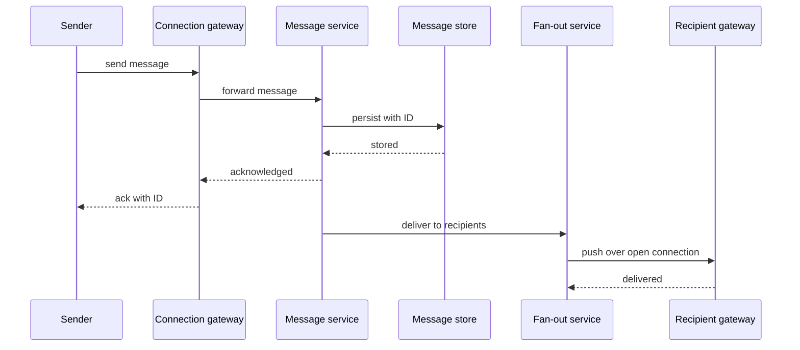
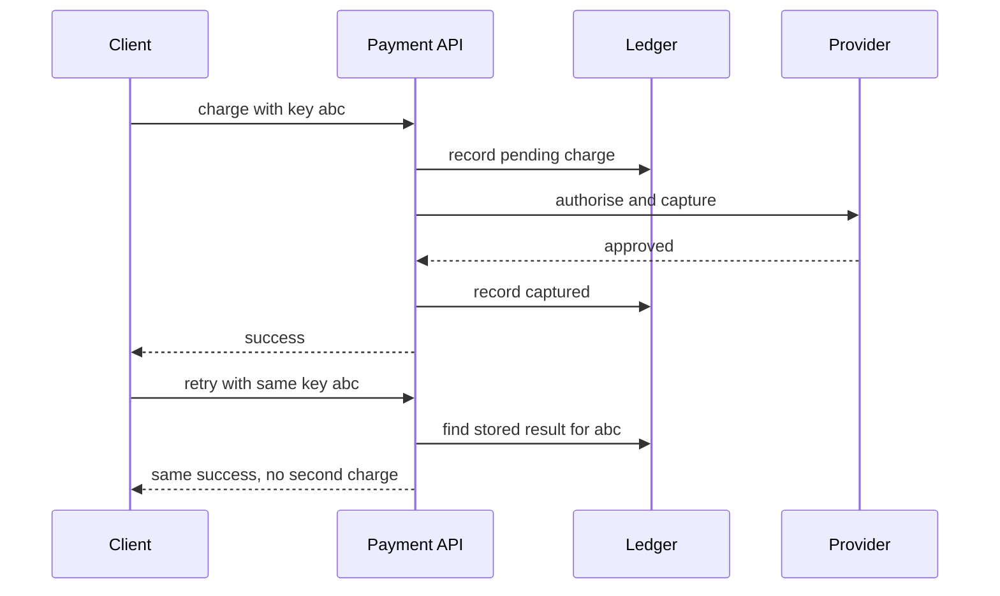

# Worked Examples

!!! note "In simple words"
    A worked example walks through one product from a vague idea to a plan. You write down what the product must do, estimate how big it is, pick the parts, and explain what you traded away.

Practice turns the method from [Fundamentals](fundamentals.md) into a habit. This page gives six outlines: a URL shortener, a chat application, a news feed, a payment system, a ride-sharing service, and a rate limiter. Each outline has requirements, rough estimates, components, and trade-offs. The numbers are assumptions chosen to make the arithmetic visible. Change them when the interviewer gives you different ones.

## Why it matters

Reading about patterns is not enough. In an interview, and on a real project, you have to decide which numbers matter, which component carries the load, and which failure hurts most. Working through concrete products shows the same reasoning repeatedly: estimate first, then the bottleneck appears, then the fix is obvious.

## How it works

Use the same skeleton for every example, so you never forget a step:

1. **Requirements.** List the core features in one sentence each. Then list the quality targets: latency, availability, durability, and consistency.
2. **Estimates.** Derive requests per second, storage per year, and bandwidth from the assumed users. Find the peak, not only the average.
3. **Interface.** Name the main operations and their responses.
4. **Components.** Draw the parts that serve the main flow, and say why each one exists.
5. **Deep dive.** Pick the hardest problem, such as ID generation, ordering, or concurrency, and explain it in detail.
6. **Trade-offs.** For each big choice, name what you gave up and what would change at higher scale.

The rough arithmetic is simple. Requests per second equal daily requests divided by 86,400 seconds. Storage per year equals records per year times the size of one record. Peak load is commonly two to three times the average, but the right factor depends on the product.

## URL shortener

### Requirements

- Create a short code for a long URL, and optionally choose a custom alias.
- Redirect a short code to its original URL.
- Optional expiry date and click counts.
- Redirects must be fast and available. Short codes must never be shared by two URLs.

### Estimates

- Assume 100 million new links per month. That is about 40 writes per second on average.
- Assume a read-to-write ratio of 100 to 1. That gives about 4,000 redirects per second on average, and about 12,000 at peak.
- Each record holds a 7-character code, the long URL, timestamps, and an owner, about 500 bytes. Five years of links give 6 billion records and about 3 TB of data.
- A 7-character code from a 62-character alphabet gives 62 to the power 7, about 3.5 trillion codes. That is far more than the expected number of links.

### Components

- **Code generator.** Hands out unique codes. A counter encoded in base 62 is simple. Ranges of counter values handed to each instance avoid a call per link.
- **Application service.** Validates the URL, creates the record, and serves the redirect.
- **Key-value store.** Maps code to URL, sharded by code. Reads dominate, so each shard is read-optimised.
- **Cache.** Keeps hot codes in memory, with a TTL.
- **Click pipeline.** Redirects publish a click event to a queue. A consumer writes counts later, so redirects never wait for analytics.

### Trade-offs

- A counter has no collisions but reveals how many links exist, and it needs a coordinator. Random codes hide volume but need a uniqueness check on insert.
- A 301 redirect is cached by browsers, which lowers load but makes click counts incomplete. A 302 keeps counts accurate at a higher load.
- Asynchronous click counting keeps redirects fast, at the cost of counts that lag by seconds.

## Chat application

### Requirements

- One-to-one and group conversations, with message history.
- Delivery and read status, and presence (online or offline).
- Push notifications for offline users.
- Messages acknowledged to the sender must not be lost. Delivery should feel immediate.

### Estimates

- Assume 50 million daily active users, each sending 40 messages per day. That is 2 billion messages per day, about 23,000 per second on average and about 70,000 at peak.
- Assume 10 percent of daily users are connected at peak, which is 5 million open connections. At 50,000 connections per server, that needs about 100 connection servers.
- Assume a stored message is 300 bytes including metadata. That is 600 GB per day, or about 220 TB per year before replication.

### Components

- **Connection gateway.** Holds a persistent WebSocket for each connected client, and records which server holds which user.
- **Session registry.** A shared key-value store that maps a user to a connection server.
- **Message service.** Assigns an ID, persists the message, and only then acknowledges the sender.
- **Message store.** Partitioned by conversation, with messages ordered by time inside each partition.
- **Fan-out service.** Reads the registry and pushes to each recipient's connection server. If the recipient is offline, it queues the message and triggers a push notification.
- **Presence service.** Uses heartbeats that expire, so a dropped connection shows as offline after a short wait.

The sequence below shows delivery to an online recipient. The sender sees a stored acknowledgement before anyone else sees the message:

### Trade-offs

- Acknowledging only after the write is durable is safer, but adds a few milliseconds to every send.
- Fan-out on write makes reads cheap but costs more for very large groups. Fan-out on read is cheap to write but slower to read.
- Ordering is easiest inside one partition, which limits throughput for the largest groups.
- Presence is approximate by design. Heartbeats can be wrong for a short time, and that is acceptable.

## News feed

### Requirements

- Users follow other users and publish posts.
- The home timeline shows posts from followed users, newest or ranked first, and pages as the user scrolls.
- A new post appears within seconds. Accepted posts are never lost.
- Very popular accounts must not overload the system.

### Estimates

- Assume 300 million daily active users, each opening the timeline 10 times per day. That is 3 billion timeline reads per day, about 35,000 per second on average and about 100,000 at peak.
- Assume 100 million posts per day, about 1,200 per second on average. With an average of 200 followers per author, fan-out on write produces about 230,000 cache writes per second.
- A celebrity with 10 million followers creates 10 million writes from one post. Averages hide this, so the design must treat such accounts as a special case.

### Components

- **Post service.** Validates and stores the post, then publishes a post-created event.
- **Fan-out workers.** Consume events and add the post ID to each follower's timeline cache, up to a fixed length.
- **Timeline service.** Reads the cached IDs for a user, loads post bodies in a batch, and returns a cursor for the next page.
- **Follow graph store.** Holds follower relationships, indexed in both directions.
- **Ranking step.** Optionally reorders candidates by recency and engagement.

### Trade-offs

- Fan-out on write gives fast reads, but a large account creates a burst of writes.
- Fan-out on read keeps writes cheap, but each timeline request must merge many sources.
- A hybrid is common. Ordinary posts are pushed on write. Posts from high-follower accounts are merged at read time.
- Capped caches bound memory. Older posts then come from the post store through a cursor, which is slower.

## Payment system

### Requirements

- Accept a charge for an order, report its status, and refund it fully or in part.
- Never charge twice, even when a client retries.
- Keep a complete, auditable record of every money movement.
- Reconcile internal records with the payment provider's daily report.
- Checkout should stay available when the provider is slow, with a clear pending state.

### Estimates

- Assume 10 million payments per day. That is about 120 per second on average, and about 500 per second during a flash sale.
- Each payment writes about four ledger entries, which is 40 million rows per day. At 200 bytes per row, that is about 8 GB per day, or about 3 TB per year.
- Retention rules set the storage bill, so estimate them with the finance team's requirements.

### Components

- **Payment API.** Requires an idempotency key on each charge request, and stores the result under that key for a set window.
- **Ledger.** Append-only entries for each state change: created, authorised, captured, failed, refunded.
- **Provider adapter.** Calls the external gateway with timeouts. Retries only operations the provider treats as safe.
- **Outbox and publisher.** Writes the outcome event in the same database transaction as the ledger change, then publishes it. This avoids a dual write.
- **Reconciliation job.** Compares the ledger with the provider report and flags any mismatch for review.

The sequence below shows how a retried charge is handled safely:

### Trade-offs

- A synchronous answer gives the user an immediate result, but a slow provider then slows checkout. A pending state with a callback keeps checkout responsive, at the cost of more states to handle.
- A database transaction cannot undo a charge at the provider. The design uses refunds and reconciliation as corrections instead of assuming rollback.
- Idempotency keys must be stored long enough to cover client retries, which adds storage.

## Ride-sharing service

### Requirements

- A rider requests a trip. The system finds a nearby available driver and offers the trip.
- Both sides see the other's live location during the trip.
- Fares are estimated up front and finalised after the trip. Trips are rated and paid.
- Matching should usually finish within a few seconds. The system stays correct if a driver disconnects mid-trip.

### Estimates

- Assume 5 million trips per day, about 60 per second on average and 150 per second at peak.
- Assume 1 million active drivers, each sending a location update every four seconds. That is 250,000 updates per second on average, and about 500,000 at peak.
- Location data is only useful while fresh. Keeping only the latest position in memory needs little storage. Trip records at 1 KB each need about 5 GB per day.

### Components

- **Location service.** Keeps the latest position of each driver in memory, grouped by a geographic cell.
- **Matching service.** Searches the driver's cell and its neighbours, offers the trip to the best candidate, and moves to the next candidate after a short timeout.
- **Trip service.** Owns the trip record and its state machine: requested, matched, in progress, completed, cancelled.
- **Pricing service.** Estimates the fare, and computes the final charge from the recorded route and time.
- **Event stream.** Carries trip and location events to notifications, analytics, and payments.

### Trade-offs

- Geographic cells keep matching local. A trip near a cell edge needs a search across neighbouring cells.
- Location updates can be lost without much harm, because only the latest value matters. This favours in-memory storage over a durable write for each update.
- Surge pricing balances supply and demand, but it must be explained to riders and capped by policy.
- A driver who disconnects mid-trip needs a rule for when the trip is still active, and when it is ended or handed over.

## Rate limiter

### Requirements

- Limit each API key to a set number of requests per window, with different limits per plan or route.
- Return a clear rejection when a limit is hit.
- Add little latency, and enforce limits across all instances.
- The limiter must not become a single point of failure.

### Estimates

- Assume 200,000 requests per second across the platform and 2 million distinct keys.
- Each key needs one small counter per window, so storage is modest, at tens of megabytes.
- The real cost is store operations: every request makes at least one, so the shared store must handle 200,000 operations per second.

### Components

- **Gateway filter.** Identifies the caller and asks the limiter for a decision.
- **Shared counter store.** Holds counters with expiry, updated atomically.
- **Rule cache.** Each instance caches the plan rules and refreshes them periodically.
- **Metrics and alerts.** Track rejection rates per key, to catch abuse and misconfigured limits.

### Trade-offs

- A central store gives accurate limits but adds a network hop. A local limit with periodic sync is faster but less accurate across instances.
- When the store is down, failing open protects availability, and failing closed protects the backend. Choose per route, based on what the backend can absorb.
- The check and the update must be a single atomic operation in the store. Reading a count, deciding in the application, and writing it back lets concurrent requests slip through together.

## Where it is used

- Interview loops, where the same framework is applied to a new product each round.
- Early design reviews, when a team needs a shared picture before writing code.
- Capacity planning, where the estimates decide the instance count and the storage budget.

## Benefits

- Concrete examples turn general patterns into specific numbers you can defend.
- Estimates show which component is the bottleneck before anyone writes code.
- Trade-offs written next to each component make later changes easier to discuss.

## Cons and limits

- The numbers are invented for practice. Real products have skewed traffic, regional patterns, and legal rules that these outlines do not model.
- An outline can hide the difficult part. Each example names one hard problem, and a real design needs a deeper answer than these notes give.
- A long answer with no structure is worse than a short answer with a clear structure. Keep each section brief.

## Best practices

- State the assumptions first, and use round numbers so the arithmetic is easy to check.
- Find the peak load and the largest single item, such as a celebrity account or a flash sale.
- Choose one hard problem to go deep on, instead of spreading thin across every component.
- Name the failure mode of each component and what the user sees when it happens.
- Close with the trade-offs and with the change that would force a redesign.

!!! tip "Interview tip"
    **Q: Which example should you practise first?**
    Start with the URL shortener, because its numbers are easy to estimate and its key-generation question is common. Then move to the chat application and the payment system, which teach ordering, delivery, and idempotency. Those three cover most of the ideas that repeat in other designs.

## Quick recap

- Use one skeleton for every design: requirements, estimates, interface, components, deep dive, trade-offs.
- Estimates come from users and requests per user; always find the peak and the largest single hotspot.
- Each example has one hard problem: key generation, ordering and fan-out, idempotency, matching latency, or atomic counters.
- Name the trade-off for every big choice, and say what would change at ten times the load.

## Official documentation

- [Redis documentation](https://redis.io/docs/latest/)
- [Apache Kafka documentation](https://kafka.apache.org/documentation/)
- [Amazon SNS developer guide](https://docs.aws.amazon.com/sns/latest/dg/welcome.html)
- [RFC 9110: HTTP Semantics](https://www.rfc-editor.org/rfc/rfc9110)

**See also:** [Fundamentals](fundamentals.md) | [Building Blocks](building-blocks.md) | [Practice Problems](practice-problems.md) | [Scalability and Failover](scalability-and-failover.md)
