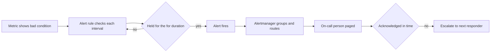

# Alerting and Health Checks

!!! note "In simple words"
    An alert pages a human when users are being hurt. A health check lets the platform decide whether a copy of the app should receive traffic or be restarted. Good alerts are few and specific, and every one of them calls for a person to do something.

Alerts ask people to act. Health checks let an orchestrator decide between sending traffic and restarting. Interviewers use these topics to see whether you can filter noise from real signal, and whether you understand the difference between liveness and readiness.

## Why it matters

An alerting setup can fail in two directions. Real outages go unnoticed, or the on-call engineer receives so many pages that they stop trusting them. Health checks fail similarly. A check that is too strict keeps restarting healthy instances, and one that is too lenient keeps broken instances in service. Getting both right protects customers and the people who respond to incidents.

## How it works

A rule checks a condition on a schedule. Once the condition has held long enough, the alert fires, a router decides who hears about it, and escalation starts if nobody picks it up. Health probes run on their own track, and they drive the platform's decisions to restart or to route traffic.



A step-by-step view:

1. A metric or a log reveals something abnormal, such as 5xx responses climbing.
2. The alert rule evaluates the condition at each interval, and waits out the `for` duration.
3. The alert fires and is passed to Alertmanager or a comparable router.
4. The router merges related alerts, applies any silences, and pages the on-call person.
5. If the page goes unacknowledged, it moves up to the next responder.
6. Health probes run separately. A failing liveness probe restarts the process, and a failing readiness probe pulls the instance out of rotation.

### SLI, SLO, error budget, and SLA

Four terms describe how reliability is measured and promised:

- **SLI (service level indicator).** A measurement, normally a ratio of good events to all valid events. An example is the share of HTTP responses that are not 5xx and arrive in under 300 ms.
- **SLO (service level objective).** The goal for an SLI across a window of time. An example is 99.9% of requests being good across 30 days.
- **Error budget.** The permitted amount of failure, equal to 100% minus the SLO. The team spends this budget on risk, such as releases and experiments, and users are not hurt too often as a result.
- **SLA (service level agreement).** A customer contract that attaches consequences, such as credits, to a missed target. An SLA is typically looser than the internal SLO, so the team gets warned before the contract is broken.

The reasoning behind SLOs is laid out in the [Google SRE book chapter on service level objectives](https://sre.google/sre-book/service-level-objectives/).

Here is a worked example for an order API with a 99.9% SLO over 30 days:

```text
Valid requests in the window:  10,000,000
Good requests (non-5xx, <300 ms): 9,995,000
SLI = 9,995,000 / 10,000,000 = 99.95%          -> meets the 99.9% SLO

Error budget = 100% - 99.9% = 0.1% of 10,000,000 = 10,000 allowed bad requests
Bad requests so far = 10,000,000 - 9,995,000  = 5,000
Budget consumed = 5,000 / 10,000 = 50%
```

Half the budget is gone, so the team might hold back risky releases until the window recovers. The budget converts a reliability target into a decision rule: ship freely while budget remains, and prioritise reliability work once it is exhausted.

### Alert on symptoms, not causes

Base alerts on what users experience, such as slow responses, failed requests, or a broken feature. Causes such as high CPU belong on dashboards. Paging on CPU wakes someone even when users are fine. Symptom alerts map naturally onto an SLO. Alerting on the rate at which the error budget is being consumed is a popular approach, because it reacts quickly to a severe incident and slowly to a minor one.

### Thresholds and conditions

An alert condition has three parts:

1. **Expression.** What is being measured, such as the error ratio over five minutes.
2. **Threshold.** The value regarded as bad.
3. **Duration.** How long the condition must persist before the alert fires.

The duration is essential. Without it, one spike pages someone. The Prometheus-style rule below illustrates the shape. It fires when the five-minute error ratio remains above 5% for ten minutes:

```text
alert: HighErrorRate
expr: |
  sum(rate(http_server_requests_seconds_count{status=~"5.."}[5m]))
    /
  sum(rate(http_server_requests_seconds_count[5m])) > 0.05
for: 10m
labels:
  severity: page
annotations:
  summary: "Error ratio above 5% for 10 minutes"
```

The 5% figure is only an example. Derive thresholds from your SLO and from past incidents, not from numbers copied from somewhere else.

### Routing, escalation, and on-call

Every alert needs a path: the owning team, the channel, and the fallback when nobody answers. An **on-call rotation** is the schedule of people who answer pages. **Escalation** passes an unanswered page to a second person after a fixed interval.

Paging products such as PagerDuty take care of schedules, acknowledgement, escalation, and notification channels. Opsgenie has been affected by a vendor product change, so verify its status before selecting it. Prometheus hands its alerts to **Alertmanager**, which groups them, applies silences, and sends them to receivers like these.

### Reducing alert fatigue

Alert fatigue sets in when pages arrive so often that people start ignoring them. Ways to counter it:

- Remove alerts that nobody acts on. Each page should lead to a concrete action.
- Group related alerts, so one outage yields one notification and not fifty.
- Set a `for` duration, so transient spikes stay quiet.
- Keep **pages** (act now, at any hour) apart from **tickets** (act during working hours).
- Review the alert list after every incident, and retune it.

### Health checks with Spring Boot Actuator

Actuator serves health information at `/actuator/health`. It combines **health indicators**, one for each component such as the database, disk space, or message broker. Custom indicators can be added. This library example needs Spring Boot Actuator on the classpath, so it is not compiled here:

```java
import org.springframework.boot.actuate.health.Health;
import org.springframework.boot.actuate.health.HealthIndicator;
import org.springframework.stereotype.Component;

@Component
public class PaymentGatewayHealthIndicator implements HealthIndicator {

    private final Gateway gateway;

    public PaymentGatewayHealthIndicator(Gateway gateway) {
        this.gateway = gateway;
    }

    @Override
    public Health health() {
        try {
            return gateway.ping()
                    ? Health.up().build()
                    : Health.down().withDetail("reason", "ping returned false").build();
        } catch (RuntimeException e) {
            return Health.down(e).build();
        }
    }

    // A small abstraction over the external provider, so the indicator can be tested
    public interface Gateway {
        boolean ping();
    }
}
```

Keep the check light. If a health endpoint calls three external systems on every probe, the probes themselves can take those systems down.

### Liveness and readiness probes

Kubernetes and similar orchestrators run two distinct probes. The [Kubernetes probe guide](https://kubernetes.io/docs/tasks/configure-pod-container/configure-liveness-readiness-startup-probes/) explains each one.

| Probe | Question answered | Result on failure |
|---|---|---|
| Liveness | Is the process stuck or unrecoverably broken? | The instance is restarted |
| Readiness | Can this instance take requests at this moment? | The instance is removed from the load balancer, but not restarted |

Spring Boot publishes these as health groups. Turn them on with `management.endpoint.health.probes.enabled=true`, after which they are served at `/actuator/health/liveness` and `/actuator/health/readiness`.

Liveness should avoid depending on external systems. When the database is down, restarting the app does not bring the database back, and repeated restarts make matters worse. Readiness is the right place for dependency checks, since it keeps traffic away from an instance that cannot serve it.

Probe timing needs tuning as well: an initial delay long enough for start-up, a timeout shorter than the period, and a failure threshold that tolerates a short hiccup.

## Where it is used

- Paging on user-facing outages, such as a jump in failed checkouts.
- Ticket-level alerts for slow disk growth, or a certificate due to expire next month.
- Kubernetes deployments, where liveness restarts broken pods and readiness governs traffic.
- Load balancer target groups, which send traffic only to instances that pass their checks.

## Benefits

- **Fewer, sharper pages** when alerts follow symptoms and SLOs.
- **Quick detection** of user-facing faults through short, clear rules.
- **Self-healing** for stuck processes via liveness probes.
- **Careful traffic control** through readiness, so a warming instance does not get requests too soon.

## Cons and limits

- **Thresholds are judgement calls** that need regular review.
- **Symptom alerts arrive later** than cause-based alerts. Dashboards can reveal causes earlier.
- **Health checks add load** on dependencies when they are deep or frequent.
- **Badly set probes** produce restart loops or stale routing.
- **Routing depends on people.** A well-written rule with no owner still fails.

## Best practices

- Alert on symptoms tied to an SLO, and use burn-rate alerts for the error budget where possible.
- Give each alert a threshold, a duration, a route, and a documented response.
- Keep pages separate from tickets, and review the list after each incident.
- Restrict liveness to internal health, and place dependency checks in readiness.
- Keep health endpoints cheap, and protect them when they reveal internal detail.
- Set probe delays, timeouts, and failure thresholds from the application's real start-up time.

## Common pitfalls

- Alerting on causes such as CPU or memory instead of the symptoms users feel.
- Omitting the `for` duration, so one data point pages someone.
- Health checks that are slow, call many services, or are exposed without protection.
- Placing a dependency check in liveness, which triggers restart loops during an external outage.
- Paging for conditions that need no action right away.
- Never reviewing alerts, so noise accumulates unchecked.

!!! tip "Interview tip"
    **Q: What is the difference between liveness and readiness?**
    Liveness asks "should this process be restarted?" Readiness asks "should this instance get traffic?" A process can be alive yet not ready while it warms caches or waits on a database. Put dependency checks in readiness, and keep liveness limited to internal health, so an external outage cannot set off a restart storm.

## Quick recap

- Alert on symptoms tied to SLOs, rather than on raw causes.
- Every alert needs a threshold, a duration, a route, and an action.
- Cut fatigue by grouping alerts, tuning them, and separating pages from tickets.
- Actuator combines health indicators, and custom ones cover key dependencies.
- Liveness restarts broken processes, and readiness controls traffic.

## Official documentation

- [Prometheus overview](https://prometheus.io/docs/introduction/overview/)
- [Kubernetes: configure liveness, readiness, and startup probes](https://kubernetes.io/docs/tasks/configure-pod-container/configure-liveness-readiness-startup-probes/)
- [Google SRE book: service level objectives](https://sre.google/sre-book/service-level-objectives/)

**See also:** [Logging](logging.md), [Metrics](metrics.md), [Distributed Tracing](distributed-tracing.md)
