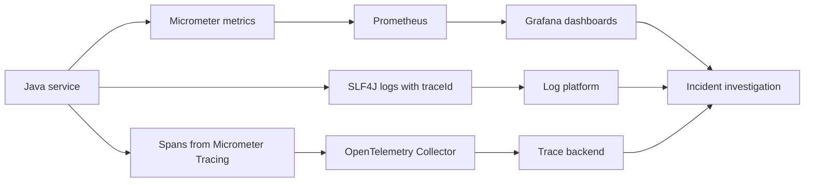
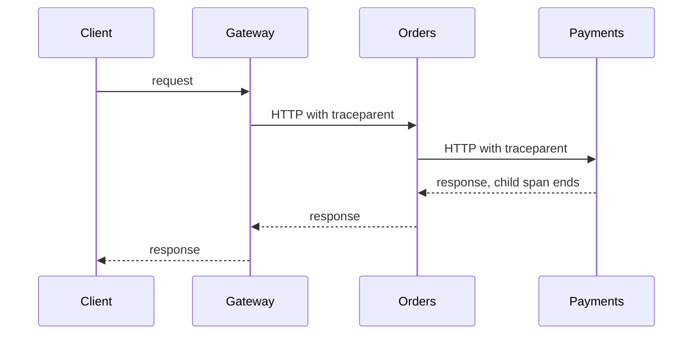

# Distributed Tracing

!!! note "In simple words"
    A trace is a timeline of one request as it moves between services. Each step on that timeline is a span with a start time and a duration, so you can point at the step that made the request slow.

Distributed tracing follows a single request across services, queues, and databases. It comes up whenever you describe microservices, because metrics and logs alone seldom reveal where a slow request actually spent its time.

## Why it matters

Picture five services that together handle a single user action, touching a dozen downstream calls. A metric can show that p99 latency has risen. A log line can show that one call failed. Neither reveals the whole chain. A trace lays out the full path with timings, so you can state that "the payment call took 1.8 seconds, and it was waiting on the database". That turns a vague slowdown into a targeted fix.

## How it works

Metrics, logs, and traces each answer a different question, and they are most useful when they link to one another. The diagram shows how the three signals leave a Java service and come together during an investigation.



Metrics reveal that many requests are unhealthy. Traces reveal where a single request spent its time. Logs reveal what the code reported at that instant. Writing the trace ID into every log line lets you move from a slow span straight to the matching log lines.

The path of one trace through the system:

1. An incoming request opens a new trace, or joins an existing one via a `traceparent` header.
2. Spring instrumentation opens a server span for the request.
3. Every outbound call opens a client span and writes the trace context into its headers.
4. Each service ships its completed spans to a collector or straight to a backend.
5. The backend groups spans by trace ID and renders the timeline and dependency map.

### Traces, spans, and context

A **trace** covers the whole life of one request. It consists of **spans**, each standing for one unit of work such as an HTTP call, a database query, or a message publication. Spans nest through parent-child references. All spans in a trace carry the same **trace ID**, while each span also has its own **span ID**.

A span stores a name, start and end times, tags (key-value attributes), and an error flag when something went wrong. Since the spans form a tree, the backend can draw a waterfall that shows which children ran one after another and which overlapped.

### Micrometer Tracing: the Spring Boot 3 successor

Spring Cloud Sleuth was the earlier tracing library for Spring. Spring Boot 3 replaces it with **Micrometer Tracing**, a facade in the same family as Micrometer metrics. Micrometer Tracing delegates to a bridge, either OpenTelemetry or Brave, and that bridge exports the spans. Your code programs against the Micrometer Tracing API. The [Micrometer Tracing reference](https://docs.micrometer.io/tracing/reference/) documents it.

Spring instruments the common paths by itself, including incoming HTTP requests and outgoing client calls. Write manual spans only where the automatic ones leave gaps.

A library example using Micrometer Tracing. It needs the `micrometer-tracing` artefact on the classpath, so it is not compiled here:

```java
import io.micrometer.tracing.Span;
import io.micrometer.tracing.Tracer;

public class PaymentClient {

    private final Tracer tracer;

    public PaymentClient(Tracer tracer) {
        this.tracer = tracer;
    }

    public void charge(String orderId) {
        Span span = tracer.nextSpan().name("payment.charge").start();
        try (Tracer.SpanInScope ignored = tracer.withSpan(span)) {
            span.tag("order.id", orderId);
            // Call the payment provider here. Any HTTP call made inside this scope
            // becomes a child span.
        } catch (RuntimeException e) {
            span.error(e);
            throw e;
        } finally {
            span.end();
        }
    }
}
```

Span tags can afford high-cardinality values, because each trace is sampled and stored individually. Metrics cannot. Even so, keep secrets and personal data out of tags.

### OpenTelemetry: the vendor-neutral standard

**OpenTelemetry (OTel)** is a specification with libraries for traces, metrics, and logs, speaking a shared protocol called OTLP. You instrument the code once, then export to whichever backend you choose. An **OpenTelemetry Collector** may run between your services and the backends, performing batching, filtering, and sampling. The [OpenTelemetry documentation](https://opentelemetry.io/docs/) covers the specification and the collector.

### Trace propagation

Spans from different services join a single trace only if each outbound call carries the context. The W3C Trace Context standard defines a `traceparent` header for this:

```text
traceparent: 00-<32-hex-char trace id>-<16-hex-char parent span id>-<flags>
```

Every receiving service reads the header, opens a child span, and forwards its own span ID. Queues need equivalent handling, which means placing the context in message headers, since HTTP headers do not travel through a broker.

Background threads and executors drop the context unless you pass it along deliberately. Wrap the task or use a context-aware executor, so that child work stays inside the same trace.



### Zipkin and Jaeger: trace storage and analysis

**Zipkin** keeps traces and produces latency breakdowns and service dependency graphs. **Jaeger** is a separate open-source backend with its own storage choices and interface. Both can answer "which downstream call accounts for most of this endpoint's latency?" and both accept OpenTelemetry data. Base the choice on what your team already runs, not on features nobody will use.

### Sampling strategies

Storing every trace at high volume is costly, so sampling decides which traces survive.

| Strategy | Decision point | Trade-off |
|---|---|---|
| Head-based | When the request begins | Cheap and simple, but may discard the one slow trace you needed |
| Tail-based | After the trace finishes, inside a collector | Retains errors and slow traces, but needs buffering and extra infrastructure |
| Probabilistic | A random percentage of requests | Easy to reason about, but does not prefer interesting traces |

In Spring Boot 3, a probabilistic head sampler is configured with `management.tracing.sampling.probability`, a number between 0 and 1. Teams often pair head sampling, to control volume, with tail sampling, to keep errors and slow requests.

```yaml
management:
  tracing:
    sampling:
      probability: 0.1
```

## Where it is used

- Locating the slow dependency inside a request that passes through many services.
- Investigating a failure that only occurs when two services interact.
- Confirming that a message consumer ran inside the same trace as the request that published the message.
- Comparing latency between releases by endpoint, using trace-level detail.

## Benefits

- **A single view** of each step's path and timing.
- **Connects services** that logs and metrics present separately.
- **Vendor-neutral** when built on OpenTelemetry.
- **Works alongside logs** once the trace ID appears in each line.

## Cons and limits

- **Sampling discards data.** Rare errors slip through when sampling happens only at the head.
- **Gaps in instrumentation** show up in queues, background threads, and custom clients until the context is wired through.
- **Storage and collector cost** rises with volume and retention.
- **Traces do not summarise.** For trends across all traffic, use metrics.
- **Overhead** per span is small, though it adds up on very hot code paths.

## Best practices

- Adopt Micrometer Tracing with OpenTelemetry, and let Spring instrument the standard paths.
- Include the trace ID in log lines, so logs and traces can be joined.
- Carry the context through HTTP headers, message headers, and executors.
- Mix head sampling for volume control with tail sampling for errors and slow requests.
- End every span in a `finally` block, and report failures through `span.error`.
- Restrict span tags to identifiers and bounded values, and exclude secrets and personal data.
- Connect latency alerts to a dashboard from which example traces can be opened.

## Common pitfalls

- Failing to propagate context through queues or background threads.
- Sampling only at the head and thereby missing rare errors.
- Opening spans without ending them, which leaks memory and distorts timelines.
- Putting the trace ID in the traces but not in the log lines, so the two cannot be joined.
- Adding secrets or personal data as span tags.
- Believing traces replace metrics. Traces show single requests, metrics show totals.

!!! tip "Interview tip"
    **Q: How do you find which service is slow in a request that touches five services?**
    Open a trace for one slow request. The waterfall gives each span's start time and duration, so the call that dominates the total stands out. Then match the trace ID against that service's logs to find the error or the query behind the slow span.

## Quick recap

- A trace is a tree of spans that all share one trace ID.
- Micrometer Tracing is the Spring Boot 3 facade, with OpenTelemetry or Brave underneath.
- Propagate context with the W3C `traceparent` header and through message headers.
- Head sampling manages volume, and tail sampling keeps errors and slow traces.
- Place the trace ID in logs, so you can jump from a log line to its trace.

## Official documentation

- [OpenTelemetry documentation](https://opentelemetry.io/docs/)
- [Micrometer Tracing reference](https://docs.micrometer.io/tracing/reference/)
- [W3C Trace Context](https://www.w3.org/TR/trace-context/)

**See also:** [Logging](logging.md), [Metrics](metrics.md), [Alerting and Health Checks](alerting-health-checks.md)
