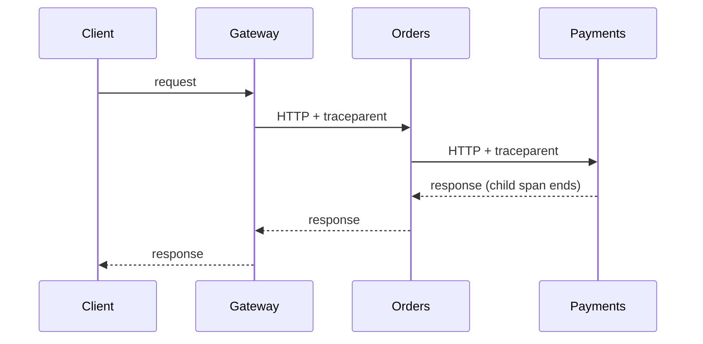

# Distributed Tracing

A distributed trace follows one request as it crosses services, queues, and databases. Interviewers ask about tracing when you describe microservices, because logs and metrics alone rarely show where a slow request spent its time.

## Core concepts

### Traces, spans, and context

A **trace** is the full journey of one request. It is made of **spans**, each representing one unit of work (an HTTP call, a database query, a message publish). Spans form a tree through parent-child links. Every span in a trace shares a **trace ID**, and each span has its own **span ID**.

### Micrometer Tracing: the Spring Boot 3 successor

Spring Cloud Sleuth was the older tracing library for Spring. In Spring Boot 3 it is replaced by **Micrometer Tracing**, which is a facade similar to Micrometer metrics. Micrometer Tracing hands the work to a bridge: OpenTelemetry or Brave. Your code uses the Micrometer Tracing API, and the bridge sends spans to a backend.

Spring Boot instruments common paths automatically (incoming HTTP requests, outgoing client calls, and more). You add manual spans only where the automatic ones do not show enough.

```java
import io.micrometer.tracing.Span;
import io.micrometer.tracing.Tracer;

public class PaymentClient {

    private final Tracer tracer;

    public PaymentClient(Tracer tracer) {
        this.tracer = tracer;
    }

    public void charge(String orderId) {
        Span span = tracer.nextSpan().name("payment.charge").start();
        try (Tracer.SpanInScope ignored = tracer.withSpan(span)) {
            span.tag("order.id", orderId);
            // Call the payment provider here. Any HTTP call made inside this scope
            // becomes a child span.
        } catch (RuntimeException e) {
            span.error(e);
            throw e;
        } finally {
            span.end();
        }
    }
}
```

Tags are useful on spans because traces are sampled and stored per request, so high cardinality is acceptable here in a way it is not for metrics.

### OpenTelemetry: the vendor-neutral standard

**OpenTelemetry (OTel)** is a standard and set of libraries for traces, metrics, and logs, with a common wire protocol (OTLP). Instrument once, and export to any backend. An **OpenTelemetry Collector** can sit between services and backends to batch, filter, and sample data before it is stored.

### Trace propagation

For a trace to span services, each outgoing call must carry the trace context. The W3C Trace Context standard uses a `traceparent` header:

```text
traceparent: 00-<32-hex-char trace id>-<16-hex-char parent span id>-<flags>
```

Each service reads the header, creates a child span, and sends its own span ID onward. Message queues need the same idea: put the context in message headers, not only in HTTP headers.



### Zipkin and Jaeger: trace storage and analysis

**Zipkin** stores traces and draws latency breakdowns and service dependency graphs. **Jaeger** is another open-source backend with its own storage options and UI. Both answer questions like "which downstream call dominates this endpoint's latency?" Both can receive OpenTelemetry data. Pick one based on your team's tooling, not on features you will not use.

### Sampling strategies

Tracing every request at high volume is expensive. Sampling decides which traces to keep.

| Strategy | Decision point | Trade-off |
|---|---|---|
| Head-based | At the start of the request | Cheap and simple; may drop the one slow trace you wanted |
| Tail-based | After the trace completes, in a collector | Keeps errors and slow traces; needs buffering and more infrastructure |
| Probabilistic | Random fraction, such as a percentage of requests | Easy to reason about; does not prioritise interesting traces |

In Spring Boot 3, a probabilistic head sampler is set with `management.tracing.sampling.probability` (a value between 0 and 1). Many teams combine head sampling for volume control with tail sampling for errors and slow requests.

## How it works

1. An incoming request starts a trace, or continues one from a `traceparent` header.
2. Spring instrumentation opens a server span for the request.
3. Outgoing calls open client spans and inject the trace context into headers.
4. Each service exports finished spans to a collector or directly to a backend.
5. The backend assembles spans by trace ID and shows the timeline and dependencies.

## Common pitfalls

- Not propagating context through message queues or background threads
- Sampling only at the head and missing rare errors
- Starting spans and forgetting to end them, which leaks memory and produces broken timelines
- Logging the trace ID but not putting it in log lines, so logs and traces cannot be joined
- Tagging spans with secrets or personal data
- Assuming traces replace metrics; traces show individual requests, metrics show the aggregate

!!! tip "Interview tip"
    **Q: How do you find which service is slow in a request that touches five services?**
    A: Open a trace for a slow request. The waterfall shows each span's start time and duration, so you can see which call dominates the total. Then match the trace ID to logs for that service to see the error or the query behind the slow span.

## Quick recap

- A trace is a tree of spans sharing one trace ID
- Micrometer Tracing is the Spring Boot 3 facade; OpenTelemetry or Brave is the bridge
- Propagate context via headers (W3C `traceparent`) and through message headers
- Use head sampling to control volume and tail sampling to keep errors and slow traces
- Put the trace ID in logs so you can move from a log line to its trace

**See also:** [Logging](logging.md), [Metrics](metrics.md), [Alerting and Health Checks](alerting-health-checks.md)
