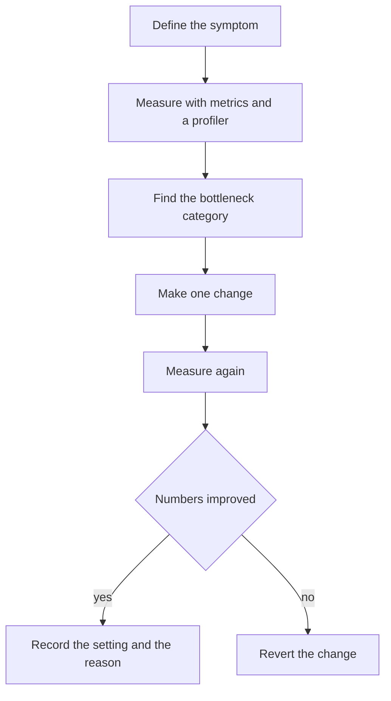

# Logging Configuration and Performance Tuning

!!! note "In simple words"
    Slow services are usually slow for a handful of familiar reasons: too much logging, the wrong thread count, a cache that is too small or unbounded, a chatty database access pattern, or a pool sized by guesswork. Measure first, change one setting, then measure again.

This page joins two topics that interact. Heavy logging slows requests, and slow requests generate more logs. It covers how Spring Boot logging is configured, then the main tuning levers: heap, threads, caches, and database access. The fundamentals of SLF4J and Logback are in [Logging](logging.md), and the profiler workflow is in [JIT and Performance Tools](../03b-jvm-internals/jit-and-performance-tools.md).

## Why it matters

Performance projects go wrong in recognisable ways. Someone raises the heap without evidence, adds threads that all contend for one database, or caches data with no expiry. Each change may backfire and conceal the real cause. A repeatable loop of measure, change, and measure again keeps the effort honest, and it is exactly what an interviewer wants to hear described.

## How it works

Tuning is a loop. Name the symptom, measure it, identify the category of bottleneck, make a single change, and keep that change only if the figures improve.



Taken step by step:

1. Describe the symptom precisely: p99 latency, CPU, memory, or throughput.
2. Gather measurements from metrics and a profiler before touching anything. See [Metrics](metrics.md).
3. Match the symptom to a bottleneck category using the table near the end of this page.
4. Apply one change, then measure again. Retain it only when the numbers move the right way.
5. Write down the setting and its reason, so that nobody reverts it later without knowing why it exists.

### Logging in Spring Boot

Spring Boot writes through SLF4J and defaults to Logback. Levels can be set in `application.yml` without any Logback XML:

```yaml
logging:
  level:
    root: INFO
    com.example.orders: DEBUG
    org.hibernate.SQL: DEBUG
```

Levels cascade by package, from the nearest ancestor. Turn DEBUG on for a single package while you investigate. Avoid enabling it on the root logger, which would flood the output with framework noise.

For richer needs, such as separate files, JSON layouts, asynchronous appenders, or rolling policies, place the configuration in `logback-spring.xml`. The Spring-aware `<springProfile>` element lets every environment pick its own appender. Appender and layout details are covered in [Logging](logging.md).

### Changing levels at runtime

Actuator can alter a logger's level on a running application, with no restart. The `loggers` endpoint has to be exposed first:

```yaml
management:
  endpoints:
    web:
      exposure:
        include: loggers
```

Send a POST to `/actuator/loggers/com.example.orders` with the body `{"configuredLevel": "DEBUG"}`. To revert to the inherited level, send `"configuredLevel": null`. Guard this endpoint closely: expose it only on an internal port or behind authentication.

### Logging cost

Even a disabled log statement costs something, because its arguments are evaluated before the call. Two habits keep this in check:

- Use `{}` placeholders, so the message is only built when the level is enabled.
- Wrap arguments that are expensive to compute, such as serialising a large object, in an explicit level check.

A library example using SLF4J. It is not compiled here:

```java
import org.slf4j.Logger;
import org.slf4j.LoggerFactory;

public class OrderHandler {

    private static final Logger log = LoggerFactory.getLogger(OrderHandler.class);

    void handle(String orderId, int lineCount) {
        // Cheap: the placeholder is formatted only if DEBUG is on
        log.debug("Handling order {} with {} lines", orderId, lineCount);

        // Expensive argument: guard the call so it runs only when DEBUG is on
        if (log.isDebugEnabled()) {
            log.debug("Order detail: {}", describeOrder(orderId));
        }
    }

    private String describeOrder(String orderId) {
        return "order-" + orderId; // Imagine a costly serialisation here
    }
}
```

Avoid logging inside a tight loop that executes millions of times per second. Record a summary instead, such as the count, the total, or the failed items.

### Correlation and sensitive data

A correlation ID stored in MDC ties together every log line from one request. Set it when the request enters the service, and clear it on the way out, because pooled threads get reused. The MDC mechanics are described in [Logging](logging.md).

Secrets, tokens, passwords, and full card numbers must never be logged. If support staff need a value, mask it. Keeping only the last four characters of an account number is a common approach.

### Memory and heap sizing

Making `-Xms` equal to `-Xmx` prevents the heap from resizing during start-up and under shifting load, which steadies latency. The downside is that the full amount is reserved immediately, so an oversized heap sits idle.

```bash
java -Xms2g -Xmx2g -jar orders-service.jar
```

In containers, a percentage of the container memory limit is safer, because the heap then tracks whatever the orchestrator grants:

```bash
java -XX:MaxRAMPercentage=75.0 -jar orders-service.jar
```

Heap sizing is a matter of measurement. Study GC logs and heap occupancy after a load test. For how collectors behave against different heap sizes and pause targets, see [Garbage Collection](../03b-jvm-internals/garbage-collection.md) and the [Oracle GC tuning guide](https://docs.oracle.com/en/java/javase/21/gctuning/).

### Thread pool tuning

Spring Boot provides a task executor for `@Async` methods, and a separate scheduler for scheduled work. Two families of settings control how many threads run and how many tasks queue:

```yaml
spring:
  task:
    execution:
      pool:
        core-size: 8
        max-size: 32
        queue-capacity: 200
    scheduling:
      pool:
        size: 4
```

A `ThreadPoolExecutor` only grows beyond its core size once the queue is full. This is why `queue-capacity` matters so much. An effectively unbounded queue keeps the pool at its core size, and work accumulates in memory. A bounded queue that fills while the pool is at maximum causes rejections. Decide deliberately how rejections should be handled.

Too few threads leave CPU and I/O underused. Too many waste memory and add context-switching overhead. For CPU-heavy work, a good starting point is the core count. For I/O-heavy work, measure, since extra threads keep helping until the downstream dependency becomes the constraint.

Virtual threads, a final feature in Java 21, shift this balance for blocking I/O. When each task can run on its own virtual thread, a large pool is less essential. Confirm your framework version supports them before you switch them on.

### Caching strategies

A cache keeps the result of an expensive read so that the next read is inexpensive. The write strategy determines how the cache and the database stay consistent.

| Strategy | How it works | Trade-off |
|----------|--------------|-----------|
| Cache-aside (lazy loading) | The application checks the cache, and on a miss it loads from the database and populates the cache | Simple and widespread; the first read after a miss is slow, and data can be stale until expiry |
| Write-through | A write goes to the cache and the database together, synchronously | Keeps both aligned; each write takes longer |
| Write-behind (write-back) | A write updates the cache, and a background process writes the database later | Fast writes; data is at risk if the cache fails before the flush |

Spring's cache abstraction offers cache-aside through annotations, after `@EnableCaching` is placed on a configuration class.

A library example using Spring. It is not compiled here:

```java
import org.springframework.cache.annotation.CacheEvict;
import org.springframework.cache.annotation.CachePut;
import org.springframework.cache.annotation.Cacheable;
import org.springframework.stereotype.Service;

@Service
public class UserService {

    @Cacheable(cacheNames = "users", key = "#id")
    public User findUser(long id) {
        return loadFromDatabase(id); // Runs only on a cache miss
    }

    @CachePut(cacheNames = "users", key = "#result.id()")
    public User updateUser(User user) {
        return saveToDatabase(user); // Always runs; refreshes the cache entry
    }

    @CacheEvict(cacheNames = "users", key = "#id")
    public void deleteUser(long id) {
        removeFromDatabase(id);
    }

    private User loadFromDatabase(long id) { return new User(id, "name"); }
    private User saveToDatabase(User user) { return user; }
    private void removeFromDatabase(long id) { }
}

record User(long id, String name) { }
```

Annotation-driven caching only applies to calls that go through the Spring proxy. If a method inside the same class calls `findUser`, the cache is bypassed. An in-process cache like Caffeine is quick but private to each instance. A shared store like Redis costs more per read but is consistent across instances. See [Spring Cache and Redis](../12-caching-performance/spring-cache-and-redis.md) and [Distributed Caching](../12-caching-performance/distributed-caching.md).

### Database access

Most database slowness in Java services comes from two sources:

- **The N+1 problem.** Load a list of parents, then touch a lazy association on each parent, and the code issues one query for the list plus one for every parent. Resolve it with a join fetch or a batch load. The worked example is in [Performance Optimisation](../12-caching-performance/performance-optimisation.md).
- **Missing indexes.** Index the columns that frequently appear in `WHERE` clauses. Inspect the query plan before adding more, because each extra index slows writes.

Pool sizing deserves care too. Every connection consumes a database resource, and an oversized pool can swamp the database. Small pools frequently outperform large ones. With Spring Boot and HikariCP, the property is `spring.datasource.hikari.maximum-pool-size`, and a load test should determine its value:

```yaml
spring:
  datasource:
    hikari:
      maximum-pool-size: 12
      minimum-idle: 3
```

### Object pooling and interning

Only pool objects that are costly to build and hold no per-use state, such as database connections or thread pools. Cheap objects should be left alone. The JVM allocates small objects quickly, and a pool adds locking and bookkeeping that may outweigh the saving.

`String.intern()` returns the canonical instance from the JVM string pool. It can save memory where identical strings repeat heavily. The call itself is slower than normal construction, and the pool consumes memory of its own, so measure before interning.

### Symptoms and first checks

This table links each symptom to a probable cause and the first thing to examine:

| Symptom | Likely cause | First thing to check |
|---------|--------------|----------------------|
| High latency under load | Blocking calls, slow queries, missing cache | Database queries per request, downstream call durations |
| High CPU | Hot loops, excessive logging, garbage collection work | Profiler output, DEBUG log volume, GC logs |
| Memory growth | Leak, unbounded collections or caches, large payloads | Heap dump and retained-size analysis |
| Requests queue or get rejected | Thread or connection pool too small, or unbounded queue | Pool metrics and queue depth |
| Network-heavy calls | Chatty APIs, large uncompressed responses | Calls per user action, response size |

## Where it is used

- Production services with latency spikes at peak load.
- Batch jobs whose memory use needs to be sized from measurements.
- Services that read the same reference data repeatedly and gain from caching.
- Any service where log volume has grown large enough to affect request time.

## Benefits

- **Targeted fixes.** Measurement points at the true cause, so effort is not wasted.
- **Lower spend.** Properly sized heaps, pools, and log volumes cut infrastructure costs.
- **Steadier latency** from fixed heaps and bounded queues.
- **Lighter database load** after caching and removing N+1 queries.

## Cons and limits

- **Caches introduce staleness.** A cached value may lag the database.
- **Tuning depends on the environment.** A value that suits a laptop can fail in production.
- **Settings interact.** A larger pool can overwhelm the database, and more threads can exhaust memory.
- **Measurement takes time.** A proper load test is slower than guessing, but it is worth the effort.

## Best practices

- Measure before tuning, and record the baseline.
- Change one setting at a time, and keep it only if the numbers improve.
- Limit DEBUG logging to a package, and disable it once the investigation ends.
- Give every cache both a size bound and an expiry time.
- Derive connection and thread pool sizes from load tests rather than defaults.
- Fix the heap with `-Xms` equal to `-Xmx` where latency matters, or use a percentage of the limit in containers.
- Inspect every list endpoint for N+1 queries, and fix them with a join fetch or a batch load.

## Common pitfalls

- **Tuning with no baseline.** An apparent gain may just be noise. Record figures first.
- **DEBUG on the root logger in production.** It slows the service and fills the disk.
- **Unbounded caches.** A cache with no size limit or expiry is a leak in disguise.
- **Poor cache keys.** Keys with too much detail lower the hit rate, and keys with too little return wrong data.
- **Forgetting the self-invocation trap.** `@Cacheable` and `@Transactional` do not apply to calls made from inside the same class.
- **Oversized connection pools.** More connections can slow the database and the application together.
- **Logging whole entities.** Doing so can trigger lazy loading and expose sensitive fields.

!!! tip "Interview tip"
    **Q: A service is slow under load. Where do you start?**
    Begin with measurement rather than a configuration change. Check the latency and pool metrics, capture a thread dump or a profile, and count the database queries per request. Only then adjust pool sizes, the heap, or caching. Mention the N+1 problem as a frequent cause of slowness that tuning alone cannot solve.

## Quick recap

- Configure logging with `logging.level.*` and `logback-spring.xml`. Change levels at runtime through the Actuator `loggers` endpoint.
- Placeholders and guards keep logging cheap. Never log secrets or personal data.
- Size the heap deliberately, and use a percentage of the memory limit inside containers.
- Thread pool and queue settings decide whether work runs, waits, or is rejected.
- Pick a cache write strategy by weighing consistency against write speed.
- Remove N+1 queries, and size connection pools from measurement.

## Official documentation

- [Oracle Java SE 21 garbage collection tuning guide](https://docs.oracle.com/en/java/javase/21/gctuning/)
- [Logback manual](https://logback.qos.ch/manual/)
- [Prometheus overview](https://prometheus.io/docs/introduction/overview/)

**See also:** [Logging](logging.md), [Metrics](metrics.md), [Performance Optimisation](../12-caching-performance/performance-optimisation.md), [Garbage Collection](../03b-jvm-internals/garbage-collection.md), [Annotations and Reflection](../03c-tooling-utilities/annotations-and-reflection.md)
