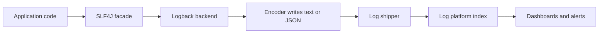

# Logging

!!! note "In simple words"
    A log is a running diary your program keeps. Useful entries record what happened, when, and for which request, and they never expose secrets. When something breaks in production, those lines are frequently the quickest route to the cause.

Logging is how an application explains itself after the fact. Interviewers ask about it to find out whether you write logs that help during an incident, rather than logs that merely exist.

## Why it matters

When a production request fails at 2 a.m., no one can attach a debugger to it. The log lines are what is left behind. Thin logs hide the cause. Noisy logs bury the one line that matters, cost real money to keep, and can leak personal data. A handful of habits (placeholders, sensible levels, correlation IDs, and masking) decide whether logs are an asset or a liability.

## How it works

Application code emits events through a facade. A backend formats them, a shipper moves the text to a central place, and the platform indexes the fields so people can search them quickly.



The lifecycle of one log event:

1. Code emits an event through SLF4J at the level that describes it.
2. The backend (Logback in a default Spring Boot application) checks the event against its level filter.
3. The encoder renders the event as one line of text or one JSON object.
4. A shipper picks the output up and forwards it to the log platform.
5. The platform indexes fields such as level, service name, and correlation ID.
6. Dashboards and alert rules query those fields during incidents.

### Facade and implementation: SLF4J and Logback

Program against **SLF4J** (Simple Logging Facade for Java). It is only an interface, and the real logger is chosen separately. Spring Boot picks **Logback** unless told otherwise. Because your classes depend solely on the facade, the backend can be swapped without touching them. The [SLF4J manual](https://www.slf4j.org/manual.html) covers the API.

A library example using SLF4J. It requires `slf4j-api` on the classpath, so it is not compiled here:

```java
import org.slf4j.Logger;
import org.slf4j.LoggerFactory;

public class OrderService {

    private static final Logger log = LoggerFactory.getLogger(OrderService.class);

    public void placeOrder(String orderId, int itemCount) {
        // Placeholders are only formatted if the level is enabled
        log.debug("Placing order {} with {} items", orderId, itemCount);
        log.info("Order {} accepted", orderId);
    }
}
```

Write `{}` placeholders instead of joining strings with `+`. Concatenation builds the full message even when the level is disabled, which wastes work on every call.

### Log levels

| Level | Purpose |
|---|---|
| TRACE | Fine-grained execution flow, normally off except while debugging |
| DEBUG | Detail for developers, such as intermediate values |
| INFO | Routine business events, like an order accepted or a job completed |
| WARN | Something unexpected that the system absorbed |
| ERROR | A failed operation that somebody must look at |

SLF4J has no FATAL level. Some frameworks provide one anyway. In practice, record fatal conditions as ERROR, and then shut the process down.

Pick a level by asking what a reader would do with the line. A line nobody acts on, at any level, is clutter. A line that demands action belongs at WARN or ERROR.

### Never log secrets or personal data

Do not write passwords, API keys, or session tokens to the log, and avoid personal data as well. Record an identifier in place of the full record. If a token must be referenced, mask it. The helper below keeps only the final four characters. It is plain Java with no libraries, and it is not compiled here:

```java
public final class Masking {

    private Masking() {
    }

    // Show only the last four characters of a token
    public static String maskToken(String token) {
        if (token == null || token.length() <= 4) {
            return "****";
        }
        return "****" + token.substring(token.length() - 4);
    }
}
```

Masking has to happen before a value reaches the logger, because the framework writes whatever it is handed. A redaction filter added later is a safety net, not the primary defence.

### Configuration: Logback, appenders, and layouts

In Spring Boot, Logback is configured through `logback-spring.xml`. An **appender** chooses the destination, such as the console, a file, or a network socket. A **layout** (or **encoder**) chooses the format. An **asynchronous appender** places a queue in front of a slow destination, so request threads are not held up by I/O.

A Logback configuration file. It is a library configuration, so it is not compiled here:

```xml
<configuration>
  <appender name="CONSOLE" class="ch.qos.logback.core.ConsoleAppender">
    <encoder>
      <pattern>%d{ISO8601} %-5level [%thread] %logger{36} traceId=%X{traceId:-} - %msg%n</pattern>
    </encoder>
  </appender>

  <appender name="ASYNC" class="ch.qos.logback.classic.AsyncAppender">
    <appender-ref ref="CONSOLE"/>
    <queueSize>8192</queueSize>
  </appender>

  <root level="INFO">
    <appender-ref ref="ASYNC"/>
  </root>
</configuration>
```

An asynchronous appender may discard events when its queue overflows, depending on how it is configured. Understand that trade-off before you rely on it for audit records. Audit trails generally need a synchronous, lossless route.

### Log4j2

**Log4j2** is another backend. Its asynchronous loggers rely on a lock-free ring buffer and can sustain very high throughput. Its configuration and layout options are more extensive than Logback's. Adopt it when measurements show logging throughput is the bottleneck, and keep the SLF4J facade so the migration stays contained.

### Structured logging, correlation IDs, and MDC

A **structured log** is machine-readable, normally one JSON object per line. A log platform can filter directly on `orderId` or `traceId`, without relying on regular expressions over free text.

**MDC** (Mapped Diagnostic Context) is a map scoped to the current thread. Each value in it is printed with every line that thread writes. Set a correlation ID in MDC when the request enters the service, and every line that request produces will carry it.

A library example using SLF4J's MDC. It is not compiled here:

```java
import org.slf4j.MDC;

import java.util.UUID;

public class CorrelationContext {

    public static final String HEADER = "X-Correlation-Id";

    public void handle(String incomingId, Runnable work) {
        String correlationId = (incomingId != null) ? incomingId : UUID.randomUUID().toString();
        MDC.put("correlationId", correlationId);
        try {
            work.run();
        } finally {
            // Thread pools reuse threads. Without this, the next request inherits the value.
            MDC.clear();
        }
    }
}
```

Two consequences follow. Clear MDC in a `finally` block, every time. Also, MDC is bound to a thread, so it does not travel with work that another thread picks up, unless you copy it across. Executors and reactive chains need explicit propagation.

### Log sampling

On a busy service, recording every successful request is expensive and hides the lines that matter. **Sampling** keeps a share of routine events while retaining every error. The counter-based sampler below is plain Java with no libraries, and it is not compiled here:

```java
import java.util.concurrent.atomic.AtomicLong;

public final class SampledLogger {

    private final AtomicLong counter = new AtomicLong();
    private final long everyN;

    public SampledLogger(long everyN) {
        if (everyN <= 0) {
            throw new IllegalArgumentException("everyN must be positive");
        }
        this.everyN = everyN;
    }

    public boolean shouldLog() {
        return counter.incrementAndGet() % everyN == 0;
    }
}
```

Sample routine INFO lines only. Errors and audit events are never sampled away.

### The ELK stack

The **ELK stack** pairs Elasticsearch (storage and full-text search), Logstash (ingestion and transformation), and Kibana (search and dashboards). Many deployments add a light shipper such as Filebeat on each host to forward the files. The stack covers ingestion, search, dashboards, and alerts on log patterns. Retention and index size are the main cost drivers.

## Where it is used

- Tracing a single failed request by searching for its correlation ID.
- Audit trails for business actions, such as an order cancelled by a support agent.
- Security reviews, for example spotting repeated failed sign-ins from one address.
- Alerts for error patterns, such as a sudden rise in one exception type.

## Benefits

- **Depth of detail** for cases that metrics cannot explain.
- **A readable narrative** of what happened and in what order.
- **Searchable output** when logs are structured and fields can be filtered.
- **Standard tooling**, since SLF4J, Logback, and the major platforms are widely known.

## Cons and limits

- **Cost rises** with volume, retention, and indexing.
- **Logs are a poor substitute for metrics.** Counting lines to derive a rate is slow and brittle.
- **Data leakage risk** whenever an object is logged without a thought for its fields.
- **Asynchronous logging can lose events** when its queue fills.
- **Per-thread context** such as MDC stops at thread boundaries.

## Best practices

- Write against SLF4J, and use `{}` placeholders.
- Set each level according to the action a reader would take.
- Emit structured JSON, with the service name, version, and correlation ID on every line.
- Store the correlation ID in MDC at the request boundary, and clear it in a `finally` block.
- Log an exception once, at the layer that handles it, including its stack trace.
- Mask or drop secrets and personal data before they reach the logger.
- Sample routine INFO lines on hot paths, and never sample errors or audit events.
- Choose retention by purpose, and keep audit logs as long as policy requires.

## Common pitfalls

- Logging personal data, tokens, or full request bodies.
- Concatenating strings inside log calls, which builds messages even when the level is off.
- Logging the same exception at every layer, which produces repeated stack traces.
- Running DEBUG in production, which fills disks and buries real signals.
- Failing to clear MDC, so one request's ID shows up on another request's lines.
- Treating log counts as metrics, which is expensive and fragile.

!!! tip "Interview tip"
    **Q: How would you trace one user's request through several services?**
    Create a correlation ID at the edge, or accept one from an incoming header. Store it in MDC so each log line carries it, and forward it to downstream calls as a header. Tracing systems extend the same idea with a trace ID and span IDs (see [distributed tracing](distributed-tracing.md)).

## Quick recap

- Program against SLF4J. Logback is the default backend in Spring Boot.
- Use `{}` placeholders, and choose the right level.
- Keep secrets and personal data out of logs, and mask any value you must reference.
- Structured JSON plus MDC makes logs searchable by correlation ID.
- Clear MDC in `finally`, and propagate it across threads deliberately.
- Sample routine lines, and keep every error and audit event.

## Official documentation

- [SLF4J manual](https://www.slf4j.org/manual.html)
- [Logback manual](https://logback.qos.ch/manual/)

**See also:** [Metrics](metrics.md), [Distributed Tracing](distributed-tracing.md), [Alerting and Health Checks](alerting-health-checks.md)
