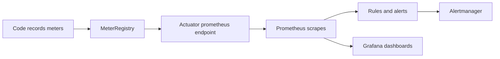

# Metrics

!!! note "In simple words"
    A metric is a number recorded repeatedly over time, such as requests per second or how long the slowest tenth of requests took. Plotting those numbers shows whether the service is healthy now and whether it is drifting toward trouble.

Metrics are numeric samples taken over time: request rate, error share, latency percentiles, heap occupancy. Interviewers ask about them to see whether you know which numbers count, how to record them without wasting resources, and why averages can mislead.

## Why it matters

Metrics are the cheapest telemetry to retain for long periods. They compress thousands of requests into a small set of series, which keeps dashboards quick and lets alert rules run on every evaluation cycle. A team watching the right numbers spots a bad release within minutes. A team watching only CPU learns about it from customers.

## How it works

Code updates meters in memory. The application publishes them over HTTP, a scraper pulls them on a schedule, rules derive rates and percentiles, and dashboards chart the outcome.



The sequence, one step at a time:

1. Code records values into meters (counters, timers, gauges, histograms) via `MeterRegistry`.
2. Actuator makes the current readings available at an endpoint such as `/actuator/prometheus`.
3. Prometheus scrapes the endpoint at a fixed interval and stores each sample as part of a time series.
4. Rules calculate rates and quantiles, and raise an alert once a threshold holds long enough.
5. Grafana turns the stored series into charts for people to read.

### Micrometer: the facade for metrics

**Micrometer** is the metrics facade underneath Spring Boot Actuator. You write to Micrometer's `MeterRegistry`, and a registry implementation, such as Prometheus or Datadog, handles export. It parallels SLF4J for logging: application code stays put even when the backend changes. The [Micrometer reference](https://docs.micrometer.io/micrometer/reference/) lists each meter type and its options.

A library example for Micrometer. It needs Micrometer on the classpath, so it is not compiled here:

```java
import io.micrometer.core.instrument.Counter;
import io.micrometer.core.instrument.MeterRegistry;
import io.micrometer.core.instrument.Timer;

public class CheckoutMetrics {

    private final Counter ordersPlaced;
    private final Timer checkoutTimer;

    public CheckoutMetrics(MeterRegistry registry) {
        this.ordersPlaced = Counter.builder("orders.placed")
                .description("Orders successfully placed")
                .register(registry);

        this.checkoutTimer = Timer.builder("checkout.duration")
                .description("Time to complete checkout")
                .publishPercentiles(0.5, 0.95, 0.99)
                .register(registry);
    }

    public void checkout(Runnable work) {
        checkoutTimer.record(work);
        ordersPlaced.increment();
    }
}
```

Create meters once, in a constructor, and keep references to them. Building meters inside a request handler is slower and error-prone.

### Prometheus: storage, scraping, and alert rules

**Prometheus** is a time-series store that pulls metrics from HTTP endpoints. In a Spring Boot service, add the Prometheus registry and expose the endpoint via Actuator. Micrometer names such as `orders.placed` appear in Prometheus with underscores in place of dots, and counters gain a `_total` suffix. The [Prometheus overview](https://prometheus.io/docs/introduction/overview/) describes the data model.

Prometheus also evaluates **alerting rules** against stored series. Those rules are written in PromQL. The alerting side is discussed in [Alerting and Health Checks](alerting-health-checks.md).

### Grafana: dashboards

**Grafana** draws dashboards from Prometheus and many other data sources. A solid service dashboard uses the same panels for each service: traffic, errors, latency, saturation (CPU, memory, pool occupancy), and business indicators. When every service looks alike, an on-call engineer can interpret an unfamiliar dashboard in seconds. The [Grafana documentation](https://grafana.com/docs/) explains panels and data sources.

### The four kinds of meter

- **Counter.** Increases only, for example orders placed or errors observed. Apply `rate()` to convert it into a per-second figure.
- **Gauge.** Moves both ways, for example the current queue length or open connections.
- **Timer.** Counts events and measures how long each took, which provides both a rate and a distribution.
- **Distribution summary.** Captures sizes or amounts, such as payload bytes, with a distribution like a timer's.

Choosing the wrong type produces misleading charts. Graphing a counter directly shows an ever-climbing line, and taking the rate of a gauge yields meaningless numbers.

### The key metrics

- **Throughput.** Requests per second, split by route and status class.
- **Latency.** p50, p95, and p99 request durations. The median shows a typical experience, while p99 shows what the unluckiest users see.
- **Errors.** The error ratio, meaning failures divided by total requests, and success ratio as its complement.
- **Apdex.** A satisfaction index. Given a target T, responses up to T are satisfied, those up to 4T are tolerated, and anything slower is frustrating. Apdex = (satisfied + tolerating / 2) / total.
- **JVM.** Heap use, garbage collection pause time, and live thread count. Spring Boot exposes these by default under names like `jvm.memory.used`, `jvm.gc.pause`, and `jvm.threads.live`.
- **Business.** Active users, conversions, and revenue, which show whether the system does its job, not just whether it is up.

### RED and USE: two checklists

Two compact methods guide which metrics belong on dashboards and alerts.

- **RED** (Rate, Errors, Duration) fits request-driven services. For each endpoint or service, chart how many requests arrive, how many fail, and how the latency is distributed.
- **USE** (Utilisation, Saturation, Errors) fits resources such as CPU, memory, disks, network links, and connection pools. Utilisation is how busy the resource is. Saturation is queued work that cannot yet be served, such as threads waiting for a connection. Errors are failed operations on that resource.

For a Java service, RED describes the HTTP layer, and USE describes the JVM heap, the garbage collector, the thread pool, and the database connection pool. On Kubernetes, add object-level signals: restart counts, pods that are not ready, and desired versus available replicas per Deployment. Those come from kube-state-metrics and the metrics API, so they are separate from Micrometer metrics.

### Percentiles: why averages mislead

An average smooths over the tail. Suppose 99 requests take 10 ms and one takes 5 seconds. The mean hardly moves, yet a percentile reveals the slow request. Two practical rules follow:

1. You cannot average percentiles gathered from several instances, because averaging p99 values gives a wrong answer. Publish **histogram buckets** and let the query engine calculate quantiles across all instances.
2. Client-side percentiles are computed inside each process. They are cheap but cannot be combined. Server-side histograms can be combined, and with several replicas that is generally what you need.

A PromQL expression for p99 latency across every instance, based on histogram buckets:

```text
histogram_quantile(0.99, sum by (le) (rate(http_server_requests_seconds_bucket[5m])))
```

Spring Boot can emit histogram buckets for HTTP timings. Enable them with `management.metrics.distribution.percentiles-histogram.http.server.requests=true`.

### Tags and cardinality

Every distinct combination of metric name and tag values becomes its own time series. The number of such series is the **cardinality**. Route templates such as `/orders/{id}` are safe tag values. Raw URLs, user IDs, or order IDs as tag values can create millions of series, which strains the monitoring system and drives up its cost.

A library example for Micrometer. It is not compiled here:

```java
import io.micrometer.core.instrument.MeterRegistry;

public class PaymentMetrics {

    private final MeterRegistry registry;

    public PaymentMetrics(MeterRegistry registry) {
        this.registry = registry;
    }

    public void recordFailure(String provider, String reasonCode) {
        // Bounded values only: a fixed provider name and a small set of reason codes.
        registry.counter("payments.failed", "provider", provider, "reason", reasonCode).increment();
    }
}
```

Limit tag values to a small, fixed set. Keep high-cardinality detail, such as an order ID, for logs or traces.

## Where it is used

- Service dashboards that show traffic, errors, and latency for every service.
- Alerts on error rate and latency measured against an SLO.
- Capacity planning from CPU, memory, and pool saturation over weeks.
- Post-deployment checks that compare error rates before and after a release.
- Business dashboards tracking orders, sign-ups, and revenue.

## Benefits

- **Cheap to keep**, because each series is a compact list of numbers.
- **Strong for trends and alerting**, since aggregated values can be evaluated continuously.
- **Familiar tooling.** Micrometer, Prometheus, and Grafana are commonly used together.
- **Early warning**, frequently before users notice anything.

## Cons and limits

- **Aggregation removes detail.** A metric cannot describe one request. Logs and traces fill that gap.
- **Cardinality grows fast** whenever tags are unbounded.
- **Averages mislead** for latency, so latency views always need percentiles or histograms.
- **Scrape intervals can miss** brief spikes that fall between samples.
- **Business definitions need agreement.** Two teams may define "active user" differently.

## Best practices

- Record through Micrometer, and export through a registry such as Prometheus.
- Watch throughput, latency percentiles, errors, saturation, and business signals for every service.
- Publish histograms whenever you need percentiles across several instances.
- Keep tags bounded, and never use user IDs or raw paths as values.
- Construct meters once, in a constructor, and reuse them.
- Alert on symptoms tied to an SLO rather than on raw causes (see [alerting](alerting-health-checks.md)).
- Lay out every service dashboard the same way, so anyone on call can read any of them.

## Common pitfalls

- Relying on average latency rather than percentiles.
- Using unbounded tag values, such as user IDs or raw paths, which multiply cardinality.
- Quoting only the mean when describing latency.
- Confusing a counter, which only rises, with a gauge, which rises and falls.
- Measuring server time alone, and missing queueing in a client or load balancer.
- Using metrics as an audit trail, when they summarise and discard individual events.

!!! tip "Interview tip"
    **Q: Why do we look at p99 latency and not the average?**
    The average conceals outliers. A small set of very slow requests can ruin the experience of a real share of users while the mean hardly shifts. Percentiles expose the distribution. Histograms let you compute percentiles across many instances, which averaging per-instance percentiles cannot do correctly.

## Quick recap

- Record through Micrometer, and export through a registry such as Prometheus.
- Track throughput, latency percentiles, errors, saturation, and business signals.
- Publish histograms when percentiles must span several instances.
- Keep tags bounded to protect cardinality.
- Alert on symptoms. [Alerting and Health Checks](alerting-health-checks.md) explains how.

## Official documentation

- [Prometheus overview](https://prometheus.io/docs/introduction/overview/)
- [Grafana documentation](https://grafana.com/docs/)
- [Micrometer reference](https://docs.micrometer.io/micrometer/reference/)

**See also:** [Logging](logging.md), [Distributed Tracing](distributed-tracing.md), [Alerting and Health Checks](alerting-health-checks.md)
