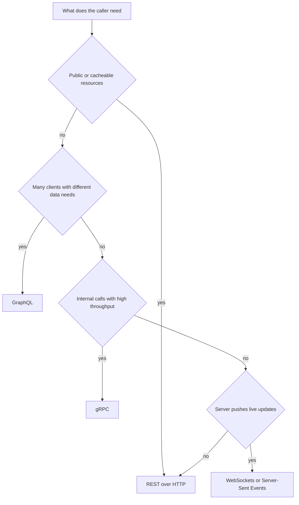

# Alternative Protocols: GraphQL, gRPC, and WebSockets

!!! note "In simple words"
    Plain REST over HTTP is the default. GraphQL lets each client name the exact fields it wants. gRPC is a quick, strongly typed way for backend services to call one another. WebSockets keep a single connection open, so either side can speak whenever it likes.

REST over HTTP is the usual starting point, yet other styles suit certain problems better. Interviewers want evidence that you choose a protocol for a reason rather than from habit. Know what each option optimises and what it costs.

## Why it matters

Every protocol shifts cost somewhere else. GraphQL pushes work onto the server, which has to defend itself against expensive queries. gRPC trades plain text for generated code and binary contracts, which are awkward from a browser. WebSockets require careful connection management. A strong answer names the price of each option, not just its advantages.

## How it works

The styles differ in how a request is shaped and how long the connection lasts. The flowchart below sketches a basic selection path.



How each style moves data:

1. **REST:** the client calls a resource URL and receives a representation.
2. **GraphQL:** the client sends a query to one endpoint, and the server resolves each requested field.
3. **gRPC:** a generated stub encodes the request as protobuf and calls the server over HTTP/2.
4. **WebSocket:** the client upgrades an HTTP connection once, and then both sides trade frames until one of them closes it.

### REST as the baseline

REST suits public APIs, cacheable reads, and plain resource operations. Its weak spots are over-fetching (a screen needs three fields and gets thirty), under-fetching (a screen needs three resources and makes three calls), and having no standard way for the server to push updates. The protocols below each tackle some part of that list.

### GraphQL: queries, mutations, and subscriptions

**GraphQL** offers a single endpoint backed by a typed schema. Clients ask for precisely the fields they need, and they can pull related data in the same request. Three kinds of operation exist:

- **Query:** reads data.
- **Mutation:** changes data.
- **Subscription:** delivers pushed updates, typically over a WebSocket-based transport.

The schema uses SDL (Schema Definition Language):

```graphql
type Query {
  order(id: ID!): Order
}

type Mutation {
  placeOrder(input: PlaceOrderInput!): Order!
}

type Subscription {
  orderStatusChanged(id: ID!): Order!
}

type Order {
  id: ID!
  status: String!
  items: [OrderItem!]!
}

type OrderItem {
  sku: String!
  quantity: Int!
}

input PlaceOrderInput {
  sku: String!
  quantity: Int!
}
```

The [GraphQL learning guide](https://graphql.org/learn/) goes further into query syntax and schema design.

Things to keep in mind:

- **Caching is harder.** Every request hits the same URL, and the operation is determined by the body. Caching moves into resolvers, or into persisted queries.
- **Expensive queries are easy to send.** Add depth limits, complexity limits, and timeouts.
- **N+1 queries are a hazard.** A list resolver that loads a related record for each item triggers one query per item. Batch loaders, such as the DataLoader pattern, combine those lookups.
- **Errors ride along with data.** A response can contain partial results and an errors array together, so HTTP status alone does not tell the story.

### Spring for GraphQL

Spring for GraphQL connects schema fields to controller methods. Add `spring-boot-starter-graphql`, and place the schema in a `.graphqls` file under `src/main/resources/graphql/`:

```graphql
type Query {
  book(id: ID!): Book
}

type Mutation {
  renameBook(id: ID!, title: String!): Book
}

type Book {
  id: ID!
  title: String!
  author: Author
}

type Author {
  id: ID!
  name: String!
}
```

This Spring for GraphQL controller is a library example and is not compiled here:

```java
import org.springframework.graphql.data.method.annotation.Argument;
import org.springframework.graphql.data.method.annotation.MutationMapping;
import org.springframework.graphql.data.method.annotation.QueryMapping;
import org.springframework.graphql.data.method.annotation.SchemaMapping;
import org.springframework.stereotype.Controller;

public record Author(String id, String name) {}

public record Book(String id, String title, String authorId) {}

@Controller
public class BookGraphQlController {

    @QueryMapping
    public Book book(@Argument String id) {
        return new Book(id, "Sample book", "a1");   // load from a service
    }

    @MutationMapping
    public Book renameBook(@Argument String id, @Argument String title) {
        return new Book(id, title, "a1");
    }

    @SchemaMapping(typeName = "Book", field = "author")
    public Author author(Book book) {
        return new Author(book.authorId(), "Sample author");   // one lookup per book
    }
}
```

The `author` method runs once per book in a list, which is the N+1 problem in GraphQL form. For lists, switch to a batch mapping (`@BatchMapping`), so that the lookups are grouped into a single call.

### gRPC: Protocol Buffers over HTTP/2

**gRPC** is a remote procedure call framework. Services and messages are declared in a `.proto` file using **Protocol Buffers** (protobuf), and tooling generates the stubs. Messages are compact binary, and gRPC runs over **HTTP/2**, which multiplexes many calls on one connection and supports streaming. The [gRPC documentation](https://grpc.io/docs/) covers code generation and language guides.

```proto
syntax = "proto3";

package orders.v1;

service OrderService {
  rpc GetOrder (GetOrderRequest) returns (OrderReply);
  rpc WatchOrder (GetOrderRequest) returns (stream OrderReply);
}

message GetOrderRequest {
  int64 id = 1;
}

message OrderReply {
  int64 id = 1;
  string status = 2;
}
```

There are four streaming modes: unary (one request, one reply), server streaming (one request, many replies), client streaming (many requests, one reply), and bidirectional streaming. Field numbers such as `= 1` and `= 2` are part of the binary format, so a number must never be reused once it has shipped.

Choose gRPC for calls between services that your organisation controls, where strong typing, compact payloads, and streaming matter. A browser cannot call gRPC natively, and it needs a proxy such as gRPC-Web. That is why REST or GraphQL usually remains the public face.

### WebSockets: persistent bidirectional connections

A **WebSocket** starts life as an HTTP request, then upgrades to a long-lived channel on which either party can send at any time. It fits chat, live dashboards, and notifications. The protocol is specified in [RFC 6455](https://www.rfc-editor.org/info/rfc6455).

A text handler written against Spring's WebSocket API. It is a library example and is not compiled here:

```java
import org.springframework.web.socket.TextMessage;
import org.springframework.web.socket.WebSocketSession;
import org.springframework.web.socket.handler.TextWebSocketHandler;

import java.io.IOException;

public class NotificationHandler extends TextWebSocketHandler {

    @Override
    protected void handleTextMessage(WebSocketSession session, TextMessage message) throws IOException {
        // Echo an acknowledgement back on the same connection
        session.sendMessage(new TextMessage("ack: " + message.getPayload()));
    }
}
```

Managing connections is where most of the effort goes:

- **Lifecycle.** Handle connect, disconnect, and error events. Mobile networks drop connections all the time.
- **Heartbeats.** Ping periodically, so that dead connections are noticed and cleaned up.
- **Reconnection.** Clients should back off, then reconnect and resume from the last event they saw.
- **Scaling.** Each connection lives on one instance. Broadcasting to clients on other instances requires a shared channel, such as a broker or pub/sub system.
- **Authentication.** Verify credentials during the handshake, and re-check permissions for every subscription.

### HTTP/2 and HTTP/3 in brief

HTTP/2 multiplexes requests across one connection and compresses headers. HTTP/3 uses QUIC as its transport. Both affect performance, and gRPC requires HTTP/2. Application code seldom configures them directly, but their effect on connection cost is worth understanding.

### Webhooks: server-initiated callbacks

A webhook flips the direction of communication. You register a URL with a provider, and when an event occurs the provider POSTs to that URL. Your system never polls. Payment notifications and source-control events are typical examples.

- Providers sign each payload with a shared secret, usually as an HMAC in a header. The receiver must check that signature before doing anything else. The security background is in [Password Security and OWASP](../10-security/password-security-owasp.md).
- Delivery is generally at least once. Retries can deliver the same event more than once, so deduplicate using the event ID.
- Persist the event and return `2xx` quickly, then process it asynchronously. A slow handler makes the provider time out and retry.

### Server-Sent Events

Server-Sent Events (SSE) let the server stream text events down a single ordinary HTTP response. The flow is one-way, server to client, and browsers reconnect on their own. SSE is less complex than WebSockets when only server-to-client updates are needed, such as a progress indicator or a live feed.

### SOAP and WS-*

SOAP is an XML-based messaging protocol. A service describes its operations in a WSDL document, and tools generate clients from that description. Its strengths are a strict contract and the WS-* specifications for security and reliable messaging. Enterprises and older integrations still rely on it heavily.

| Aspect | SOAP | REST |
|---|---|---|
| Model | Operations | Resources |
| Contract | WSDL, frequently written first | OpenAPI, frequently generated from code |
| Format | XML envelopes | Usually JSON |
| Transport | Any, including HTTP, SMTP, and JMS | HTTP semantics |
| State | Conversational state possible through WS-* features | Stateless by design |
| Security | WS-Security standards | HTTPS with token schemes such as OAuth 2.0 |
| Typical use | Enterprise and legacy integration | Public and mobile APIs |

REST does not require HTTPS, although it is almost always deployed over TLS. SOAP envelopes are heavier, so the performance difference is most noticeable under high call volumes.

Select SOAP when a partner insists on its contract, when WS-* security or transactions are needed, or when the transport is something other than HTTP. Select REST for public, cacheable, or mobile-facing APIs.

### Other options

- **JSON** is the payload format most REST APIs use. It is compact, readable, and the usual default.
- **Falcor** is a JavaScript library from Netflix that combines several data sources into one client-side model and caches the results. It is a niche tool, relevant mainly to front-end teams with a large data-fetching problem.

### Choosing

| Requirement | Good fit | Reason |
|---|---|---|
| Public, cacheable, resource-oriented API | REST | Mature tooling and HTTP caches |
| Many clients with different data needs | GraphQL | Clients determine the response shape |
| Internal calls, high throughput | gRPC | Typed contracts, binary payloads, streaming |
| Live updates flowing both ways | WebSockets | Persistent two-way channel |
| One-way live updates from server | Server-Sent Events | Simpler than WebSockets here |
| Telling another system that something happened | Webhooks | The provider calls you, so no polling |
| Rigid enterprise contract, WS-* security, non-HTTP transport | SOAP | WSDL contract and WS-* standards |

## Where it is used

- REST for most public and partner APIs, and for mobile backends.
- GraphQL for a backend-for-frontend that serves several screens with differing data shapes.
- gRPC between microservices in one platform, and for high-volume internal streams.
- WebSockets for chat, live dashboards, and shared editing.
- Webhooks for payment, shipping, and source-control notifications.
- SOAP in banking, insurance, and government integrations that already depend on WSDL.

## Benefits

- **GraphQL** delivers exactly the fields requested, in one round trip.
- **gRPC** gives typed contracts, compact messages, and streaming over HTTP/2.
- **WebSockets** provide low-latency two-way messaging without repeated polling.
- **Webhooks** send events as they occur, with no polling load on either side.
- **REST** remains simple, cacheable, and understood by nearly every client.

## Cons and limits

- **GraphQL** complicates caching and cost control, and it requires query limits.
- **gRPC** is hard to use from browsers, and the generated code needs managing.
- **WebSockets** require heartbeats, reconnection logic, and a broadcast mechanism when several instances are running.
- **Webhooks** need a receiver that is always reachable, plus a way to replay missed events.
- **SOAP** carries heavy XML, and its tooling is less familiar to newer teams.

## Best practices

- Pick a protocol for a stated reason, and be clear about what you give up.
- Put depth and complexity limits and timeouts on every public GraphQL endpoint.
- Batch related lookups in GraphQL, and in any loop that calls a remote service.
- Never reuse or renumber protobuf field numbers.
- Send heartbeats on WebSockets, and resume from the last event after reconnecting.
- Check webhook signatures, deduplicate by event ID, and acknowledge quickly.
- Keep REST as the default for public and cacheable APIs.

## Common pitfalls

- Choosing GraphQL or gRPC because it is newer, without a problem that needs it.
- Leaving GraphQL open to unbounded queries, with no depth or cost limits.
- Reusing or renumbering protobuf fields, which breaks existing clients.
- Keeping WebSocket connections open without heartbeats, so dead ones pile up.
- Broadcasting from a single instance, so clients connected elsewhere miss messages.
- Expecting gRPC to be callable straight from a browser.

!!! tip "Interview tip"
    **Q: When would you use gRPC instead of REST?**
    Use gRPC for internal service-to-service calls where you control both ends and want typed contracts, compact binary messages, and streaming over HTTP/2. Keep REST for public APIs, since it caches well, can be tried with a browser or curl, and suits any client.

## Quick recap

- GraphQL lets clients shape responses. Protect it with depth and cost limits, and remove N+1 queries with batching.
- gRPC uses protobuf over HTTP/2 and supports streaming. Field numbers must never be reused.
- WebSockets offer persistent two-way channels. Plan for heartbeats, reconnects, and fan-out across instances.
- REST stays the default for public and cacheable APIs.
- Choose by the requirement, and be ready to explain why.

## Official documentation

- [gRPC documentation](https://grpc.io/docs/)
- [GraphQL learning guide](https://graphql.org/learn/)
- [RFC 6455: The WebSocket Protocol](https://www.rfc-editor.org/info/rfc6455)

**See also:** [REST Principles and Versioning](rest-principles-versioning.md), [Pagination, Errors, and Idempotency](pagination-errors-idempotency.md), [API Security](api-security.md)
