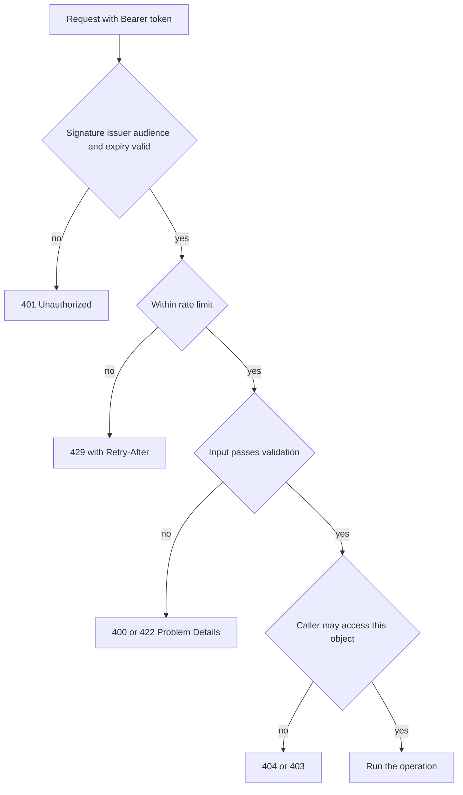

# API Security

!!! note "In simple words"
    Anyone who can reach an API can send it requests, so it has to verify who is calling, decide what that caller may do, cap how fast they can call, and check every input before using it. Lean on a standard identity provider, verify each object access, and validate everything that comes in.

APIs are exposed by design, so attackers start by probing them. This page covers how callers prove identity (tokens, JWTs, OAuth 2.0), how abuse is limited (rate limiting), how browsers may call across origins (CORS), and how untrusted input gets handled. Interviewers want to see security treated as part of the design, not a checklist added at the end.

## Why it matters

Most API breaches are mundane. A valid user reads another customer's record by editing an ID in the URL, a long-lived key leaks, or an endpoint accepts input it should have refused. Building authentication, authorisation, limits, and validation into each boundary prevents these from the start. Discovering them after launch costs far more.

## How it works

A request passes several checks before any work happens. The caller presents a token, the gateway or service verifies it, rate limits apply, the handler confirms access to the specific resource, and the input is validated before execution.



In order:

1. The client gets a token from an identity provider using OAuth 2.0 or OpenID Connect, or it uses an API key.
2. The token travels in the `Authorization: Bearer` header.
3. The gateway or service checks the signature, the issuer, the audience, and the expiry.
4. The client's rate limit is consulted, and excess traffic receives `429`.
5. The handler validates the input, confirms the caller may touch this particular resource, and only then performs the operation.
6. Responses include security headers, and errors avoid exposing internals.

### Authentication and authorisation

**Authentication** establishes "who are you?". **Authorisation** establishes "may you do this?". Enforce both on every request. Holding a valid token for user A must not allow reading user B's order. That flaw, broken object-level authorisation, is among the most frequent API vulnerabilities. OWASP ranks broken access control first in its Top 10 (2021 edition).

### API keys, tokens, and JWTs

- **API keys** name a client application. They are simple, yet long-lived and easily leaked. Keep only a hash on the server, rotate them, and limit each key's scope.
- **Opaque tokens** are random strings the server resolves by looking them up. Revocation takes effect immediately.
- **JWTs (JSON Web Tokens)** are signed, self-describing tokens carrying claims such as subject (`sub`), issuer (`iss`), audience (`aud`), and expiry (`exp`). A server can check one without a lookup, but revoking it early requires a deny-list. The format is specified in [RFC 7519](https://www.rfc-editor.org/rfc/rfc7519).

A JWT is signed but readable by default, because it is encoded rather than encrypted. Whoever holds the token can decode its claims. Keep secrets and sensitive personal information out of the payload.

Check every claim that matters. The verifier should be configured with the signing algorithm it accepts, instead of trusting whatever algorithm the token names. The claim check below illustrates the principle. It is plain Java with no libraries, and it is not compiled here:

```java
import java.util.Map;

public class TokenPolicy {

    private static final String EXPECTED_ISSUER = "https://auth.example.com/";
    private static final String EXPECTED_AUDIENCE = "orders-api";

    // Claims would be read from a verified token by your JWT library.
    public static boolean isAcceptable(Map<String, Object> claims, long nowEpochSeconds) {
        Object iss = claims.get("iss");
        Object aud = claims.get("aud");
        Object exp = claims.get("exp");
        if (!EXPECTED_ISSUER.equals(iss) || !EXPECTED_AUDIENCE.equals(aud)) {
            return false;
        }
        return exp instanceof Number n && n.longValue() > nowEpochSeconds;
    }
}
```

In production, a dependable JWT library handles the signature and the standard claims. What this sketch shows is that issuer, audience, and expiry all need explicit checks, and that the algorithm must be pinned by configuration.

### OAuth 2.0 and OpenID Connect

**OAuth 2.0** is a framework for delegated authorisation. A client obtains a restricted access token from an authorisation server, either on behalf of a user or in its own right. **OpenID Connect (OIDC)** layers identity on top, supplying an ID token that states who the user is. Browser-based and mobile user login uses the authorisation code flow with PKCE. Service-to-service calls use the client credentials flow.

Enterprise identity platforms, Microsoft Entra ID (formerly Azure AD) among them, implement these specifications. A Spring resource server checks incoming bearer tokens against the issuer's published keys. Avoid inventing your own login scheme or token format when a standard provider does the job.

### Rate limiting

Rate limiting guards the service against abuse and accidental floods. Limits typically apply per API key, per user, or per IP address. A throttled request receives `429 Too Many Requests` together with a `Retry-After` header.

A **token bucket** is a well-known algorithm. Each client owns a bucket of fixed capacity. Tokens drip in at a steady rate, and every request spends one. The single-node version below is plain Java with no libraries, and it is not compiled here:

```java
public final class TokenBucket {

    private final long capacity;
    private final double refillPerNano;
    private double tokens;
    private long lastRefillNanos;

    public TokenBucket(long capacity, double tokensPerSecond) {
        this.capacity = capacity;
        this.refillPerNano = tokensPerSecond / 1_000_000_000.0;
        this.tokens = capacity;
        this.lastRefillNanos = System.nanoTime();
    }

    public synchronized boolean tryConsume() {
        long now = System.nanoTime();
        tokens = Math.min(capacity, tokens + (now - lastRefillNanos) * refillPerNano);
        lastRefillNanos = now;
        if (tokens >= 1.0) {
            tokens -= 1.0;
            return true;
        }
        return false;
    }
}
```

Once several instances run, the bucket state has to be shared, typically in Redis or at the API gateway. A per-instance limit multiplies with the replica count: five replicas each allowing 100 requests a second really allow 500.

### CORS

**Cross-Origin Resource Sharing (CORS)** is enforced by browsers. When a page served from one origin (scheme, host, and port) calls an API on another, the API must return headers such as `Access-Control-Allow-Origin` for the browser to expose the response. Calls that are not "simple" are preceded by a preflight `OPTIONS` request.

CORS does not authenticate anyone. It only dictates which origins a browser may read responses from. Name specific origins rather than using `*`. Never pair `*` with credentials, since browsers refuse that combination. Limit allowed methods and headers to what clients truly need.

### HTTPS enforcement

Encrypt all traffic with TLS, and redirect plain HTTP to HTTPS. Set `Strict-Transport-Security` (HSTS), so browsers refuse plain HTTP after their first secure visit. Terminating TLS at a load balancer or gateway is acceptable, provided the hop between that point and the service is also protected.

### Input validation and sanitisation

Regard every body, parameter, header, and file name as hostile. Check types, lengths, formats, and ranges at the edge of the system. Spring Boot 3 takes Bean Validation annotations from `jakarta.validation`. This record is a library example, so it is not compiled here:

```java
import jakarta.validation.constraints.Email;
import jakarta.validation.constraints.NotBlank;
import jakarta.validation.constraints.Size;

public record SignUpRequest(
        @NotBlank @Email String email,
        @NotBlank @Size(min = 12, max = 128) String password) {
}
```

A minimum of 12 characters is a policy decision for your system. NIST SP 800-63B recommends favouring length over composition rules, and screening passwords against lists of breached credentials.

Validation is only one layer. Parameterised queries stop SQL injection. Output must be encoded for the context where it appears. User input should never reach a shell command, and untrusted data should not be deserialised through unsafe mechanisms.

### OWASP as a reference

The **OWASP Top 10** catalogues the most serious web application risks. This page uses the 2021 edition. OWASP revises the list from time to time, so check the current release when it matters. Categories that bear most heavily on APIs:

- **A01 Broken Access Control.** Missing object-level or function-level checks, such as one user reading another's records.
- **A02 Cryptographic Failures.** Weak TLS, secrets stored in clear text, and poor hashing.
- **A03 Injection.** SQL, command, and similar injections fed by untrusted input.
- **A05 Security Misconfiguration.** Overly permissive CORS, debug endpoints left switched on, and default credentials.
- **A07 Identification and Authentication Failures.** Weak sign-in and mistakes in token handling.

OWASP also maintains a separate API Security Top 10 for API-specific risks. The [OWASP Top 10 project page](https://owasp.org/www-project-top-ten/) points to the current lists.

### Authentication methods compared

Every method involves trade-offs among statelessness, revocability, and effort. The table lays out the common choices.

| Method | Stateless | Revocation | Typical use | Main risk |
|---|---|---|---|---|
| Basic auth | Yes | Only by changing the password | Internal tools, scripts | Credentials sent with every request; needs TLS |
| API key | Yes | Rotate or disable the key | Identifying third-party apps | Long-lived; a leak exposes everything it reaches |
| Session cookie | No; the server keeps session state | Immediate | Server-rendered web apps | CSRF; sharing sessions between instances |
| JWT bearer | Yes | Deny-list or short lifetime | SPAs, mobile apps, microservices | Hard to revoke; a leaked token works until it expires |
| OAuth 2.0 access token | Yes | Revoked at the authorisation server | Delegated access, partner integrations | Mistakes in redirect URIs and grant types |
| OpenID Connect | Yes for the ID token's claims | Depends on the provider | User login and single sign-on | Treating an ID token as an API credential |
| Mutual TLS | Yes | Certificate revocation and rotation | Service-to-service calls | Managing certificates |

Basic auth cannot log a user out, because the password is resent with each request. Keep API keys out of URLs, since URLs end up in logs, and store only hashes server-side. Mutual TLS offers strong service identity, provided the certificate lifecycle is under control.

### Single sign-on

Single sign-on means logging in once and reaching several applications without signing in again. The common sequence:

1. The user opens application A, which holds no session.
2. A redirects the browser to the identity provider.
3. The user authenticates with the provider.
4. The provider redirects back to A with a code or token, and A creates its own session.
5. The user opens application B, which redirects to the same provider.
6. The provider recognises the user, so B obtains a token without prompting again.

The main protocols are SAML 2.0 (XML assertions, common in enterprises), OpenID Connect (JSON tokens built on OAuth 2.0, common in newer systems), and Kerberos (common in Windows domains).

For OIDC in Spring Boot, configuration lives under `spring.security.oauth2.client`:

```yaml
spring:
  security:
    oauth2:
      client:
        registration:
          corporate:
            client-id: ${OIDC_CLIENT_ID}
            client-secret: ${OIDC_CLIENT_SECRET}
            scope:
              - openid
              - profile
              - email
        provider:
          corporate:
            issuer-uri: https://login.example.com/realms/corp
```

Turn on login with `oauth2Login(Customizer.withDefaults())` in the security filter chain. The complete configuration is in [Authentication: JWT, OAuth 2.0, and OpenID Connect](../10-security/authentication-jwt-oauth.md).

### Authorisation strategies

- **Role-based access control (RBAC)** attaches permissions to roles, and assigns roles to users. It is easy to explain and audit, so it is the usual starting point. See [Spring Security Authorisation](../10-security/spring-security-authorisation.md).
- **Attribute-based access control (ABAC)** evaluates attributes of the user, the resource, and the environment. It expresses rules such as "same department, during business hours", but the policies are harder to test and to explain.

```text
allow when user.department == resource.owningDepartment
      and request time is within business hours
```

- **OAuth 2.0 scopes** cap what a token can do. A token carrying `orders:read` can read orders but cannot change them, regardless of the user's roles:

```text
scope=orders:read payments:write
```

### Authentication and authorisation compared

| | Authentication | Authorisation |
|---|---|---|
| Question answered | Who is this? | What may this caller do? |
| Sequence | First | After authentication succeeds |
| Evidence used | Password, certificate, signed token | Roles, scopes, ownership, attributes |
| Token type | The OIDC ID token identifies the user | The access token authorises calls |
| Failure response | `401 Unauthorized` | `403 Forbidden` |

## Where it is used

- Public APIs accepting bearer tokens from web and mobile applications.
- Partner integrations using OAuth 2.0 client credentials with scoped tokens.
- Internal microservices identifying each other through mutual TLS or workload tokens.
- Browser applications calling APIs across origins, where CORS rules apply.
- Public endpoints that need rate limits to stop scraping and abuse.

## Benefits

- **Proven standards.** OAuth 2.0 and OIDC are widely understood and heavily tested.
- **Stateless tokens** let any instance verify a request without consulting a session store.
- **Scopes and roles** keep each client's privileges small and easy to audit.
- **Rate limits** shield shared resources from a single noisy client.

## Cons and limits

- **JWTs are awkward to revoke** before expiry, so their lifetimes must be short.
- **Stateless checks trust the signature**, which puts key management at the centre of security.
- **Rate limiting needs shared state** across instances, which introduces a dependency.
- **CORS is easy to misconfigure**, and it protects only browser clients.
- **Authorisation logic spreads** across handlers unless it is centralised, and then a single missed check goes unnoticed.

## Best practices

- Authenticate every request, and authorise every object access.
- Verify issuer, audience, expiry, and the signature algorithm for every JWT.
- Keep tokens short-lived, and use refresh tokens for longer sessions.
- Lean on OAuth 2.0 and OIDC through a standard provider, not a homegrown login.
- Share rate-limit state across instances, and reply with `429` and `Retry-After`.
- Whitelist specific CORS origins, and never combine `*` with credentials.
- Validate all input at the boundary, and walk through the OWASP Top 10 as a review checklist.
- Answer with the same response for an object the caller cannot see as for one that does not exist, so IDs cannot be probed.

## Common pitfalls

- Verifying that a token is valid, yet never checking whether the caller may touch this object.
- Accepting tokens without checking the issuer, the audience, or the expiry.
- Writing secrets into JWT payloads, where any holder can read them.
- Rate limiting only per instance, so the effective limit multiplies with the replica count.
- Sending `Access-Control-Allow-Origin: *` from endpoints that use cookies or credentials.
- Including stack traces, SQL errors, or internal identifiers in error bodies.

!!! tip "Interview tip"
    **Q: A user reports they can see another user's order by changing the ID in the URL. What is the bug?**
    It is broken object-level authorisation (OWASP A01). The endpoint authenticates the caller, but never checks that the order belongs to them. The repair is to load the resource in the caller's scope, for example by querying on both the order ID and the owner ID. Return `404` for resources the caller may not see, so IDs cannot be enumerated.

## Quick recap

- Authenticate every request, and authorise every object access.
- Verify the JWT issuer, audience, and expiry, and pin the algorithm. Keep secrets out of the payload.
- Adopt OAuth 2.0 and OIDC through a standard identity provider, not custom login code.
- Rate-limit using state shared across instances, and return `429` with `Retry-After`.
- CORS is a browser policy and not authentication. Never pair `*` with credentials.
- Validate all input at the boundary, and use the OWASP Top 10 as a checklist.

## Official documentation

- [OWASP Top 10](https://owasp.org/www-project-top-ten/)
- [JSON Web Token introduction (jwt.io)](https://jwt.io/introduction)
- [RFC 7519: JSON Web Token](https://www.rfc-editor.org/rfc/rfc7519)

**See also:** [REST Principles and Versioning](rest-principles-versioning.md), [Pagination, Errors, and Idempotency](pagination-errors-idempotency.md), [Alternative Protocols](alternative-protocols.md)
