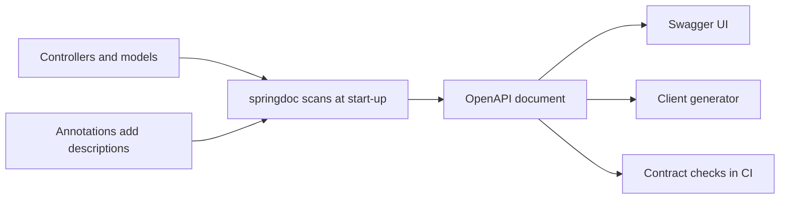

# Documenting APIs with OpenAPI and springdoc

!!! note "In simple words"
    An OpenAPI description is a machine-readable map of an API, covering its paths, inputs, outputs, errors, and security rules. Tools read that map to build documentation, generate client code, and run tests, so the contract lives in one place.

OpenAPI is a standard, machine-readable way of describing HTTP APIs. It used to be known as Swagger. A description lists paths, methods, parameters, bodies, status codes, and security schemes. Interviewers raise it to learn whether you regard the API contract as a product, and whether your docs can stay synchronised with the code.

## Why it matters

Developers decide whether to adopt an API based on its documentation. Missing or inaccurate docs lead them to guess, and guesses break in production. A precise description also lets build tools flag breaking changes, generate clients in several languages, and let testers send real requests from a browser page. Docs produced from the code stay accurate without extra effort.

## How it works

Springdoc inspects controllers and models at start-up. It assembles an OpenAPI document and publishes it at fixed URLs. The interactive UI and any generators then consume that document, and nothing else has to be done for it to appear.



The sequence at runtime:

1. At start-up, springdoc reads the controllers, the request and response types, and their annotations.
2. It builds the OpenAPI model in memory.
3. It exposes that model at the configured paths.
4. The UI and the generators read the document, with no further steps required.

### What the spec contains

An OpenAPI document, written in JSON or YAML, has four main sections:

- `info` gives the title, version, and description.
- `servers` lists base URLs, such as production and a local environment.
- `paths` maps every URL and method to an operation, including its parameters and responses.
- `components` stores reusable schemas, parameters, responses, and security schemes.

Tools use the description to draw interactive docs, generate client libraries, and exercise endpoints. The description can be written first (design-first) or generated from the code (code-first). Spring projects usually go code-first with springdoc. The [OpenAPI Specification](https://spec.openapis.org/oas/latest.html) defines each field precisely.

### Setup with springdoc-openapi

Add `springdoc-openapi-starter-webmvc-ui`, using the 2.x line for Spring Boot 3. With that dependency present, the application serves:

- `/v3/api-docs`: the description in JSON.
- `/v3/api-docs.yaml`: the description in YAML.
- `/swagger-ui/index.html`: an interactive page for trying requests.

```xml
<dependency>
    <groupId>org.springdoc</groupId>
    <artifactId>springdoc-openapi-starter-webmvc-ui</artifactId>
    <version><!-- use the 2.x release for Spring Boot 3 --></version>
</dependency>
```

The [springdoc project site](https://springdoc.org/) lists version compatibility and the complete set of configuration options.

### Annotating operations

springdoc picks up controller mappings on its own. Annotations contribute the prose that code cannot express. This is a library example and is not compiled here:

```java
import io.swagger.v3.oas.annotations.Operation;
import io.swagger.v3.oas.annotations.Parameter;
import io.swagger.v3.oas.annotations.responses.ApiResponse;
import io.swagger.v3.oas.annotations.responses.ApiResponses;
import io.swagger.v3.oas.annotations.tags.Tag;
import org.springframework.http.ResponseEntity;
import org.springframework.web.bind.annotation.GetMapping;
import org.springframework.web.bind.annotation.PathVariable;
import org.springframework.web.bind.annotation.RequestMapping;
import org.springframework.web.bind.annotation.RestController;

@RestController
@RequestMapping("/api/v1/users")
@Tag(name = "Users", description = "Read and manage user accounts")
public class UserDocController {

    public record UserView(long id, String name) {}

    @GetMapping("/{id}")
    @Operation(summary = "Get a user", description = "Returns one user by ID")
    @ApiResponses({
            @ApiResponse(responseCode = "200", description = "User found"),
            @ApiResponse(responseCode = "404", description = "No user with this ID")
    })
    public ResponseEntity<UserView> get(
            @Parameter(description = "User identifier", example = "123") @PathVariable long id) {
        return ResponseEntity.ok(new UserView(id, "Sample user"));
    }
}
```

What each annotation contributes:

| Annotation | Contribution |
|---|---|
| `@Tag` | Groups related operations under one heading in the UI |
| `@Operation` | Summary, description, and the deprecation flag for one operation |
| `@Parameter` | Description and example for a path, query, or header parameter |
| `@ApiResponse` | A documented status code with its meaning, and optionally an example body |
| `@Schema` | Description, example, and constraints for a model or field |
| `@SecurityRequirement` | The security scheme that protects an operation |

Set `@Operation(deprecated = true)` to flag an operation as deprecated in the published contract. The Java `@Deprecated` annotation speaks to the compiler and to code that calls the method. It does not reach API consumers.

Do not annotate a `@RequestBody` parameter to describe its example. The example belongs on the schema, covered in the next section.

### Documenting models

`@Schema` on a model's fields supplies descriptions, examples, and constraints. It works on record components and on ordinary classes alike. This record is a library example and is not compiled here:

```java
import io.swagger.v3.oas.annotations.media.Schema;

@Schema(description = "A request to create a user")
public record CreateUserRequest(
        @Schema(description = "Full name", example = "Jane Doe", minLength = 1, maxLength = 100)
        String name,

        @Schema(description = "Contact address", example = "jane@example.com")
        String email) {
}
```

Bean Validation annotations, such as `@NotBlank` and `@Email`, feed into the schema too. That keeps the documented constraints aligned with what the code actually enforces.

### Example responses with @ExampleObject

A schema describes shape, while an example shows a realistic instance. Reviewers and client developers rely on examples to grasp a contract quickly. `@ExampleObject` attaches one or more examples to a response's `@Content`. Each can carry a name and a summary, which the UI uses to list the variants separately. This is a library example and is not compiled here:

```java
import io.swagger.v3.oas.annotations.Operation;
import io.swagger.v3.oas.annotations.media.Content;
import io.swagger.v3.oas.annotations.media.ExampleObject;
import io.swagger.v3.oas.annotations.media.Schema;
import io.swagger.v3.oas.annotations.responses.ApiResponse;
import org.springframework.web.bind.annotation.GetMapping;
import org.springframework.web.bind.annotation.PathVariable;
import org.springframework.web.bind.annotation.RestController;

record InvoiceView(long id, String status, long totalCents) { }

@RestController
class InvoiceApi {

    @Operation(summary = "Fetch an invoice")
    @ApiResponse(
            responseCode = "200",
            description = "Invoice found",
            content = @Content(
                    mediaType = "application/json",
                    schema = @Schema(implementation = InvoiceView.class),
                    examples = {
                            @ExampleObject(name = "paid", summary = "A settled invoice",
                                    value = "{\"id\": 42, \"status\": \"PAID\", \"totalCents\": 1999}"),
                            @ExampleObject(name = "open", summary = "An invoice awaiting payment",
                                    value = "{\"id\": 43, \"status\": \"OPEN\", \"totalCents\": 4500}")
                    }))
    @GetMapping("/api/invoices/{id}")
    InvoiceView get(@PathVariable long id) {
        return new InvoiceView(id, "OPEN", 4500);
    }
}
```

Three points about examples:

- They are documentation, not tests. Springdoc does not verify that an example conforms to its schema. Keep examples current, and where possible generate them from a real response.
- Use invented data only. Once the UI is published, every example is public, so it must not hold genuine customer details, tokens, or internal IDs.
- When a response has several meaningful cases, such as a paid and an open invoice, name each example. Clients then compare the variants side by side rather than guessing.

### Configuring paths and the UI

Most defaults are sensible. These properties decide where the documents are published and which paths are covered:

```yaml
springdoc:
  api-docs:
    path: /v3/api-docs
  swagger-ui:
    path: /swagger-ui.html
    operations-sorter: alpha
  paths-to-match: /api/**
  paths-to-exclude: /internal/**
```

Administrative and internal paths should stay out of the public description. Hiding them in the UI does not count, so exclude them through configuration and protect the UI itself in production.

### Global information and bearer security

A bean that constructs the `OpenAPI` object supplies the title, servers, and security scheme for the whole API. Operations that need a token then reference that scheme. This is a library example and is not compiled here:

```java
import io.swagger.v3.oas.models.Components;
import io.swagger.v3.oas.models.OpenAPI;
import io.swagger.v3.oas.models.info.Info;
import io.swagger.v3.oas.models.security.SecurityRequirement;
import io.swagger.v3.oas.models.security.SecurityScheme;
import org.springframework.context.annotation.Bean;
import org.springframework.context.annotation.Configuration;

@Configuration
public class OpenApiConfig {

    @Bean
    public OpenAPI orderApi() {
        return new OpenAPI()
                .info(new Info().title("Order API").version("1.0.0")
                        .description("Places and tracks orders"))
                .components(new Components().addSecuritySchemes("bearerAuth",
                        new SecurityScheme()
                                .type(SecurityScheme.Type.HTTP)
                                .scheme("bearer")
                                .bearerFormat("JWT")))
                .addSecurityItem(new SecurityRequirement().addList("bearerAuth"));
    }
}
```

`addSecurityItem` attaches the requirement to every operation. In an API that mixes public and protected endpoints, skip that call and place `@SecurityRequirement(name = "bearerAuth")` on the protected operations.

### Documenting error responses

Error bodies deserve the same care as success bodies. When errors use Problem Details (see [Pagination, Errors, and Idempotency](pagination-errors-idempotency.md)), describe that schema once and point each failing `@ApiResponse` at it. Clients generate their error handling from these entries, so a missing `401` or `409` is a defect in the contract.

### Generating clients and servers

The OpenAPI Generator reads the description and writes client code. Point it at the running service, or at a file in the repository, and choose a target generator:

```bash
openapi-generator-cli generate \
  -i http://localhost:8080/v3/api-docs \
  -g typescript-axios \
  -o generated/orders-client
```

Generated clients follow the contract, so a breaking change surfaces when the client is built rather than when customers hit it. Generate into a dedicated folder, and commit the specification itself rather than hand-edits to the generated output.

## Where it is used

- Public APIs whose consumers need a browsable reference and generated SDKs.
- Internal services where teams call one another and need a current contract.
- Contract checks in CI, which fail the build when code drifts from the description.
- Developer portals that publish the specification to partners.

## Benefits

- **Accurate documentation** produced directly from the code, with little extra work.
- **Interactive testing** through the built-in UI.
- **Generated clients** in many languages that track the contract.
- **Early detection** of breaking changes when the description is compared during the build.

## Cons and limits

- **Annotations clutter** controllers, and they need upkeep as the code changes.
- **Examples can drift** because springdoc does not check them against the schema.
- **Code-first descriptions can hide design flaws**, since the design is only reviewed once the code exists.
- **An exposed UI in production** reveals the whole API surface to attackers.

## Best practices

- Keep the description in the build, and fail the build on unexpected breaking changes.
- Annotate operations and models with descriptions, examples, and every status code they can return.
- Document the error responses, including `401`, `403`, and `409` where they apply.
- Declare a bearer security scheme for protected APIs, and keep internal paths out of the public description.
- Use invented data in every example.
- Generate clients from the description, and never hand-edit the generated code.
- Protect the UI in production, or switch it off.

## Common pitfalls

- Publishing internal or administrative endpoints in the public description.
- Placing real secrets, tokens, or personal data in examples.
- Documenting only the success case, so clients never prepare for `401`, `403`, or `409`.
- Declaring an operation deprecated in prose alone, so no tool or client notices.
- Maintaining the description by hand until it drifts away from the code.
- Leaving the Swagger UI open in production with no protection.

!!! tip "Interview tip"
    **Q: Code-first or design-first OpenAPI, and why?**
    For an internal service that changes frequently, code-first keeps the description accurate with little effort. For a public API with many consumers, design-first lets the team review the contract before any code exists, and the generated clients follow that same contract. State which approach you prefer, and name the check that keeps the description honest.

## Quick recap

- OpenAPI describes paths, operations, schemas, and security. springdoc generates it from Spring code.
- Annotate operations and models with descriptions, examples, and status codes, and cover the error responses as well.
- Declare a bearer scheme for protected APIs, and keep internal paths out of the public description.
- Generate clients from the description, so contract changes break the build instead of production.
- Choose code-first for speed, or design-first for public contracts, and verify the description in tests.

## Official documentation

- [OpenAPI Specification](https://spec.openapis.org/oas/latest.html)
- [springdoc-openapi project](https://springdoc.org/)

**See also:** [REST Principles and Versioning](rest-principles-versioning.md), [API Security](api-security.md), [Pagination, Errors, and Idempotency](pagination-errors-idempotency.md)
