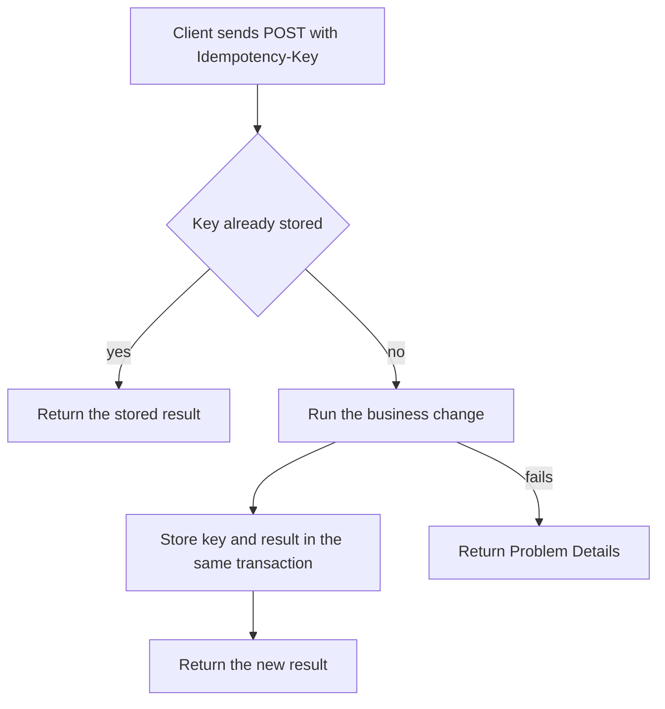

# Pagination, Errors, and Idempotency

!!! note "In simple words"
    Pagination hands out a long list a slice at a time. A good error tells the client what went wrong in one predictable shape. Idempotency means that replaying a request does not repeat its side effects, so a double-click or a network retry does not charge a card twice.

These three problems turn up in almost every API: sending large collections without overloading the server, reporting failures in a form the client can act on, and making retried writes harmless. Interviewers return to them because each one appears in production as a duplicate charge, a timeout, or a confused client.

## Why it matters

Networks drop responses after the server has already acted. A client submits a payment, the server charges the card, the reply is lost, and the client tries again. Without protection, the customer pays twice. Collections that grow into the millions slow the database, and a list that changes while a client walks through it can cause skipped or repeated items. Clear error bodies let client developers fix their own code without digging through server logs. All three topics sit where API design meets money and user trust.

## How it works

Each topic runs on a short cycle. A client requests a page and gets a cursor back. A failure yields a standard error body. A write carries an idempotency key, and the server keeps the outcome against that key.



For list endpoints, the flow looks like this:

1. The client asks for a page and receives the items together with a next cursor.
2. The client returns that cursor on the next call, and the server uses an index to seek straight to the position.
3. Errors come back as Problem Details, with a status that reflects the cause.
4. For a write, the client sends a `POST` with an `Idempotency-Key` header, and the server records the result.
5. A retry that repeats the key gets back the recorded result rather than triggering the work again.

### Offset-based pagination

Offset pagination takes parameters such as `?page=3&size=20` or `?offset=40&limit=20`. It is straightforward, and any page can be requested directly. The database must still step over every skipped row, so deep pages get progressively slower. Inserts and deletes that happen between two calls can also make items show up twice or disappear.

### Cursor-based (keyset) pagination

Keyset pagination records the final item the client received, and then asks for everything after it. The **seek method** expresses this in SQL:

```sql
-- First page
SELECT id, created_at, total
FROM orders
ORDER BY created_at DESC, id DESC
LIMIT 20;

-- Next page, given the last row returned: (created_at, id) = (:lastCreatedAt, :lastId)
SELECT id, created_at, total
FROM orders
WHERE (created_at, id) < (:lastCreatedAt, :lastId)
ORDER BY created_at DESC, id DESC
LIMIT 20;
```

An index on `(created_at, id)` lets the database locate the starting point directly. The unique `id` acts as a tie-breaker, which makes the ordering total. The trade-off is that you cannot jump to an arbitrary page, such as page 50, without walking there.

Clients should receive an opaque cursor rather than a raw key. Here is a simple encoder. It is plain Java with no libraries, and it is not compiled here:

```java
import java.nio.charset.StandardCharsets;
import java.util.Base64;

public final class Cursor {

    private Cursor() {
    }

    public static String encode(long createdAtEpochMillis, long id) {
        String raw = createdAtEpochMillis + ":" + id;
        return Base64.getUrlEncoder().withoutPadding()
                .encodeToString(raw.getBytes(StandardCharsets.UTF_8));
    }

    public static long[] decode(String cursor) {
        String raw = new String(Base64.getUrlDecoder().decode(cursor), StandardCharsets.UTF_8);
        String[] parts = raw.split(":");
        if (parts.length != 2) {
            throw new IllegalArgumentException("invalid cursor");
        }
        return new long[] {Long.parseLong(parts[0]), Long.parseLong(parts[1])};
    }
}
```

Keeping the cursor opaque means the server can change the underlying key later without breaking clients. Treat every decoded cursor as untrusted input. This sketch does not defend against tampering, so sign or encrypt the cursor if clients must not alter it.

### Filtering, sorting, and partial responses

- **Filtering.** Exact matches (`status=PAID`), ranges (`createdAfter=...`), and patterns (`name=ab*`). Accept only whitelisted fields.
- **Sorting.** A single field or several, such as `sort=-createdAt,total`. Whitelist the sortable fields, and give each an index.
- **Partial responses (sparse fieldsets).** `fields=id,status` limits the output to the named fields, shrinking list payloads.
- **Batch operations.** A single request carries many items and receives a result for each one, so a bad item does not fail the batch silently.

### Problem Details for consistent errors

Clients should not have to learn a different error format for every endpoint. **Problem Details** (RFC 9457, which supersedes RFC 7807) defines a standard JSON error body with members such as `type`, `title`, `status`, `detail`, and `instance`. Extension members, such as a list of invalid fields, can be added as needed.

```json
{
  "type": "https://example.com/problems/order-not-found",
  "title": "Order not found",
  "status": 404,
  "detail": "Order 42 was not found",
  "instance": "/api/v1/orders/42"
}
```

Spring Framework 6 includes a `ProblemDetail` class. The handler below turns a missing order into a Problem Details response. It is a Spring example and is not compiled here:

```java
import org.springframework.http.HttpStatus;
import org.springframework.http.ProblemDetail;
import org.springframework.http.ResponseEntity;
import org.springframework.web.bind.annotation.ExceptionHandler;
import org.springframework.web.bind.annotation.RestControllerAdvice;

@RestControllerAdvice
public class ApiErrorHandler {

    public static class OrderNotFoundException extends RuntimeException {
        public OrderNotFoundException(long id) {
            super("Order " + id + " was not found");
        }
    }

    @ExceptionHandler(OrderNotFoundException.class)
    public ResponseEntity<ProblemDetail> handleNotFound(OrderNotFoundException ex) {
        ProblemDetail problem = ProblemDetail.forStatusAndDetail(HttpStatus.NOT_FOUND, ex.getMessage());
        problem.setTitle("Order not found");
        problem.setType(java.net.URI.create("https://example.com/problems/order-not-found"));
        return ResponseEntity.status(HttpStatus.NOT_FOUND).body(problem);
    }
}
```

For validation failures, attach a property that lists each invalid field with its message, so the client knows exactly which input to correct. Never place stack traces or internal class names in the response.

### Idempotency

A request is **idempotent** when running it several times has the same effect as running it once. `GET`, `PUT`, and `DELETE` are idempotent by definition. `POST` is not. That matters because a network timeout can hide the fact that the server already acted. The client cannot tell whether the first attempt succeeded, so it retries. A naive server then books a second order or charges a second time.

The usual remedy is an **idempotency key**. The client creates a unique value, typically a UUID, for each logical operation and sends it in a header such as `Idempotency-Key`. The server:

1. Looks up the key.
2. If a stored result exists, returns it without doing the work again.
3. Otherwise performs the work, and stores the key with its result inside the same transaction as the business change.
4. Rejects a reused key that arrives with a different request body.

The in-memory sketch below shows the basic shape. It is plain Java and is not compiled here. It is not production-safe:

```java
import java.util.Map;
import java.util.concurrent.ConcurrentHashMap;
import java.util.function.Supplier;

public class IdempotencyStore {

    private final Map<String, String> responses = new ConcurrentHashMap<>();

    public String execute(String idempotencyKey, Supplier<String> action) {
        // Runs the action at most once per key, while this map holds the key
        return responses.computeIfAbsent(idempotencyKey, k -> action.get());
    }
}
```

Production needs more. The store has to survive restarts and be visible to every instance. Build it as a database table with a unique constraint on the key, and write it in the same transaction as the business change. In addition, `computeIfAbsent` holds the map's lock while the supplied action runs, which makes it a poor fit for slow remote calls.

### Preventing duplicate processing and retry-safe design

Idempotency keys handle retries from clients. Queue consumers face a parallel issue, because delivery is typically at least once. Store the IDs of messages already handled, or design the handler so that a second run is harmless. An upsert or a state check before writing both achieve that.

Clients that retry should use **exponential backoff with jitter**, so they do not all retry in step and swamp the server. Retry only failures that might clear on their own: timeouts, `503`, and `429` with a `Retry-After` hint. Validation failures will not improve with time, so never retry them.

### Paging in Spring MVC

Spring Data maps the `page`, `size`, and `sort` query parameters onto a `Pageable`. `@PageableDefault` supplies defaults. Use a `Page` when the client wants the total count, and a `Slice` when knowing whether a next page exists is enough. This is a Spring Data example and is not compiled here:

```java
import org.springframework.data.domain.Page;
import org.springframework.data.domain.Pageable;
import org.springframework.data.web.PageableDefault;
import org.springframework.web.bind.annotation.GetMapping;
import org.springframework.web.bind.annotation.RequestMapping;
import org.springframework.web.bind.annotation.RestController;

@RestController
@RequestMapping("/api/v1/orders")
public class OrderPageController {

    public record OrderSummary(long id, String status) {}

    @GetMapping
    public Page<OrderSummary> list(@PageableDefault(size = 20, sort = "id") Pageable pageable) {
        return Page.empty(pageable);   // replace with a repository query that maps to OrderSummary
    }
}
```

Spring Data cautions against serialising `Page` directly, since its JSON layout is not a stable contract. Wrap the content in your own response record, with fields such as `items`, `page`, `size`, `totalElements`, and `hasNext`. Spring HATEOAS's `PagedModel` is another option. Either approach shields the API from internal changes in Spring Data.

## Where it is used

- Order and transaction histories in admin consoles and customer-facing pages.
- Payment, booking, and order endpoints that clients might retry after a timeout.
- Uniform error responses across every endpoint of a public API.
- Queue consumers that must handle each message effectively once, despite at-least-once delivery.

## Benefits

- **Handles large collections** well when keyset pagination is backed by an index.
- **Stable paging** through cursors, even while rows change underneath.
- **Safe retries** for writes, so network hiccups do not produce duplicates.
- **Errors clients can act on,** handled in a single place.

## Cons and limits

- **No random access** with keyset pagination, so jumping straight to page 50 is off the table.
- **Cursor format is a commitment.** Changing the sort order later means issuing new cursors.
- **Idempotency storage** brings a table, a unique constraint, and a cleanup policy with it.
- **Problem Details is standardised in shape only.** Teams still have to agree on their extension members.
- **Retries add load** when many clients retry simultaneously, which is why backoff and jitter are needed.

## Best practices

- Use keyset pagination for large or frequently changing collections, and offset pagination only for small, stable ones.
- Make the sort order total by including a unique tie-breaker, and index every field that can be sorted on.
- Keep cursors opaque, and validate them when they come back.
- Return Problem Details for every error, with the right status and no internal detail.
- Require an `Idempotency-Key` for payment and order creation, and store the key with its result in one transaction.
- Refuse a reused key that comes with a different body.
- Retry only transient failures, using exponential backoff and jitter.

## Common pitfalls

- Relying on offset pagination over big, changing tables, which skips and repeats rows.
- Putting raw database keys into cursors, so a schema change breaks clients.
- Error shapes that vary by endpoint, or that expose stack traces.
- Keeping idempotency keys only in memory, or without a unique constraint.
- Reusing a key with different content and silently getting the old result back.
- Retrying validation errors, which will never succeed.

!!! tip "Interview tip"
    **Q: A client times out on `POST /payments` and retries. How do you avoid charging twice?**
    The client sends the same `Idempotency-Key` on every attempt. The server saves the key and its outcome in the same transaction as the payment record. A retry receives the saved outcome instead of a second charge, and a reused key attached to a different body is rejected.

## Quick recap

- Keyset pagination scales better than offset pagination, and cursors should be opaque and validated.
- Problem Details (RFC 9457) gives one consistent error format.
- A `POST` needs an idempotency key before it is safe to retry.
- Keep idempotency records durable, with a unique constraint, inside the business transaction.
- Retry transient failures only, with backoff and jitter.

## Official documentation

- [RFC 9457: Problem Details for HTTP APIs](https://www.rfc-editor.org/rfc/rfc9457)
- [RFC 9110: HTTP Semantics](https://www.rfc-editor.org/rfc/rfc9110)

**See also:** [REST Principles and Versioning](rest-principles-versioning.md), [API Security](api-security.md), [Alternative Protocols](alternative-protocols.md)
