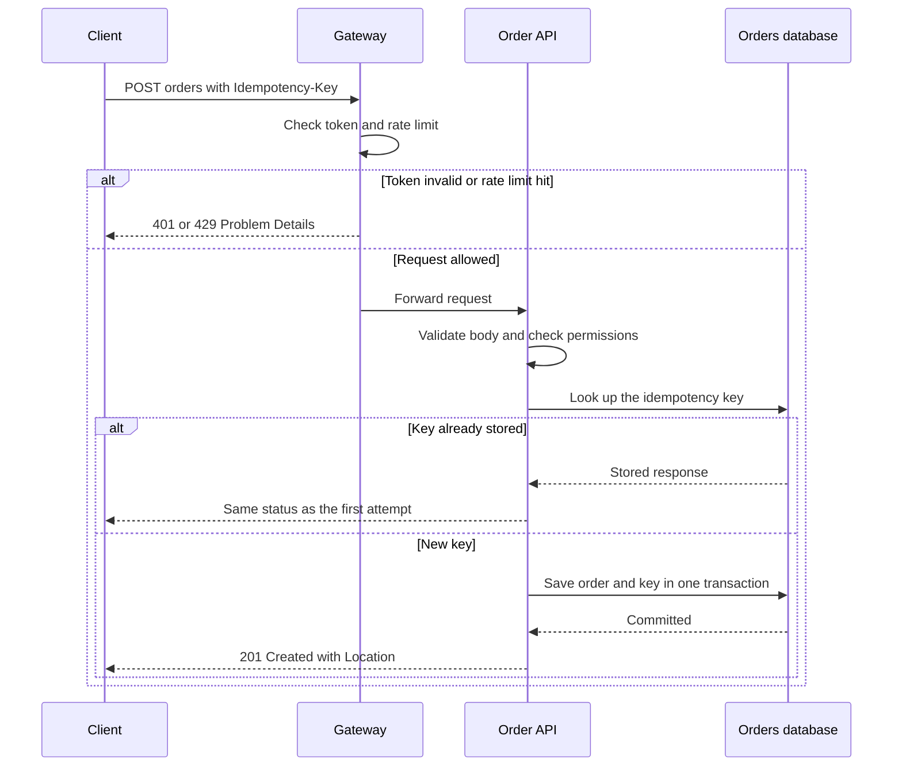

# REST Principles and Versioning

!!! note "In simple words"
    REST models everything your API exposes as a resource with its own address, such as an order at `/orders/42`. Callers act on it using standard HTTP verbs and read the outcome from standard status codes. The hard part is changing the contract without breaking the people who depend on it.

REST is a style of design built on top of HTTP. Resources get URLs, and the HTTP methods and status codes do most of the explaining. Interviewers use REST questions to find out whether you use HTTP correctly, and whether you can evolve an API without breaking its consumers.

## Why it matters

Your API's consumers are software you do not control. A mobile build can stay installed for years, and a partner's nightly batch may call your endpoints without anyone looking at it. Using methods and status codes correctly lets caches, proxies, retry logic, and client libraries behave predictably. Disciplined versioning lets you improve the API without demanding that everyone upgrade at once. Both choices shape production behaviour long after launch.

## How it works

A REST request carries a method, a resource URL, headers, and possibly a body. The server authenticates the caller, checks authorisation, routes the request to a handler, and replies with a status code and a representation. The sequence below walks through a `POST` that creates an order, including the checks made along the way.



In prose, the lifecycle runs like this:

1. The client sends a method, a URL, headers, and optionally a body.
2. The gateway verifies the token and the rate limit, and answers immediately when either fails.
3. The service validates the body and confirms the caller may act on the resource.
4. The handler carries out the operation and picks the status code that matches the result.
5. The response holds a representation negotiated through the `Accept` header.
6. Clients rely on the contract, so changes must come through a new version or a non-breaking addition.

The semantics of these messages are defined in [RFC 9110, HTTP Semantics](https://www.rfc-editor.org/rfc/rfc9110).

### Resources and statelessness

Shape the API around **resources** (nouns) instead of actions (verbs). `/orders/42` names an order. Actions map onto methods, or onto sub-resources when a state change deserves its own identity, such as `POST /orders/42/cancellation`.

**Stateless** means every request is self-contained: credentials, parameters, and the representation all travel with it. The server holds no conversation in memory between calls. Any instance can therefore serve any request, which keeps scaling out and load balancing simple. Any session state that is genuinely needed lives in a database or a cache.

### HTTP methods and their properties

| Method | Purpose | Safe | Idempotent |
|---|---|---|---|
| `GET` | Read a resource | Yes | Yes |
| `HEAD` | Read headers only | Yes | Yes |
| `OPTIONS` | Describe what is allowed (used in CORS preflight) | Yes | Yes |
| `PUT` | Replace a resource at a known URL | No | Yes |
| `PATCH` | Partially change a resource | No | Not necessarily |
| `POST` | Create, or trigger processing | No | No |
| `DELETE` | Remove a resource | No | Yes |

"Safe" means the request leaves server state untouched. "Idempotent" means that sending it twice produces the same outcome as sending it once. `PUT` swaps out the full representation, so a repeat changes nothing. `PATCH` can fail the test, for instance when it means "add one to the counter". `POST` is neither safe nor idempotent, so a retried `POST` may create a duplicate. See [idempotency](pagination-errors-idempotency.md#idempotency).

### HEAD and OPTIONS

- `HEAD` gives the same headers `GET` would, without the body. It is handy for checking existence, or for reading `Content-Length` or `ETag` cheaply. Spring MVC serves `HEAD` through the `GET` handlers you already wrote.
- `OPTIONS` reports which methods and headers a resource accepts. Browsers issue it as a CORS preflight (see [API Security](api-security.md)), and clients may use it to discover capabilities.

```bash
curl -I https://api.example.com/api/v1/orders/42             # HEAD: headers only
curl -i -X OPTIONS https://api.example.com/api/v1/orders/42  # look for the Allow header
```

### DELETE responses

A `DELETE` has idempotent effect: once the resource is gone, further calls leave things as they were. Reply `204 No Content` when a removal succeeds.

What a repeated delete returns is a policy choice. Some APIs answer `204` again, which makes retries painless. Others answer `404`, so callers can distinguish "already gone" from "removed just now". Whichever you choose, document it. When a business rule forbids the removal, such as deleting a shipped order, reply `409 Conflict`. If you want the response to explain itself, `200` with a body also works.

### Partial updates: PUT, PATCH, and merge patch

`PUT` needs the complete representation, and a client that leaves a field out usually wipes it. `PATCH` carries only the changes, so the body must make clear what they mean. Two formats handle that:

- **JSON Merge Patch (RFC 7396)**: the body mirrors the resource shape, and any field set to `null` gets removed. It is easy to use, but it cannot store a literal `null` while also removing a value, and it cannot address items inside arrays.
- **JSON Patch (RFC 6902)**: the body is an ordered list of operations, so changes can be stated precisely.

```json
PATCH /api/v1/orders/42
Content-Type: application/json-patch+json

[
  { "op": "replace", "path": "/status", "value": "SHIPPED" },
  { "op": "add", "path": "/tags/-", "value": "priority" },
  { "op": "remove", "path": "/note" }
]
```

Do not assume a `PATCH` is idempotent. Adding an item to an array twice leaves it with two copies. Retry-safe designs need an idempotency key or a check on the current state first. Spring does not apply JSON Patch on its own, so bring in a JSON Patch library, or accept a DTO whose fields are all optional.

### Status codes

- **2xx success:** `200 OK`, `201 Created` (with a `Location` header), `204 No Content`.
- **3xx redirection:** `301` and `308` for a permanent move, `304` for cache revalidation.
- **4xx client error:** `400` for a malformed request, `401` when authentication is missing, `403` when the caller is known but not allowed, `404` for an unknown resource, `409` for a conflict, `422` for input that is well formed but fails a business rule, and `429` for too many requests.
- **5xx server error:** `500` for an unexpected fault, `503` when the service is temporarily unavailable.

Further codes that are worth recognising:

- `206 Partial Content` for ranged requests, such as resumable downloads.
- `301` and `308` are permanent redirects, and `302` and `307` are temporary. The 307 and 308 variants preserve the method, whereas 301 and 302 may switch it.
- `304 Not Modified` when a cached copy still stands, triggered by a conditional `GET` that carries `ETag` or `Last-Modified`.
- `410 Gone` when a resource was deliberately removed and will not return.
- `502 Bad Gateway` and `504 Gateway Timeout` when an upstream dependency fails or responds too slowly. Use `503` with `Retry-After` when you are deliberately shedding load.

Pick the code that describes the actual problem. A `200` carrying an error payload defeats monitoring, caching, and client libraries.

Here is a Spring MVC controller that follows these conventions. It is a Spring example and is not compiled here:

```java
import org.springframework.http.ResponseEntity;
import org.springframework.web.bind.annotation.GetMapping;
import org.springframework.web.bind.annotation.PathVariable;
import org.springframework.web.bind.annotation.PostMapping;
import org.springframework.web.bind.annotation.RequestBody;
import org.springframework.web.bind.annotation.RequestMapping;
import org.springframework.web.bind.annotation.RestController;

import java.net.URI;

@RestController
@RequestMapping("/api/v1/orders")
public class OrderV1Controller {

    public record CreateOrderRequest(String sku, int quantity) {}

    public record OrderV1Response(long id, String status) {}

    @GetMapping("/{id}")
    public ResponseEntity<OrderV1Response> get(@PathVariable long id) {
        return ResponseEntity.ok(new OrderV1Response(id, "PLACED"));
    }

    @PostMapping
    public ResponseEntity<OrderV1Response> create(@RequestBody CreateOrderRequest request) {
        long newId = 1001L; // would come from the service layer
        return ResponseEntity
                .created(URI.create("/api/v1/orders/" + newId))
                .body(new OrderV1Response(newId, "PLACED"));
    }
}
```

### Content negotiation

Clients use `Accept` to state which representation they can handle, for example `application/json`. The response carries `Content-Type` to label what it actually contains. When no acceptable representation exists, the server returns `406 Not Acceptable`. Spring selects its message converters based on these two headers.

### Versioning

APIs evolve, and versioning lets breaking changes ship without a forced migration. Three common strategies exist:

| Strategy | Example | Pros | Cons |
|---|---|---|---|
| URL path | `/api/v1/orders` | Explicit, simple to route and cache | URL space multiplies over time |
| Header or media type | `Accept: application/vnd.example.order.v2+json` | Stable URLs | Awkward to try in a browser |
| Query parameter | `/orders?version=2` | Trivial to add | Easy to overlook, and it competes with filters |

URL versioning is the most widespread, precisely because it is so visible. Purists lean toward media types. Spring can route on a media-type version through `produces`. This is a Spring example and is not compiled here:

```java
import org.springframework.web.bind.annotation.GetMapping;
import org.springframework.web.bind.annotation.PathVariable;
import org.springframework.web.bind.annotation.RequestMapping;
import org.springframework.web.bind.annotation.RestController;

@RestController
@RequestMapping("/api/orders")
public class OrderVersionedController {

    public record OrderV2Response(long id, String status, String currency) {}

    @GetMapping(value = "/{id}", produces = "application/vnd.example.order.v2+json")
    public OrderV2Response getV2(@PathVariable long id) {
        return new OrderV2Response(id, "PLACED", "EUR");
    }
}
```

### Backward compatibility and deprecation

Additive changes are **non-breaking**: an extra optional response field, a fresh endpoint, or an optional query parameter. Clients that ignore unfamiliar fields carry on working. **Breaking** changes include deleting or renaming a field, altering a type, making an optional input mandatory, and changing what a status code signifies.

A breaking change should follow these steps:

1. Ship the new version alongside the current one.
2. Document the change, together with a deprecation timeline.
3. Announce the deprecation with `Deprecation` and `Sunset` headers. RFC 8594 defines `Sunset`.
4. Track which clients still hit the old version, and reach out to them.
5. Retire the old version only once the timeline has passed and traffic has fallen away.

### Hypermedia links (HATEOAS)

HATEOAS is the idea that each response carries links to related resources, and to the actions currently available, so the client never has to build a URL by hand. Clients navigate by following those links instead of assembling URLs. Strict adherence is uncommon, but links aid discovery and reveal which operations are possible.

```json
{
  "id": 42,
  "status": "PLACED",
  "_links": {
    "self":   { "href": "/api/v1/orders/42" },
    "cancel": { "href": "/api/v1/orders/42/cancellation", "method": "POST" }
  }
}
```

Spring HATEOAS derives the links from controller methods, so they track the code automatically. This is a Spring HATEOAS example and is not compiled here:

```java
import static org.springframework.hateoas.server.mvc.WebMvcLinkBuilder.linkTo;
import static org.springframework.hateoas.server.mvc.WebMvcLinkBuilder.methodOn;

import org.springframework.hateoas.EntityModel;
import org.springframework.web.bind.annotation.GetMapping;
import org.springframework.web.bind.annotation.PathVariable;
import org.springframework.web.bind.annotation.RequestMapping;
import org.springframework.web.bind.annotation.RestController;

@RestController
@RequestMapping("/api/v1/orders")
public class OrderLinksController {

    public record OrderView(long id, String status) {}

    @GetMapping("/{id}")
    public EntityModel<OrderView> get(@PathVariable long id) {
        OrderView order = new OrderView(id, "PLACED");
        return EntityModel.of(order,
                linkTo(methodOn(OrderLinksController.class).get(id)).withSelfRel());
    }
}
```

Only emit a link when the caller can really perform that action. Showing a link to a forbidden action discloses information, so generate links from the same rules that enforce authorisation.

## Where it is used

- Public and partner APIs covering orders, accounts, catalogues, and payments.
- Internal service APIs that many teams depend upon.
- Mobile and browser clients, which cache responses and rely on stable URLs.
- Gateways and proxies, which route, cache, and rate-limit based on method and path.

## Benefits

- **Works with existing tools.** Browsers, curl, proxies, and client libraries already speak HTTP.
- **Cacheable reads.** `GET` responses can be stored by browsers, CDNs, and intermediaries.
- **Predictable retries.** Knowing which methods are safe or idempotent makes retry logic and monitoring reliable.
- **Smooth evolution** as long as additive change remains the norm.

## Cons and limits

- **Over- and under-fetching.** A screen may require several resources, or just a slice of one. REST offers no built-in fix, so see [Alternative Protocols](alternative-protocols.md).
- **Verbs sneak in.** Some actions don't fit a method neatly, which turns URL design into a debate.
- **Every version costs effort.** Each supported version has to be built and tested.
- **Status code conventions differ** between teams, which is why the contract must be written down.

## Best practices

- Name resources with nouns, using plural collections such as `/orders`.
- Use the method whose meaning fits, and state which methods are idempotent.
- Return `201 Created` with a `Location` header, and `204` for successful deletes.
- Return Problem Details for every error, with a status matching the cause.
- Put a major version in the URL, and bump it only for breaking changes.
- Publish an OpenAPI description and keep it synchronised with the code (see [OpenAPI and springdoc](openapi-documentation.md)).
- Include hypermedia links only where the client can act on them.

## Common pitfalls

- Verbs in URLs, such as `/getOrder` or `/createOrder`, that clash with HTTP methods.
- Relying on `POST` for everything, which discards the safety and idempotency signals.
- Answering with `200` and an error inside the body.
- Renaming fields in responses without introducing a new version.
- Making database identifiers and internal structure the public contract.
- Omitting the `Location` header on `201 Created`.

!!! tip "Interview tip"
    **Q: What is the difference between PUT and PATCH?**
    `PUT` substitutes the full resource at a URL, so applying it twice leaves the same final state. `PATCH` applies a partial change, expressed either as a subset of fields or as a patch document such as JSON Patch. Because `PATCH` is not guaranteed idempotent, build it so repeating it is safe, or handle it like `POST` when retries are possible.

## Quick recap

- Model resources as nouns, and give HTTP methods and status codes their intended meanings.
- Know which methods are safe and which are idempotent.
- Return the status code that matches the result.
- Version through a URL, a header, or a query parameter, and stay consistent.
- Favour additive, non-breaking changes, and deprecate with a clear timeline.

## Official documentation

- [RFC 9110: HTTP Semantics](https://www.rfc-editor.org/rfc/rfc9110)
- [OpenAPI Specification](https://spec.openapis.org/oas/latest.html)

**See also:** [Pagination, Errors, and Idempotency](pagination-errors-idempotency.md), [API Security](api-security.md), [Alternative Protocols](alternative-protocols.md)
