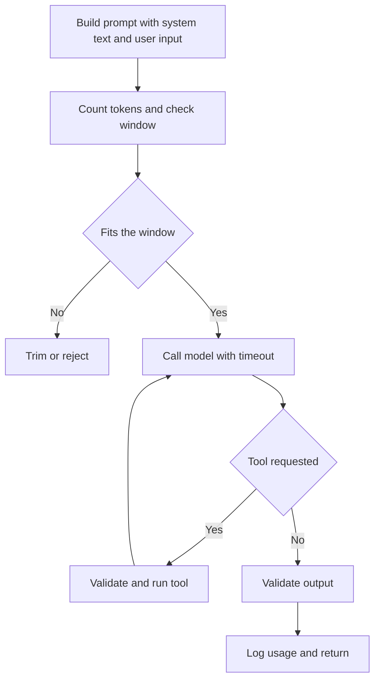

# LLM Integration

!!! note "In simple words"
    A large language model (LLM) reads a list of messages and writes text back. Calling one from your application is like calling any slow, costly, sometimes unreliable remote service, so you wrap it, limit it, and check what it returns.

Interviewers ask about LLM integration to see whether you can treat a model as a dependency. That means managing what goes in and what comes out, controlling cost and latency, and planning for the ways the call fails. The examples here use a provider-neutral interface, because the same ideas apply to hosted models and to models you run yourself.

## Why it matters

A model call looks like a function call, but it behaves differently. It can take seconds, it may be rate limited, it bills per token, and it can return something different on the next call. A feature built as if the model were a local function will hang threads, overrun budgets, and trust text it should check. Designing for those properties from the start prevents most of the incidents that LLM features cause in production.

## How it works

### The model as a remote dependency

Wrap the model behind an interface in your own code. The rest of the application then depends on that interface, not on one vendor's SDK. This lets you test with a fake model that is fast and deterministic, and it lets you change providers without touching business logic.

When you compare providers, use the criteria your product needs: quality on your own tasks, how data is handled, latency, cost, and where the model can run. Measure on your own examples, because general benchmark claims rarely match your workload.

### A provider-neutral interface

The program below defines chat messages, sampling options, and a `ChatModel` interface. A fake model implements it for tests. It compiles on Java 21 without any network access:

```java
import java.util.List;

public class LlmClientDemo {

    public enum Role { SYSTEM, USER, ASSISTANT }

    public record ChatMessage(Role role, String content) {}

    public record SamplingOptions(double temperature, double topP, int maxOutputTokens) {}

    public interface ChatModel {
        String complete(List<ChatMessage> messages, SamplingOptions options);
    }

    // Fake model for unit tests: no network, and the same output every time
    static final class EchoModel implements ChatModel {
        @Override
        public String complete(List<ChatMessage> messages, SamplingOptions options) {
            return "echo: " + messages.get(messages.size() - 1).content();
        }
    }

    public static void main(String[] args) {
        ChatModel model = new EchoModel();
        String answer = model.complete(
                List.of(new ChatMessage(Role.SYSTEM, "Be brief."),
                        new ChatMessage(Role.USER, "Summarise this order.")),
                new SamplingOptions(0.2, 0.9, 256));
        System.out.println(answer);
    }
}
```

A real adapter implements `ChatModel` and maps these records to the provider's request format. The business code only ever sees `ChatModel`.

### Prompts and roles

A prompt is the full list of messages sent in one call. Most chat APIs use three roles:

- **System** messages hold standing instructions about behaviour, output format, and limits.
- **User** messages carry the request, either from the end user or from your application.
- **Assistant** messages carry earlier model replies, so the model sees the conversation so far.

Good prompts say what the task is, what the output must look like, and what to do when information is missing. Place untrusted content, such as user text or retrieved documents, inside clearly marked delimiters, and state that instructions inside those delimiters must not be followed. This reduces **prompt injection**, where input text tries to override your instructions, but it does not remove the risk. Treat the model's output as untrusted for that reason.

### The context window and tokens

A model reads a fixed maximum number of **tokens** in one call. That limit is the context window. A token is a sub-word piece of text, not a word or a character, and the count depends on the model's tokeniser. The window must hold the system prompt, the conversation so far, the retrieved context, and the output.

Handle long inputs in this order:

1. Count input tokens with the tokeniser for your model. A rough character ratio can be far off.
2. Reserve room for the output, through the maximum output token setting.
3. Drop or summarise the oldest conversation turns first, and always keep the system prompt.
4. Reject or split requests that still cannot fit.

### Cost control

Cost usually grows with input and output tokens. Build these controls in from the start:

- Cap the output tokens for each use case.
- Trim context to what the task needs. The [RAG page](rag-and-vector-databases.md) covers how to retrieve only relevant passages.
- Cache answers to repeated identical requests when the answer is stable.
- Send simple tasks to a smaller model and keep larger models for hard ones.
- Record usage per request and per tenant, so spikes are visible and can be attributed.
- Set budgets and alerts. The [metrics page](../20-observability/metrics.md) shows how to publish counters for them.

Do not hard-code prices in code or in documentation. They change, and they differ between providers and models.

### Sampling parameters

Sampling parameters control how the model picks each next token:

- **Temperature** sets how varied the output is. Values near zero suit extraction and classification. Higher values suit brainstorming.
- **Top-k** limits the choice to the k most likely next tokens.
- **Top-p** (nucleus sampling) limits the choice to the smallest set of tokens whose probabilities add up to p.

Not every provider exposes every parameter, and some models ignore certain settings. Set them explicitly, test their effect on your data, and do not assume the output is identical even at temperature zero.

### Streaming

A long answer can take several seconds. **Streaming** sends tokens as they are produced, so the user sees progress sooner. On the server, forward the chunks over Server-Sent Events or a WebSocket. When the client disconnects, cancel the upstream call, so you stop paying for tokens nobody will read.

Streaming changes error handling. Once the first chunk has been sent, the HTTP status is already fixed, so a failure in the middle must be reported as an error event inside the stream.

### Tool (function) calling

Tool calling lets the model ask your code to run an action. You describe each function by name, purpose, and a JSON schema of its parameters. The model replies with a structured request, such as `lookupOrder` with `{"orderId": "42"}`. Your code checks the arguments, runs the function, and returns the result to the model. The model then writes its final answer.

Rules for tools:

- The model proposes, and your code decides. Validate and authorise each call as you would any client request.
- Offer only the tools that the current user and request need.
- Cap the number of tool rounds, so a loop cannot run forever.
- Treat tool output as data. It must not be read as new instructions.

### Structured output

When you need data rather than prose, ask for JSON that matches a schema. Then parse and validate it with a typed parser. Models can still return invalid output, so retry once or fall back to a safe default when validation fails.

### Failure handling

Expect timeouts, rate-limit responses, content filter blocks, and malformed output. Design for each one:

- Set an explicit timeout on every call.
- Retry transient errors with exponential backoff and jitter, within a fixed budget.
- Validate every output, and count an invalid output as a failure.
- Provide a fallback: a cached answer, a simpler path, or a clear "temporarily unavailable" message.
- Log request metadata and outcomes. Do not log full prompts that contain personal data unless you have a retention policy for them.



The loop back from the tool step is capped in practice, as the rules above require.

## Where it is used

- Chat assistants that answer questions from product or policy text.
- Summaries, drafts, and classification of support tickets or documents.
- Extraction of structured fields from free text, such as addresses or invoice lines.
- Agents that call internal APIs on a user's behalf, with tight limits on what they may do.

## Benefits

- A thin interface keeps the rest of the application stable when providers change.
- Clear limits on tokens and rounds keep cost and latency predictable.
- Validation and fallbacks turn a flaky dependency into a feature that degrades gracefully.
- Usage logs make the cost of each feature visible.

## Cons and limits

- Outputs vary between calls, so tests must check properties of the output rather than exact text.
- Token limits force trade-offs about how much context a feature can use.
- A model can be wrong with confidence, and validation only catches format errors, not every factual error.
- Prompt injection is an open risk, because the model cannot always tell instructions from data.
- Provider outages and rate limits are outside your control.

## Best practices

- Hide the provider behind your own interface, and test with a fake.
- Count tokens with the model's own tokeniser, and reserve output space.
- Set timeouts, bounded retries, and tool-round caps on every call.
- Validate outputs before they drive any action.
- Record usage per feature and per tenant, with alerts.
- Keep an evaluation set of real examples, and rerun it when the prompt or model changes.
- Do not log personal data from prompts without a retention policy.

!!! tip "Interview tip"
    **Q: How would you keep an LLM feature from running up costs or hanging the service?**
    Put the model behind an interface with timeouts and bounded retries. Cap input and output tokens, and trim the context. Record usage per tenant, with alerts. Validate every output, cap the tool rounds, and provide a fallback when the call fails. Then measure cost and latency on real traffic, rather than guessing.

## Quick recap

- Wrap the model behind your own interface, so you can test it and change providers.
- Manage the context window explicitly, and count tokens with the model's tokeniser.
- Sampling settings shape the output. Set them deliberately and test their effect.
- Tool calls are proposals. Validate, authorise, and bound them.
- Plan for timeouts, retries, invalid output, and cost from the start.

## Official documentation

- [Claude API documentation](https://platform.claude.com/docs/en/home)
- [Spring AI reference documentation](https://docs.spring.io/spring-ai/reference/index.html)
- [Spring Framework reference documentation](https://docs.spring.io/spring-framework/reference/)

**See also:** [RAG and Vector Databases](rag-and-vector-databases.md) | [Spring AI and Use Cases](spring-ai-use-cases.md) | [AI and Machine Learning Fundamentals](../ai-machine-learning/llms-and-transformers.md)
