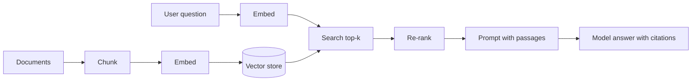

# Retrieval-Augmented Generation and Vector Databases

Retrieval-Augmented Generation (RAG) gives a model the relevant passages from your own documents at the time it answers, instead of relying on what it learned during training. Interviewers ask about RAG because it is the most common way to build question answering over private data, and because its quality depends on ingestion, retrieval, and ranking choices that many teams get wrong.

## Core concepts

### The RAG pipeline

RAG has two phases:

1. **Ingestion (offline):** load documents, split them into chunks, convert each chunk into an embedding (a vector), and store the vectors with their text and metadata.
2. **Query (online):** embed the user's question, retrieve the most similar chunks, add them to the prompt, and ask the model to answer from that context.

The model only sees what you retrieve, so retrieval quality sets the ceiling on answer quality.



### Document ingestion and chunking

Documents are too long to embed or retrieve whole. A **chunk** is a passage small enough to be specific, and large enough to carry meaning. Common approaches:

- Fixed size with overlap, measured in tokens or characters
- Structural splits at headings, paragraphs, or list items
- Semantic splits at topic changes

Overlap keeps a sentence that straddles a boundary present in both chunks. A character-based chunker with overlap:

```java
import java.util.ArrayList;
import java.util.List;

public final class Chunker {

    private Chunker() {
    }

    public static List<String> chunk(String text, int size, int overlap) {
        if (size <= 0 || overlap < 0 || overlap >= size) {
            throw new IllegalArgumentException("need size > 0 and 0 <= overlap < size");
        }
        List<String> chunks = new ArrayList<>();
        int step = size - overlap;
        for (int start = 0; start < text.length(); start += step) {
            int end = Math.min(text.length(), start + size);
            chunks.add(text.substring(start, end));
            if (end == text.length()) {
                break;
            }
        }
        return chunks;
    }
}
```

Production chunkers usually count tokens, respect structure, and attach metadata (source, section, page, last-updated date) so answers can cite where they came from. Keep metadata when you chunk; it is what makes citations and access control possible.

### Embeddings and vector similarity

An **embedding** is a fixed-length list of numbers produced by an embedding model. Texts with similar meaning get vectors that point in similar directions. Retrieval ranks stored chunks by how similar their vectors are to the query vector.

The usual metric is **cosine similarity**, the cosine of the angle between two vectors:

```java
public final class Similarity {

    private Similarity() {
    }

    public static double cosine(float[] a, float[] b) {
        if (a.length != b.length) {
            throw new IllegalArgumentException("dimension mismatch");
        }
        double dot = 0.0;
        double normA = 0.0;
        double normB = 0.0;
        for (int i = 0; i < a.length; i++) {
            dot += a[i] * b[i];
            normA += a[i] * a[i];
            normB += b[i] * b[i];
        }
        // A zero vector has no direction; guard before dividing
        if (normA == 0.0 || normB == 0.0) {
            return 0.0;
        }
        return dot / (Math.sqrt(normA) * Math.sqrt(normB));
    }
}
```

Other metrics appear in practice: Euclidean (L2) distance, dot product (fast, and equivalent to cosine when vectors are normalised), and Manhattan (L1) distance. Use the metric the embedding model was trained for, and check the store's documentation for which one it expects.

Brute-force search compares the query against every vector. That is exact and fine for small collections. It becomes too slow as the collection grows.

### Approximate nearest-neighbour indexes

**Approximate nearest-neighbour (ANN)** search trades a small loss in recall for large gains in speed. Two index families you will meet:

- **HNSW (Hierarchical Navigable Small World):** a layered graph. Search starts at a sparse top layer and descends, following neighbour links. Fast queries; uses more memory; build time and parameters affect recall.
- **IVF (Inverted File):** clusters vectors into partitions and searches only the nearest partitions. Lower memory; recall depends on how many partitions you probe.

Both are approximate. Measure recall against exact search on a sample of real queries before you commit.

### Vector databases and where they fit

Options include **pgvector** (a PostgreSQL extension, which keeps vectors next to relational data), and dedicated stores such as **Pinecone**, **Weaviate**, **Milvus**, **Chroma**, and **Qdrant**. Choose by the constraints that matter:

| Concern | Consideration |
|---|---|
| Existing relational data | pgvector keeps joins, transactions, and access control in one database |
| Scale and index control | Dedicated stores offer more index and sharding options |
| Operations | Managed services reduce work; self-hosted gives control |
| Filtering | Check how metadata filters combine with vector search |
| Team skills | A store your team can operate is worth more than a theoretical advantage |

Scaling trade-offs include index build time, memory per vector, filter selectivity, re-indexing when the embedding model changes, and write throughput during ingestion.

### Keyword, hybrid, and re-ranked search

Vector search finds meaning but can miss exact terms such as product codes, names, and error messages. Keyword search (BM25) is strong at exact terms. **Hybrid search** runs both and merges the results. A common merge is **reciprocal rank fusion (RRF)**: each document scores the sum of 1 / (k + rank) across the lists it appears in, with k a small constant. The original paper, [Cormack, Clarke, and Büttcher (SIGIR 2009)](https://cormack.uwaterloo.ca/cormacksigir09-rrf.pdf), fixed k at 60 and found the choice was not critical.

```java
import java.util.HashMap;
import java.util.List;
import java.util.Map;

public final class ReciprocalRankFusion {

    private ReciprocalRankFusion() {
    }

    // Each input list holds document IDs, best first
    public static Map<String, Double> fuse(List<List<String>> rankings, int k) {
        Map<String, Double> scores = new HashMap<>();
        for (List<String> ranking : rankings) {
            for (int i = 0; i < ranking.size(); i++) {
                int rank = i + 1;
                scores.merge(ranking.get(i), 1.0 / (k + rank), Double::sum);
            }
        }
        return scores;
    }
}
```

Sort the resulting map by value to get the final order. A **re-ranker** (a model that scores each query-passage pair more carefully) can then reorder the top candidates. It costs more per item, so apply it to a short list only.

### Adding context to the prompt

Place retrieved passages in the prompt with their sources, and instruct the model to answer only from them and to say when the answer is not there. Limit the total context to what fits the window, and prefer fewer, better passages over many weak ones.

## How it works

1. Ingest: parse, chunk, embed, and store each chunk with metadata.
2. Query: embed the question with the same embedding model used for ingestion.
3. Retrieve: run vector search (and optionally keyword search), filtered by access rules.
4. Re-rank and trim the candidates to the context budget.
5. Generate: send the question and passages to the model, then return the answer with citations.
6. Evaluate: measure retrieval (did the right passage come back?) and answer quality on a labelled set.

## Common pitfalls

- Mixing embedding models between ingestion and query, which makes similarity meaningless
- Chunks too large to be specific, or too small to carry context
- Dropping metadata, which removes citations and per-user access control
- Ignoring access control at retrieval time, so users see passages they should not
- Trusting vector search alone for exact identifiers
- Changing the embedding model without re-embedding the whole collection
- Evaluating only the final answer, so retrieval failures stay hidden

!!! tip "Interview tip"
    **Q: The model's answers are wrong. How do you debug a RAG system?**
    A: Split the problem. First check retrieval: for a set of labelled questions, did the correct passage appear in the top results? If not, fix chunking, embeddings, filtering, or hybrid search. If retrieval is right but the answer is wrong, fix the prompt, the context ordering, or the model. Measure each stage separately.

## Quick recap

- RAG = ingest and index your documents, retrieve relevant chunks, then generate from them
- Chunk with overlap and keep metadata for citations and access control
- Cosine similarity and ANN indexes (HNSW, IVF) make search fast; measure recall
- Hybrid search with rank fusion and a re-ranker improves results
- Evaluate retrieval and generation separately

**See also:** [LLM Integration](llm-integration.md), [Spring AI and Use Cases](spring-ai-use-cases.md)
