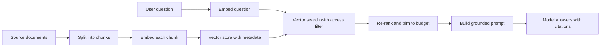

# Retrieval-Augmented Generation and Vector Databases

!!! note "In simple words"
    Retrieval-augmented generation (RAG) first looks up the passages in your own documents that match a question, then gives those passages to the model and asks it to answer from them. The model does not need to have memorised your documents.

RAG is the most common way to build question answering over private data. Interviewers ask about it because its quality depends on choices that many teams get wrong: how documents are split, how they are searched, how results are ranked, and how access is checked.

## Why it matters

A model trained on public text knows nothing about your refund policy, your product manuals, or last week's incident notes. You could retrain the model each time documents change, but that is slow and costly. RAG keeps the knowledge in a search index that you can update in minutes, and it lets each answer point to the passage it came from. That makes answers checkable.

RAG also moves the risk. If the search returns the wrong passage, the model answers from the wrong text, however capable it is. So the search half needs as much care as the generation half.

## How it works

### The two phases

RAG has an offline phase and an online phase.

1. **Ingestion (offline).** Load the documents, split them into chunks, convert each chunk into an embedding (a vector), and store the vector together with the chunk text and its metadata.
2. **Query (online).** Embed the user's question with the same model, retrieve the most similar chunks, place them in the prompt, and ask the model to answer from them.

The model only sees what retrieval returns, so retrieval quality sets a ceiling on answer quality. A perfect model cannot answer from a passage it never received.



The access filter sits inside the search step, before any passage reaches the model. Filtering after the model has seen a passage is too late.

### Splitting documents into chunks

A whole document is too long to embed usefully, and too broad to retrieve precisely. A **chunk** is a passage small enough to be specific, and large enough to carry its meaning. Common approaches are:

- **Fixed size with overlap**, measured in characters or tokens.
- **Structural splits** at headings, paragraphs, or list items.
- **Semantic splits** where the topic changes.

Overlap keeps a sentence that crosses a boundary present in both neighbouring chunks. The chunker below uses characters and overlap. It compiles on Java 21:

```java
import java.util.ArrayList;
import java.util.List;

public final class Chunker {

    private Chunker() {
    }

    public static List<String> chunk(String text, int size, int overlap) {
        if (size <= 0 || overlap < 0 || overlap >= size) {
            throw new IllegalArgumentException("need size > 0 and 0 <= overlap < size");
        }
        List<String> chunks = new ArrayList<>();
        int step = size - overlap;
        for (int start = 0; start < text.length(); start += step) {
            int end = Math.min(text.length(), start + size);
            chunks.add(text.substring(start, end));
            if (end == text.length()) {
                break;
            }
        }
        return chunks;
    }

    public static void main(String[] args) {
        chunk("abcdefghij", 4, 1).forEach(System.out::println);   // abcd, defg, ghij
    }
}
```

Production chunkers count tokens, respect document structure, and attach metadata such as source, section, page, and last-updated date. The metadata is what makes citations and access control possible, so keep it through every step.

### Embeddings and similarity

An **embedding** is a fixed-length list of numbers produced by an embedding model. Texts with similar meaning get vectors that point in similar directions. Retrieval ranks chunks by how close their vectors are to the query vector.

The most common measure is **cosine similarity**, the cosine of the angle between two vectors. A value near 1 means the same direction, and a value near 0 means unrelated. The function below handles the zero-vector case, which has no direction:

```java
public final class Similarity {

    private Similarity() {
    }

    public static double cosine(float[] a, float[] b) {
        if (a.length != b.length) {
            throw new IllegalArgumentException("dimension mismatch");
        }
        double dot = 0.0;
        double normA = 0.0;
        double normB = 0.0;
        for (int i = 0; i < a.length; i++) {
            dot += a[i] * b[i];
            normA += a[i] * a[i];
            normB += b[i] * b[i];
        }
        if (normA == 0.0 || normB == 0.0) {
            return 0.0;                      // a zero vector has no direction
        }
        return dot / (Math.sqrt(normA) * Math.sqrt(normB));
    }

    public static void main(String[] args) {
        System.out.println(cosine(new float[] {1f, 0f}, new float[] {1f, 0f}));   // 1.0
        System.out.println(cosine(new float[] {1f, 0f}, new float[] {0f, 1f}));   // 0.0
    }
}
```

Other measures appear in practice: Euclidean distance, the dot product (which equals cosine similarity when vectors are normalised to length one), and Manhattan distance. Use the measure the embedding model was trained for, and check the vector store's documentation for the one it expects.

Brute-force search compares the query with every stored vector. That is exact, and fine for small collections. It gets slow as the collection grows.

### Approximate nearest-neighbour indexes

**Approximate nearest-neighbour** (ANN) search trades a small loss of recall for a large gain in speed. Two index families are common:

- **HNSW** (Hierarchical Navigable Small World) builds a layered graph. A search starts at a sparse top layer and moves down through neighbour links. Queries are fast, but the index uses more memory. Build settings change recall.
- **IVF** (inverted file) groups vectors into clusters and searches only the nearest clusters. It needs less memory, and recall depends on how many clusters are searched.

Both are approximate. Measure recall against exact search on a sample of real queries before you commit to an index.

### Vector stores

Options include **pgvector**, a PostgreSQL extension that keeps vectors next to relational data, and dedicated stores such as Pinecone, Weaviate, Milvus, Chroma, and Qdrant. The [pgvector project](https://github.com/pgvector/pgvector) documents its index types and distance operators.

| Concern | What to consider |
|---|---|
| Existing relational data | pgvector keeps joins, transactions, and access rules in one database |
| Scale and index control | Dedicated stores offer more index and sharding options |
| Operations | Managed services reduce work, and self-hosting gives control |
| Filtering | Check how metadata filters combine with vector search |
| Team skills | A store the team can run beats a theoretical advantage |

Plan for index build time, memory per vector, filter selectivity, and the cost of re-embedding everything when the embedding model changes. Also plan for write throughput during ingestion.

### Keyword, hybrid, and re-ranked search

Vector search finds meaning, but it can miss exact terms such as product codes, names, and error messages. Keyword search, usually BM25, is strong on exact terms. **Hybrid search** runs both and merges the results. A common way to merge is **reciprocal rank fusion** (RRF). Each document scores the sum of 1 divided by (k plus its rank) across every list it appears in, where k is a small constant. The original paper by [Cormack, Clarke, and Büttcher (SIGIR 2009)](https://cormack.uwaterloo.ca/cormacksigir09-rrf.pdf) used k equal to 60, and found the exact value was not critical.

```java
import java.util.HashMap;
import java.util.List;
import java.util.Map;

public final class ReciprocalRankFusion {

    private ReciprocalRankFusion() {
    }

    // Each input list holds document IDs, best first. Returns a fused score per document.
    public static Map<String, Double> fuse(List<List<String>> rankings, int k) {
        Map<String, Double> scores = new HashMap<>();
        for (List<String> ranking : rankings) {
            for (int i = 0; i < ranking.size(); i++) {
                int rank = i + 1;                                  // ranks start at 1
                scores.merge(ranking.get(i), 1.0 / (k + rank), Double::sum);
            }
        }
        return scores;
    }

    public static void main(String[] args) {
        Map<String, Double> fused = fuse(
                List.of(List.of("doc-a", "doc-b", "doc-c"),        // keyword ranking
                        List.of("doc-b", "doc-a", "doc-d")),       // vector ranking
                60);
        System.out.println(fused.get("doc-a") > fused.get("doc-d"));   // true
    }
}
```

Sort the map by value to get the final order. A **re-ranker** is a model that scores each query and passage pair more carefully. It costs more per item, so run it only on a short list of candidates.

### Building the prompt

Place the retrieved passages in the prompt with their sources. Tell the model to answer only from those passages, and to say when the answer is missing. Keep the total context inside the window, and prefer a few strong passages over many weak ones. The grounded prompt builder in the [Spring AI page](spring-ai-use-cases.md) shows one way to lay this out.

## Where it is used

- Internal knowledge bases, such as policies, runbooks, and onboarding guides.
- Customer support assistants that answer from product documentation.
- Search over contracts, research notes, or technical manuals.
- Question answering over an e-commerce catalogue, combining exact codes with semantic queries.

## Benefits

- Answers can change as soon as documents change, without retraining a model.
- Each answer can cite the passage it came from, which builds trust and makes checking easy.
- Access rules can be enforced at retrieval, so users only see text they are allowed to read.
- Hybrid search and re-ranking often improve results with modest extra effort.

## Cons and limits

- Retrieval can miss the right passage, and then the answer is wrong or empty.
- Chunking choices change results, and a poor split can cut an answer in half.
- Embedding model changes force a full re-embedding of the collection.
- Vector search is approximate, so recall must be measured.
- Long, rambling context wastes the window and can confuse the model.

## Best practices

- Use the same embedding model for ingestion and for queries.
- Keep metadata on every chunk, and filter on access rules inside the search.
- Start with a fixed chunk size and overlap, then tune it using a labelled test set.
- Combine keyword and vector search when exact terms matter.
- Limit the context to a budget, and order the passages sensibly.
- Evaluate retrieval and generation separately, and track each one over time.
- Store chunk IDs with the answers, so every citation can be traced.

## Common pitfalls

- Mixing embedding models between ingestion and query, which makes similarity meaningless.
- Chunks that are too large to be specific, or too small to carry context.
- Dropping metadata, which removes citations and access control.
- Applying access rules after the model has seen the text.
- Relying on vector search alone for exact identifiers.
- Changing the embedding model without re-embedding the collection.
- Judging only the final answer, so retrieval failures stay hidden.

!!! tip "Interview tip"
    **Q: The model's answers are wrong. How do you debug a RAG system?**
    Split the problem in two. First check retrieval: for a set of labelled questions, did the correct passage appear among the top results? If not, look at chunking, the embedding model, the filters, and hybrid search. If retrieval is right but the answer is wrong, look at the prompt, the order of the passages, or the model. Measure each stage separately, so you know which one to fix.

## Quick recap

- RAG = ingest and index your documents, retrieve the relevant chunks, then generate from them.
- Chunk with overlap, and keep metadata for citations and access control.
- Cosine similarity and approximate indexes such as HNSW and IVF make search fast. Measure recall.
- Hybrid search with rank fusion and a re-ranker improves results.
- Evaluate retrieval and generation separately.

## Official documentation

- [pgvector project documentation](https://github.com/pgvector/pgvector)
- [Spring AI reference documentation](https://docs.spring.io/spring-ai/reference/index.html)
- [Claude API documentation](https://platform.claude.com/docs/en/home)

**See also:** [LLM Integration](llm-integration.md) | [Spring AI and Use Cases](spring-ai-use-cases.md) | [Search and Analytics](../23-specialisations/search-analytics.md)
