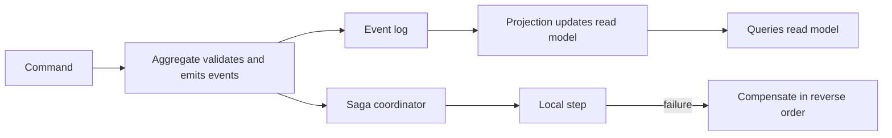

# Advanced Patterns

!!! note "In simple words"
    When one piece of work spans several services or stores, one database transaction is no longer enough. These patterns describe how to record what happened, split work into steps, and undo steps that cannot finish.

These patterns appear when a system spans several services, data stores, or machines. Interviewers ask about them to check that you understand consistency trade-offs, failure handling across services, and when a pattern is worth its complexity.

## Why it matters

A single database transaction is simple: either every change commits or none does. Once an order touches a payment provider, a warehouse, and an email service, no single transaction can cover all three. Teams then face questions. What happens if the payment succeeds and the stock check fails? How do you rebuild a screen that reads from several sources? How do you know what happened last week? The patterns in this page give answers, each with a cost.

## How it works

### Event sourcing

In **event sourcing**, the system stores the sequence of events that happened to an entity, rather than only its current state. The current state is rebuilt by replaying the events in order. An account is described as "opened, deposited 50, withdrew 20", not as "balance 30".

Benefits: a full audit trail, the ability to rebuild state or build new views from history, and a natural fit for asynchronous integration. Costs: queries are harder, event schemas must evolve carefully, and long histories need snapshots so that replay stays fast.

Java 21 makes the model concise. A sealed interface lists the allowed events, and a `switch` folds each event into the state. The compiler checks that every event is handled:

```java
import java.math.BigDecimal;
import java.util.List;

public class AccountEvents {

    public sealed interface AccountEvent permits Deposited, Withdrawn {}

    public record Deposited(String accountId, BigDecimal amount) implements AccountEvent {}

    public record Withdrawn(String accountId, BigDecimal amount) implements AccountEvent {}

    public record Account(BigDecimal balance) {

        public static Account empty() {
            return new Account(BigDecimal.ZERO);
        }

        public Account apply(AccountEvent event) {
            return switch (event) {
                case Deposited d -> new Account(balance.add(d.amount()));
                case Withdrawn w -> new Account(balance.subtract(w.amount()));
            };
        }
    }

    public static Account replay(List<AccountEvent> history) {
        Account account = Account.empty();
        for (AccountEvent event : history) {
            account = account.apply(event);
        }
        return account;
    }

    public static void main(String[] args) {
        Account account = replay(List.of(
                new Deposited("acc-1", new BigDecimal("50")),
                new Withdrawn("acc-1", new BigDecimal("20"))));
        System.out.println(account.balance());   // 30
    }
}
```

If someone adds a new event type to `permits`, every `switch` that does not handle it fails to compile. That is the main safety benefit.

### CQRS

**Command Query Responsibility Segregation** (CQRS) separates the write model from the read model. The write side accepts commands and enforces the rules. The read side serves queries shaped for screens and reports. The two can use different stores and different schemas. Events from the write side update one or more read models, which are called projections.

Projections are updated asynchronously, so a read can lag behind a write. That is **eventual consistency**. Design the user experience for it: show a "processing" state, or return the new data in the response to the command.

CQRS and event sourcing often appear together, but neither needs the other. CQRS alone helps when reads and writes have very different shapes or loads.

### Sagas

A **saga** coordinates one business transaction across several services. Each step commits its own local change, and no distributed lock or two-phase commit is used. If a later step fails, the completed steps are undone by **compensating actions**, such as refunding a payment or releasing reserved stock.

There are two styles:

- **Choreography**: each service listens for events and reacts. It is simple for short flows, but the overall flow is hard to see and hard to change.
- **Orchestration**: a coordinator tells each service what to do next, and handles failures. The flow is clearer and easier to monitor, but the coordinator is one more component to run.

The class below is an in-memory orchestrator. It runs the steps in order. When a step fails, it runs the compensations of the completed steps in reverse order. Production sagas must persist their progress, so that a restart can resume or compensate:

```java
import java.util.ArrayDeque;
import java.util.Deque;
import java.util.List;

public final class OrderSaga {

    public interface Step {
        void execute();

        void compensate();
    }

    private OrderSaga() {
    }

    public static void run(List<Step> steps) {
        Deque<Step> completed = new ArrayDeque<>();
        try {
            for (Step step : steps) {
                step.execute();
                completed.push(step);
            }
        } catch (RuntimeException failure) {
            while (!completed.isEmpty()) {       // undo the most recent completed step first
                completed.pop().compensate();
            }
            throw failure;
        }
    }

    public static void main(String[] args) {
        Step charge = new Step() {
            public void execute() { System.out.println("charge card"); }
            public void compensate() { System.out.println("refund card"); }
        };
        Step reserve = new Step() {
            public void execute() { throw new IllegalStateException("no stock"); }
            public void compensate() { System.out.println("release stock"); }
        };
        try {
            run(List.of(charge, reserve));
        } catch (IllegalStateException e) {
            System.out.println("saga failed: " + e.getMessage());
        }
    }
}
```

Running `main` prints the charge, then the refund, then the failure message. The reservation never completed, so its compensation does not run.

Compensations can fail as well. Make them idempotent, retry them with backoff, and raise an alert when one cannot finish. Some actions cannot be undone, such as an email that has already been sent. Place those steps last, or model them with a compensating message, such as a correction email.

### Workflow engines: Temporal

A **workflow engine** runs long-lived business processes durably. **Temporal** lets you write a workflow as ordinary code. The engine persists the progress of each step, so the workflow survives restarts and resumes where it stopped. Retries, timers, and timeouts are part of the platform. Activities, which are the steps with side effects, must still be idempotent, because the engine may retry them.

Temporal suits sagas, approvals that take days, and scheduled processes. For a simple two-step flow, a queue and a database table are often enough. The [Temporal documentation](https://docs.temporal.io/) covers workflows, activities, and retry policies.

### Stream processing: Kafka Streams and Apache Flink

**Stream processing** computes results continuously over an unbounded sequence of events.

- **Kafka Streams** is a Java library. You write a topology of operators, such as filter, map, join, and aggregate. The topology runs inside your application and reads from and writes to Kafka topics. It suits data that already lives in Kafka, when you want a library rather than a cluster.
- **Apache Flink** is a distributed processing engine with its own cluster. It handles large, stateful pipelines, event-time windows, and checkpointing.

The core concepts are windows (tumbling, sliding, and session), event time versus processing time, watermarks for late data, and state kept per key. Choose Kafka Streams for processing embedded in an application, and Flink for larger or more complex pipelines. The [Apache Flink documentation](https://nightlies.apache.org/flink/flink-docs-stable/) is the reference for its APIs.



The diagram is a mental model rather than a single system. Commands produce events, projections read them, and a saga coordinates steps across services.

## Where it is used

- Payment flows that involve an external provider, an inventory service, and a notification service.
- Order fulfilment, where shipping is a long-running process.
- Banking ledgers and audit trails, where history must be complete.
- Dashboards and search views built from events.
- Real-time metrics and fraud signals computed over streams of transactions.

## Benefits

- Event sourcing gives an audit trail and the ability to build new views from history.
- CQRS lets reads and writes scale and evolve separately.
- Sagas let services stay independent, with no shared database transaction.
- Workflow engines keep long processes correct across restarts.
- Stream processors compute results continuously, with state that survives failures.

## Cons and limits

- Event sourcing adds cost for simple data that needs no history.
- Event schemas must be versioned, or replay breaks.
- Read models lag behind writes, so users may see old data for a moment.
- Compensations are not always exact undo. A refund is not the same as a payment that never happened.
- Stream processing must handle late and out-of-order events, and that adds complexity.

## Best practices

- Use event sourcing only where the history matters, and keep the event schemas versioned.
- Design the user interface for eventual consistency, and show processing states.
- Make every saga step and every compensation idempotent, and persist the saga state.
- Use orchestration for long flows that need visibility, and choreography for short ones.
- Set retry limits and alerts for compensations that cannot finish.
- Test late and duplicate events in stream pipelines, not only the happy path.

## Common pitfalls

- Using event sourcing for simple create, read, update, and delete data.
- Changing event shapes without versioning, which breaks replay.
- Expecting a read model to reflect a write immediately.
- Writing sagas whose compensations are not idempotent, or with no plan for a failed compensation.
- Picking choreography for a long flow that needs clear tracking.
- Using distributed transactions to avoid eventual consistency, which often costs more than it saves.
- Ignoring late and out-of-order events in stream processing.

!!! tip "Interview tip"
    **Q: How do you handle a payment that succeeds when a later stock reservation fails?**
    Use a saga. The reservation step fails, so the saga runs the payment's compensation, a refund or a void, in reverse order. Each step and each compensation is idempotent and its progress is persisted, so the saga can resume after a crash. The customer sees an order that failed cleanly, not a partial state.

## Quick recap

- Event sourcing stores history and rebuilds state by replaying it. Sealed types and exhaustive switches keep the handling complete.
- CQRS separates reads and writes. Projections are eventually consistent.
- Sagas replace distributed transactions with local steps and compensations.
- Workflow engines such as Temporal persist long-running processes.
- Kafka Streams runs embedded in an application. Flink is a distributed engine. Both handle stateful stream processing.

## Official documentation

- [Apache Kafka documentation](https://kafka.apache.org/documentation/)
- [Temporal documentation](https://docs.temporal.io/)
- [Apache Flink documentation](https://nightlies.apache.org/flink/flink-docs-stable/)
- [Java 21 java.util.concurrent package](https://docs.oracle.com/en/java/javase/21/docs/api/java.base/java/util/concurrent/package-summary.html)

**See also:** [Search and Analytics](search-analytics.md) | [Machine Learning for Backend Engineers](ml-for-backend-engineers.md) | [Distributed Transactions](../14-microservices/distributed-transactions.md) | [Distributed Tracing](../20-observability/distributed-tracing.md)
