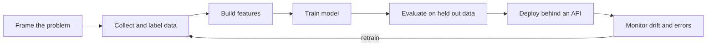

# Machine Learning for Backend Engineers

!!! note "In simple words"
    A backend engineer does not need to invent new models. The job is to serve a trained model behind an API, feed it the same kind of inputs it learned from, measure how it behaves in production, and have a plan for when it is wrong or slow.

Backend engineers are often asked to serve a model, keep its inputs consistent, measure its behaviour in production, and explain its limits to the rest of the team. This page covers the vocabulary and lifecycle you need, and the Java and JavaScript options for running models.

## Why it matters

Most ML projects that fail in production do not fail because the model was weak in the lab. They fail because the features at serving time differ from the features used in training, because the test data was reused until it stopped being honest, or because nobody recorded which model version made each decision. Backend work is where those problems are caught, so understanding the lifecycle helps you ask the right questions early.

## How it works

### The ML lifecycle

1. **Frame the problem.** Decide what is predicted, for whom, and which decision the prediction drives.
2. **Collect and label data.** Gather examples of inputs and the correct outputs.
3. **Build features.** Turn raw data into numeric inputs the model can use.
4. **Train.** Fit the model's parameters to the training data.
5. **Evaluate.** Measure performance on data the model did not see during training.
6. **Deploy and monitor.** Serve predictions and watch for drift and errors.

Backend engineers mostly work on feature definitions that exist at serving time, on measurement and monitoring, and on the serving layer itself.



### Training, validation, and test sets

Split labelled data into three parts. The **training** set is what the model learns from. The **validation** set is used to tune settings, such as the depth of a tree or the learning rate. The **test** set is used once, at the end, for an honest final measurement. Reusing the test set to make choices inflates the results, because the choices quietly fit it.

**Overfitting** means the model memorises the training data and does worse on new data. **Underfitting** means it has not learned the pattern at all. Comparing training and validation results is the basic check for both.

### Features and training-serving skew

A **feature** is an input variable, such as the number of orders in the last 30 days, or the age of an account in days. The most common production bug in ML systems is **training-serving skew**. A feature is computed one way in the training pipeline and another way in the online service. The model then receives values it was never trained on, and its quality drops without any error message.

Mitigations:

- Share feature definitions in code, so the training and serving paths call the same function.
- Use a feature store where the team has one.
- Log the feature values used at serving time, so they can be compared with the training data later.

Also watch for **data leakage**. This happens when a feature contains information that would not be available at prediction time, such as a field that is set only after the outcome. Leakage makes offline metrics look excellent and production results poor.

### Evaluation metrics

Choose metrics that match the decision the model supports:

- **Accuracy** is the share of correct predictions. It misleads when one class is rare, because a model that always says "not fraud" can look accurate.
- **Precision** is, of the cases flagged positive, how many really were positive.
- **Recall** is, of the cases that really were positive, how many were flagged.
- **Calibration** asks whether a predicted probability of 0.7 comes true about 70 percent of the time.
- **Business metrics** measure the outcome you care about, ideally in a controlled experiment.

Precision and recall pull against each other through the decision threshold. The right balance depends on the cost of each kind of mistake. A missed fraud case and a wrongly blocked payment have very different costs.

### Serving models behind REST or gRPC

A model is usually served as a small service with a prediction endpoint. Backend concerns include:

- **Latency budget.** Agree on the maximum time a prediction may take, and measure it at p95 and p99.
- **Batching.** Group requests when throughput matters more than the time of each one.
- **Versioning.** Version models the way you version APIs, and record which version answered each request.
- **Fallbacks.** If the model is unavailable or too slow, return a rule-based default.
- **Input validation.** Reject malformed or out-of-range features before inference runs.
- **Rollout.** Use shadow traffic, canary releases, and A/B tests before a full switch.

A prediction response should include the model version, so that later outcomes can be joined with the exact model that produced each prediction.

### Prediction API contract

A typical contract includes the model name and version, the features or a reference to them, the prediction, and a score or confidence. Keep the contract stable when the model changes, so callers do not need to change with it. The same discipline used for any public HTTP API applies here: stable names, clear error responses, and documented fields.

### Running models in Java

Java applications can run a model inside the process instead of calling a separate service:

- **Deep Java Library (DJL)** is a Java deep-learning library with an engine-independent API. It loads models from several frameworks through pluggable engines, and suits teams that want to stay on the JVM.
- **ONNX Runtime** is an inference engine for models in the ONNX format, which many training frameworks can export to. It has a Java API and is a common choice for production inference.

The scorer below is a small, hand-written logistic model. It is not a real model library, but it shows what serving code does: check the input shape, compute a weighted sum, and map it to a probability. It compiles on Java 21:

```java
public final class LinearScorer {

    private final double[] weights;
    private final double bias;

    public LinearScorer(double[] weights, double bias) {
        this.weights = weights.clone();          // copy, so callers cannot change the model
        this.bias = bias;
    }

    public double score(double[] features) {
        if (features.length != weights.length) {
            throw new IllegalArgumentException("feature count mismatch");
        }
        double sum = bias;
        for (int i = 0; i < weights.length; i++) {
            sum += weights[i] * features[i];
        }
        return 1.0 / (1.0 + Math.exp(-sum));    // logistic function: maps any sum into 0 to 1
    }

    public static void main(String[] args) {
        LinearScorer scorer = new LinearScorer(new double[] {0.8, -0.5}, -0.1);
        System.out.printf("%.3f%n", scorer.score(new double[] {1.0, 2.0}));   // sum is -0.3, so about 0.426
    }
}
```

The feature-count check and the separation of model parameters from the service code are the same concerns that apply when you load a real model with DJL or ONNX Runtime.

### TensorFlow.js

**TensorFlow.js** runs models in JavaScript, either in the browser or in Node.js. It helps when inference should happen on the client, for privacy, latency, or offline use, or when a JavaScript service needs a model. It is not a Java library, so it fits best in a front-end or Node component. Model size and the device's capability limit what runs in a browser. The [TensorFlow.js site](https://www.tensorflow.org/js) has guides and model examples.

## Where it is used

- Fraud or risk scores that run inside a payment API, with a fallback rule.
- Recommendation scores served to a product page with a strict latency budget.
- Forecasting jobs that run in batch and write results to a table.
- Image or document models embedded in a service through ONNX Runtime or DJL.
- Client-side classifiers in a web app, using TensorFlow.js.

## Benefits

- A served model can be replaced without changing the callers, if the contract is stable.
- Monitoring the inputs and outputs catches drift early, before users notice.
- In-process inference removes a network hop, which lowers latency.
- A fallback keeps the feature working when the model is unavailable.

## Cons and limits

- Models change behaviour when the data changes, and they need monitoring and retraining.
- Training-serving skew is hard to notice, because nothing raises an error.
- Offline metrics can flatter a model that will do poorly in production.
- Models are harder to explain and debug than ordinary code.
- Running large models in-process uses a lot of memory, and that affects the whole service.

## Best practices

- Share feature code between training and serving, and log the features used at serving time.
- Keep the test set untouched until the final evaluation.
- Pick metrics that match the decision, and check calibration when probabilities drive actions.
- Version every model, and record the version with each prediction.
- Set a latency budget, and provide a fallback for timeouts and errors.
- Roll out new models with shadow traffic or a canary before a full switch.
- Monitor input distributions, outcomes, and the rate of fallbacks.

## Common pitfalls

- Training-serving skew, caused by computing features differently online and offline.
- Data leakage, which inflates offline results.
- Reusing the test set for tuning, so it is no longer an honest measure.
- Using accuracy on a heavily imbalanced problem.
- No fallback when the model is slow or unavailable.
- Serving predictions without recording the model version.
- Deploying a new model with no shadow or canary period.

!!! tip "Interview tip"
    **Q: A model did well in testing but poorly in production. What do you check?**
    First look for training-serving skew. Compare the feature values seen at serving time with the training data. Then check for data leakage in the training features, for drift in the input distribution, and for a different definition of the outcome label in production. Confirm which model version is actually serving, and compare it with the version that was evaluated.

## Quick recap

- Know the lifecycle: frame, collect, build features, train, evaluate, deploy, monitor.
- Keep test data untouched, and choose metrics that match the decision.
- Training-serving skew and data leakage cause most production surprises.
- Serve models with latency budgets, versioning, fallbacks, and staged rollouts.
- Java can run models in-process with DJL or ONNX Runtime. TensorFlow.js runs in JavaScript.

## Official documentation

- [ONNX Runtime documentation](https://onnxruntime.ai/docs/)
- [Deep Java Library (DJL)](https://djl.ai/)
- [TensorFlow.js](https://www.tensorflow.org/js)

**See also:** [Search and Analytics](search-analytics.md) | [Advanced Patterns](advanced-patterns.md) | [LLM Integration](../22-ai-integration/llm-integration.md) | [AI and Machine Learning Fundamentals](../ai-machine-learning/ml-fundamentals.md)
