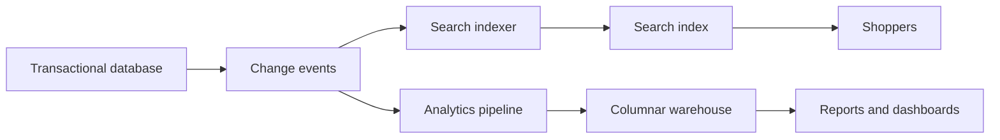

# Search and Analytics

!!! note "In simple words"
    Search answers "which documents contain these words, and which match best?". Analytics answers "what are the totals and trends across a large amount of data?". Both are slow or awkward on the database that handles everyday transactions, so they get their own stores.

Interviewers ask about search and analytics when a system must answer queries that a transactional database serves poorly. This page covers the inverted index behind search engines, Elasticsearch and Apache Solr as search platforms, and the basics of analytical storage.

## Why it matters

A product page that filters thousands of items by keyword, price, and stock cannot run that as a plain `WHERE` clause at scale without slow scans and poor ranking. A dashboard that sums sales over three years cannot run on the checkout database without slowing checkout. Good search and analytics designs move these workloads to structures built for them, and they keep the source of truth in the transactional store.

## How it works

### Why a `LIKE` query is not enough

A query such as `LIKE '%term%'` cannot use a normal B-tree index, because the leading wildcard forces a scan of every row. It also ignores relevance. It does not handle stemming, where "running" should match "run", or synonyms, typos, or ranking by how well a document matches. A search engine builds structures designed for those needs.

### The inverted index

The core structure is the **inverted index**. For each term, it keeps a sorted list of the documents that contain the term, which is called a posting list. It also records positions and frequencies. A query looks up each query term, combines the lists, and scores the matching documents. The index is built at write time, so queries stay fast.

The toy index below shows the idea in plain Java. It lowercases the text, splits it into terms, and answers an "all terms" query by intersecting posting lists. It compiles on Java 21:

```java
import java.util.Arrays;
import java.util.HashMap;
import java.util.List;
import java.util.Locale;
import java.util.Map;
import java.util.Set;
import java.util.TreeSet;

public class InvertedIndexDemo {

    private final Map<String, Set<Integer>> postings = new HashMap<>();

    public void add(int docId, String text) {
        for (String term : analyse(text)) {
            postings.computeIfAbsent(term, t -> new TreeSet<>()).add(docId);
        }
    }

    public Set<Integer> searchAll(String query) {
        Set<Integer> result = null;
        for (String term : analyse(query)) {
            Set<Integer> docs = postings.getOrDefault(term, Set.of());
            if (result == null) {
                result = new TreeSet<>(docs);
            } else {
                result.retainAll(docs);       // keep only documents that contain every term so far
            }
        }
        return result == null ? Set.of() : result;
    }

    // A tiny analyser: lowercase, then split on anything that is not a letter or digit
    static List<String> analyse(String text) {
        return Arrays.stream(text.toLowerCase(Locale.ROOT).split("[^a-z0-9]+"))
                .filter(term -> !term.isEmpty())
                .toList();
    }

    public static void main(String[] args) {
        InvertedIndexDemo index = new InvertedIndexDemo();
        index.add(1, "Wireless headphones with noise cancelling");
        index.add(2, "Wired headphones, budget model");
        index.add(3, "Wireless speaker");
        System.out.println(index.searchAll("wireless headphones"));   // [1]
    }
}
```

Text passes through an **analyser** before it is indexed. A tokeniser splits it into terms, and filters lowercase them, remove stop words, and stem them. The same analyser must run on the query. If the two differ, matches fail in confusing ways.

### Elasticsearch

**Elasticsearch** is a distributed search and analytics engine built on Lucene. It stores JSON documents in **indices**. Each index has **mappings** that set field types and analysers. The main concepts are:

- **Mapping.** Decide whether a field is `text`, which is analysed for full-text search, or `keyword`, which is exact and used for filters and aggregations. Changing a field's type usually means reindexing, so mapping mistakes are costly.
- **Shards and replicas.** An index is split into shards that spread across nodes. Replicas add redundancy and read capacity.
- **Queries.** The query DSL combines full-text clauses such as `match`, exact clauses such as `term` and `range`, and boolean logic.
- **Aggregations.** These group and summarise results, such as counting orders by status or averaging price by category.

The request below searches product names and filters by price and stock. It also counts results by brand:

```json
{
  "query": {
    "bool": {
      "must": [
        { "match": { "name": "wireless headphones" } }
      ],
      "filter": [
        { "range": { "price": { "lte": 150 } } },
        { "term": { "inStock": true } }
      ]
    }
  },
  "aggs": {
    "by_brand": { "terms": { "field": "brand.keyword" } }
  }
}
```

Clauses under `filter` do not affect the score and can be cached. Clauses under `must` contribute to the score. That distinction is worth remembering, because it decides both ranking and performance.

### Relevance tuning

Elasticsearch scores matches with **BM25** by default. BM25 gives more weight to terms that are rare across the collection, and it adjusts for document length. You tune relevance by:

- Boosting important fields, so a match in the title counts more than a match in the description.
- Adding business signals, such as popularity or recency, with `function_score` or a similar mechanism.
- Adding synonyms for domain terms.
- Choosing analysers that suit the language and the data.
- Testing against a labelled set of queries with judged results, rather than trusting intuition.

### Java access

Use the official Java client for Elasticsearch in application code. Spring Data Elasticsearch offers repository-style access on top of it. Whichever you choose, keep the index mappings under version control, and create indices through a deployment step rather than by hand in production.

The [Elasticsearch reference](https://www.elastic.co/guide/en/elasticsearch/reference/current/index.html) describes the query DSL, mappings, and client libraries in detail.

### Apache Solr

**Apache Solr** is another search platform built on Lucene. It offers similar core features: inverted indices, faceting, and relevance scoring. Its configuration model uses schema files and its own query syntax. Teams often choose it for an existing investment, a specific feature, or operational familiarity. The concepts carry over. Analysers, fields, faceting, and relevance tuning work the same way in principle.

### Analytics and data warehousing

Transactional databases, known as OLTP systems, serve many small reads and writes. Analytical systems, known as OLAP, scan large amounts of data to compute totals. Heavy reports on the production transactional database slow the business down, so analytics usually runs on a separate store.

Key ideas:

- **Columnar storage** keeps each column together, so a query over three columns reads only those three. Analytical engines use it widely.
- **Star schema** places a central fact table, such as sales or events, next to dimension tables for customers, products, and dates.
- **Data warehouse** is a curated store for analysis, fed by ETL or ELT pipelines from operational systems.
- **Data lake** keeps raw files in object storage, often with a table format on top.
- **Real-time analytics** engines ingest streams and answer queries within seconds. They trade some consistency for freshness.

Elasticsearch aggregations cover some analytical needs over search data. For large reports across years of history, a columnar analytical engine is the better tool.



## Where it is used

- Product search on an online shop, with filters, facets, and ranking.
- Log and event search for operations teams.
- Search over documents, tickets, or knowledge base articles.
- Sales and usage dashboards built on a warehouse fed from transactions.

## Benefits

- Inverted indices answer full-text queries quickly, even over large collections.
- Analysers handle stemming, synonyms, and case, which users expect.
- Aggregations give faceted navigation and summaries in one request.
- A separate analytical store keeps reports from slowing the transactional system.

## Cons and limits

- Search indices are derived data. They can lag behind the source and must be rebuilt when mappings change.
- Mapping changes usually need a full reindex.
- Relevance tuning takes time and needs judged examples to do well.
- Analytical pipelines add cost, latency, and another system to monitor.
- Elasticsearch and Solr need careful capacity planning, because memory and shard count affect speed.

## Best practices

- Treat the search index as a derived view, and keep the ability to rebuild it from the source.
- Set mappings deliberately: `text` for full-text fields, `keyword` for exact filters and aggregations.
- Use the same analyser for indexing and querying.
- Put exact conditions in `filter`, so they do not affect scores and can be cached.
- Keep index mappings and creation scripts under version control.
- Build a labelled set of queries, and measure relevance changes against it.
- Keep heavy analytics off the production transactional database.

## Common pitfalls

- Using `text` fields for exact filters, or `keyword` fields for full-text search.
- Changing a mapping in place and expecting old documents to change with it.
- Analysers that differ between indexing and querying.
- Putting business conditions in `must` instead of `filter`, which affects scoring and caching.
- Running heavy reports on the production database.
- Treating the search index as the source of truth.
- Tuning relevance by feel, with no labelled evaluation set.

!!! tip "Interview tip"
    **Q: How do you keep a search index in sync with the database?**
    Treat the index as a derived view. Publish change events from the database, using the outbox pattern or change data capture. An indexer consumes the events and updates the documents. Make the indexer idempotent, so replays are harmless. Keep the ability to rebuild the whole index from source data, and watch the lag between the database and the index.

## Quick recap

- The inverted index maps terms to documents. Analysers must match at indexing and query time.
- Elasticsearch uses mappings, shards, and the query DSL. Keep exact filters in `filter`.
- BM25 is the default score. Tune relevance with boosts, synonyms, and a labelled set.
- Solr offers similar core features with a different configuration model.
- Analytics belongs on a separate columnar store, fed from operational systems.

## Official documentation

- [Elasticsearch reference documentation](https://www.elastic.co/guide/en/elasticsearch/reference/current/index.html)
- [Apache Kafka documentation](https://kafka.apache.org/documentation/)
- [Java 21 java.util.stream package](https://docs.oracle.com/en/java/javase/21/docs/api/java.base/java/util/stream/package-summary.html)

**See also:** [Advanced Patterns](advanced-patterns.md) | [Machine Learning for Backend Engineers](ml-for-backend-engineers.md) | [RAG and Vector Databases](../22-ai-integration/rag-and-vector-databases.md) | [Replication, Sharding, and NoSQL](../19-system-design-fundamentals/replication-sharding-nosql.md)
