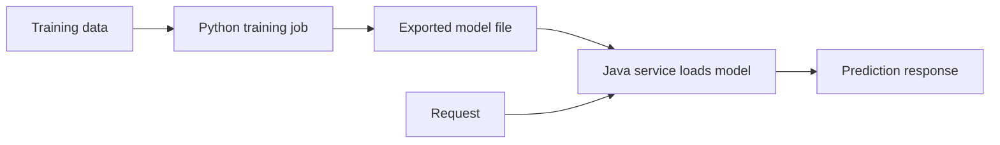
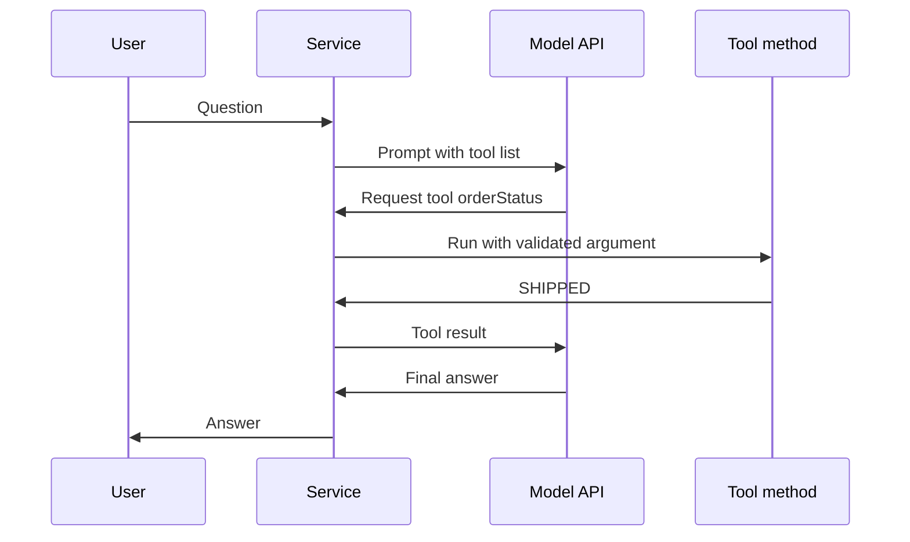
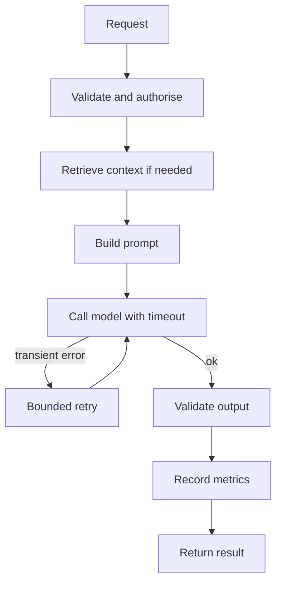

# AI in Java

Most Java teams do not train models. They load a trained model for inference, call a hosted LLM over HTTP, or use a model server, and they wrap that call in ordinary service code. Interviewers ask where the boundary lies, which libraries fit, and how you make an AI call reliable, observable, and secure in production.

!!! note "In simple words"
    Training a model is the expensive study session, and inference is answering a question with the finished model. Java services usually do the answering: they send input to a model, get a result back, and handle timeouts and errors like any other call.

## Why it matters

An AI feature is a remote dependency with unusual failure modes. Calls can take seconds, return malformed output, hit rate limits, or cost real money per request. A Java service that treats a model call like a normal database call will time out badly, retry dangerously, and leak data into logs. Knowing the boundary between training and inference, and the patterns for calling models safely, is what makes an AI feature production ready.

## How it works

### Training versus inference

- **Training** fits model weights to data. It is compute-heavy and iterative, and the Python ecosystem, with PyTorch, TensorFlow, and scikit-learn, dominates it.
- **Inference** runs a trained model on new inputs. It is latency-sensitive, and it is what a Java service usually does.

A common split is this: data scientists train in Python, export the model in a portable format, and a Java service loads it and exposes predictions through an API. Java can also train with DeepLearning4J, but that is less common outside JVM-only shops.



### Options for Java

| Option | What it does | Fits when |
|--------|--------------|-----------|
| ONNX Runtime (Java API) | Runs ONNX models exported from many frameworks | You want framework-neutral inference |
| TensorFlow Java | Loads TensorFlow SavedModels for inference | The model already ships as a SavedModel |
| DeepLearning4J | Builds and trains networks on the JVM | Pure-Java training and inference |
| Hosted LLM APIs over HTTP | Calls a provider's model | You need a general language model |
| Spring AI | Spring abstractions over chat, embeddings, tools, and vector stores | Spring Boot services that call LLMs or build RAG |
| Model server (TensorFlow Serving, Triton, TorchServe) | Serves models as separate services | Several models, batching, GPUs, independent scaling |

Check the current versions and artefact coordinates in each project's documentation before you add a dependency. Library APIs change between major releases.

### TensorFlow Java

TensorFlow's Java binding loads a SavedModel and runs its serving signature. The model holds native resources, so close it when you finish, using try-with-resources. This code is not compiled here. It needs the TensorFlow Java dependency and a real model directory:

```java
import org.tensorflow.SavedModelBundle;
import org.tensorflow.Session;

public final class ModelLoader {
    public static void main(String[] args) {
        try (SavedModelBundle model = SavedModelBundle.load("models/churn/1", "serve")) {
            Session session = model.session();
            // Build input tensors, then call session.runner().feed(...).fetch(...).run()
            System.out.println("Model loaded, session open: " + (session != null));
        }
    }
}
```

Tensor creation and closing need care, because native memory sits outside the garbage collector. Inference runs on the CPU unless you add a GPU build of the native library. Training is mostly done elsewhere.

### DeepLearning4J

DL4J builds networks with a configuration builder, trains them on `DataSetIterator` inputs, and runs `output()` to get predictions. Its ND4J backend supports CPU and CUDA GPUs. Pick it when the whole pipeline should stay on the JVM. Its ecosystem of pretrained models is smaller than the Python one.

### Calling a hosted LLM over HTTP

The JDK's built-in `java.net.http` client is enough for a plain call. The request body is JSON with a model identifier, a token limit, and the messages. The API key comes from the environment or a secret store, never from source code.

The example below compiles with Java 21 using only the JDK. It shows one provider's HTTP shape. Other providers differ in their paths and headers, so check the current API reference for the provider you use:

```java
import java.net.URI;
import java.net.http.HttpClient;
import java.net.http.HttpRequest;
import java.net.http.HttpResponse;
import java.time.Duration;

public class HostedModelCall {
    public static void main(String[] args) throws Exception {
        String apiKey = System.getenv("ANTHROPIC_API_KEY");
        String model = System.getenv().getOrDefault("LLM_MODEL", "set-a-model-id");

        String body = """
                {
                  "model": "%s",
                  "max_tokens": 256,
                  "messages": [
                    {"role": "user", "content": "Explain dependency injection in two sentences."}
                  ]
                }
                """.formatted(model);

        HttpRequest request = HttpRequest.newBuilder(URI.create("https://api.anthropic.com/v1/messages"))
                .header("x-api-key", apiKey)
                .header("anthropic-version", "2023-06-01")
                .header("content-type", "application/json")
                .timeout(Duration.ofSeconds(30))
                .POST(HttpRequest.BodyPublishers.ofString(body))
                .build();

        HttpResponse<String> response = HttpClient.newHttpClient()
                .send(request, HttpResponse.BodyHandlers.ofString());

        System.out.println("Status: " + response.statusCode());
        System.out.println(response.body()); // parse the JSON with Jackson or a similar library
    }
}
```

Use a real JSON library to build and read payloads. String templates are fine for a demo, but escaping user input by hand is error-prone. Set a timeout on every outbound call, because a slow model call can otherwise hold a request thread indefinitely.

### Spring AI

Spring AI gives a portable API over chat models, embedding models, tool calling, and vector stores. Spring Boot auto-configures a `ChatClient.Builder` when a provider starter is on the classpath. The fluent API keeps the prompt, the user message, and the call in one chain.

The Spring code below is not compiled here. It needs Spring Boot and a Spring AI provider starter on the classpath:

```java
import org.springframework.ai.chat.client.ChatClient;
import org.springframework.stereotype.Service;

@Service
public class SupportAnswerService {

    private final ChatClient chatClient;

    public SupportAnswerService(ChatClient.Builder builder) {
        this.chatClient = builder.build();
    }

    public String answer(String question) {
        return chatClient.prompt()
                .system("You are a concise support assistant.")
                .user(question)
                .call()
                .content();
    }
}
```

Embeddings use the same pattern through an `EmbeddingModel`, and a `VectorStore` implementation handles storage and similarity search. Spring AI's API has changed across 0.x and 1.x releases, so match the documentation to your version.

### Tool calling

Tool calling lets the model request a Java method. Your code runs that method, and the result goes back to the model. Annotate a method with a clear description and keep its inputs narrow. This Spring example is not compiled here:

```java
import org.springframework.ai.tool.annotation.Tool;
import org.springframework.stereotype.Component;

@Component
public class OrderTools {

    @Tool(description = "Returns the status of an order by its order ID")
    public String orderStatus(String orderId) {
        // Look up the order through the existing service layer, not raw SQL
        return "SHIPPED";
    }
}
```

Validate every argument the model supplies, and check authorisation inside the method. The model can request any tool you expose, so treat its arguments as untrusted input.



### Retries and failures

Provider calls fail with rate limits, timeouts, and transient server errors. Retry only the errors that are safe to retry, using exponential backoff and a maximum number of attempts. The Spring Retry example below is not compiled here. It needs Spring Retry on the classpath and `@EnableRetry` on a configuration class:

```java
import java.io.IOException;
import org.springframework.retry.annotation.Backoff;
import org.springframework.retry.annotation.Retryable;
import org.springframework.stereotype.Service;

@Service
public class RetryingAnswerService {

    @Retryable(retryFor = IOException.class, maxAttempts = 3,
            backoff = @Backoff(delay = 1000, multiplier = 2))
    public String ask(String prompt) throws IOException {
        // Call the model client here. Throw IOException for transient network failures.
        return "stub answer for: " + prompt;
    }
}
```

Replace `IOException` with the transient exception type your client throws. Do not retry a non-idempotent action, such as a tool call that charges a card, without a safeguard. For protection against cascading failures, wrap the call in a circuit breaker such as Resilience4j, so repeated provider failures fail fast instead of piling up requests.

### Observability

Track the operations that matter for AI calls: latency per model and operation, error rates by type, retries, and token usage. Micrometer records these with the same tooling as other Spring metrics. This Spring example is not compiled here:

```java
import io.micrometer.core.instrument.MeterRegistry;
import io.micrometer.core.instrument.Timer;
import org.springframework.ai.chat.client.ChatClient;
import org.springframework.stereotype.Service;

@Service
public class TimedAnswerService {

    private final ChatClient chatClient;
    private final MeterRegistry registry;

    public TimedAnswerService(ChatClient.Builder builder, MeterRegistry registry) {
        this.chatClient = builder.build();
        this.registry = registry;
    }

    public String answer(String question) {
        Timer.Sample sample = Timer.start(registry);
        try {
            return chatClient.prompt().user(question).call().content();
        } finally {
            sample.stop(registry.timer("llm.request.duration", "operation", "answer"));
        }
    }
}
```

Log prompts and responses with care. They can contain personal data, so redact or sample them, and check your data-handling policy first.

### Step by step

A typical AI-backed endpoint:

1. Validate and authorise the request before any model call.
2. Retrieve context if the feature uses RAG, filtered by the user's permissions.
3. Build the prompt from fixed instructions, retrieved passages, and the user's question.
4. Call the model with a timeout, a token limit, and a retry policy.
5. Validate the output: parse structured responses, check citations, and apply business rules.
6. Record metrics, then return the result.



## Where it is used

- Chat and support assistants embedded in existing Spring Boot services.
- Fraud and risk scoring through an ONNX model loaded at service start-up.
- Document question answering with retrieval in front of a hosted model.
- Batch scoring jobs that run an exported model over a table of records.
- Model servers that expose several models to many services behind one API.

## Benefits

- Java teams keep the same deployment, monitoring, and security tooling they already use.
- Exported models such as ONNX run in-process with low latency.
- Spring AI gives a provider-neutral interface, which eases switching models.
- Hosted models need no GPU infrastructure on the team's side.

## Cons and limits

- Native libraries such as TensorFlow bring memory and packaging complications.
- Hosted model calls add latency, cost per request, and an external dependency.
- Spring AI and other libraries change between releases, so examples date quickly.
- Model output is probabilistic, so the service must validate it before acting.
- Keeping models and prompts in step with a service release is extra work.

## Best practices

- Put the model behind a service class, not in the controller.
- Set a timeout on every model call, and a token limit on every LLM request.
- Retry only transient, safe-to-repeat errors, with backoff and a maximum number of attempts.
- Keep API keys in a secret manager or environment configuration, never in source code.
- Protect against prompt injection, and never give the model a tool that acts beyond the user's rights.
- Treat model output as untrusted. Parse it, validate it, and apply business rules before acting on it.
- Record which model version produced which output, and keep a rollback path.
- Package the service on a current long-term-support Java runtime. Keep large model files in a volume or object store rather than the image, unless the image size is acceptable.
- Scale stateless API instances horizontally. Scale GPU-backed inference separately, and batch requests when throughput matters more than per-request latency.
- Stream responses when the interface can show partial text, and cache repeated answers only where that is safe.

!!! tip "Interview tip"
    **Q: How would you integrate an LLM into an existing Spring Boot service?**
    Put the model behind a service class, not in the controller. Set timeouts and bounded retries, keep keys in configuration, and validate both input and output. Add metrics and a fallback, such as a cached answer or a plain error message, so the rest of the service keeps working when the provider is slow or unavailable.

## Quick recap

- Java usually handles inference and integration, while training is mostly done in Python.
- Choose a runtime by fit: ONNX Runtime or TensorFlow for exported models, DL4J for JVM-only pipelines, and HTTP or Spring AI for hosted LLMs.
- Wrap model calls with timeouts, bounded retries, and circuit breakers.
- Validate arguments for tool calls, and treat model output as untrusted.
- Measure latency, errors, and token use from the start.

## Official documentation

- [Spring AI reference documentation](https://docs.spring.io/spring-ai/reference/index.html)
- [ONNX Runtime documentation](https://onnxruntime.ai/docs/)
- [Spring Framework reference documentation](https://docs.spring.io/spring-framework/reference/)
- [Anthropic API documentation](https://docs.anthropic.com/)

**See also:** [LLMs and Transformers](llms-and-transformers.md), [RAG and Generative AI](rag-and-generative-ai.md), [AI integration section](../22-ai-integration/index.md), [ML Fundamentals](ml-fundamentals.md)
