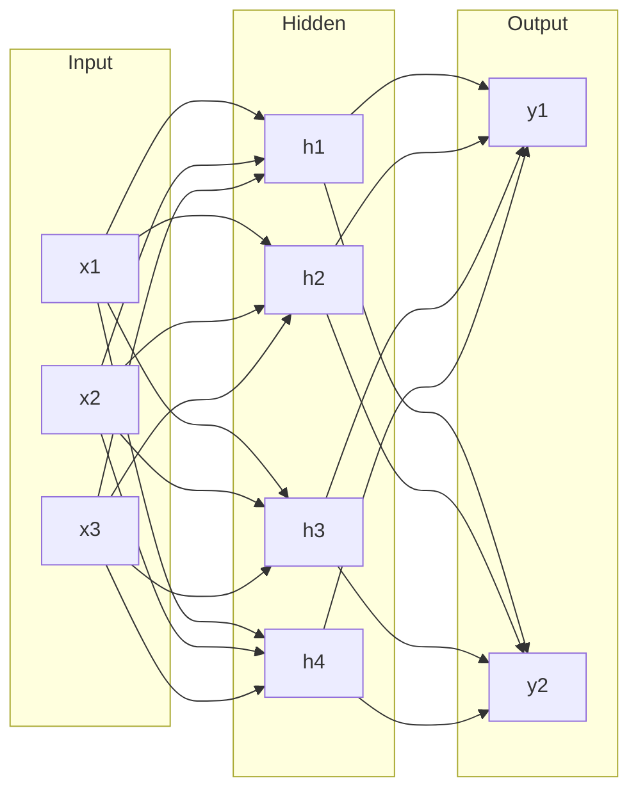
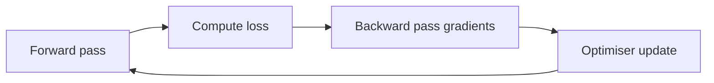
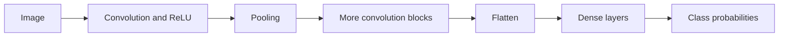

# Deep Learning

Deep learning stacks many layers of learned transformations, so the model builds its own features from raw inputs such as pixels, audio, and text. Interviewers expect you to explain how a network learns through backpropagation, why architectures differ (CNNs, RNNs, attention), and how to keep training from overfitting.

!!! note "In simple words"
    A neural network is many simple math units arranged in layers. It makes a guess, measures how wrong the guess was, and nudges its weights a little to be less wrong next time. Repeat that millions of times and it learns.

## Why it matters

Classical models need features designed by hand. Deep networks learn useful features directly from raw data, which is why they lead in vision, speech, and language. The cost is data, compute, and a training process that is easy to get wrong. Knowing how the pieces fit lets you debug a network that does not learn and choose an architecture that matches the shape of your data.

## How it works

### Neurons and activation functions

A neuron computes a weighted sum of its inputs plus a bias, then applies an activation function:

```
output = activation(w1 x1 + w2 x2 + ... + b)
```

Without a non-linear activation, any stack of linear layers collapses into one linear map, so depth adds nothing. The common choices are:

- **ReLU**, `max(0, z)`, is the default for hidden layers. It is cheap and reduces vanishing gradients compared with sigmoid.
- **Sigmoid**, `1 / (1 + e^-z)`, squashes values to (0, 1). It suits a binary output probability.
- **Tanh** squashes values to (-1, 1). It is zero-centred and appears in older recurrent models.
- **Softmax** turns a vector of scores into probabilities that sum to 1. It suits multi-class outputs.

### A small network as a diagram

The diagram shows a network with three inputs, one hidden layer of four neurons, and two outputs. Every neuron in one layer connects to every neuron in the next, which is why the layer is called fully connected or dense.



### Multi-layer perceptrons

A multi-layer perceptron (MLP) is a stack of fully connected layers: an input layer, one or more hidden layers, and an output layer. Depth is the number of layers, and width is the number of neurons in a layer. MLPs suit tabular data and act as a baseline for other architectures.

### Backpropagation

Training repeats four steps on each mini-batch:

1. **Forward pass**: compute predictions from the inputs.
2. **Loss**: measure the error with a loss function. Cross-entropy suits classification, and mean squared error suits regression.
3. **Backward pass**: apply the chain rule from the loss back through each layer. This gives the gradient of the loss with respect to every weight. Intermediate gradients are reused, so the cost is close to one extra forward pass.
4. **Update**: move each weight against its gradient using an optimiser.



Frameworks such as PyTorch build the computation graph automatically. The example below is Python with PyTorch. It is not compiled here, and it needs PyTorch installed:

```python
import torch
from torch import nn

model = nn.Sequential(
    nn.Linear(784, 256),
    nn.ReLU(),
    nn.Dropout(p=0.2),
    nn.Linear(256, 10),  # raw logits; CrossEntropyLoss applies softmax
)
loss_fn = nn.CrossEntropyLoss()
optimizer = torch.optim.Adam(model.parameters(), lr=1e-3)

def train_step(x: torch.Tensor, y: torch.Tensor) -> float:
    model.train()
    optimizer.zero_grad()          # clear gradients from the last step
    loss = loss_fn(model(x), y)    # forward pass and loss
    loss.backward()                # backpropagation
    optimizer.step()               # weight update
    return loss.item()
```

### Optimisers

| Optimiser | Idea | Trade-off |
|-----------|------|-----------|
| SGD | Step against the gradient | Simple and well understood; needs careful learning-rate tuning |
| Momentum | Keep a running velocity of past gradients | Smooths noisy steps; one more parameter |
| RMSprop | Scale each step by a running average of squared gradients | Adapts per parameter |
| Adam | Momentum plus RMSprop-style scaling | Robust default; can generalise slightly worse on some tasks |

### Regularisation

- **L2 weight decay** adds a penalty on squared weights, which shrinks them toward zero.
- **Dropout** randomly zeroes activations during training. Most frameworks use *inverted dropout*: surviving activations are scaled by 1/(1-p) during training, so nothing changes at inference.
- **Early stopping** halts training when validation loss stops improving.
- **Batch normalisation** normalises each layer's inputs over the batch. It stabilises training, allows larger learning rates, and has a mild regularising effect.
- **Data augmentation** creates new training examples by transforming existing ones, such as flips or crops for images.

### Convolutional neural networks

A convolutional neural network (CNN) slides small learned filters across an image. The weights are shared across positions, so the same edge detector works anywhere in the image.



- **Convolution** computes a dot product between a filter and each local patch. Early filters learn edges and textures. Deeper filters combine them into parts and objects.
- **Pooling**, often max pooling, downsamples the feature maps and gives small shifts a similar response.
- **Padding and stride** control the output size. Stride is the step the filter takes.

Pooling gives approximate invariance to small shifts. Convolution itself is *equivariant* to translation: shifting the input shifts the feature map by the same amount.

Landmark architectures:

- **AlexNet (2012)** was a deep CNN trained on GPUs. It won the ImageNet challenge by a wide margin and started the modern deep learning era.
- **VGG (2014)** stacked small 3x3 convolutions.
- **Inception (2014)** ran filters of several sizes in parallel within one block.
- **ResNet (2015)** added skip connections, so each block learns a residual. That made very deep networks trainable.
- **MobileNet** used depthwise-separable convolutions for phones and edge devices.

### Recurrent neural networks

Recurrent networks process a sequence one step at a time and carry a hidden state forward:

```
h_t = tanh(W_h h_(t-1) + W_x x_t + b)
```

Plain RNNs struggle with long dependencies. Gradients shrink (vanishing) or grow (exploding) as they pass back through many time steps. Gradient clipping handles explosions. Gated units handle vanishing gradients.

- **LSTM** adds a cell state and three gates: forget, input, and output. The forget gate decides what to erase, the input gate decides what to write, and the output gate decides what to expose. The cell state can carry information across many steps with little decay.
- **GRU** merges the gates into two, update and reset, with fewer parameters. It often performs about as well.

Recurrent models are sequential, so their steps cannot be parallelised across time during training. This is a main reason transformers replaced them for language.

### Attention

Attention lets a model weight each input by its relevance to a query. Given queries Q, keys K, and values V:

```
Attention(Q, K, V) = softmax(Q K^T / sqrt(d_k)) V
```

Each output is a weighted average of the values, where the weights come from query-key similarity. Attention was first added to recurrent encoder-decoder models for translation. Transformers later made it the only mechanism, covered in [LLMs and Transformers](llms-and-transformers.md).

### Architecture summary

| Architecture | Typical task | Key idea | Good for |
|--------------|--------------|----------|----------|
| MLP | Tabular, both | Fully connected layers | Baselines, structured data |
| CNN | Vision | Shared local filters | Images, detection |
| ResNet | Vision | Skip connections | Very deep image models |
| RNN, LSTM, GRU | Sequences | Hidden state and gates | Time series, older NLP |
| Transformer | Language, multimodal | Self-attention, parallel | Modern NLP and LLMs |
| U-Net | Segmentation | Encoder-decoder with skip connections | Medical and pixel-level tasks |

### Step by step

1. Choose an architecture that matches the structure of the data: a grid for images, a sequence for text or audio, or a table.
2. Normalise the inputs and split the data as for any other model.
3. Start with a small model that can overfit a tiny batch. If it cannot, the pipeline has a bug.
4. Train with an optimiser such as Adam, and watch the training and validation loss together.
5. Add regularisation or capacity only when the curves show a problem.
6. Use early stopping, and keep the best checkpoint.

## Where it is used

- Image classification, object detection, and medical imaging with CNNs and U-Net variants.
- Speech recognition and time series forecasting with recurrent or convolutional models.
- Recommendation systems with embedding layers and MLP heads.
- Language and multimodal models built on transformers.
- Mobile vision on phones through compact networks such as MobileNet.

## Benefits

- Learned features remove much of the manual feature engineering.
- Deep models reach top accuracy on images, audio, and language.
- Transfer learning lets a pretrained model be adapted with a small labelled set.
- Architectures such as CNNs and transformers match the structure of the data.

## Cons and limits

- Training needs large labelled datasets and substantial compute.
- Networks are hard to inspect, and their decisions are hard to explain.
- Small datasets overfit quickly unless augmentation or transfer learning is used.
- Training is sensitive to learning rate, initialisation, and normalisation choices.
- Recurrent models are slow to train on long sequences because they cannot run steps in parallel.

## Best practices

- Call `model.eval()` at inference. Otherwise dropout and batch normalisation stay in training mode.
- Call `optimizer.zero_grad()` before each backward pass, or gradients accumulate across steps.
- Apply softmax inside the model only if the loss does not expect logits. `CrossEntropyLoss` expects raw logits.
- Start from a pretrained model when the data is small.
- Judge the model on validation loss and metrics, not on training loss alone.

!!! tip "Interview tip"
    **Q: Why does ReLU help deep networks train better than sigmoid?**
    Sigmoid and tanh saturate: for large inputs their derivative is near zero, so gradients vanish as they pass through many layers. ReLU's derivative is 1 for positive inputs, so gradients pass through unchanged on the active side. Its drawback is dying units that never activate, which leaky variants address.

## Quick recap

- Activation functions provide the non-linearity that lets depth add expressive power.
- Backpropagation applies the chain rule to compute gradients, and the optimiser uses them to update weights.
- CNNs share local filters across space. RNNs carry state across time, and LSTMs and GRUs use gates to keep long-range information.
- Attention computes relevance-weighted averages, and it underpins transformers.
- Regularise with weight decay, dropout, batch normalisation, augmentation, and early stopping.

## Official documentation

- [PyTorch documentation](https://pytorch.org/docs/stable/index.html)
- [Deep Residual Learning for Image Recognition (ResNet)](https://arxiv.org/abs/1512.03385)

**See also:** [ML Fundamentals](ml-fundamentals.md), [ML Algorithms](ml-algorithms.md), [LLMs and Transformers](llms-and-transformers.md)
