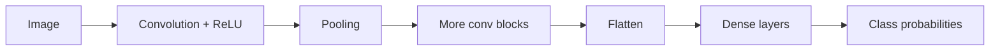

# Deep Learning

Deep learning stacks many layers of learned transformations, so the model builds its own features from raw inputs such as pixels, audio, and text. Interviewers expect you to explain how a network learns (backpropagation), why architectures differ (CNNs, RNNs, attention), and how to keep training from overfitting.

## Core concepts

### Neurons and activation functions

A neuron computes a weighted sum of its inputs plus a bias, then applies an activation function:

```
output = σ(w1·x1 + w2·x2 + ... + b)
```

Without a non-linear activation, any stack of linear layers collapses into one linear map. Common choices:

- **ReLU** `max(0, z)`: the default for hidden layers. Cheap and reduces vanishing gradients compared with sigmoid.
- **Sigmoid** `1 / (1 + e^-z)`: squashes to (0, 1). Used for binary output probabilities.
- **Tanh**: squashes to (-1, 1). Zero-centred, used in older recurrent models.
- **Softmax**: turns a vector of scores into probabilities that sum to 1. Used for multi-class output.

### Multi-layer perceptrons

A multi-layer perceptron (MLP) is a stack of fully connected layers: input, one or more hidden layers, and an output layer. Depth is the number of layers, and width is the number of neurons per layer. MLPs suit tabular data and act as a baseline for other architectures.

### Backpropagation

Training repeats four steps on each mini-batch:

1. **Forward pass**: compute predictions from the inputs.
2. **Loss**: measure the error with a loss function (cross-entropy for classification, mean squared error for regression).
3. **Backward pass**: apply the chain rule from the loss back through each layer to get the gradient of the loss with respect to every weight. Intermediate gradients are reused, which keeps the cost close to one extra forward pass.
4. **Update**: move each weight against its gradient using an optimiser.

Frameworks such as PyTorch build this computation graph automatically. Here is a minimal training step:

```python
import torch
from torch import nn

model = nn.Sequential(
    nn.Linear(784, 256),
    nn.ReLU(),
    nn.Dropout(p=0.2),
    nn.Linear(256, 10),  # raw logits; CrossEntropyLoss applies softmax
)
loss_fn = nn.CrossEntropyLoss()
optimizer = torch.optim.Adam(model.parameters(), lr=1e-3)

def train_step(x: torch.Tensor, y: torch.Tensor) -> float:
    model.train()
    optimizer.zero_grad()          # clear gradients from the last step
    loss = loss_fn(model(x), y)    # forward pass and loss
    loss.backward()                # backpropagation
    optimizer.step()               # weight update
    return loss.item()
```

### Optimisers

| Optimiser | Idea | Trade-off |
|-----------|------|-----------|
| SGD | Step against the gradient | Simple and well understood; needs careful learning-rate tuning |
| Momentum | Keep a running velocity of past gradients | Smooths noisy steps; one more parameter |
| RMSprop | Scale each step by a running average of squared gradients | Adapts per parameter |
| Adam | Momentum plus RMSprop-style scaling | Robust default; can generalise slightly worse on some tasks |

### Regularisation

- **L2 weight decay** adds a penalty on squared weights, shrinking them toward zero.
- **Dropout** randomly zeroes activations during training. Most frameworks use *inverted dropout*: surviving activations are scaled by 1/(1-p) during training, so nothing changes at inference.
- **Early stopping** halts training when validation loss stops improving.
- **Batch normalisation** normalises each layer's inputs over the batch, which stabilises training and permits larger learning rates. It also has a mild regularising effect.
- **Data augmentation** creates new training examples by transforming existing ones, such as flips or crops for images.

## Convolutional neural networks

A convolutional neural network (CNN) slides small learned filters across an image. Weights are shared across positions, so the same edge detector works anywhere in the image. A typical stack is:



- **Convolution** computes a dot product between a filter and each local patch. Early filters learn edges and textures; deeper filters combine them into parts and objects.
- **Pooling** (often max pooling) downsamples the feature maps and gives small shifts a similar response.
- **Padding and stride** control the output size. Stride is the step the filter takes.

Note that pooling gives approximate invariance to small shifts. Convolution itself is *equivariant* to translation: shifting the input shifts the feature map by the same amount.

Landmark architectures:

- **AlexNet (2012)**: a deep CNN trained on GPUs that won the ImageNet challenge by a wide margin and started the modern deep-learning era.
- **VGG (2014)**: stacks of small 3×3 convolutions.
- **Inception (2014)**: runs filters of several sizes in parallel within one block.
- **ResNet (2015)**: adds skip connections that let each block learn a residual, which makes very deep networks trainable.
- **MobileNet**: depthwise-separable convolutions for phones and edge devices.

## Recurrent neural networks

Recurrent networks process sequences one step at a time and carry a hidden state forward:

```
h_t = tanh(W_h · h_(t-1) + W_x · x_t + b)
```

Plain RNNs struggle with long dependencies. Gradients shrink (vanishing) or grow (exploding) as they pass back through many time steps. Gradient clipping handles explosions. Gated units handle vanishing gradients.

- **LSTM** adds a cell state and three gates: forget, input, and output. The forget gate decides what to erase, the input gate decides what to write, and the output gate decides what to expose. The cell state can carry information across many steps with little decay.
- **GRU** merges the gates into two (update and reset) with fewer parameters, and often performs similarly.

Recurrent models are sequential, so they cannot be parallelised across time steps during training. This limitation is a main reason transformers replaced them for language.

## Attention

Attention lets a model weight each input by its relevance to a query. Given queries Q, keys K, and values V:

```
Attention(Q, K, V) = softmax(Q·Kᵀ / √d_k) · V
```

Each output is a weighted average of the values, where the weights come from query-key similarity. Attention was first added to recurrent encoder-decoder models for translation. Transformers later made it the only mechanism, covered in [LLMs and Transformers](llms-and-transformers.md).

## Architecture summary

| Architecture | Typical task | Key idea | Good for |
|--------------|--------------|----------|----------|
| MLP | Tabular, both | Fully connected layers | Baselines, structured data |
| CNN | Vision | Shared local filters | Images, detection |
| ResNet | Vision | Skip connections | Very deep image models |
| RNN / LSTM / GRU | Sequences | Hidden state, gates | Time series, older NLP |
| Transformer | Language, multimodal | Self-attention, parallel | Modern NLP and LLMs |
| U-Net | Segmentation | Encoder-decoder with skips | Medical and pixel-level tasks |

## How it works / Step by step

1. Choose an architecture that matches the data's structure: grid (images), sequence (text, audio), or table.
2. Normalise inputs and split the data as for any model.
3. Start with a small model that can overfit a tiny batch. If it cannot, the pipeline has a bug.
4. Train with an optimiser such as Adam, and watch training and validation loss together.
5. Add regularisation or capacity only when the curves show the problem.
6. Use early stopping and keep the best checkpoint.

## Common pitfalls

- Forgetting `model.eval()` at inference, which leaves dropout and batch-norm in training mode.
- Forgetting `optimizer.zero_grad()`, so gradients accumulate across steps.
- Applying softmax inside a model whose loss already expects logits.
- Using a very deep network on a small dataset without augmentation or transfer learning.
- Judging a model only on training loss.

!!! tip "Interview tip"
    **Why does ReLU help deep networks train better than sigmoid?** Sigmoid and tanh saturate: for large inputs their derivative is near zero, so gradients vanish as they pass through many layers. ReLU's derivative is 1 for positive inputs, so gradients pass through unchanged on the active side. Its drawback is "dying" units that never activate, which leaky variants address.

## Quick recap

- Activation functions provide the non-linearity that lets depth add expressive power.
- Backpropagation applies the chain rule to compute gradients; the optimiser uses them to update weights.
- CNNs share local filters across space; RNNs carry state across time; LSTMs and GRUs use gates to keep long-range information.
- Attention computes relevance-weighted averages and underpins transformers.
- Regularise with weight decay, dropout, batch normalisation, augmentation, and early stopping.

**See also:** [ML Fundamentals](ml-fundamentals.md), [ML Algorithms](ml-algorithms.md), [LLMs and Transformers](llms-and-transformers.md)
