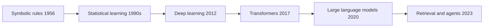

# AI and Machine Learning: History and Milestones

Artificial intelligence has moved through cycles of high expectation, disappointment, and renewed progress. Each shift had a clear driver: better algorithms, more data, or cheaper computing. Interviewers ask about this history to check that you can connect a technique to the problem it solved, and to the limit that pushed the field forward.

!!! note "In simple words"
    AI has gone from hand-written rules, to models that learn from examples, to deep networks, to transformers that read huge amounts of text. Each step fixed a limit of the step before and created a new one.

## Why it matters

Today's tools, such as LLMs, retrieval systems, and agents, make more sense when you know what came before them. Many ideas are decades old and were held back by data or hardware, not by a lack of insight. Knowing the timeline also helps you avoid repeating hype, and it gives you a clear story for an interview question about how the field got here.

## How it works

### Eras at a glance

| Period | Dominant approach | What drove it | Main limit |
|--------|-------------------|---------------|------------|
| 1956 to the 1980s | Symbolic AI, with logic and hand-written rules | Early programs and the expert-systems boom | Little computing power and little data |
| 1990s to the 2000s | Statistical machine learning | Learning from data instead of coding rules | Small datasets and hand-built features |
| 2010s | Deep learning | GPUs, large labelled datasets, and better training methods | Heavy need for labelled data, and models that are hard to explain |
| 2017 to 2019 | Transformers and pre-training | Self-attention and pre-training on unlabelled text | Training cost and fine-tuning effort |
| 2020 to 2023 | Large language models | Scaling model size and data | Hallucination, cost, and alignment with user intent |
| 2023 onward | Retrieval, tools, and agents | Grounding answers in external data and calling tools | Latency, reliability of multi-step tasks, and evaluation |

The dates are approximate where the field has no single agreed starting point.

### Phase 1: foundations (1956 to the 1980s)

The 1956 Dartmouth workshop is usually cited as the founding event of AI as a named field. Early work relied on symbolic reasoning, meaning programs that manipulated logical statements and rules. In the 1980s, expert systems encoded the knowledge of human specialists as if-then rules for narrow domains such as medical diagnosis and equipment configuration. They worked inside their niches, but they were costly to build and hard to maintain.

The first AI winter followed the gap between early promises and what the hardware and data could support. A 1966 report that cut funding for machine translation marks an early chill. The harder winter of the mid-1970s to early 1980s brought reduced funding and interest. The exact boundaries vary by source.

### Phase 2: statistical machine learning (1990s to 2000s)

The field shifted from writing rules to learning them from examples. Methods such as decision trees, support vector machines, naive Bayes, and ensembles like random forests became standard tools. Probabilistic graphical models, including Bayesian networks, gave a principled way to reason under uncertainty.

In 1997, IBM's Deep Blue defeated the world chess champion Garry Kasparov in a match. The system relied heavily on search and hand-tuned evaluation. It is a useful reminder that a famous result does not always mean a general learning method.

### Phase 3: the deep learning revolution (2010s)

Neural networks had existed for decades. Three things came together in the 2010s: large labelled datasets such as ImageNet, which appeared around 2009, graphics processors that could train large networks in reasonable time, and better training techniques.

- **2012**: AlexNet, a convolutional network trained on GPUs, won the ImageNet image recognition competition by a wide margin. It is the event most often cited as the start of the deep learning era.
- **2014 to 2015**: deeper convolutional architectures followed. VGG and GoogLeNet (Inception) appeared in 2014, and ResNet in 2015. Residual connections made very deep networks trainable.
- **2014**: generative adversarial networks (GANs) introduced a training setup in which a generator and a discriminator compete.
- **Sequence models**: LSTMs date to 1997, and GRUs appeared in 2014. Both became the standard way to model sequences such as text and speech in the mid-2010s, before attention-based models replaced them.
- **2016**: AlphaGo defeated the Go professional Lee Sedol. It combined deep networks with tree search and reinforcement learning.
- **Frameworks**: TensorFlow was released in 2015, and PyTorch was publicly released in January 2017. Open frameworks made experiments easier to repeat and share.

### Phase 4: attention and transformers (2017 to 2019)

The 2017 paper "Attention Is All You Need" introduced the Transformer. It replaced recurrence with self-attention, which lets every token look at every other token in parallel. That made training faster on modern hardware and handled long-range dependencies better than recurrent networks. Almost every large language model since is built on this architecture.

- **2018**: BERT showed that pretraining a bidirectional encoder on large unlabelled text, then fine-tuning it, beat task-specific models across many language benchmarks.
- **2019**: GPT-2, with 1.5 billion parameters, produced fluent long-form text and showed useful zero-shot and few-shot behaviour without task-specific training.
- **Key insight**: larger models trained on more data kept improving, and new abilities appeared at scale.

### Phase 5: large language models (2020 to 2023)

- **2020**: GPT-3, with 175 billion parameters, showed in-context learning. A prompt with a few examples could steer the model without changing its weights. It was offered through an API rather than released as open weights.
- **2022**: ChatGPT put a conversational interface on a GPT-3.5-family model. Training with reinforcement learning from human feedback (RLHF) made its answers follow user intent more closely. Reports of its rapid uptake brought generative AI into mainstream use. The widely quoted user numbers were estimates, not official counts.
- **2022**: BLOOM, from the BigScience collaboration, was a 176-billion-parameter open model.
- **2023**: GPT-4 accepted images as well as text and showed stronger reasoning than its predecessors.
- **2023**: open-weight models such as Meta's LLaMA, with 7 to 65 billion parameters, and Mistral AI's mixture-of-experts models made local and private deployment practical. Fine-tuned variants such as Alpaca and Vicuna followed.

### Phase 6: retrieval and grounding (2020 to the present)

Large models sometimes produce fluent but false statements, which is called hallucination. Retrieval-augmented generation (RAG) addresses this by fetching relevant documents at query time and placing them in the prompt. The idea was formalised in a 2020 research paper. It became the standard pattern for enterprise question answering after 2023.

Supporting pieces are vector embeddings, vector databases, and similarity search. Frameworks such as LangChain and LlamaIndex, which was originally called GPT Index, were released to help build these pipelines. See [RAG and Generative AI](rag-and-generative-ai.md) for the mechanics.

### Phase 7: multimodal models and agents (2023 onward)

- **Multimodal models** accept text together with images, audio, or video. Examples include GPT-4V, Google's Gemini family, and Anthropic's Claude 3, released in 2024.
- **Agents** let a model call tools such as search, code execution, and APIs in a loop. Early open-source experiments such as AutoGPT and BabyAGI showed the pattern. Production systems add planning, error handling, and human approval steps.
- **Parameter-efficient fine-tuning**: LoRA, published in 2021, trains small low-rank adapters instead of all the weights. QLoRA, from 2023, combines LoRA with quantised base weights, so large models can be tuned on modest hardware.

### Phase 8: specialisation and safety (recent)

- **Domain models** target medicine, law, and code. The Codex code model, published in 2021, showed that language models could write working programs.
- **Efficiency** methods such as distillation, pruning, and quantisation shrink models for faster and cheaper inference, including on devices.
- **Synthetic data** supplements scarce real data for training.
- **Safety and alignment**: Anthropic's Constitutional AI, from 2022, trains a model to critique its own outputs against a written set of principles. Interpretability research and red-teaming test how models fail.

### Step by step

Use this sequence to tell the story in an interview. Each step names the problem, the fix, and the new limit:

1. **Symbolic rules** worked for narrow problems, but they could not scale to messy real-world data.
2. **Statistical learning** replaced hand-written rules with models fitted to examples, which needed more data than was available.
3. **Deep learning** gained from big datasets and GPUs, but it needed labelled data and produced models that were hard to inspect.
4. **Transformers with pretraining** used unlabelled text, which removed much of the labelling bottleneck.
5. **Scaling** produced general-purpose language models, but they hallucinate and need alignment.
6. **Retrieval and tools** ground answers in external data and let models act, which raises new questions of latency and evaluation.

## Where it is used

- Today's assistants combine transformers, RLHF, retrieval, and tool calling.
- Vision systems in phones and cameras descend from the CNN work of the 2010s.
- Speech and translation products moved from recurrent models to transformers.
- Expert-system ideas survive in business rules engines and decision tables.
- The statistical methods of the 1990s still power most tabular analytics.

## Benefits

- Knowing the history helps you pick a technique for the constraint in front of you.
- It explains why each new method was adopted, not only what it does.
- It helps separate durable ideas, such as gradient descent and attention, from short-lived trends.
- It gives a structured way to discuss past claims and current limits.

## Cons and limits

- Hindsight makes the path look more direct than it was.
- Dates and firsts are often disputed, and many ideas had several independent origins.
- Headline results, such as chess or Go victories, do not show general ability.
- Popularity figures for products are often estimates.

## Best practices

- Treat dates as approximate. Say "around" or "in the mid-1970s" rather than quoting a single day.
- Separate the origin of an idea from its popularity. RAG was proposed in 2020 and became mainstream later. LoRA is from 2021, not 2024.
- Do not equate a headline result with general ability. Deep Blue and AlphaGo were each built for one game.
- Quote user-growth figures only with a note that they are estimates.
- Credit ideas to their own lineage. Transformers, pretraining, RLHF, and RAG each have separate authors and papers.

!!! tip "Interview tip"
    **Q: Why did deep learning take off in the 2010s, when neural networks had existed for decades?**
    Three things changed together: large labelled datasets, GPUs that make training large networks practical, and training techniques that let deep networks learn reliably. The 2012 ImageNet win by AlexNet is the usual marker. Mention that the algorithms were not entirely new, and that data and hardware made them work.

## Quick recap

- The field moved from symbolic rules (1956 onward) to statistical learning (1990s), deep learning (2012 onward), and transformers (2017).
- AlexNet (2012) marked the deep learning turn, helped by ImageNet and GPUs.
- Transformers replaced recurrence with self-attention, and pretraining on unlabelled text followed.
- GPT-3 (2020) and ChatGPT (2022) brought large language models into wide use.
- RAG, tools, and agents address hallucination and limited reach, and they introduce new questions of latency and evaluation.

## Official documentation

- [Attention Is All You Need (the transformer)](https://arxiv.org/abs/1706.03762)
- [Deep Residual Learning for Image Recognition (ResNet)](https://arxiv.org/abs/1512.03385)
- [Generative Adversarial Networks](https://arxiv.org/abs/1406.2661)
- [BERT: Pre-training of Deep Bidirectional Transformers](https://arxiv.org/abs/1810.04805)

**See also:** [AI and Machine Learning overview](index.md) | [ML Fundamentals](ml-fundamentals.md) | [Deep Learning](deep-learning.md) | [LLMs and Transformers](llms-and-transformers.md) | [RAG and Generative AI](rag-and-generative-ai.md)
