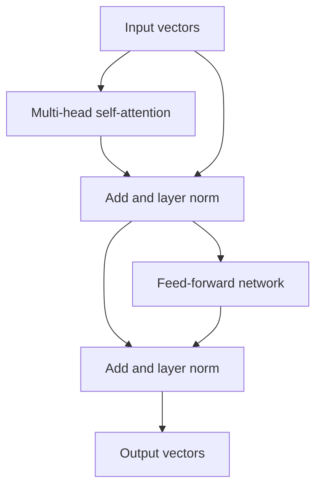

# LLMs and Transformers

Large language models (LLMs) are transformer networks trained on very large text corpora to predict tokens. Interviewers ask about the transformer block, why self-attention replaced recurrence, how BERT and GPT differ, and how a base model becomes a useful assistant through fine-tuning, alignment, and prompting.

## Core concepts

### From text to tokens

A model does not read characters or words directly. A tokenizer splits text into subword units. Byte-pair encoding (BPE) and similar methods learn a vocabulary of frequent fragments, so common words are one token and rare words are several. The token count determines cost, latency, and how much text fits in the context window.

Each token ID maps to a learned embedding vector of dimension `d_model`.

### Positional encoding

Self-attention treats its input as a set, so it needs position information. The original transformer added sinusoidal encodings:

```
PE(pos, 2i)   = sin(pos / 10000^(2i / d_model))
PE(pos, 2i+1) = cos(pos / 10000^(2i / d_model))
```

Many modern models use learned or rotary (RoPE) position encodings instead. The principle is the same: each position gets a distinct signal the model can use.

### Self-attention

Each token produces three vectors through learned projections: a query (what it is looking for), a key (what it offers), and a value (the content it passes on). Scaled dot-product attention is:

```
Attention(Q, K, V) = softmax(Q·Kᵀ / √d_k) · V
```

The score matrix compares every token with every other token in one matrix multiply, which is why transformers parallelise well during training. The division by √d_k keeps scores in a range where softmax still has useful gradients.

A numpy version shows the mechanics:

```python
import numpy as np

def scaled_dot_product_attention(Q, K, V):
    d_k = Q.shape[-1]
    scores = Q @ K.T / np.sqrt(d_k)
    scores -= scores.max(axis=-1, keepdims=True)   # numerical stability
    weights = np.exp(scores)
    weights /= weights.sum(axis=-1, keepdims=True)  # softmax per row
    return weights @ V

rng = np.random.default_rng(0)
Q = K = V = rng.normal(size=(4, 8))  # 4 tokens, 8 dimensions
print(scaled_dot_product_attention(Q, K, V).shape)  # (4, 8)
```

### Multi-head attention

Multi-head attention runs several attention operations in parallel, each with its own projections, then concatenates the results and projects them back to `d_model`. Different heads can learn to track different relations, such as syntactic agreement or coreference. Interpretability research shows this only partly; do not claim that a given head has a fixed role.

### The transformer block

Each block combines:



Residual connections let gradients flow through deep stacks. Layer normalisation stabilises activations. The feed-forward network processes each position independently. Blocks are stacked many times.

### Three families

| Family | Attention | Typical use | Examples |
|--------|-----------|-------------|----------|
| Encoder-only | Bidirectional | Classification, embeddings, extraction | BERT |
| Decoder-only | Causal (each token sees only earlier tokens) | Text generation, chat | GPT family, Llama |
| Encoder-decoder | Encoder bidirectional, decoder causal with cross-attention | Translation, summarisation | T5, BART |

### BERT: masked language modelling

BERT is an encoder pretrained with masked language modelling. About 15% of tokens are selected for prediction. Of those, most are replaced by a mask token, some by random tokens, and some left unchanged, and the model predicts the original tokens. Because it sees context on both sides, BERT yields strong representations for understanding tasks. The original paper also used next-sentence prediction, which later work often dropped.

### GPT: causal language modelling

GPT is a decoder that predicts the next token from all earlier tokens. Generation is autoregressive: append the chosen token, then predict again. The causal mask stops a position from attending to future positions during training, so one forward pass trains every position at once.

Scale grew quickly across the family. GPT-1 had about 117 million parameters, GPT-2 about 1.5 billion, and GPT-3 about 175 billion. Larger models trained on more data improved steadily, and GPT-3 showed in-context learning from examples in the prompt alone.

### Pretraining, fine-tuning, and alignment

- **Pretraining** learns general language from a large unlabelled corpus with a self-supervised objective. It is the expensive stage.
- **Supervised fine-tuning (SFT)** trains on curated instruction and response pairs so the model follows directions.
- **Preference training** (reinforcement learning from human feedback, RLHF) trains a reward model on human rankings of responses, then optimises the model against it, often with PPO. Simpler preference-optimisation methods such as DPO learn from the same kind of pairs without a separate reinforcement learning loop.
- **Parameter-efficient fine-tuning** updates a small set of added weights. LoRA learns low-rank updates to frozen weight matrices. QLoRA also quantises the frozen base model, so fine-tuning fits on smaller hardware.

Pretraining gives knowledge and general skill. Fine-tuning and alignment shape behaviour, tone, and format.

### Prompting

Prompting steers a frozen model with text:

- **Zero-shot**: state the task only.
- **Few-shot**: include a handful of input and output examples in the prompt.
- **Chain-of-thought**: ask for step-by-step reasoning before the answer. It often helps multi-step problems, and it costs more tokens.
- **System prompt**: sets role, rules, and format for the whole conversation.
- **Structured output**: request JSON with a schema and validate it in code.

```text
System: You are a support assistant. Answer only from the policy text provided.
        If the answer is not in the text, reply "not found".
User:   Policy: Refunds are available within 30 days of purchase.
        Question: Can I get a refund after 45 days?
```

### Decoding controls

The model outputs a probability distribution over the next token. Decoding settings choose from it:

- **Temperature** rescales logits before softmax. Low values make output more deterministic; high values make it more varied.
- **Top-k** keeps only the k most likely tokens.
- **Top-p (nucleus)** keeps the smallest set of tokens whose probabilities add up to p.

For factual tasks, use low temperature. For drafting or brainstorming, allow more variety.

### Capabilities and limits

Large models do well at in-context learning, summarisation, translation, code writing, and structured extraction. They also have real limits:

- **Hallucination**: fluent but false output. Ground answers in retrieved sources (see [RAG and Generative AI](rag-and-generative-ai.md)) and ask for citations.
- **Knowledge cutoff**: training data has an end date. Newer facts need retrieval or tools.
- **Context limit**: the window is finite, and very long inputs can dilute attention to key details.
- **Multi-step reasoning**: long chains of logic are error-prone, and verification helps.
- **Bias**: outputs reflect patterns in the training data.

## How it works / Step by step

A single generation step:

1. The prompt is tokenised and embedded.
2. The transformer stack runs and produces logits for the next token.
3. Decoding settings pick one token.
4. The token is appended and the loop repeats until a stop condition.

Serving systems cache the attention keys and values of earlier tokens (the KV cache), so each new token does not recompute the whole prefix.

## Common pitfalls

- Assuming a larger context window removes the need for retrieval or chunking.
- Trusting a confident answer without checking sources.
- Using temperature near 1 for tasks that need exact output.
- Measuring cost in words instead of tokens.
- Expecting prompt tricks to fix a missing capability that needs fine-tuning or tools.

!!! tip "Interview tip"
    **BERT or GPT for a task?** Use an encoder such as BERT, or a small encoder fine-tuned on labels, for classification and extraction where you need fast, deterministic outputs. Use a decoder LLM when the output is free text, or when you need zero-shot flexibility across many tasks. The attention masks explain the difference: bidirectional for understanding, causal for generation.

## Quick recap

- Transformers replace recurrence with self-attention, which parallelises well and captures long-range links.
- Attention weights each token by query-key similarity; multi-head attention runs several views in parallel.
- BERT is bidirectional and suits understanding; GPT is causal and suits generation.
- Pretraining learns general language; SFT and preference training shape behaviour.
- Prompts, temperature, and top-p control output; RAG and tools address knowledge and hallucination limits.

**See also:** [ML Fundamentals](ml-fundamentals.md), [Deep Learning](deep-learning.md), [RAG and Generative AI](rag-and-generative-ai.md), [AI in Java](ai-in-java.md)
