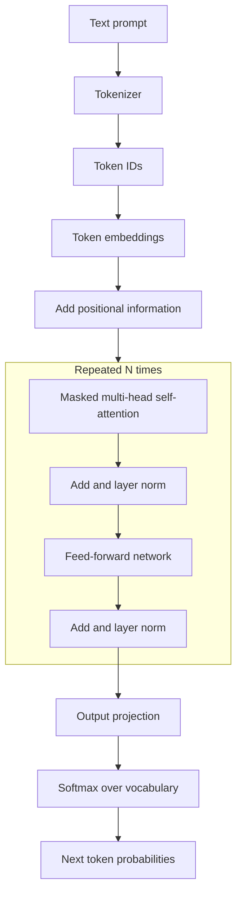
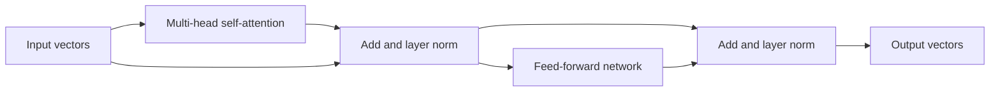
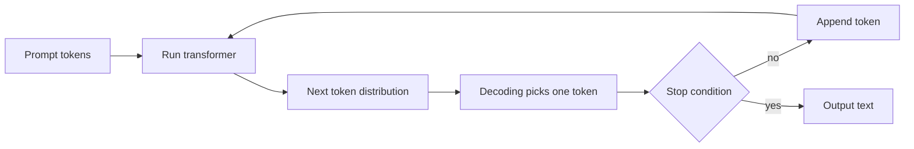

# LLMs and Transformers

Large language models (LLMs) are transformer networks trained on very large text collections to predict the next token. Interviewers ask about the transformer block, why self-attention replaced recurrence, how BERT and GPT differ, and how a base model becomes a useful assistant through fine-tuning, alignment, and prompting.

!!! note "In simple words"
    An LLM reads text as small pieces called tokens and repeatedly guesses the next piece. The transformer lets every piece look at every other piece in the text, so the guess can use the whole context.

## Why it matters

LLMs now sit inside search, support tools, coding assistants, and document workflows. To use them well you need to know what the model actually does: it predicts tokens, its answers depend on the context you give it, and its knowledge stops at its training data. Those facts explain most of the costs, limits, and failures you will meet in production.

## How it works

### The transformer at a glance

A transformer takes a sequence of token vectors and returns a new vector for each position. An LLM stacks many transformer blocks, then turns the last vector into a probability for every token in the vocabulary.



### From text to tokens

A model does not read characters or words directly. A tokenizer splits text into subword units. Byte-pair encoding (BPE) and similar methods learn a vocabulary of frequent fragments, so common words become one token and rare words become several. The token count decides cost, latency, and how much text fits in the context window.

Each token ID maps to a learned embedding vector of size `d_model`.

### Positional information

Self-attention treats its input as a set, so it needs position information. The original transformer added sinusoidal encodings:

```
PE(pos, 2i)   = sin(pos / 10000^(2i / d_model))
PE(pos, 2i+1) = cos(pos / 10000^(2i / d_model))
```

Many modern models use learned or rotary (RoPE) position encodings instead. The principle is the same: each position gets a distinct signal the model can use.

### Self-attention

Each token produces three vectors through learned projections: a query (what it is looking for), a key (what it offers), and a value (the content it passes on). Scaled dot-product attention is:

```
Attention(Q, K, V) = softmax(Q K^T / sqrt(d_k)) V
```

The score matrix compares every token with every other token in one matrix multiplication, which is why transformers parallelise well during training. Dividing by sqrt(d_k) keeps the scores in a range where softmax still has useful gradients.

The Python example below uses NumPy. It is not compiled here, and it runs with NumPy installed:

```python
import numpy as np

def scaled_dot_product_attention(Q, K, V):
    d_k = Q.shape[-1]
    scores = Q @ K.T / np.sqrt(d_k)
    scores -= scores.max(axis=-1, keepdims=True)   # numerical stability
    weights = np.exp(scores)
    weights /= weights.sum(axis=-1, keepdims=True)  # softmax per row
    return weights @ V

rng = np.random.default_rng(0)
Q = K = V = rng.normal(size=(4, 8))  # 4 tokens, 8 dimensions
print(scaled_dot_product_attention(Q, K, V).shape)  # (4, 8)
```

### Multi-head attention

Multi-head attention runs several attention operations in parallel, each with its own projections. It then concatenates the results and projects them back to `d_model`. Different heads can learn to track different relations, such as agreement or coreference. Interpretability research supports this only in part, so do not claim that a particular head has a fixed role.

### The transformer block

Each block combines attention and a feed-forward network. Residual connections let gradients flow through deep stacks, and layer normalisation stabilises the activations. The feed-forward network processes each position independently. Blocks are stacked many times.



### Three families

| Family | Attention | Typical use | Examples |
|--------|-----------|-------------|----------|
| Encoder-only | Bidirectional | Classification, embeddings, extraction | BERT |
| Decoder-only | Causal, where each token sees only earlier tokens | Text generation and chat | GPT family, Llama |
| Encoder-decoder | Encoder bidirectional, decoder causal with cross-attention | Translation, summarisation | T5, BART |

### BERT: masked language modelling

BERT is an encoder pretrained with masked language modelling. About 15 percent of the tokens are selected for prediction. Most of those are replaced by a mask token, some by random tokens, and some are left unchanged. The model predicts the original tokens. Because it sees context on both sides, BERT gives strong representations for understanding tasks. The original paper also used next-sentence prediction, which later work often dropped.

### GPT: causal language modelling

GPT is a decoder that predicts the next token from all the earlier tokens. Generation is autoregressive: append the chosen token, then predict again. A causal mask stops each position from attending to future positions during training, so a single forward pass trains every position at once.

Scale grew quickly across this family. GPT-1 had about 117 million parameters, GPT-2 about 1.5 billion, and GPT-3 about 175 billion. Larger models trained on more data improved steadily, and GPT-3 showed in-context learning from examples placed in the prompt alone.

### Generation loop



### Pretraining, fine-tuning, and alignment

- **Pretraining** learns general language from a large unlabelled corpus with a self-supervised objective. It is the expensive stage.
- **Supervised fine-tuning (SFT)** trains on curated instruction and response pairs so the model follows directions.
- **Preference training** uses reinforcement learning from human feedback (RLHF). A reward model is trained on human rankings of responses, and the language model is then optimised against it, often with PPO. Simpler preference methods such as DPO learn from the same kind of pairs without a separate reinforcement learning loop.
- **Parameter-efficient fine-tuning** updates a small set of added weights. LoRA learns low-rank updates to frozen weight matrices. QLoRA also quantises the frozen base model, so fine-tuning fits on smaller hardware.

Pretraining gives knowledge and general skill. Fine-tuning and alignment shape behaviour, tone, and output format.

### Prompting

Prompting steers a frozen model with text:

- **Zero-shot** states the task only.
- **Few-shot** includes a handful of input and output examples in the prompt.
- **Chain-of-thought** asks for step-by-step reasoning before the answer. It often helps multi-step problems, and it costs more tokens.
- **System prompt** sets the role, rules, and format for the whole conversation.
- **Structured output** requests JSON with a schema, and the code validates the result.

```text
System: You are a support assistant. Answer only from the policy text provided.
        If the answer is not in the text, reply "not found".
User:   Policy: Refunds are available within 30 days of purchase.
        Question: Can I get a refund after 45 days?
```

### Decoding controls

The model outputs a probability distribution over the next token, and decoding settings choose from it:

- **Temperature** rescales the logits before softmax. Low values make output more deterministic, and high values make it more varied.
- **Top-k** keeps only the k most likely tokens.
- **Top-p (nucleus)** keeps the smallest set of tokens whose probabilities add up to p.

For factual tasks, use a low temperature. For drafting or brainstorming, allow more variety.

### Capabilities and limits

LLMs do well at in-context learning, summarisation, translation, code writing, and structured extraction. They also have real limits:

- **Hallucination** is fluent but false output. Ground answers in retrieved sources (see [RAG and Generative AI](rag-and-generative-ai.md)) and ask for citations.
- **Knowledge cutoff**: the training data ends at a date, so newer facts need retrieval or tools.
- **Context limit**: the window is finite, and very long inputs can dilute attention to the key details.
- **Multi-step reasoning**: long chains of logic are error-prone, so verification helps.
- **Bias**: outputs reflect patterns in the training data.

### Step by step

A single generation step:

1. The prompt is tokenised and embedded.
2. The transformer stack runs and produces logits for the next token.
3. Decoding settings pick one token.
4. The token is appended, and the loop repeats until a stop condition is met.

Serving systems cache the attention keys and values of earlier tokens, called the KV cache. Each new token then does not recompute the whole prefix.

## Where it is used

- Chat assistants and customer support drafting.
- Code completion and code review assistants.
- Summarisation and extraction from contracts, tickets, and reports.
- Embeddings from encoder models for search and clustering.
- Classification and entity extraction with fine-tuned BERT-style encoders.

## Benefits

- One model handles many tasks through prompts, with no task-specific training.
- Self-attention captures long-range links and trains in parallel.
- Pretraining on unlabelled text removes much of the labelling cost.
- Fine-tuning and prompting adapt behaviour without training from scratch.

## Cons and limits

- Training and serving are expensive in compute, memory, and energy.
- Outputs can be fluent and wrong, so every factual claim needs a check.
- The knowledge is frozen at the cutoff date, and the context window is finite.
- Cost grows with tokens, so long prompts and long answers add up.
- Behaviour can shift with a model version change, which affects prompts that worked before.

## Best practices

- Count cost in tokens, not words, and budget prompt and output length.
- Use a low temperature for exact or factual output.
- Ground answers in retrieved or supplied text, and ask for citations.
- Validate structured output in code. Never trust it as valid JSON without a parser.
- Pin the model version, and re-test prompts when it changes.
- Prefer a smaller encoder model for fast, deterministic classification.

!!! tip "Interview tip"
    **Q: BERT or GPT for a task?**
    Use an encoder such as BERT, or a small encoder fine-tuned on labels, for classification and extraction where you need fast, deterministic outputs. Use a decoder LLM when the output is free text, or when you need zero-shot flexibility across many tasks. The attention masks explain the difference: bidirectional for understanding, causal for generation.

## Quick recap

- Transformers replace recurrence with self-attention, which parallelises well and captures long-range links.
- Attention weights each token by query-key similarity. Multi-head attention runs several views in parallel.
- BERT is bidirectional and suits understanding. GPT is causal and suits generation.
- Pretraining learns general language, and SFT and preference training shape behaviour.
- Prompts, temperature, and top-p control output. RAG and tools address knowledge and hallucination limits.

## Official documentation

- [Attention Is All You Need (the transformer)](https://arxiv.org/abs/1706.03762)
- [BERT: Pre-training of Deep Bidirectional Transformers](https://arxiv.org/abs/1810.04805)
- [LoRA: Low-Rank Adaptation of Large Language Models](https://arxiv.org/abs/2106.09685)
- [Anthropic API documentation](https://docs.anthropic.com/)

**See also:** [ML Fundamentals](ml-fundamentals.md), [Deep Learning](deep-learning.md), [RAG and Generative AI](rag-and-generative-ai.md), [AI in Java](ai-in-java.md)
